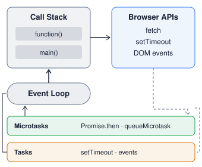
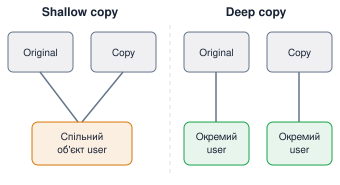
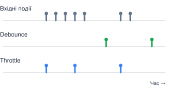

# JavaScript

## 1.1. У чому різниця між `var`, `let` та `const`?

<a id="q-1-1"></a>

### Пояснення

#### Interview answer (EN)

The main difference is scope: var is function-scoped and can be redeclared, while let and const are block-scoped and stay in the temporal dead zone until their declaration runs. Const only forbids reassigning the binding, so an object declared with const can still be mutated. In practice I use const by default, let when a value really changes, and I avoid var, because it leaks out of blocks and, at the top level of a classic script, even becomes a property of the global object.

| Характеристика | var | let | const |
| --- | --- | --- | --- |
| Область видимості | Функціональна | Блокова | Блокова |
| Повторне оголошення в тій самій області | Так | Ні | Ні |
| Переприсвоєння | Так | Так | Ні |
| Hoisting | Так, з `undefined` | Так, без ініціалізації | Так, без ініціалізації |
| Temporal Dead Zone | Ні | Так | Так |
| Верхній рівень classic script | Створює властивість `globalThis` | Не створює | Не створює |
| Binding у заголовку `for` | Один на весь цикл | Новий на кожну ітерацію | Новий на кожну ітерацію (лише в `for...of`/`for...in`) |

Блокова область видимості:

```javascript
if (true) {
  var x = 1;
  let y = 2;
}

console.log(x); // 1 — var «протікає» з блоку
console.log(y); // ReferenceError
```

На верхньому рівні звичайного (classic) скрипту `var` створює властивість глобального об'єкта, а `let` і `const` — ні. В ES-модулях верхній рівень має власну область видимості, тому навіть `var` не потрапляє в `globalThis`.

```javascript
// classic script: <script src="app.js">
var a = 1;
let b = 2;

console.log(globalThis.a); // 1
console.log(globalThis.b); // undefined
```

`let` у заголовку циклу `for` створює окремий binding для кожної ітерації, тому callbacks бачать «своє» значення, а з `var` усі callbacks ділять одну змінну. Класичну задачу з `setTimeout` розібрано в [Closure](../09-live-coding/README.md#q-9-2).

`const` забороняє переприсвоєння змінної, але не зміну вмісту об'єкта.

```javascript
const user = { name: "Alex" };

user.name = "John"; // OK
user = {}; // TypeError
```

У сучасному JavaScript зазвичай використовують `const` за замовчуванням, а `let` — коли значення потрібно переприсвоювати. `var` переважно зустрічається в legacy-коді.

#### Можливі уточнення

- **Як зробити об'єкт, оголошений через `const`, справді незмінним?** — `Object.freeze()`, але він поверхневий: вкладені об'єкти лишаються змінними.
- **Чому `for (const i = 0; i < 3; i++)` падає, а `for (const item of items)` працює?** — у класичному `for` вираз `i++` переприсвоює binding; у `for...of` кожна ітерація отримує новий binding.
- **Що виведе цикл із `var` і `setTimeout`?** — 3, 3, 3: усі callbacks бачать одну змінну, яка вже дорівнює 3.

#### Пов’язані питання

- [Що таке hoisting та Temporal Dead Zone?](#q-1-2)
- [Closure](../09-live-coding/README.md#q-9-2)

#### Документація

- [MDN — let](https://developer.mozilla.org/en-US/docs/Web/JavaScript/Reference/Statements/let)
- [MDN — var](https://developer.mozilla.org/en-US/docs/Web/JavaScript/Reference/Statements/var)
- [MDN — const](https://developer.mozilla.org/en-US/docs/Web/JavaScript/Reference/Statements/const)

## 1.2. Що таке hoisting та Temporal Dead Zone?

<a id="q-1-2"></a>

### Пояснення

#### Interview answer (EN)

Hoisting means that declarations are registered when a scope is created, before any of its code runs. Var bindings start out as undefined and function declarations are available in full, so both can be used before the line where they appear. Let, const and class are hoisted too, but they stay uninitialized in the temporal dead zone, so touching them early throws a ReferenceError, even through typeof.

**Hoisting** — поведінка JavaScript, за якої bindings для оголошень створюються до виконання коду у відповідній області видимості.

```javascript
console.log(a); // undefined
var a = 10;
```

Але з `let`:

```javascript
console.log(b); // ReferenceError
let b = 10;
```

**Temporal Dead Zone (TDZ)** — проміжок від початку області видимості до моменту ініціалізації змінної `let`, `const` або `class`. У цей період звертатися до змінної не можна. Навіть `typeof`, який для неоголошеної змінної безпечно повертає `"undefined"`, для змінної в TDZ кидає помилку:

```javascript
typeof notDeclared; // "undefined"
typeof value;       // ReferenceError — value у TDZ
let value = 1;
```

Function declarations піднімаються разом з тілом:

```javascript
sayHello(); // Hello

function sayHello() {
  console.log("Hello");
}
```

А function expressions і стрілкові функції — ні: піднімається лише змінна, якій їх присвоєно.

```javascript
greet(); // TypeError: greet is not a function — greet поки undefined
var greet = function () {};

hello(); // ReferenceError — hello у TDZ
const hello = () => {};
```

| Оголошення | Що доступно до рядка оголошення |
| --- | --- |
| `var x` | Binding зі значенням `undefined` |
| `let` / `const` / `class` | Binding існує, але в TDZ → `ReferenceError` |
| `function f() {}` | Уся функція |
| `var f = function () {}` | `undefined` → виклик дає `TypeError` |
| `const f = () => {}` | TDZ → `ReferenceError` |

TDZ — саме «temporal»: важливий момент виконання, а не позиція в тексті.

```javascript
function read() {
  return count;
}

let count = 1;
read(); // 1 — функцію викликано вже після ініціалізації count
```

Важливо: казати, що `let` і `const` не підлягають hoisting, не зовсім правильно — вони піднімаються, але не ініціалізуються.

#### Можливі уточнення

- **Чи піднімаються класи?** — так, але, як і `let`, перебувають у TDZ до оголошення.
- **Чому TDZ називається «temporal»?** — вона залежить від того, коли виконується звернення, а не від того, де воно написане.

#### Пов’язані питання

- [У чому різниця між `var`, `let` та `const`?](#q-1-1)

#### Документація

- [MDN — Hoisting](https://developer.mozilla.org/en-US/docs/Glossary/Hoisting)
- [MDN — let: Temporal dead zone](https://developer.mozilla.org/en-US/docs/Web/JavaScript/Reference/Statements/let#temporal_dead_zone_tdz)

## 1.3. Що таке closure (замикання)? Наведи практичний приклад.

<a id="q-1-3"></a>

### Пояснення

#### Interview answer (EN)

A closure is a function bundled with the lexical environment it was created in, so it can still read and update outer variables after the outer function has returned. Each call of the outer function creates a fresh environment, which is why two counters from the same factory are independent. Closures power callbacks, debounce, private state and React hooks, but they also keep captured data alive and can hold on to stale values.

Замикання — це здатність функції зберігати доступ до лексичного оточення, у якому вона була створена, навіть після завершення виконання зовнішньої функції.

```javascript run
function createCounter() {
  let count = 0;

  return function () {
    return ++count;
  };
}

const counterA = createCounter();
const counterB = createCounter();

console.log(counterA(), counterA(), counterA()); // 1 2 3
console.log(counterB()); // 1 — окреме лексичне оточення
```

Зовнішня функція вже завершила виконання, але внутрішня досі має доступ до `count`. Кожен виклик `createCounter()` створює нове оточення, тому лічильники не впливають один на одного.

Практичне застосування: debounce, throttle, інкапсуляція даних, callbacks, фабрики функцій та React hooks.

Два наслідки, про які часто питають:

- **Stale closure.** Функція бачить змінні з того моменту, коли її створено. У React callback, створений під час одного рендеру, бачить state саме цього рендеру.
- **Пам'ять.** Поки живе функція (наприклад, як event listener чи callback таймера), живуть і змінні, які вона захопила. Великий об'єкт у замиканні довгоживучого callback може стати memory leak.

#### Можливі уточнення

- **Як closure пов'язаний зі stale closure у React?** — callback із `useEffect` або `setInterval` бачить значення з рендеру, у якому був створений; допомагають залежності, functional update або ref.
- **Чи може замикання спричинити memory leak?** — так, якщо довгоживучий callback утримує великі дані, а його не прибрали.

#### Пов’язані питання

- [Що таке stale closure?](../03-react/README.md#q-3-12)
- [Closure](../09-live-coding/README.md#q-9-2)
- [Реалізуй debounce](../09-live-coding/README.md#q-9-7)
- [Як працює Garbage Collector?](#q-1-14)

#### Документація

- [MDN — Closures](https://developer.mozilla.org/en-US/docs/Web/JavaScript/Guide/Closures)

## 1.4. Як працює Event Loop?

<a id="q-1-4"></a>

### Пояснення

#### Interview answer (EN)

JavaScript runs on a single main thread, while the browser handles timers, network and other work in the background and queues their callbacks. The event loop takes one task, runs it to completion, drains the whole microtask queue, and only then may it run requestAnimationFrame callbacks and render a frame. That's why a long synchronous task or an endless chain of microtasks freezes the UI: nothing can be painted until the stack and the microtask queue are empty.

JavaScript виконує код в одному основному потоці. Таймери, мережа, події користувача обробляються середовищем виконання (браузером), а їхні callbacks ставляться в черги.

Спрощена схема одного оберту Event Loop у браузері:

```flow
Task | Береться одне завдання з черги (скрипт, callback таймера, подія) і виконується до порожнього call stack
Microtasks | Виконуються всі microtasks, зокрема ті, що додалися під час цього кроку
requestAnimationFrame | Якщо настав час кадру — викликаються callbacks rAF
Rendering | Style, layout, paint — браузер оновлює екран
Наступний task | Цикл повторюється
```

Важливі деталі:

- Рендеринг відбувається не після кожного task, а коли браузер вирішує оновити кадр (зазвичай під частоту екрана; у фоновій вкладці — рідше або зовсім ні).
- Callbacks `requestAnimationFrame` — не microtasks і не звичайні tasks. Вони виконуються в кроці оновлення рендерингу, безпосередньо перед paint, тому це правильне місце для візуальних змін і анімацій.
- `await` не блокує потік: код після `await` продовжиться як microtask, а тим часом виконується інший код.
- Довгий синхронний task (> 50 мс вважається long task) затримує реакцію на кліки й погіршує INP. Важку роботу ділять на частини й поступаються основним потоком між ними (`setTimeout`, а там, де підтримується, — `scheduler.yield()`) або переносять у Web Worker.

Microtasks можуть «заморити» рендеринг: поки черга microtasks не спорожніє, браузер не намалює кадр і не обробить клік.

```javascript
// Неправильно: черга microtasks ніколи не спорожніє — сторінка зависне
function loop() {
  queueMicrotask(loop);
}
loop();
```

Саме тому асинхронний JavaScript не обов'язково означає багатопотоковий JavaScript.



#### Можливі уточнення

- **Чи гарантує `setTimeout(fn, 0)` виконання через 0 мс?** — ні, це мінімальна затримка: callback чекає, поки звільниться стек і спорожніють microtasks; вкладені таймери браузер обмежує до ~4 мс, а у фонових вкладках — сильніше.
- **Де тут Web Workers?** — кожен worker має власний потік і власний event loop; з основним потоком він спілкується через `postMessage`.
- **Як розбити важке обчислення, щоб не блокувати UI?** — частинами з поступанням потоком між ними або в Web Worker.

#### Пов’язані питання

- [У чому різниця між microtasks та macrotasks?](#q-1-5)
- [Event Loop](../09-live-coding/README.md#q-9-1)
- [Що таке Core Web Vitals — LCP, INP та CLS?](../08-architecture/README.md#q-8-10)

#### Документація

- [MDN — JavaScript execution model](https://developer.mozilla.org/en-US/docs/Web/JavaScript/Reference/Execution_model)
- [HTML Standard — Event loops](https://html.spec.whatwg.org/multipage/webappapis.html#event-loops)
- [web.dev — Optimize long tasks](https://web.dev/articles/optimize-long-tasks)

## 1.5. У чому різниця між microtasks та macrotasks?

<a id="q-1-5"></a>

### Пояснення

#### Interview answer (EN)

Microtasks are promise reactions, await continuations, queueMicrotask callbacks and MutationObserver notifications, while tasks include timers, user events, messages and similar callbacks. After every task, the browser empties the entire microtask queue before it moves on, so a resolved promise always runs before a zero-delay timeout. The practical risk is that microtasks which keep scheduling more microtasks block rendering just like a long synchronous loop.

Після кожного task браузер виконує **всі** microtasks, включно з доданими під час цього процесу, і лише потім переходить до рендерингу чи наступного task. Термін «macrotask» неофіційний — у специфікації HTML це просто tasks.

| Microtasks | Tasks («macrotasks») |
| --- | --- |
| `Promise.then()` / `catch()` / `finally()` | `setTimeout()` / `setInterval()` |
| Продовження після `await` | Події користувача (click, input, keydown) |
| `queueMicrotask()` | `postMessage`, `MessageChannel` |
| `MutationObserver` | Виконання `<script>` |

`requestAnimationFrame` не належить до жодної з колонок: його callbacks виконуються перед paint у кроці рендерингу.

Порядок з `async/await`:

```javascript run
console.log("script start");

setTimeout(() => console.log("setTimeout"), 0);

async function load() {
  console.log("load: before await");
  await null;
  console.log("load: after await");
}

load();

Promise.resolve().then(() => console.log("promise.then"));
queueMicrotask(() => console.log("queueMicrotask"));

console.log("script end");
```

Результат:

```text
script start
load: before await
script end
load: after await
promise.then
queueMicrotask
setTimeout
```

Код async-функції до першого `await` виконується синхронно. Продовження після `await` стає microtask і потрапляє в чергу раніше, ніж `then` і `queueMicrotask`, бо `load()` викликано першим. `setTimeout` — task, тому навіть із затримкою 0 він виконається після всіх microtasks.

```demo
event-loop
```

#### Можливі уточнення

- **Чи може клік користувача «вклинитися» в ланцюжок `then`?** — ні: подія — це task, вона обробиться тільки після того, як черга microtasks спорожніє.
- **Чому `then`, доданий усередині іншого `then`, виконується раніше за `setTimeout`?** — він потрапляє в ту саму чергу microtasks, яка вичерпується до наступного task.

#### Пов’язані питання

- [Як працює Event Loop?](#q-1-4)
- [Event Loop](../09-live-coding/README.md#q-9-1)
- [Як працюють async/await і як обробляти в них помилки?](#q-1-18)

#### Документація

- [MDN — Using microtasks with queueMicrotask()](https://developer.mozilla.org/en-US/docs/Web/API/HTML_DOM_API/Microtask_guide)
- [MDN — In depth: Microtasks and the JavaScript runtime environment](https://developer.mozilla.org/en-US/docs/Web/API/HTML_DOM_API/Microtask_guide/In_depth)

## 1.6. Як працює `this` у звичайних та стрілкових функціях?

<a id="q-1-6"></a>

### Пояснення

#### Interview answer (EN)

For a regular function, this is decided at call time: a method call gives the object before the dot, new gives the fresh instance, call, apply and bind set it explicitly, and a plain call gives undefined in strict code. Arrow functions have no this of their own; they use the this of the surrounding scope, which makes them handy for callbacks but wrong as object methods. The classic bug is passing a method as a callback and losing its receiver.

У звичайній функції значення `this` залежить від способу її виклику. Стрілкова функція не має власного `this`, а отримує його з лексичного оточення.

| Спосіб виклику | `this` у звичайній функції |
| --- | --- |
| `obj.method()` | `obj` |
| `fn()` | `undefined` у strict mode (ES-модулі, класи); `globalThis` у non-strict |
| `new Fn()` | Новий об'єкт |
| `fn.call(ctx)`, `fn.apply(ctx)`, `fn.bind(ctx)` | `ctx` |
| Обробник `addEventListener` | `event.currentTarget` |

```javascript
const user = {
  name: "Alex",

  regular() {
    console.log(this.name);
  },

  arrow: () => {
    console.log(this.name);
  }
};

user.regular(); // Alex
user.arrow();
// Літерал об'єкта не створює власного this — arrow бере this верхнього рівня:
// ES module: this === undefined → TypeError: Cannot read properties of undefined
// classic script: this === window → виведе window.name (зазвичай порожній рядок)
```

**Втрата `this`.** Коли метод передають як callback, його викликають уже без `obj.`:

```javascript
const regular = user.regular;
regular(); // у strict mode: TypeError — this === undefined

button.addEventListener("click", user.regular);
// this — це button, а не user

button.addEventListener("click", () => user.regular()); // Alex
button.addEventListener("click", user.regular.bind(user)); // Alex
```

Там, де стрілкова функція доречна, — callback усередині методу:

```javascript
const timer = {
  seconds: 0,

  start() {
    setInterval(() => {
      this.seconds++; // this — timer, бо стрілкова бере this із start()
    }, 1000);
  }
};
```

Для звичайної функції можна явно встановити `this`:

- `call()` — викликає функцію з аргументами через кому.
- `apply()` — викликає функцію з масивом аргументів.
- `bind()` — повертає нову прив'язану функцію.

Для стрілкової функції змінити `this` цими методами не можна: аргумент `thisArg` ігнорується.

#### Можливі уточнення

- **Чи можна зробити `bind` двічі?** — ні, повторний `bind` не змінює `this`: перша прив'язка остаточна.
- **Чому в класах обробники часто оголошують як стрілкові class fields?** — `handleClick = () => {...}` прив'язує `this` до екземпляра, тому метод можна передавати як callback.

#### Пов’язані питання

- [Чим відрізняються ES modules та CommonJS?](#q-1-19)

#### Документація

- [MDN — this](https://developer.mozilla.org/en-US/docs/Web/JavaScript/Reference/Operators/this)
- [MDN — Arrow function expressions](https://developer.mozilla.org/en-US/docs/Web/JavaScript/Reference/Functions/Arrow_functions)
- [MDN — Function.prototype.bind()](https://developer.mozilla.org/en-US/docs/Web/JavaScript/Reference/Global_Objects/Function/bind)

## 1.7. У чому різниця між `==` та `===`?

<a id="q-1-7"></a>

### Пояснення

#### Interview answer (EN)

Strict equality compares values without converting types, so values of different types are never equal. Loose equality first applies coercion rules, which leads to surprises like an empty string being equal to zero. I use strict equality everywhere, with one common exception: value == null, a compact way to check for both null and undefined. For edge cases like NaN or negative zero, Object.is performs a same-value comparison.

`==` допускає неявне приведення типів. `===` порівнює без приведення типів.

```javascript
5 == "5";           // true
5 === "5";          // false
null == undefined;  // true
null === undefined; // false
0 == false;         // true
"" == 0;            // true
```

Об'єкти обидва оператори порівнюють за посиланням:

```javascript
({}) === ({});     // false — різні об'єкти
const a = {};
const b = a;
a === b;           // true
```

Особливі випадки:

| Вираз | Результат |
| --- | --- |
| `NaN === NaN` | `false` |
| `Object.is(NaN, NaN)` | `true` |
| `0 === -0` | `true` |
| `Object.is(0, -0)` | `false` |
| `value == null` | `true` лише для `null` і `undefined` |

Зазвичай використовують `===`, щоб уникнути неочікуваної поведінки. Ідіома `value == null` — свідомий виняток, який дозволяють багато style guides.

#### Пов’язані питання

- [Чим відрізняються `null`, `undefined` та `NaN`?](#q-1-8)
- [Як працює неявне приведення типів?](#q-1-22)

#### Документація

- [MDN — Equality comparisons and sameness](https://developer.mozilla.org/en-US/docs/Web/JavaScript/Guide/Equality_comparisons_and_sameness)
- [MDN — Object.is()](https://developer.mozilla.org/en-US/docs/Web/JavaScript/Reference/Global_Objects/Object/is)

## 1.8. Чим відрізняються `null`, `undefined` та `NaN`?

<a id="q-1-8"></a>

### Пояснення

#### Interview answer (EN)

Undefined is what the language gives you when nothing was assigned: an uninitialized variable, a missing property or argument, or a function without a return. Null is a value a developer assigns on purpose to say that something is empty. NaN is a special Number value that signals a failed numeric operation; it isn't even equal to itself, so I check for it with Number.isNaN. As for typeof null returning object, that's just a historical quirk.

| Значення | Значення терміна | typeof |
| --- | --- | --- |
| `undefined` | Значення не визначене | `"undefined"` |
| `null` | Явна відсутність значення | `"object"` |
| `NaN` | Некоректний числовий результат | `"number"` |

```javascript
let a; // undefined

const user = null;

Number("hello"); // NaN
```

Де з'являється `undefined`: неініціалізована змінна, відсутня властивість об'єкта, непереданий аргумент, функція без `return`.

Практичні відмінності:

```javascript
function greet(name = "Guest") {
  return name;
}

greet(undefined); // "Guest" — default спрацьовує лише для undefined
greet(null);      // null

JSON.stringify({ a: undefined, b: null }); // '{"b":null}'
```

`NaN` має цікаву особливість:

```javascript
NaN === NaN;           // false
Number.isNaN(NaN);     // true
isNaN("hello");        // true — глобальна isNaN спочатку приводить до числа
Number.isNaN("hello"); // false
```

А `typeof null === "object"` — історична особливість JavaScript, тому перевірку на об'єкт пишуть як `value !== null && typeof value === "object"`.

#### Пов’язані питання

- [У чому різниця між `==` та `===`?](#q-1-7)
- [Чим відрізняються `||`, `??` та `?.`?](#q-1-21)

#### Документація

- [MDN — null](https://developer.mozilla.org/en-US/docs/Web/JavaScript/Reference/Operators/null)
- [MDN — undefined](https://developer.mozilla.org/en-US/docs/Web/JavaScript/Reference/Global_Objects/undefined)
- [MDN — Number.isNaN()](https://developer.mozilla.org/en-US/docs/Web/JavaScript/Reference/Global_Objects/Number/isNaN)

## 1.9. Що таке shallow copy та deep copy?

<a id="q-1-9"></a>

### Пояснення

#### Interview answer (EN)

A shallow copy, made with spread or Object.assign, duplicates only the top level, so nested objects are still shared with the original. A deep copy recreates the nested structures as well, and today structuredClone is the standard tool: it handles Date, Map, Set and circular references. It throws on functions and DOM nodes, though, and drops class prototypes, while the JSON round-trip silently loses even more, such as undefined values, Dates and Maps.

Shallow copy створює копію лише верхнього рівня об'єкта. Вкладені об'єкти залишаються спільними.

```javascript
const original = {
  user: { name: "Alex" }
};

const copy = { ...original };

copy.user.name = "John";

console.log(original.user.name); // John
```

Deep copy створює незалежну копію вкладених структур.

```javascript
const copy = structuredClone(original);
```

| Дані | `structuredClone` | `JSON.parse(JSON.stringify())` |
| --- | --- | --- |
| `Date` | `Date` | Рядок ISO |
| `Map` / `Set` | `Map` / `Set` | `{}` |
| `undefined` | Зберігається | Властивість зникає (у масиві стає `null`) |
| `NaN`, `Infinity` | Зберігаються | `null` |
| Функції, `Symbol` | `DataCloneError` | Властивість зникає |
| DOM-вузли | `DataCloneError` | Немає сенсу копіювати |
| Екземпляри класів | Звичайний об'єкт: прототип, методи й getters класу втрачаються | Те саме |
| Циклічні посилання | Підтримуються | `TypeError` |
| `BigInt` | Підтримується | `TypeError` |

```javascript run
const source = {
  date: new Date(0),
  tags: new Set(["js"]),
  missing: undefined,
  count: NaN
};

const viaJson = JSON.parse(JSON.stringify(source));
console.log("JSON:", typeof viaJson.date, JSON.stringify(viaJson.tags), viaJson.count, "missing" in viaJson);
// JSON: string {} null false

const viaClone = structuredClone(source);
console.log("structuredClone:", viaClone.date instanceof Date, viaClone.tags.has("js"), viaClone.count, "missing" in viaClone);
// structuredClone: true true NaN true

try {
  structuredClone({ onClick() {} });
} catch (error) {
  console.log(error.name); // DataCloneError
}
```

У React/Redux deep copy для оновлення state зазвичай не потрібна: достатньо скопіювати лише змінений шлях (див. іммутабельність). Повна глибока копія дорожча й ламає referential equality для частин, які не змінювалися.



#### Можливі уточнення

- **Чи робить spread глибоку копію?** — ні, `{ ...obj }` і `[...arr]` копіюють лише перший рівень.
- **Коли deep copy — погана ідея?** — для великого state: це дорого, а нові посилання на незмінені частини змусять мемоізовані компоненти перерендеритися.

#### Пов’язані питання

- [Що таке іммутабельність і навіщо вона потрібна?](#q-1-16)
- [Reference vs Value](../09-live-coding/README.md#q-9-5)

#### Документація

- [MDN — structuredClone()](https://developer.mozilla.org/en-US/docs/Web/API/Window/structuredClone)
- [MDN — The structured clone algorithm](https://developer.mozilla.org/en-US/docs/Web/API/Web_Workers_API/Structured_clone_algorithm)
- [MDN — Shallow copy](https://developer.mozilla.org/en-US/docs/Glossary/Shallow_copy)

## 1.10. Як працює прототипне наслідування?

<a id="q-1-10"></a>

### Пояснення

#### Interview answer (EN)

Every object has an internal link to its prototype, and when a property isn't found on the object itself, the engine walks up that chain until it finds it or reaches null. Classes are syntactic sugar over the same mechanism: methods live once on the prototype object and all instances share them. A typical follow-up is the difference between a constructor's prototype property, which becomes the prototype of instances created with new, and the internal link itself, which you read with Object.getPrototypeOf.

Кожен звичайний JavaScript-об'єкт має внутрішнє посилання `[[Prototype]]` на інший об'єкт або `null`. Якщо властивість відсутня в самому об'єкті, JavaScript шукає її в ланцюжку прототипів. Власна властивість з тим самим іменем «затіняє» властивість прототипу.

```javascript
const animal = {
  speak() {
    console.log("Sound");
  }
};

const dog = Object.create(animal);

dog.speak(); // Sound
```

Класи `class` та `extends` використовують цей самий прототипний механізм.

```javascript run
class Animal {
  speak() {
    return "Sound";
  }
}

class Dog extends Animal {}

const dog = new Dog();

console.log(dog.speak());                                               // "Sound"
console.log(Object.getPrototypeOf(dog) === Dog.prototype);              // true
console.log(Object.getPrototypeOf(Dog.prototype) === Animal.prototype); // true
console.log(Object.hasOwn(dog, "speak"));                               // false — метод у прототипі
console.log(typeof Dog.prototype, typeof dog.prototype);                // object undefined
```

`prototype` і `[[Prototype]]` — різні речі:

| Що це | Пояснення |
| --- | --- |
| `[[Prototype]]` | Внутрішній слот **кожного** об'єкта — куди йти далі при пошуку властивості |
| `Fn.prototype` | Звичайна властивість функції-конструктора чи класу: об'єкт, який стане `[[Prototype]]` екземплярів, створених через `new Fn()` |
| `Object.getPrototypeOf(obj)` | Стандартний спосіб прочитати `[[Prototype]]` (`Object.create(proto)` — створити об'єкт із заданим прототипом) |
| `obj.__proto__` | Застарілий accessor для `[[Prototype]]`; у новому коді не використовують |

Звичайні об'єкти та екземпляри не мають властивості `prototype`, як і стрілкові функції та методи — їх не можна викликати через `new`.

#### Можливі уточнення

- **Чим `class` відрізняється від функції-конструктора?** — механізм той самий, але клас не можна викликати без `new`, його код завжди в strict mode, методи неперелічувані, а оголошення класу перебуває в TDZ.
- **Як перевірити, чи властивість власна, а не з прототипу?** — `Object.hasOwn(obj, "key")`.

#### Документація

- [MDN — Inheritance and the prototype chain](https://developer.mozilla.org/en-US/docs/Web/JavaScript/Guide/Inheritance_and_the_prototype_chain)
- [MDN — Object.getPrototypeOf()](https://developer.mozilla.org/en-US/docs/Web/JavaScript/Reference/Global_Objects/Object/getPrototypeOf)

## 1.11. У чому різниця між `map`, `forEach`, `filter` та `reduce`?

<a id="q-1-11"></a>

### Пояснення

#### Interview answer (EN)

Map returns a new array of the same length with transformed items, filter returns a new array with the items that pass a predicate, and reduce folds the array into a single value of any type. ForEach just runs a side effect for each item and returns undefined, and none of these methods can be stopped early. Another trap is async callbacks: forEach doesn't wait for them, so for sequential async work I'd use a for...of loop with await.

| Метод | Призначення | Повертає |
| --- | --- | --- |
| `map` | Трансформувати елементи | Новий масив тієї ж довжини |
| `forEach` | Виконати дію для кожного | `undefined` |
| `filter` | Відфільтрувати елементи | Новий масив |
| `reduce` | Накопичити результат | Будь-який тип |

```javascript
const numbers = [1, 2, 3, 4];

numbers.map(n => n * 2);
// [2, 4, 6, 8]

numbers.filter(n => n > 2);
// [3, 4]

numbers.reduce((sum, n) => sum + n, 0);
// 10

numbers.forEach(n => console.log(n));
```

Самі ці методи не мутують початковий масив, але callback всередині них може це зробити.

Нюанси:

- `reduce` без початкового значення на порожньому масиві кидає `TypeError`, тому initial value краще передавати завжди.
- Перервати `forEach` чи `map` не можна (хіба що винятком). Для раннього виходу є `find`, `some`, `every` або `for...of` з `break`.
- `forEach(async ...)` не чекає на Promise: цикл завершиться одразу, а помилки всередині легко пропустити.
- `map` заради side effects без використання результату — антипатерн; у React `map` використовують для рендеру списків.

#### Можливі уточнення

- **Як перервати ітерацію?** — `for...of` з `break`, або `some`/`find`, які зупиняються на першому збігу.
- **Як згрупувати масив за ключем?** — `reduce` або `Object.groupBy()` (ES2024).

#### Пов’язані питання

- [Як працюють async/await і як обробляти в них помилки?](#q-1-18)

#### Документація

- [MDN — Array.prototype.map()](https://developer.mozilla.org/en-US/docs/Web/JavaScript/Reference/Global_Objects/Array/map)
- [MDN — Array.prototype.reduce()](https://developer.mozilla.org/en-US/docs/Web/JavaScript/Reference/Global_Objects/Array/reduce)

## 1.12. Чим відрізняються `Promise.all`, `Promise.allSettled`, `Promise.race` та `Promise.any`?

<a id="q-1-12"></a>

### Пояснення

#### Interview answer (EN)

Promise.all fulfills with all results in their original order and rejects as soon as any input rejects, so it suits requests that are useless without each other. AllSettled always waits for every outcome and reports a status for each one. Race settles with whichever input settles first, success or failure, which is handy for timeouts, while any waits for the first success and rejects with an AggregateError only if everything fails. None of them cancels the losing operations; that requires an AbortController.

| Метод | Коли виконується успішно | Коли відхиляється |
| --- | --- | --- |
| `Promise.all` | Усі fulfilled → масив результатів у порядку вхідних | При першій помилці (fail-fast) |
| `Promise.allSettled` | Коли всі завершилися → масив `{ status, value }` / `{ status, reason }` | Ніколи |
| `Promise.race` | Перший завершений — fulfilled | Перший завершений — rejected |
| `Promise.any` | Перший fulfilled | `AggregateError`, якщо всі rejected |

```javascript
const [users, products] = await Promise.all([
  fetchUsers(),
  fetchProducts()
]);
```

`Promise.allSettled` корисний, коли декілька незалежних запитів можуть завершитися помилками, але потрібно отримати всі доступні результати.

```javascript run
const wait = (ms, value, fail = false) =>
  new Promise((resolve, reject) =>
    setTimeout(() => (fail ? reject(new Error(value)) : resolve(value)), ms)
  );

Promise.race([wait(50, "slow"), wait(10, "fast error", true)])
  .then((value) => console.log("race:", value))
  .catch((error) => console.log("race rejected:", error.message));

Promise.any([wait(50, "slow"), wait(10, "fast error", true)])
  .then((value) => console.log("any:", value));

Promise.any([wait(20, "a", true), wait(30, "b", true)])
  .catch((error) => console.log(error.name, error.errors.map((e) => e.message).join(", ")));

Promise.allSettled([wait(40, "ok"), wait(5, "boom", true)])
  .then((results) => console.log("allSettled:", results.map((r) => r.status).join(", ")));
```

Результат:

```text
race rejected: fast error
AggregateError a, b
allSettled: fulfilled, rejected
any: slow
```

Важливий нюанс: жоден із методів не скасовує інші операції. Якщо `Promise.all` відхилився або `race` вже має переможця, решта запитів продовжує виконуватися. Для справжнього скасування запит потрібно запускати з `AbortSignal`, наприклад таймаут без `race`: `fetch(url, { signal: AbortSignal.timeout(5000) })`.

#### Можливі уточнення

- **Як зробити таймаут для запиту?** — `Promise.race` із таймером лише перестає чекати; щоб справді зупинити запит, потрібен `AbortController` або `AbortSignal.timeout()`.
- **Що повертає `Promise.all([])`?** — одразу fulfilled із `[]`; а `Promise.any([])` одразу відхиляється з `AggregateError`.

#### Пов’язані питання

- [Як працює `AbortController`?](../06-browser-network/README.md#q-6-13)
- [Як працюють async/await і як обробляти в них помилки?](#q-1-18)

#### Документація

- [MDN — Promise concurrency](https://developer.mozilla.org/en-US/docs/Web/JavaScript/Reference/Global_Objects/Promise#promise_concurrency)
- [MDN — Promise.any()](https://developer.mozilla.org/en-US/docs/Web/JavaScript/Reference/Global_Objects/Promise/any)
- [MDN — AbortSignal.timeout()](https://developer.mozilla.org/en-US/docs/Web/API/AbortSignal/timeout_static)

## 1.13. Що таке debounce та throttle? Коли їх використовувати?

<a id="q-1-13"></a>

### Пояснення

#### Interview answer (EN)

Debounce postpones a call until events have stopped for a given delay, so a burst of keystrokes turns into a single search request. Throttle guarantees at most one call per interval, which fits continuous events like scroll, resize or pointer moves. Most implementations let you choose whether the call fires on the leading edge, at the start of a burst, on the trailing edge, at the end, or on both. In React, the debounced function has to be created once, otherwise every render resets the timer.

**Debounce** — виконання функції після того, як виклики припинилися на заданий час.

**Throttle** — обмеження частоти виконання функції: не частіше ніж раз на інтервал.

Debounce чекає паузи між подіями. Throttle дозволяє виконання з обмеженою частотою.

Debounce використовують для пошуку, валідації поля, автозбереження.

Throttle використовують для scroll, resize, mousemove та інших частих подій. Для візуальних оновлень під час scroll часто достатньо «throttle до кадру» через `requestAnimationFrame`.

**Leading і trailing edge:**

| | Leading edge | Trailing edge |
| --- | --- | --- |
| Debounce | Виклик одразу на першу подію серії, далі тиша до паузи | Один виклик після паузи з останніми аргументами (типова поведінка) |
| Throttle | Перший виклик одразу | Останній виклик наприкінці інтервалу, щоб не загубити фінальний стан |

Наприклад, у lodash `debounce` за замовчуванням працює лише на trailing edge, а `throttle` — і на leading, і на trailing.

У React debounced-функцію треба створити один раз, інакше кожен рендер створить новий таймер. Приклад для реалізації з методом `cancel` (як у lodash):

```tsx
const debouncedSearch = useMemo(
  () => debounce((query: string) => fetchResults(query), 300),
  []
);

useEffect(() => () => debouncedSearch.cancel(), [debouncedSearch]);
```

Debounce зменшує кількість запитів, але не усуває race condition: відповідь на старий запит усе ще може прийти пізніше за новий, тому попередній запит варто скасовувати або ігнорувати.



```demo
debounce-throttle
```

#### Можливі уточнення

- **Що краще для пошуку з автопідказками?** — debounce (trailing), бо потрібен запит після того, як користувач перестав друкувати.
- **Навіщо `cancel` у cleanup?** — щоб відкладений виклик не спрацював після unmount компонента.

#### Пов’язані питання

- [Реалізуй debounce](../09-live-coding/README.md#q-9-7)
- [Race Condition](../09-live-coding/README.md#q-9-8)
- [Що таке closure (замикання)?](#q-1-3)

#### Документація

- [MDN — Debounce](https://developer.mozilla.org/en-US/docs/Glossary/Debounce)
- [MDN — Throttle](https://developer.mozilla.org/en-US/docs/Glossary/Throttle)

## 1.14. Як працює Garbage Collector? Через що виникають memory leaks?

<a id="q-1-14"></a>

### Пояснення

#### Interview answer (EN)

JavaScript engines use a tracing garbage collector: starting from roots such as globals and the current call stack, they mark everything reachable and reclaim the rest, so even circular references are collected once nothing reaches them. A leak therefore means that something long-lived still points to data we no longer need, like a forgotten listener, an interval, a subscription, an unbounded cache or a detached DOM node kept in a variable. To confirm a leak, I compare heap snapshots in Chrome DevTools.

Garbage Collector автоматично звільняє пам'ять, зайняту об'єктами, які більше недоступні з кореневих посилань програми (глобальні об'єкти, поточний стек викликів).

Основний принцип — reachability: якщо до об'єкта більше неможливо дістатися, він може бути видалений. Тому циклічні посилання між двома непотрібними об'єктами не є проблемою для mark-and-sweep. Сучасні рушії, наприклад V8, збирають сміття поколіннями й частково паралельно, але принцип той самий. Момент збирання недетермінований — на нього не можна покладатися.

Типові причини memory leaks:

- Незняті event listeners.
- Незупинені timers.
- Неочищені subscriptions (WebSocket, store, observers).
- Кеші, які необмежено ростуть.
- Замикання, що утримують непотрібні об'єкти.
- **Detached DOM nodes** — елемент видалено зі сторінки, але на нього досі посилається JavaScript (масив, `Map`, замикання). Тоді в пам'яті лишається все піддерево.

Приклад очищення у React:

```typescript
useEffect(() => {
  const timer = setInterval(doSomething, 1000);

  return () => clearInterval(timer);
}, []);
```

Кілька listeners зручно знімати одним `AbortController`:

```typescript
useEffect(() => {
  const controller = new AbortController();

  window.addEventListener("resize", onResize, { signal: controller.signal });
  window.addEventListener("scroll", onScroll, { signal: controller.signal });

  return () => controller.abort();
}, []);
```

**WeakMap / WeakSet** тримають ключі «слабко»: запис не заважає GC видалити об'єкт-ключ. Це підходить для метаданих чи кешу, прив'язаного до об'єктів або DOM-вузлів. `WeakRef` і `FinalizationRegistry` існують, але MDN радить уникати їх, якщо можна: поведінка GC непередбачувана.

**Як знайти leak у Chrome DevTools:**

1. Memory → Heap snapshot: зробити знімок.
2. Кілька разів повторити підозрілу дію (відкрити й закрити модальне вікно, перейти між сторінками).
3. Зробити ще один знімок і переглянути Comparison — які об'єкти лише накопичуються.
4. Відфільтрувати за `Detached`, щоб знайти від'єднані DOM-вузли, і в панелі Retainers подивитися, хто їх утримує.

#### Можливі уточнення

- **Чим WeakMap кращий за Map для кешу за об'єктом?** — не утримує ключ: коли об'єкт більше ніде не використовується, запис зникне разом із ним.
- **Чи можуть циклічні посилання спричинити leak?** — у сучасних рушіях ні, якщо до циклу немає шляху від коренів.

#### Пов’язані питання

- [Що таке closure (замикання)?](#q-1-3)
- [Коли використовувати `Map` і `Set` замість об'єктів?](#q-1-20)
- [Коли виконується cleanup-функція в `useEffect`?](../03-react/README.md#q-3-8)

#### Документація

- [MDN — Memory management](https://developer.mozilla.org/en-US/docs/Web/JavaScript/Guide/Memory_management)
- [Chrome DevTools — Fix memory problems](https://developer.chrome.com/docs/devtools/memory-problems)
- [Chrome DevTools — Record heap snapshots](https://developer.chrome.com/docs/devtools/memory-problems/heap-snapshots)

## 1.15. Що таке currying?

<a id="q-1-15"></a>

### Пояснення

#### Interview answer (EN)

Currying transforms a function of several arguments into a chain of functions that each take one argument, so you can fix some arguments now and supply the rest later. It relies on closures to remember the arguments passed so far. In everyday frontend code it shows up as handler factories, like a function that takes a field name and returns an onChange handler. It's closely related to partial application, which bind can also provide.

Currying — перетворення функції з декількома аргументами на послідовність функцій, кожна з яких приймає один аргумент.

```javascript
const add = a => b => a + b;

const addFive = add(5);

addFive(10); // 15
addFive(20); // 25
```

Практичне застосування — повторне використання функцій із заздалегідь заданими параметрами, функціональне програмування, конфігурація обробників.

Приклад у React — фабрика обробників:

```tsx
const handleChange = (field: keyof FormState) =>
  (event: React.ChangeEvent<HTMLInputElement>) =>
    setForm((prev) => ({ ...prev, [field]: event.target.value }));

<input value={form.email} onChange={handleChange("email")} />
```

Універсальна функція `curry` — популярна задача на live coding. Цей варіант дозволяє передавати й кілька аргументів за раз:

```javascript run
function curry(fn) {
  return function curried(...args) {
    return args.length >= fn.length
      ? fn(...args)
      : (...rest) => curried(...args, ...rest);
  };
}

const sum3 = (a, b, c) => a + b + c;
const curriedSum = curry(sum3);

console.log(curriedSum(1)(2)(3)); // 6
console.log(curriedSum(1, 2)(3)); // 6
console.log(curriedSum(1)(2, 3)); // 6
```

`fn.length` не враховує параметри з default value та rest-параметри, тому для таких функцій потрібно явно передавати кількість аргументів.

**Currying vs partial application:** currying завжди дає ланцюжок унарних функцій, а partial application просто фіксує частину аргументів і повертає функцію від решти, наприклад `sum3.bind(null, 1, 2)`.

#### Пов’язані питання

- [Що таке closure (замикання)?](#q-1-3)

#### Документація

- [Wikipedia — Currying](https://en.wikipedia.org/wiki/Currying)
- [MDN — Function.prototype.bind(): Partially applied functions](https://developer.mozilla.org/en-US/docs/Web/JavaScript/Reference/Global_Objects/Function/bind#partially_applied_functions)

## 1.16. Що таке іммутабельність і навіщо вона потрібна?

<a id="q-1-16"></a>

### Пояснення

#### Interview answer (EN)

Immutability means we never change existing data in place; instead we create a new version, copying only the objects along the changed path and reusing everything else, which is known as structural sharing. React and Redux depend on it because they detect changes by comparing references, so a mutated object looks unchanged and the UI may not update. Redux Toolkit hides the copying behind Immer, and newer array methods like toSorted help avoid accidental mutations.

Іммутабельність — принцип, за яким існуючі дані не змінюються напряму. Натомість створюється нова версія даних.

```javascript
const user = { name: "Alex", age: 30 };

// Mutation
user.age = 31;

// Immutable update
const updatedUser = {
  ...user,
  age: 31
};
```

Для вкладених даних копіюється лише шлях до зміни, а решта перевикористовується:

```javascript
const state = {
  user: { name: "Alex", address: { city: "Kyiv" } },
  todos: []
};

const next = {
  ...state,
  user: {
    ...state.user,
    address: { ...state.user.address, city: "Lviv" }
  }
};

next.todos === state.todos; // true — незмінена частина спільна
next.user === state.user;   // false — змінений шлях має нові посилання
```

Мутуючі методи масивів і їхні іммутабельні альтернативи:

| Мутує | Не мутує |
| --- | --- |
| `push`, `unshift` | `[...arr, item]`, `[item, ...arr]` |
| `splice` | `filter`, `toSpliced` (ES2023) |
| `sort` | `toSorted` (ES2023) |
| `reverse` | `toReversed` (ES2023) |
| `arr[i] = value` | `arr.with(i, value)` (ES2023) |

`Object.freeze()` допомагає виявити випадкові мутації, але він поверхневий і не замінює дисципліни.

У React та Redux це важливо, оскільки порівняння посилань дозволяє ефективно визначати зміни, мемоізувати результати та передбачувано керувати станом. Мутація state у React може не викликати повторного рендеру, а в Redux — зламати селектори й time-travel debugging.

#### Можливі уточнення

- **Як Redux Toolkit дозволяє «мутувати» state у reducers?** — Immer записує зміни чернетки й створює новий іммутабельний об'єкт.
- **Чому `array.sort()` у компоненті може бути багом?** — він сортує масив на місці, тобто мутує props чи state; краще `toSorted()` або `[...array].sort()`.

#### Пов’язані питання

- [Що таке shallow copy та deep copy?](#q-1-9)
- [Як працює Immer у Redux Toolkit?](../04-redux-toolkit/README.md#q-4-4)
- [Reference vs Value](../09-live-coding/README.md#q-9-5)

#### Документація

- [React — Updating Objects in State](https://react.dev/learn/updating-objects-in-state)
- [Redux — Immutable Update Patterns](https://redux.js.org/usage/structuring-reducers/immutable-update-patterns)
- [MDN — Array.prototype.toSorted()](https://developer.mozilla.org/en-US/docs/Web/JavaScript/Reference/Global_Objects/Array/toSorted)

## 1.17. Як працює поширення подій: capturing, bubbling і делегування?

<a id="q-1-17"></a>

### Пояснення

#### Interview answer (EN)

A DOM event travels in three phases: it goes down from the window to the target during capturing, fires on the target itself, and then bubbles back up through the ancestors. Event delegation relies on bubbling, so a single listener on a parent can handle events from many children by checking event.target, and it also covers elements added later. StopPropagation halts that journey, whereas preventDefault only cancels the browser's default action, such as submitting a form or following a link.

Фази поширення події:

```flow
Capturing | Подія йде від window вниз до цільового елемента; спрацьовують listeners з { capture: true }
Target | Подія досягає елемента, на якому вона сталася
Bubbling | Подія піднімається від target до window; спрацьовують звичайні listeners
```

```javascript
parent.addEventListener("click", onParentCapture, { capture: true }); // спрацює першим
child.addEventListener("click", onChild);
parent.addEventListener("click", onParentBubble); // спрацює після onChild
```

`event.target` — елемент, на якому подія сталася. `event.currentTarget` — елемент, чий listener зараз виконується.

**Делегування:** один listener на батьківському елементі замість сотні на дочірніх. Працює і для елементів, доданих пізніше.

```javascript
list.addEventListener("click", (event) => {
  const button = event.target.closest("button[data-id]");

  if (!button || !list.contains(button)) return;

  removeItem(button.dataset.id);
});
```

| Метод | Що робить |
| --- | --- |
| `stopPropagation()` | Зупиняє подальше поширення (до інших елементів) |
| `stopImmediatePropagation()` | Те саме + не викликає інші listeners на цьому ж елементі |
| `preventDefault()` | Скасовує дію браузера за замовчуванням (submit, перехід за посиланням, введення символу), але не поширення |

Нюанси:

- Не всі події спливають: `focus`/`blur` не спливають (для делегування є `focusin`/`focusout`), `mouseenter`/`mouseleave` теж.
- `{ passive: true }` повідомляє браузеру, що listener не викличе `preventDefault()`, тому scroll і touch можуть почати обробку одразу.
- У React обробники делегуються до кореневого контейнера застосунку (з React 17), є варіанти `onClickCapture`, а `e.stopPropagation()` працює за деревом React-компонентів. Усі події в React спливають, крім `onScroll`.
- `stopPropagation()` «про всяк випадок» ламає інші обробники вище: аналітику, закриття dropdown при кліку поза ним.

#### Можливі уточнення

- **Як закрити dropdown при кліку поза ним?** — listener на `document` і перевірка `!container.contains(event.target)`; `stopPropagation()` усередині dropdown зламає інші такі обробники.
- **Чим `target` відрізняється від `currentTarget`?** — `target` — де подія сталася, `currentTarget` — де висить listener, що виконується.

#### Документація

- [MDN — Event bubbling](https://developer.mozilla.org/en-US/docs/Learn_web_development/Core/Scripting/Event_bubbling)
- [MDN — EventTarget.addEventListener()](https://developer.mozilla.org/en-US/docs/Web/API/EventTarget/addEventListener)
- [React — Responding to Events: Event propagation](https://react.dev/learn/responding-to-events#event-propagation)

## 1.18. Як працюють async/await і як обробляти в них помилки?

<a id="q-1-18"></a>

### Пояснення

#### Interview answer (EN)

An async function always returns a promise, and await pauses only that function until the awaited promise settles, so the rest of the page keeps running. A rejection inside it surfaces as an exception, which I handle with try and catch, or with a catch on the returned promise; a rejection that nobody handles fires the unhandledrejection event. I also watch out for accidental sequential awaits: independent requests should start together and be awaited with Promise.all.

- `async`-функція завжди повертає Promise; `throw` усередині робить його rejected.
- Код після `await` продовжується як microtask, тобто `await` не блокує потік.
- Rejected Promise в `await` перетворюється на виняток, який ловить `try/catch`.

```javascript
async function loadUser(id) {
  setLoading(true);

  try {
    const response = await fetch(`/api/users/${id}`);

    if (!response.ok) {
      throw new Error(`HTTP ${response.status}`);
    }

    return await response.json();
  } catch (error) {
    reportError(error);
    throw error;
  } finally {
    setLoading(false);
  }
}
```

Пастки, про які часто питають:

- `fetch` відхиляє Promise лише при мережевій помилці чи скасуванні. Відповіді 404 і 500 — це fulfilled Promise, тому треба перевіряти `response.ok`.
- `return await` усередині `try` має сенс: без `await` помилку з `response.json()` цей `catch` не перехопить.
- Promise без `await` і без `.catch()` — unhandled rejection. У браузері це подія `unhandledrejection` і помилка в консолі, у Node.js за замовчуванням процес завершується.
- `forEach(async ...)` не чекає на callbacks — використовуйте `for...of` з `await` або `Promise.all`.

Послідовні та паралельні `await`:

```javascript run
const delay = (ms, value) => new Promise((resolve) => setTimeout(() => resolve(value), ms));
const elapsed = (start) => `${Math.round((Date.now() - start) / 100) * 100}ms`;

async function sequential() {
  const start = Date.now();
  const user = await delay(200, "user");
  const posts = await delay(200, "posts"); // стартує лише після user
  console.log("sequential:", user, posts, elapsed(start));
}

async function parallel() {
  const start = Date.now();
  const [user, posts] = await Promise.all([delay(200, "user"), delay(200, "posts")]);
  console.log("parallel:", user, posts, elapsed(start));
}

await sequential(); // sequential: user posts 400ms
await parallel();   // parallel: user posts 200ms
```

Послідовні `await` потрібні, лише коли наступний запит залежить від результату попереднього.

#### Можливі уточнення

- **Чи відхиляє `fetch` Promise при 404?** — ні, потрібно перевірити `response.ok` або `response.status`.
- **Як виконати запити паралельно, але обробити кожну помилку окремо?** — `Promise.allSettled`.
- **Якого типу `error` у `catch` у TypeScript?** — `unknown` (з `useUnknownInCatchVariables`, що входить у `strict`), тому його треба звузити, наприклад через `error instanceof Error`.

#### Пов’язані питання

- [У чому різниця між microtasks та macrotasks?](#q-1-5)
- [Чим відрізняються `Promise.all`, `Promise.allSettled`, `Promise.race` та `Promise.any`?](#q-1-12)
- [Як би ти організував централізовану обробку помилок?](../08-architecture/README.md#q-8-11)
- [Як тестувати асинхронний код?](../07-testing/README.md#q-7-4)

#### Документація

- [MDN — async function](https://developer.mozilla.org/en-US/docs/Web/JavaScript/Reference/Statements/async_function)
- [MDN — Using promises](https://developer.mozilla.org/en-US/docs/Web/JavaScript/Guide/Using_promises)
- [MDN — Window: unhandledrejection event](https://developer.mozilla.org/en-US/docs/Web/API/Window/unhandledrejection_event)

## 1.19. Чим відрізняються ES modules та CommonJS?

<a id="q-1-19"></a>

### Пояснення

#### Interview answer (EN)

ES modules are the standard module system: import and export are static, so tools can analyze the dependency graph, tree-shake unused code and load modules asynchronously, and imports are live, read-only bindings to the exported variables. CommonJS is Node's older system, where require is a synchronous function call that returns the module.exports object, so destructured values are just snapshots. For code splitting, dynamic import returns a promise of a module, and bundlers turn it into a separate chunk.

| | ES modules | CommonJS |
| --- | --- | --- |
| Синтаксис | `import` / `export` | `require()` / `module.exports` |
| Аналіз | Статичний, на верхньому рівні → tree shaking | Звичайний виклик функції, може бути будь-де |
| Завантаження | Асинхронне, можливий top-level `await` | Синхронне |
| Імпортовані значення | Live bindings, тільки для читання | Об'єкт `module.exports` на момент виклику |
| `this` на верхньому рівні | `undefined` | `module.exports` |
| Strict mode | Завжди | Лише з `"use strict"` |
| Браузер | Нативно: `<script type="module">` | Тільки через bundler |

Live binding:

```javascript
// counter.js
export let count = 0;

export function increment() {
  count++;
}

// main.js
import { count, increment } from "./counter.js";

increment();
console.log(count); // 1 — бачимо актуальне значення
count = 5;          // TypeError: імпорт не можна переприсвоїти
```

**Named vs default export.** Named exports мають фіксовані імена, тому краще працюють з автоімпортом, рефакторингом і пошуком. Default export можна імпортувати під будь-яким ім'ям — зручно для «головної» сутності модуля, але імена в проєкті легко розходяться. `React.lazy` очікує модуль із default export.

**Dynamic `import()`** повертає Promise модуля й дозволяє завантажувати код на вимогу — bundler винесе його в окремий chunk:

```javascript
const { formatReport } = await import("./heavy-report.js");
```

У Node.js файл вважається ES-модулем, якщо має розширення `.mjs` або `"type": "module"` у `package.json`. Сучасні версії Node.js уміють і `require()` синхронних ES-модулів (без top-level `await`).

#### Можливі уточнення

- **Чому tree shaking погано працює з CommonJS?** — `require` і `module.exports` динамічні, тож bundler не може статично довести, що експорт не використовується.
- **Як завантажити компонент через `React.lazy`, якщо в нього named export?** — `lazy(() => import("./Chart").then((m) => ({ default: m.Chart })))`.

#### Пов’язані питання

- [Що таке code splitting та tree shaking?](../08-architecture/README.md#q-8-5)
- [Як працює `this` у звичайних та стрілкових функціях?](#q-1-6)

#### Документація

- [MDN — JavaScript modules](https://developer.mozilla.org/en-US/docs/Web/JavaScript/Guide/Modules)
- [MDN — import()](https://developer.mozilla.org/en-US/docs/Web/JavaScript/Reference/Operators/import)
- [Node.js — Modules: ECMAScript modules](https://nodejs.org/api/esm.html)

## 1.20. Коли використовувати `Map` і `Set` замість об'єктів і масивів? Навіщо `WeakMap`?

<a id="q-1-20"></a>

### Пояснення

#### Interview answer (EN)

A Map is a key-value collection where keys can be of any type, including objects; it preserves insertion order, has a built-in size and handles frequent additions and deletions well. A plain object is still the better fit for fixed, JSON-friendly records. A Set stores unique values, which makes deduplication and membership checks trivial. WeakMap and WeakSet accept only objects as keys and hold them weakly, so they're ideal for attaching metadata or caching per object without causing memory leaks.

| | Object | Map |
| --- | --- | --- |
| Типи ключів | Рядки та символи | Будь-які, зокрема об'єкти |
| Розмір | `Object.keys(obj).length` | `map.size` |
| Ітерація | Через `Object.entries()` | Напряму, у порядку додавання |
| Успадковані ключі | Є прототип (`toString` тощо), якщо не `Object.create(null)` | Немає |
| JSON | Серіалізується | Потрібне перетворення |
| Часті додавання/видалення | Гірше | Оптимізовано |

```javascript run
const visits = new Map();
const user = { id: 1 };

visits.set(user, 3);
visits.set("user", 10);

console.log(visits.get(user), visits.get("user"), visits.size); // 3 10 2

const unique = [...new Set([1, 2, 2, 3, 3])];
console.log(unique.join(", ")); // 1, 2, 3

const asObject = {};
asObject[user] = 3;
console.log(Object.keys(asObject).join()); // [object Object] — ключ став рядком
```

`Set` у ES2025 отримав методи `union`, `intersection`, `difference`, `isSubsetOf` та інші.

**WeakMap / WeakSet:** ключі — лише об'єкти (або незареєстровані symbols), посилання на них слабкі, колекції не ітеруються й не мають `size`. Типові сценарії: приватні дані або кеш для об'єкта, позначка «вже оброблено» для DOM-вузла.

```javascript
const cache = new WeakMap();

function getLayout(element) {
  if (!cache.has(element)) {
    cache.set(element, measure(element));
  }

  return cache.get(element);
}
// Коли element видалять і він більше ніде не потрібен, запис зникне разом із ним
```

У Redux state `Map` і `Set` зазвичай не зберігають: вони несеріалізовані, і Redux Toolkit попереджає про це в dev-режимі. Там використовують звичайні об'єкти та масиви (наприклад, нормалізований `entities` за id).

#### Пов’язані питання

- [Як працює Garbage Collector? Через що виникають memory leaks?](#q-1-14)

#### Документація

- [MDN — Keyed collections](https://developer.mozilla.org/en-US/docs/Web/JavaScript/Guide/Keyed_collections)
- [MDN — Map](https://developer.mozilla.org/en-US/docs/Web/JavaScript/Reference/Global_Objects/Map)
- [MDN — WeakMap](https://developer.mozilla.org/en-US/docs/Web/JavaScript/Reference/Global_Objects/WeakMap)

## 1.21. Чим відрізняються `||`, `??` та `?.`?

<a id="q-1-21"></a>

### Пояснення

#### Interview answer (EN)

The OR operator falls back on any falsy value, so zero, an empty string or false get replaced by the default, which is a common bug with counters and form fields. Nullish coalescing falls back only on null or undefined, so it's the safer choice for defaults. Optional chaining stops evaluation and returns undefined when the left side is null or undefined, instead of throwing. It shouldn't be sprinkled everywhere, though, because it can hide data that really should be there.

**Falsy-значення:** `false`, `0`, `-0`, `0n`, `""`, `null`, `undefined`, `NaN`. Усе інше truthy — зокрема `[]`, `{}`, `"0"` і `"false"`.

**Nullish-значення:** лише `null` і `undefined`.

```javascript run
const settings = { volume: 0, autoplay: false, retries: null };

console.log(settings.volume || 50);     // 50 — 0 є falsy
console.log(settings.volume ?? 50);     // 0 — 0 не є nullish
console.log(settings.autoplay || true); // true — false загубився
console.log(settings.autoplay ?? true); // false
console.log(settings.retries ?? 3);     // 3
console.log(settings.theme?.color);     // undefined, без TypeError
console.log(settings.onChange?.("x"));  // undefined — функцію не викликано
```

Нюанси:

- Є оператори присвоєння `||=`, `&&=`, `??=`: `options.timeout ??= 5000`.
- `??` не можна змішувати з `||` чи `&&` без дужок — це `SyntaxError`.
- Пастка в JSX: `{count && <Badge />}` при `count === 0` відрендерить `0`. Краще `{count > 0 && <Badge />}`.

#### Пов’язані питання

- [Чим відрізняються `null`, `undefined` та `NaN`?](#q-1-8)
- [Як працює неявне приведення типів?](#q-1-22)

#### Документація

- [MDN — Nullish coalescing operator (??)](https://developer.mozilla.org/en-US/docs/Web/JavaScript/Reference/Operators/Nullish_coalescing)
- [MDN — Optional chaining (?.)](https://developer.mozilla.org/en-US/docs/Web/JavaScript/Reference/Operators/Optional_chaining)
- [MDN — Falsy](https://developer.mozilla.org/en-US/docs/Glossary/Falsy)

## 1.22. Як працює неявне приведення типів?

<a id="q-1-22"></a>

### Пояснення

#### Interview answer (EN)

Implicit coercion happens whenever an operator expects a different type: arithmetic and relational operators usually convert operands to numbers, while plus switches to string concatenation as soon as either side is a string. Objects are first turned into primitives, which is why an empty array becomes an empty string. Knowing these rules helps with predict-the-output questions, but in real code I prefer explicit conversions with Number or String, along with strict equality.

JavaScript має три основні перетворення: до рядка, до числа і до boolean. Об'єкти спочатку перетворюються на примітив (через `Symbol.toPrimitive`, `valueOf` або `toString`), а вже потім — на потрібний тип.

- `+`: якщо хоча б один операнд після перетворення на примітив — рядок, відбувається конкатенація; інакше — додавання чисел.
- `-`, `*`, `/`, `<`, `>`: операнди перетворюються на числа.
- `if`, `!`, `&&`, `||`: перевіряється truthy/falsy.

```javascript run
const show = (label, value) =>
  console.log(label.padEnd(16), "→", typeof value === "string" ? JSON.stringify(value) : String(value));

show('"5" + 2', "5" + 2);
show('"5" - 2', "5" - 2);
show('"5" * "2"', "5" * "2");
show("true + 1", true + 1);
show("null + 1", null + 1);
show("undefined + 1", undefined + 1);
show("[] + []", [] + []);
show("[] + {}", [] + {});
show("[] == false", [] == false);
show('"" == 0', "" == 0);
show("null == 0", null == 0);
show("Boolean([])", Boolean([]));
```

Результат:

```text
"5" + 2          → "52"
"5" - 2          → 3
"5" * "2"        → 10
true + 1         → 2
null + 1         → 1
undefined + 1    → NaN
[] + []          → ""
[] + {}          → "[object Object]"
[] == false      → true
"" == 0          → true
null == 0        → false
Boolean([])      → true
```

| Значення | `Number(value)` |
| --- | --- |
| `""`, `" "` | `0` |
| `"12px"` | `NaN` (а `parseInt("12px", 10)` → `12`) |
| `null` | `0` |
| `undefined` | `NaN` |
| `true` / `false` | `1` / `0` |
| `[]` / `[5]` | `0` / `5` |

Практичний наслідок: значення з `<input>` — завжди рядок, тому `input.value + 1` дає конкатенацію. Перетворюйте явно: `Number(value)`, `String(value)`, `Boolean(value)`.

#### Пов’язані питання

- [У чому різниця між `==` та `===`?](#q-1-7)
- [Чим відрізняються `||`, `??` та `?.`?](#q-1-21)

#### Документація

- [MDN — Type coercion](https://developer.mozilla.org/en-US/docs/Glossary/Type_coercion)
- [MDN — JavaScript data types: Type coercion](https://developer.mozilla.org/en-US/docs/Web/JavaScript/Guide/Data_structures#type_coercion)
- [MDN — Addition (+)](https://developer.mozilla.org/en-US/docs/Web/JavaScript/Reference/Operators/Addition)
