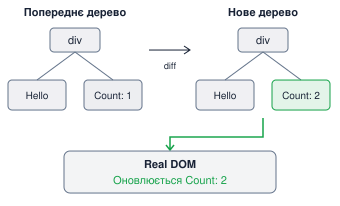
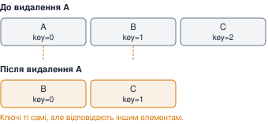
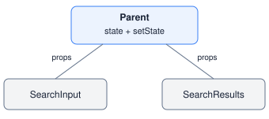
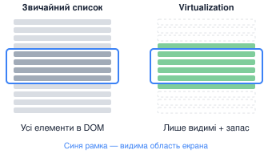

# React

## 3.1. Що таке Virtual DOM?

<a id="q-3-1"></a>

### Пояснення

#### Interview answer (EN)

Virtual DOM is an informal name for the lightweight tree of React elements that components return when they render. React compares the new tree with the previous one, and during the commit phase it applies only the necessary changes to the real DOM. The real benefit is the declarative model rather than raw speed: you describe what the UI should look like, and React works out the minimal updates.

"Virtual DOM" — неофіційний термін. У документації React натомість говорять про два етапи оновлення:

| Етап | Що відбувається |
| --- | --- |
| Render | React викликає компоненти й отримує дерево React elements — звичайних JS-об'єктів на кшталт `{ type, props, key }`. Нове дерево порівнюється з попереднім (reconciliation). Реальний DOM не змінюється |
| Commit | React застосовує до реального DOM лише ті зміни, які виявив під час render, а потім запускає layout effects та effects |

Створити React element дешево — це просто об'єкт, на відміну від DOM-вузла. Якщо результат рендера не змінився, React взагалі не торкається DOM.

Fiber — внутрішня архітектура reconciler, яка з'явилася в React 16. Кожен компонент у дереві представлений fiber-вузлом, а роботу рендера можна розбивати на частини, переривати та пріоритезувати. Саме на цьому побудовані concurrent features: `useTransition`, `useDeferredValue`, Suspense. Для співбесіди рівня Middle достатньо знати, що Fiber — це внутрішня структура даних і механізм планування роботи React.

Важливо: Virtual DOM не означає, що React завжди швидший за точкові DOM-операції вручну. Порівняння дерев — це додаткова робота. Перевага в іншому: декларативний код, передбачувані оновлення та групування змін.



#### Можливі уточнення

- **Is the Virtual DOM faster than the real DOM?** — Не сам по собі. Він дає зручну модель і мінімізує кількість змін у DOM, але ручний точковий код може бути швидшим.
- **What is React Fiber?** — Внутрішня структура даних і reconciler, що дозволяє переривати рендер і працювати з пріоритетами (основа concurrent rendering).
- **Чи означає кожен render зміну DOM?** — Ні. Render — це виклик компонента; DOM змінюється на етапі commit і лише там, де є різниця.

#### Пов’язані питання

- [Як працює reconciliation?](#q-3-2)
- [Що спричиняє повторний рендер компонента?](#q-3-3)

#### Документація

- [React — Render and Commit](https://react.dev/learn/render-and-commit)

## 3.2. Як працює reconciliation?

<a id="q-3-2"></a>

### Пояснення

#### Interview answer (EN)

Reconciliation is how React matches the new element tree to the previous one. It looks at the element type, its position among siblings and its key: if those stay the same, React keeps the component instance and its state and simply updates the props. If the type or the key changes, React unmounts the old subtree and mounts a fresh one, so all local state inside it is lost.

Reconciliation — процес, у якому React визначає, як нове дерево елементів відповідає попередньому. Замість загального порівняння дерев React використовує прості правила, тому алгоритм працює за лінійний час:

- **Той самий тип на тій самій позиції** — React зберігає екземпляр компонента та його state, оновлює лише props і DOM-атрибути.
- **Інший тип** (`<div>` → `<section>`, `UserCard` → `AdminCard`) — старе піддерево демонтується повністю, нове створюється з нуля. State усіх нащадків скидається.
- **Списки** — елементи серед сусідів зіставляються за `key`, а не за порядком.

```typescript
<UserProfile key={userId} />
```

Зміна `userId` у цьому прикладі призведе до скидання локального стану `UserProfile`. Це офіційний спосіб «почати з чистого аркуша» без effects.

Поширена помилка — оголошувати компонент усередині іншого компонента.

Неправильно:

```typescript
function Parent() {
  function SearchInput() {
    const [text, setText] = useState("");
    return <input value={text} onChange={e => setText(e.target.value)} />;
  }

  return <SearchInput />;
}
```

На кожному рендері `Parent` створюється нова функція `SearchInput`, тобто новий тип. React вважає його іншим компонентом, тому input монтується заново, втрачає введений текст і фокус. Компоненти потрібно оголошувати на верхньому рівні модуля.

#### Можливі уточнення

- **Як примусово скинути стан компонента?** — Змінити йому `key`.
- **Чому `isAdmin ? <Counter /> : <Counter />` зберігає лічильник при перемиканні?** — Той самий тип на тій самій позиції, тому для React це той самий компонент. Щоб розділити стан, дайте різні `key`.

#### Пов’язані питання

- [Чому не рекомендується використовувати індекс масиву як `key`?](#q-3-14)
- [Що таке Virtual DOM?](#q-3-1)

#### Документація

- [React — Preserving and Resetting State](https://react.dev/learn/preserving-and-resetting-state)

## 3.3. Що спричиняє повторний рендер компонента?

<a id="q-3-3"></a>

### Пояснення

#### Interview answer (EN)

A component re-renders when its own state changes, when its parent re-renders, when a context it reads gets a new value, or when an external store it subscribes to changes. Changed props aren't a trigger on their own; they simply arrive with the parent's render. And a render only means React calls the function again, because the DOM is touched only if the output actually differs.

Основні причини:

- Оновлення власного state (`useState`, `useReducer`).
- Рендер батьківського компонента. За замовчуванням React рендерить усіх нащадків, навіть якщо їхні props не змінилися.
- Зміна значення Context, який компонент читає через `useContext` або `use`.
- Оновлення зовнішнього store, на який підписаний компонент (`useSyncExternalStore`, `useSelector`).

Поширений міф: «компонент ререндериться, коли змінюються його props». Насправді нові props з'являються лише тому, що відрендерився батьківський компонент. Без `memo` дочірній компонент рендериться і з тими самими props.

React може пропустити оновлення, якщо нове значення state ідентичне старому за `Object.is`. Через це мутація об'єкта не працює:

```typescript
// Неправильно: той самий об'єкт, React може не відрендерити компонент
user.name = "Alex";
setUser(user);

// Правильно: нове посилання
setUser({ ...user, name: "Alex" });
```

Важливо розрізняти render та commit: повторний виклик функції компонента не обов'язково означає зміну реального DOM.

Знайти причину ререндерів допомагає React DevTools Profiler з увімкненою опцією «Record why each component rendered while profiling».

#### Пов’язані питання

- [Чи ререндериться дочірній компонент, якщо його props не змінилися?](#q-3-4)
- [Чому зміна Context ререндерить усіх споживачів і як цього уникнути?](#q-3-27)
- [Як уникнути зайвих ререндерів при використанні `useSelector`?](../04-redux-toolkit/README.md#q-4-12)

#### Документація

- [React — Render and Commit](https://react.dev/learn/render-and-commit)

## 3.4. Чи ререндериться дочірній компонент, якщо його props не змінилися?

<a id="q-3-4"></a>

### Пояснення

#### Interview answer (EN)

Yes, by default a parent's render also renders all of its children, even when their props are identical. Before reaching for memo, I usually fix the structure: I move state down into the component that actually uses it, or pass the expensive part as children, so it's created by a component that doesn't re-render. When that isn't enough, memo or the React Compiler lets React skip children whose props haven't changed.

За замовчуванням — так, якщо рендериться батьківський компонент.

```typescript
function Parent() {
  const [count, setCount] = useState(0);

  return (
    <>
      <button onClick={() => setCount(count + 1)}>
        {count}
      </button>

      <Child name="Alex" />
    </>
  );
}
```

`Child` буде повторно викликаний при кожному кліку, хоча `name` не змінився.

**1. Перенести state нижче (move state down).** Якщо state потрібен лише частині дерева, винесіть цю частину в окремий компонент:

```typescript
function Counter() {
  const [count, setCount] = useState(0);
  return <button onClick={() => setCount(c => c + 1)}>{count}</button>;
}

function Parent() {
  return (
    <>
      <Counter />
      <ExpensiveTree />
    </>
  );
}
```

Тепер клік ререндерить лише `Counter`.

**2. Передати дорогу частину як `children`.** Коли state потрібен обгортці, а всередині є важке дерево:

```typescript
function ColorBox({ children }: { children: React.ReactNode }) {
  const [color, setColor] = useState("red");

  return (
    <div style={{ color }}>
      <input value={color} onChange={e => setColor(e.target.value)} />
      {children}
    </div>
  );
}

function App() {
  return (
    <ColorBox>
      <ExpensiveTree />
    </ColorBox>
  );
}
```

Елемент `<ExpensiveTree />` створює `App`, а не `ColorBox`. Коли змінюється `color`, `children` — той самий об'єкт, тому React не рендерить `ExpensiveTree` повторно.

**3. `React.memo`.** Пропускає рендер, якщо кожен prop дорівнює попередньому за `Object.is`:

```typescript
const Child = React.memo(function Child({ name }: { name: string }) {
  return <div>{name}</div>;
});
```

`memo` не допоможе, якщо батько щоразу передає новий об'єкт, функцію або JSX у props. Також він не блокує оновлення власного state компонента та Context, який він читає.

**4. React Compiler.** React Compiler 1.0 стабільний з 7 жовтня 2025 року. Це build-time плагін (Babel; є інтеграції з Vite, Next.js, Expo), який автоматично мемоізує компоненти, обчислення та JSX. Фактично він робить те, що вручну роблять `memo`, `useMemo` і `useCallback`, і часто точніше. Умова — код має дотримуватися Rules of React; компоненти, які їх порушують, компілятор просто пропускає. Працює з React 17+ (для версій до 19 потрібен пакет `react-compiler-runtime`). У проєкті з компілятором ручна мемоізація потрібна рідко: `useMemo`/`useCallback` залишаються як escape hatch, наприклад для стабільної залежності effect.

#### Можливі уточнення

- **Чому `memo` не спрацював?** — У props щоразу новий об'єкт, функція або `children`; або компонент читає Context, що змінився.
- **Do we still need `useMemo` and `useCallback` with React Compiler?** — Зрідка: як escape hatch для точного контролю, наприклад стабільної залежності effect.
- **Чи можна передати власну функцію порівняння в `memo`?** — Так, `memo(Component, arePropsEqual)`, але вона має порівнювати всі props, включно з функціями, інакше з'являться stale closures.

#### Пов’язані питання

- [У чому різниця між `useMemo`, `useCallback` та `React.memo`?](#q-3-5)
- [Коли мемоізація може погіршити продуктивність?](#q-3-6)
- [Що таке lifting state up?](#q-3-16)

#### Документація

- [React — memo](https://react.dev/reference/react/memo)
- [React — React Compiler Introduction](https://react.dev/learn/react-compiler/introduction)
- [React Blog — React Compiler v1.0](https://react.dev/blog/2025/10/07/react-compiler-1)

## 3.5. У чому різниця між `useMemo`, `useCallback` та `React.memo`?

<a id="q-3-5"></a>

### Пояснення

#### Interview answer (EN)

The useMemo hook caches the result of a calculation between renders, while useCallback caches the function itself, so it keeps the same reference as long as its dependencies don't change. React.memo works at the component level: it skips a re-render when every prop equals the previous one by Object.is. They are usually combined, because a memoized child only benefits if its parent passes stable objects and callbacks.

| Інструмент | Що мемоізує | Типовий випадок |
| --- | --- | --- |
| `useMemo` | Результат обчислення | Дороге фільтрування чи сортування; стабільний об'єкт для props або deps |
| `useCallback` | Посилання на функцію | Callback для `memo`-компонента або залежність effect |
| `React.memo` | Компонент: пропускає рендер при незмінних props | Важкий компонент, який часто отримує ті самі props |

```typescript
const filteredUsers = useMemo(
  () => users.filter(user => user.active),
  [users]
);
```

```typescript
const handleClick = useCallback(() => {
  doSomething(id);
}, [id]);
```

`useCallback(fn, deps)` — це те саме, що `useMemo(() => fn, deps)`.

Як вони працюють разом:

```typescript
const Row = React.memo(function Row({ user, onSelect }: RowProps) {
  return <li onClick={() => onSelect(user.id)}>{user.name}</li>;
});

function UserList({ users }: { users: User[] }) {
  const [selectedId, setSelectedId] = useState<string | null>(null);

  const handleSelect = useCallback((id: string) => {
    setSelectedId(id);
  }, []);

  return users.map(user => (
    <Row key={user.id} user={user} onSelect={handleSelect} />
  ));
}
```

Без `useCallback` функція `handleSelect` була б новою на кожному рендері, і `memo` на `Row` нічого б не давав.

Важливо: `useMemo` — оптимізація, а не гарантія. React може скинути кеш (наприклад, якщо компонент призупинився під час першого монтування). Якщо код без `useMemo` працює неправильно, проблему треба виправити інакше. У проєктах з React Compiler більшість такої мемоізації додається автоматично.

#### Пов’язані питання

- [Коли мемоізація може погіршити продуктивність?](#q-3-6)
- [Чи ререндериться дочірній компонент, якщо його props не змінилися?](#q-3-4)
- [Як знайти причину повільної роботи React-застосунку?](../08-architecture/README.md#q-8-9)

#### Документація

- [React — useMemo](https://react.dev/reference/react/useMemo)
- [React — useCallback](https://react.dev/reference/react/useCallback)
- [React — memo](https://react.dev/reference/react/memo)

## 3.6. Коли мемоізація може погіршити продуктивність?

<a id="q-3-6"></a>

### Пояснення

#### Interview answer (EN)

Memoization isn't free: React has to keep previous values in memory and compare dependencies or props on every render. If the calculation is cheap, or the dependencies change on every render anyway, you pay that cost and get nothing back, and the code becomes harder to read. That's why I profile first and memoize only the measured hot spots, or let the React Compiler handle it.

Мемоізація має вартість: збереження значень у пам'яті, порівняння залежностей та props на кожному рендері, додаткова складність коду і ризик помилок у dependencies.

Випадки, коли мемоізація зайва або марна:

- **Дешеве обчислення.**

```typescript
const fullName = useMemo(
  () => firstName + " " + lastName,
  [firstName, lastName]
);
```

Тут достатньо `const fullName = firstName + " " + lastName;`.

- **Залежності змінюються щоразу.** Якщо в deps потрапляє об'єкт або функція, створені під час рендера, кеш ніколи не спрацює.
- **`memo` на компоненті, який завжди отримує нові props**, наприклад JSX у `children` або inline-об'єкт `style={{ ... }}`.
- **Мемоізація «про всяк випадок» скрізь** — шум у коді без виміряного ефекту.

Як вимірювати: React DevTools Profiler, компонент `<Profiler>`, а для окремих обчислень — `console.time`. Документація React орієнтує так: якщо обчислення сумарно займає близько 1 мс або більше, мемоізація може мати сенс. Вимірювати краще на production-збірці та з CPU throttling.

У проєкті з React Compiler ручна мемоізація здебільшого не потрібна: компілятор сам вирішує, що кешувати.

#### Пов’язані питання

- [У чому різниця між `useMemo`, `useCallback` та `React.memo`?](#q-3-5)
- [Як знайти причину повільної роботи React-застосунку?](../08-architecture/README.md#q-8-9)

#### Документація

- [React — useMemo](https://react.dev/reference/react/useMemo)
- [React — Profiler](https://react.dev/reference/react/Profiler)

## 3.7. Як працює `useEffect`?

<a id="q-3-7"></a>

### Пояснення

#### Interview answer (EN)

useEffect lets a component synchronize with something outside React, such as a subscription, a timer or a browser API. React runs the setup after the commit, usually after the browser paints, and re-runs it whenever one of its reactive dependencies changes, calling the previous cleanup first. You don't really choose the dependency list: every prop, state value or function from the component body that the effect reads must be listed, and the linter enforces that.

`useEffect` використовується для синхронізації компонента із зовнішніми системами: subscriptions, timers, WebSocket, браузерні API, сторонні віджети.

```typescript
useEffect(() => {
  document.title = title;
}, [title]);
```

| Залежності | Поведінка |
| --- | --- |
| Не передані | Після кожного commit компонента |
| `[]` | Один раз після монтування. У development зі Strict Mode: setup → cleanup → setup |
| `[a, b]` | Після монтування та після кожного commit, у якому `a` або `b` змінилися |

React порівнює кожну залежність із попереднім значенням за `Object.is`.

**Reactive values** — це props, state та всі змінні й функції, оголошені безпосередньо в тілі компонента. Вони можуть змінитися між рендерами, тому якщо effect їх читає, вони мають бути в dependencies. Не є reactive: константи поза компонентом, а також `setState`-функції та об'єкти з `useRef`, бо їхня ідентичність стабільна (linter дозволяє їх не вказувати).

Правило перевіряє `react-hooks/exhaustive-deps` з `eslint-plugin-react-hooks`. Глушити його не варто. Щоб прибрати залежність, треба «довести», що вона не потрібна: винести константу за межі компонента, створити об'єкт усередині effect, використати functional update або `useEffectEvent`.

Типова пастка — об'єкт у залежностях:

```typescript
const options = { roomId, serverUrl }; // новий об'єкт на кожному рендері

useEffect(() => {
  const connection = createConnection(options);
  connection.connect();
  return () => connection.disconnect();
}, [options]); // effect перезапускається після кожного рендера
```

Краще створити `options` всередині effect і залежати від примітивів `[roomId, serverUrl]`.

Effects не виконуються під час server rendering.

#### Можливі уточнення

- **Чому effect спрацьовує двічі при старті?** — Strict Mode у development запускає додатковий цикл setup → cleanup, щоб перевірити cleanup. У production — один раз.
- **Як прибрати залежність, не обманюючи linter?** — Винести значення за межі компонента, перенести всередину effect, functional update, `useEffectEvent`.
- **Коли effect виконується відносно paint?** — Зазвичай після paint. Якщо його спричинила взаємодія (клік), React може виконати його до paint.

#### Пов’язані питання

- [Коли виконується cleanup-функція в `useEffect`?](#q-3-8)
- [Що таке stale closure?](#q-3-12)
- [У яких випадках не потрібно використовувати `useEffect`?](#q-3-23)
- [useEffect](../09-live-coding/README.md#q-9-4)

#### Документація

- [React — useEffect](https://react.dev/reference/react/useEffect)
- [React — Lifecycle of Reactive Effects](https://react.dev/learn/lifecycle-of-reactive-effects)

## 3.8. Коли виконується cleanup-функція в `useEffect`?

<a id="q-3-8"></a>

### Пояснення

#### Interview answer (EN)

The cleanup runs before React re-runs the effect with new dependencies, and once more when the component unmounts. It should undo whatever the setup did: remove listeners, clear timers, close connections or ignore an outdated request. In development, Strict Mode runs an extra setup and cleanup cycle on mount precisely to expose effects whose cleanup is missing or incomplete.

Cleanup виконується:

- перед наступним запуском effect, якщо залежності змінилися;
- при демонтуванні компонента;
- у development зі Strict Mode — одразу після першого setup (setup → cleanup → setup).

Cleanup бачить значення з того рендера, в якому був створений effect, тобто «старі» props і state. Саме це потрібно, щоб відписатися від того, на що підписувалися.

```typescript
useEffect(() => {
  function handleResize() {
    setWidth(window.innerWidth);
  }

  window.addEventListener("resize", handleResize);

  return () => {
    window.removeEventListener("resize", handleResize);
  };
}, []);
```

Handler оголошено всередині effect, тому він не потрапляє в dependencies і не спричиняє зайвих повторних підписок.

Cleanup також захищає від race conditions під час завантаження даних:

```typescript
useEffect(() => {
  const controller = new AbortController();

  fetch(`/api/users/${userId}`, { signal: controller.signal })
    .then(response => response.json())
    .then(setUser)
    .catch(error => {
      if (error.name !== "AbortError") setError(error);
    });

  return () => controller.abort();
}, [userId]);
```

Якщо `userId` зміниться до завершення запиту, попередній запит буде скасовано, і стара відповідь не перезапише нову.

Без cleanup з'являються memory leaks, дубльовані subscriptions та оновлення state демонтованих компонентів.


#### Пов’язані питання

- [Як працює `useEffect`?](#q-3-7)
- [Race Condition](../09-live-coding/README.md#q-9-8)
- [Як працює `AbortController`?](../06-browser-network/README.md#q-6-13)

#### Документація

- [React — Synchronizing with Effects](https://react.dev/learn/synchronizing-with-effects)

## 3.9. Чим відрізняються `useEffect` та `useLayoutEffect`?

<a id="q-3-9"></a>

### Пояснення

#### Interview answer (EN)

useLayoutEffect runs synchronously after React updates the DOM but before the browser paints, so you can measure layout and adjust it without a visible flicker. The trade-off is that it blocks painting, which means heavy work there makes the UI feel slow. For most synchronization, such as subscriptions or network requests, plain useEffect remains the right default.

`useLayoutEffect` виконується після змін DOM, але до того, як браузер відмалює екран. Якщо всередині оновити state, React синхронно виконає ще один рендер до paint, і користувач побачить лише фінальний результат.

`useEffect` зазвичай виконується після paint. Виняток: якщо effect спричинила взаємодія користувача (наприклад, клік), React може виконати його до paint.

`useLayoutEffect` корисний, коли потрібно виміряти DOM і скоригувати layout до того, як користувач побачить проміжний стан, наприклад позиціонувати tooltip:

```typescript
const ref = useRef<HTMLDivElement>(null);
const [height, setHeight] = useState(0);

useLayoutEffect(() => {
  if (!ref.current) return;
  setHeight(ref.current.getBoundingClientRect().height);
}, []);
```

Нюанси:

- `useLayoutEffect` блокує paint, тому важка робота в ньому погіршує продуктивність.
- Він не виконується під час server rendering.
- Існує ще `useInsertionEffect` — він потрібен авторам CSS-in-JS бібліотек для вставки стилів до layout effects. У звичайному коді застосунку він не потрібен.

За замовчуванням краще використовувати `useEffect`.

#### Документація

- [React — useLayoutEffect](https://react.dev/reference/react/useLayoutEffect)

## 3.10. Чим відрізняються `useRef` та `useState`?

<a id="q-3-10"></a>

### Пояснення

#### Interview answer (EN)

Both values survive re-renders, but they serve different purposes. State is a snapshot used for rendering, and calling its setter schedules a new render. A ref is a mutable box: changing ref.current takes effect immediately and doesn't re-render anything, so it suits DOM nodes, timer IDs or the latest value for a callback. As a rule, you shouldn't read or write a ref during rendering, because the UI won't stay in sync with it.

| Характеристика | `useRef` | `useState` |
| --- | --- | --- |
| Зберігає значення між рендерами | Так | Так |
| Оновлення викликає ререндер | Ні | Так, якщо значення змінилося за `Object.is` |
| Як змінюється | Напряму: `ref.current = value`, одразу | Через setter, нове значення буде в наступному рендері |
| Використання в JSX | Не варто | Основне призначення |
| Доступ до DOM | Так | Ні |

```typescript
const inputRef = useRef<HTMLInputElement>(null);

function focusInput() {
  inputRef.current?.focus();
}

<input ref={inputRef} />
```

```typescript
const intervalRef = useRef<number | null>(null);

function start() {
  intervalRef.current = window.setInterval(tick, 1000);
}

function stop() {
  if (intervalRef.current !== null) clearInterval(intervalRef.current);
}
```

Правило: не читати й не змінювати `ref.current` під час рендера (виняток — ліниву ініціалізацію). Працюйте з refs в event handlers та effects.

React 19: `ref` можна передавати у function component як звичайний prop без `forwardRef`, а ref callback може повертати cleanup-функцію.

#### Документація

- [React — useRef](https://react.dev/reference/react/useRef)
- [React — Referencing Values with Refs](https://react.dev/learn/referencing-values-with-refs)

## 3.11. Чому не можна викликати hooks умовно?

<a id="q-3-11"></a>

### Пояснення

#### Interview answer (EN)

React doesn't identify hooks by name; it relies on the order in which they're called during every render. If a hook sits inside a condition or a loop, that order can change between renders, and React would hand one hook's state to another. That's why hooks must be called at the top level of components or custom hooks, and eslint-plugin-react-hooks catches violations. The one exception is the use API, which may be called conditionally.

React зберігає state hooks як список, прив'язаний до компонента, і зіставляє кожен виклик із його станом за порядковим номером.

Неправильно:

```typescript
if (isLoggedIn) {
  const [user, setUser] = useState(null);
}
```

Якщо умова зміниться, порядок викликів hooks порушиться, і React віддасть state не тому hook.

Правильно:

```typescript
const [user, setUser] = useState(null);

useEffect(() => {
  if (isLoggedIn) {
    fetchUser();
  }
}, [isLoggedIn]);
```

Hooks не можна викликати:

- в умовах, циклах і після раннього `return`;
- в event handlers та callbacks, переданих у `useMemo`, `useEffect` тощо;
- у class components та звичайних функціях, які не є компонентами чи custom hooks;
- у блоках `try`/`catch`/`finally`.

Виняток — API `use`. Воно не є hook у цьому сенсі й може викликатися в умовах і циклах, але лише всередині компонента або hook і не в `try`/`catch`:

```typescript
function Heading({ show }: { show: boolean }) {
  if (!show) return null;

  const theme = use(ThemeContext); // дозволено після умови

  return <h1 className={theme}>Hello</h1>;
}
```

Правила перевіряє `eslint-plugin-react-hooks` (правила `rules-of-hooks` та `exhaustive-deps` у preset `recommended`). Актуальні версії плагіна також містять правила на основі React Compiler (`purity`, `refs`, `set-state-in-render` тощо); з релізом React Compiler 1.0 вони увійшли в preset `recommended`. Встановлювати сам компілятор для цього не потрібно.

#### Документація

- [React — Rules of Hooks](https://react.dev/reference/rules/rules-of-hooks)
- [React — eslint-plugin-react-hooks](https://react.dev/reference/eslint-plugin-react-hooks)
- [React — use](https://react.dev/reference/react/use)

## 3.12. Що таке stale closure?

<a id="q-3-12"></a>

### Пояснення

#### Interview answer (EN)

A stale closure happens when a callback created during one render keeps reading the props or state of that render after newer values exist. Typical examples are intervals or subscriptions set up in an effect with an empty dependency list. Depending on the case, I fix it by listing the dependency, using a functional state update, keeping the latest value in a ref, or, since React 19.2, moving that logic into useEffectEvent.

Ситуація, коли функція використовує застарілі значення з попереднього рендера через замикання.

Кожен рендер — окремий виклик функції компонента зі своїми константами. Функція, створена в рендері, «пам'ятає» саме їх:

```javascript run
function render(count) {
  return () => console.log("callback бачить count =", count);
}

const callbackFromFirstRender = render(0);
const callbackFromSecondRender = render(1);

callbackFromFirstRender(); // 0 — значення першого «рендера»
callbackFromSecondRender(); // 1
```

У React це виглядає так:

```typescript
const [count, setCount] = useState(0);

useEffect(() => {
  const timer = setInterval(() => {
    console.log(count);
  }, 1000);

  return () => clearInterval(timer);
}, []);
```

Тут `count` завжди буде дорівнювати 0, оскільки effect створив interval лише в першому рендері.

Варіанти вирішення:

| Ситуація | Рішення |
| --- | --- |
| Треба оновити state на основі попереднього | Functional update: `setCount(prev => prev + 1)` |
| Effect має реагувати на значення | Додати його в dependencies |
| Effect має прочитати актуальне значення, але не перезапускатися через нього | `useEffectEvent` |
| Старіші версії React або код поза effects | Ref з актуальним значенням |

`useEffectEvent` стабільний з React 19.2. Він відокремлює «подію» від реактивної частини effect:

```typescript
import { useEffect, useEffectEvent } from "react";

function ChatRoom({ roomId, theme }: { roomId: string; theme: string }) {
  const onConnected = useEffectEvent(() => {
    showNotification("Connected!", theme); // завжди актуальний theme
  });

  useEffect(() => {
    const connection = createConnection(roomId);
    connection.on("connected", () => onConnected());
    connection.connect();
    return () => connection.disconnect();
  }, [roomId]); // зміна theme не перепідключає чат
}
```

Обмеження: Effect Event викликають лише зсередини effects, не передають в інші компоненти чи hooks і не додають у dependencies. Його не варто використовувати лише для того, щоб заглушити linter.

#### Пов’язані питання

- [Як працює `useEffect`?](#q-3-7)
- [Що таке closure (замикання)?](../01-javascript/README.md#q-1-3)
- [Closure](../09-live-coding/README.md#q-9-2)

#### Документація

- [React — useEffectEvent](https://react.dev/reference/react/useEffectEvent)
- [React — Separating Events from Effects](https://react.dev/learn/separating-events-from-effects)

## 3.13. Як працює batching оновлень стану?

<a id="q-3-13"></a>

### Пояснення

#### Interview answer (EN)

React batches state updates: setters called within the same event or task are queued and processed in a single render instead of one render per call. With createRoot, which is the only root API left in React 19, this automatic batching applies everywhere, including promises, timeouts and native event handlers. Because state is a snapshot, I use a functional updater when the next value depends on the previous one, and flushSync is the rare escape hatch for a synchronous update.

Batching — групування декількох оновлень state в один рендер.

```typescript
function handleClick() {
  setName("Alex");
  setAge(30);
  setLoading(false);
  // один рендер після завершення обробника
}
```

До React 18 (і з legacy `ReactDOM.render`) batching працював лише в React event handlers. З `createRoot` (React 18+) automatic batching працює для будь-яких оновлень: у Promise, `setTimeout`, нативних event listeners. У React 19 `ReactDOM.render` видалено, тому `createRoot` — єдиний варіант.

Batching відбувається в межах одного event або task. Оновлення з двох різних кліків не об'єднуються.

State у функції компонента — snapshot конкретного рендера. Setter не змінює поточну змінну, а ставить оновлення в чергу:

```typescript
const [count, setCount] = useState(0);

function handleClick() {
  setCount(count + 1);
  setCount(count + 1);
  setCount(count + 1);
  console.log(count); // 0
}
// Після рендера: 1

function handleClickWithUpdater() {
  setCount(c => c + 1);
  setCount(c => c + 1);
  setCount(c => c + 1);
}
// Після рендера: 3
```

Functional updater отримує результат попередніх оновлень у черзі.

Якщо потрібно, щоб DOM оновився негайно (наприклад, прокрутити до щойно доданого елемента), існує `flushSync`:

```typescript
import { flushSync } from "react-dom";

flushSync(() => {
  setItems(nextItems);
});

listRef.current?.lastElementChild?.scrollIntoView();
```

`flushSync` використовують рідко: він вимикає batching для цього оновлення й може погіршити продуктивність.

#### Пов’язані питання

- [React State](../09-live-coding/README.md#q-9-3)

#### Документація

- [React — Queueing a Series of State Updates](https://react.dev/learn/queueing-a-series-of-state-updates)
- [React — State as a Snapshot](https://react.dev/learn/state-as-a-snapshot)
- [React — flushSync](https://react.dev/reference/react-dom/flushSync)

## 3.14. Чому не рекомендується використовувати індекс масиву як `key`?

<a id="q-3-14"></a>

### Пояснення

#### Interview answer (EN)

Keys tell React which list item is which between renders. With index keys, inserting, deleting or reordering items shifts the indexes, so React reuses the wrong component instances, and state such as input values or focus ends up attached to the wrong items. A stable unique ID from the data avoids that, while index keys are acceptable only for static lists that never change order.

React використовує `key` для ідентифікації елементів серед сусідів між рендерами.

```typescript
items.map((item, index) => (
  <Item key={index} item={item} />
));
```

Якщо видалити, додати або перемістити елемент, індекси зміняться, і React пов'яже стан компонента з неправильним елементом.

Правильніше:

```typescript
items.map(item => (
  <Item key={item.id} item={item} />
));
```

Вимоги до `key`:

- унікальний серед сусідів (глобальна унікальність не потрібна);
- стабільний між рендерами.

Неправильно генерувати key під час рендера (`key={Math.random()}` або `crypto.randomUUID()` у `map`): кожен рендер створюватиме нові ключі, і всі елементи монтуватимуться заново. Якщо в даних немає id, його генерують один раз під час створення елемента.

`key` не передається в компонент як prop. Для групи елементів без обгортки використовують `<Fragment key={item.id}>`.

Індекс прийнятний для статичних списків, порядок і склад яких ніколи не змінюються.



#### Пов’язані питання

- [Як працює reconciliation?](#q-3-2)

#### Документація

- [React — Rendering Lists](https://react.dev/learn/rendering-lists)

## 3.15. Що таке controlled та uncontrolled components?

<a id="q-3-15"></a>

### Пояснення

#### Interview answer (EN)

In a controlled input, React state is the source of truth: you pass value and update it in onChange, which makes instant validation and dependent fields easy. An uncontrolled input keeps its value in the DOM, and you read it when needed, through a ref or with FormData on submit. React 19 makes the uncontrolled style more convenient, since a form action receives FormData directly and React resets the form after a successful action.

Controlled component — значення контролюється React state.

```typescript
const [value, setValue] = useState("");

<input
  value={value}
  onChange={e => setValue(e.target.value)}
/>
```

Uncontrolled component — значення зберігається в DOM.

```typescript
const inputRef = useRef<HTMLInputElement>(null);

<input ref={inputRef} defaultValue="Hello" />
```

| | Controlled | Uncontrolled |
| --- | --- | --- |
| Джерело правди | React state | DOM |
| Початкове значення | `value` / `checked` | `defaultValue` / `defaultChecked` |
| Читання значення | Будь-коли зі state | Через ref або `FormData` під час submit |
| Валідація на льоту, залежні поля | Просто | Складніше |
| Ререндери | На кожен введений символ | Мінімум |

Uncontrolled форма з React 19 `<form action>`:

```typescript
function SubscribeForm() {
  async function subscribe(formData: FormData) {
    const email = String(formData.get("email") ?? "");
    await api.subscribe(email);
  }

  return (
    <form action={subscribe}>
      <input name="email" type="email" required />
      <button type="submit">Підписатися</button>
    </form>
  );
}
```

Функція в `action` отримує `FormData` і виконується як transition. Після успішного виконання React автоматично скидає uncontrolled поля форми. Стан pending та результат можна отримати через `useFormStatus` і `useActionState`. До React 19 те саме роблять в `onSubmit` через `new FormData(event.currentTarget)`.

Типові помилки:

- `value` без `onChange` — поле стає read-only, React показує попередження.
- Перемикання між controlled та uncontrolled: `value={undefined}`, а потім рядок. Початкове значення має бути `""`, а не `undefined`.

#### Пов’язані питання

- [Що нового в React 19?](#q-3-25)
- [Як організувати форму з валідацією в React?](#q-3-29)

#### Документація

- [React — input](https://react.dev/reference/react-dom/components/input)
- [React — form](https://react.dev/reference/react-dom/components/form)
- [MDN — FormData](https://developer.mozilla.org/en-US/docs/Web/API/FormData)

## 3.16. Що таке lifting state up?

<a id="q-3-16"></a>

### Пояснення

#### Interview answer (EN)

When two components need the same changing data, I move that state to their closest common parent and pass the value down as props, together with callbacks to update it. That gives a single source of truth, so the siblings can't drift out of sync. The trade-off is that state lifted too high makes more of the tree re-render, so it should live as low as possible, and context or a store is worth it only when prop drilling gets deep.

Переміщення спільного стану до найближчого спільного батьківського компонента, щоб синхронізувати декілька дочірніх компонентів.

Наприклад, `SearchInput` змінює пошуковий текст, а `SearchResults` використовує його. Обидва отримують необхідні дані від батьківського компонента:

```typescript
function SearchPage() {
  const [query, setQuery] = useState("");

  return (
    <>
      <SearchInput value={query} onChange={setQuery} />
      <SearchResults query={query} />
    </>
  );
}
```



Принципи:

- **Single source of truth** — кожне значення має одного власника. Не копіюйте props у state дочірнього компонента.
- **Тримайте state якомога нижче.** Чим вище state, тим більша частина дерева ререндериться при його зміні.
- **Prop drilling** через багато рівнів — сигнал для composition (`children`), Context або store.

#### Пов’язані питання

- [Чи ререндериться дочірній компонент, якщо його props не змінилися?](#q-3-4)
- [Коли варто використовувати локальний state, Context API або Redux?](../04-redux-toolkit/README.md#q-4-1)

#### Документація

- [React — Sharing State Between Components](https://react.dev/learn/sharing-state-between-components)

## 3.17. Що таке React Portal?

<a id="q-3-17"></a>

### Пояснення

#### Interview answer (EN)

A portal lets a component render its DOM nodes into a different container, typically document.body, while it keeps its place in the React tree. That's useful for modals, tooltips and dropdowns that would otherwise be clipped by overflow hidden or trapped in a stacking context. Context still flows normally, and React events bubble through React ancestors rather than DOM ancestors, which sometimes surprises people.

Portal дозволяє рендерити React-компонент в іншому місці DOM, зберігаючи його місце в React-дереві.

```typescript
import { createPortal } from "react-dom";

return createPortal(
  <Modal />,
  document.body
);
```

Використовується для modals, tooltips, popovers та overlays. Допомагає уникнути проблем із `overflow: hidden`, stacking contexts та `z-index`.

Context і поширення React events працюють відповідно до React-дерева, а не DOM-дерева:

```typescript
<div onClick={() => console.log("clicked")}>
  {createPortal(<button>Inside portal</button>, document.body)}
</div>
```

Клік по кнопці виведе `clicked`, хоча в DOM кнопка не є нащадком `div`.

Для модальних вікон portal не вирішує доступність автоматично: потрібні керування фокусом, закриття по Escape, `aria-modal` і повернення фокусу. Альтернатива — нативний `<dialog>` з `showModal()`: він рендериться в top layer, тому проблеми з `z-index` зникають і без portal.

#### Документація

- [React — createPortal](https://react.dev/reference/react-dom/createPortal)
- [MDN — The Dialog element](https://developer.mozilla.org/en-US/docs/Web/HTML/Reference/Elements/dialog)

## 3.18. Як працюють Error Boundaries?

<a id="q-3-18"></a>

### Пояснення

#### Interview answer (EN)

An error boundary catches errors thrown while rendering its children, in lifecycle methods or in effects, and shows fallback UI instead of unmounting the whole app. It doesn't catch errors in event handlers, in async code like timeouts, during server rendering, or in the boundary itself, so those errors have to be pushed back into rendering, for example through state or showBoundary. For reporting, React 19 adds the root options onCaughtError and onUncaughtError.

Error Boundary перехоплює помилки під час рендерингу дочірнього дерева та показує fallback UI. Без нього помилка під час рендера видаляє з екрана весь UI застосунку.

```typescript
<ErrorBoundary fallback={<ErrorPage />}>
  <Application />
</ErrorBoundary>
```

Нативна реалізація можлива лише як class component:

```typescript
type Props = { fallback: React.ReactNode; children: React.ReactNode };
type State = { error: Error | null };

class ErrorBoundary extends React.Component<Props, State> {
  state: State = { error: null };

  static getDerivedStateFromError(error: Error): State {
    return { error };
  }

  componentDidCatch(error: Error, info: React.ErrorInfo) {
    logError(error, info.componentStack);
  }

  render() {
    return this.state.error ? this.props.fallback : this.props.children;
  }
}
```

На практиці частіше використовують пакет `react-error-boundary` (його рекомендує й документація React):

```typescript
import { ErrorBoundary, useErrorBoundary } from "react-error-boundary";

<ErrorBoundary
  FallbackComponent={ErrorFallback}
  onError={(error, info) => logError(error, info.componentStack)}
  resetKeys={[userId]}
>
  <UserProfile userId={userId} />
</ErrorBoundary>
```

Error Boundaries **не** перехоплюють помилки:

- в event handlers;
- в асинхронному коді (`setTimeout`, `.then` поза рендером);
- під час SSR;
- у самому boundary.

Як передати таку помилку в найближчий boundary:

```typescript
function SaveButton() {
  const { showBoundary } = useErrorBoundary();

  async function handleClick() {
    try {
      await saveProfile();
    } catch (error) {
      showBoundary(error);
    }
  }

  return <button onClick={handleClick}>Зберегти</button>;
}
```

Без бібліотеки той самий ефект дає `setState(() => { throw error; })`: updater виконується під час рендера, тому помилка потрапляє в boundary. Помилки всередині `startTransition` (React 19 Actions) і відхилені Promise, прочитані через `use`, boundary перехоплює автоматично.

Для централізованого логування в React 19 є опції root:

```typescript
createRoot(container, {
  onCaughtError(error, errorInfo) {
    report(error, errorInfo.componentStack);
  },
  onUncaughtError(error, errorInfo) {
    report(error, errorInfo.componentStack);
  },
});
```

`onCaughtError` викликається для помилок, перехоплених boundary, `onUncaughtError` — для неперехоплених. Є ще `onRecoverableError` для помилок, після яких React відновився сам.

Boundaries варто ставити на рівні маршрутів і незалежних віджетів, щоб помилка в одному блоці не ламала всю сторінку.

#### Можливі уточнення

- **Чому немає function-версії Error Boundary?** — React досі не має hook-еквівалента `getDerivedStateFromError`/`componentDidCatch`; тому — class або `react-error-boundary`.
- **Як «скинути» boundary після помилки?** — `resetKeys` або `resetErrorBoundary` у `react-error-boundary`; або змінити `key` boundary.
- **Чи потрапить у boundary помилка RTK Query?** — Ні, RTK Query повертає її в полі `error`, а не кидає під час рендера.

#### Пов’язані питання

- [Як би ти організував централізовану обробку помилок?](../08-architecture/README.md#q-8-11)

#### Документація

- [React — Catching rendering errors with an Error Boundary](https://react.dev/reference/react/Component#catching-rendering-errors-with-an-error-boundary)
- [React — createRoot](https://react.dev/reference/react-dom/client/createRoot)

## 3.19. Що таке custom hooks і коли їх варто створювати?

<a id="q-3-19"></a>

### Пояснення

#### Interview answer (EN)

A custom hook is a function whose name starts with use and that calls other hooks, so it lets you reuse stateful logic, not the state itself: every component that calls it gets its own independent state. I create one when the same state or effect logic repeats across components, or when naming the logic makes a component easier to read. A good hook has a specific purpose, like useOnlineStatus, rather than wrapping lifecycle ideas like useMount.

Custom hook — функція, назва якої починається з `use` і яка викликає інші hooks. Вона дозволяє повторно використовувати stateful React-логіку.

```typescript
function useToggle(initial = false) {
  const [value, setValue] = useState(initial);

  const toggle = () => setValue(prev => !prev);

  return { value, toggle };
}
```

Приклад з effect:

```typescript
function useDebouncedValue<T>(value: T, delay = 300): T {
  const [debounced, setDebounced] = useState(value);

  useEffect(() => {
    const id = setTimeout(() => setDebounced(value), delay);
    return () => clearTimeout(id);
  }, [value, delay]);

  return debounced;
}
```

Важливо:

- Два компоненти, які викликають один custom hook, не отримують спільний state. Для спільного стану потрібні lifting state up, Context або store.
- Префікс `use` обов'язковий: за ним React і linter розуміють, що всередині діють Rules of Hooks.
- Якщо функція не викликає hooks, це звичайна утиліта, і префікс `use` їй не потрібен.
- Custom hooks тестують через `renderHook` з React Testing Library.

#### Пов’язані питання

- [Чому не можна викликати hooks умовно?](#q-3-11)

#### Документація

- [React — Reusing Logic with Custom Hooks](https://react.dev/learn/reusing-logic-with-custom-hooks)

## 3.20. Навіщо потрібен Strict Mode?

<a id="q-3-20"></a>

### Пояснення

#### Interview answer (EN)

Strict Mode is a development-only wrapper that stress-tests components for bugs that would otherwise surface later. It renders components twice to expose impure rendering, runs an extra setup and cleanup cycle for effects and, since React 19, for ref callbacks, and it warns about deprecated APIs. None of this happens in production, so a double request on startup in development is a hint to add cleanup or caching, not a reason to remove Strict Mode.

Strict Mode допомагає виявляти потенційні проблеми в development-режимі.

```typescript
<StrictMode>
  <App />
</StrictMode>
```

Що саме робить Strict Mode:

| Перевірка | Що виявляє |
| --- | --- |
| Двічі викликає тіло компонента, а також функції, передані в `useState`, `useReducer`, `useMemo`, та updater-функції | Нечистий рендер, мутації |
| Запускає effects у циклі setup → cleanup → setup під час монтування | Відсутній або неповний cleanup |
| Те саме для ref callbacks (React 19) | Відсутній cleanup у ref callback |
| Попередження про застарілі API | Код, який зламається в наступних версіях |

Нюанси React 19: під час повторного рендера `useMemo` і `useCallback` повторно використовують результат першого виклику. Логи другого виклику React DevTools показує приглушеними.

Strict Mode можна вмикати й для частини дерева, але тоді effects під час першого монтування не перезапускаються.

Ці додаткові перевірки не впливають на production.

#### Пов’язані питання

- [Як працює `useEffect`?](#q-3-7)
- [Коли виконується cleanup-функція в `useEffect`?](#q-3-8)

#### Документація

- [React — StrictMode](https://react.dev/reference/react/StrictMode)

## 3.21. Як працюють `React.lazy` та `Suspense`?

<a id="q-3-21"></a>

### Пояснення

#### Interview answer (EN)

React.lazy splits a component into a separate chunk that is loaded the first time it renders, and Suspense shows a fallback while that component, or anything else below it, is suspended. Suspense only reacts to Suspense-enabled sources: lazy components, promises read with use, and data loaded through frameworks like Next.js or Relay. A fetch inside useEffect doesn't suspend anything, so such code still needs its own loading state.

`React.lazy` дозволяє завантажувати код компонента лише тоді, коли він потрібен.

```typescript
const Settings = lazy(() => import("./Settings"));

<Suspense fallback={<Spinner />}>
  <Settings />
</Suspense>
```

Правила для `lazy`:

- Оголошувати на верхньому рівні модуля, а не всередині компонента, інакше state скидатиметься при кожному рендері.
- Модуль має мати `default` export. Для named export: `lazy(() => import("./Settings").then(m => ({ default: m.Settings })))`.
- Помилку завантаження chunk (наприклад, після деплою або без мережі) перехоплює Error Boundary.

`Suspense` показує fallback, поки хоча б один компонент усередині призупинив рендеринг. Suspense активують лише:

- `lazy`-компоненти;
- читання Promise через `use`;
- Suspense-enabled фреймворки та бібліотеки (Next.js, Relay).

`Suspense` не реагує на `fetch` усередині `useEffect` або event handler.

```typescript
function Albums({ albumsPromise }: { albumsPromise: Promise<Album[]> }) {
  const albums = use(albumsPromise);
  return <AlbumList albums={albums} />;
}
```

Promise має бути закешованим, тобто створеним поза рендером (у фреймворку, Server Component або кеші). `use(fetch(...))` прямо в рендері створюватиме новий Promise щоразу.

Якщо оновлення відбувається всередині transition (наприклад, навігація), React не замінює вже показаний контент на fallback, а чекає, поки новий контент буде готовий.

#### Пов’язані питання

- [Що таке `useTransition` та `useDeferredValue`?](#q-3-22)
- [Як працюють Error Boundaries?](#q-3-18)
- [Що таке code splitting та tree shaking?](../08-architecture/README.md#q-8-5)

#### Документація

- [React — lazy](https://react.dev/reference/react/lazy)
- [React — Suspense](https://react.dev/reference/react/Suspense)
- [React — use](https://react.dev/reference/react/use)

## 3.22. Що таке `useTransition` та `useDeferredValue`?

<a id="q-3-22"></a>

### Пояснення

#### Interview answer (EN)

Both APIs keep urgent updates, like typing, responsive while slower rendering happens in the background. useTransition wraps a state update you control and gives you an isPending flag; in React 19 the callback can be async, which is the foundation of Actions. useDeferredValue is for when you only receive a value: React first renders with the old value and then re-renders with the new one, and the slow child has to be memoized for that to help.

Ці hooks допомагають розділяти термінові та менш термінові оновлення UI.

```typescript
const [isPending, startTransition] = useTransition();

function handleChange(value: string) {
  setInput(value);

  startTransition(() => {
    setSearch(value);
  });
}
```

`useTransition` позначає оновлення state як нетермінові. Рендер transition можна перервати: якщо користувач надрукує ще символ, React відкине незавершену роботу й почне з новим значенням. Значення самого input має оновлюватися терміново, поза transition.

У React 19 `startTransition` приймає async-функцію (Action). `isPending` залишається `true`, доки Action не завершиться:

```typescript
startTransition(async () => {
  await saveDraft(text);
  startTransition(() => {
    setStatus("saved");
  });
});
```

Оновлення state після `await` поки що потрібно знову обгортати в `startTransition` — це відоме обмеження, описане в документації.

`useDeferredValue` дозволяє відкласти використання нового значення в менш пріоритетній частині UI:

```typescript
const deferredQuery = useDeferredValue(query);
const isStale = query !== deferredQuery;

<div style={{ opacity: isStale ? 0.5 : 1 }}>
  <SlowList query={deferredQuery} />
</div>
```

Ця оптимізація працює, лише якщо `SlowList` обгорнутий у `memo`: під час термінового рендера `deferredQuery` ще старий, і `memo` пропускає важкий рендер.

React 19 додав другий аргумент `useDeferredValue(value, initialValue)`. Під час першого рендера hook поверне `initialValue` (наприклад, `""` або порожній список), а потім у фоні відрендерить актуальне значення.

Це не debounce: тут немає фіксованої затримки, і на швидкому пристрої оновлення відбувається майже одразу. Мережеві запити так не зменшити — для них потрібні debounce або скасування.

#### Пов’язані питання

- [Як працюють `React.lazy` та `Suspense`?](#q-3-21)
- [Як би ти оптимізував компонент, який рендерить тисячі елементів?](#q-3-24)
- [Що таке debounce та throttle?](../01-javascript/README.md#q-1-13)

#### Документація

- [React — useTransition](https://react.dev/reference/react/useTransition)
- [React — useDeferredValue](https://react.dev/reference/react/useDeferredValue)

## 3.23. У яких випадках не потрібно використовувати `useEffect`?

<a id="q-3-23"></a>

### Пояснення

#### Interview answer (EN)

Effects are meant for synchronizing with systems outside React, so many common uses are unnecessary. Values derived from props or state should be calculated during rendering, with useMemo for expensive ones; logic caused by a specific user action belongs in the event handler; and state that should reset when an ID changes can be reset with a key. Removing such effects avoids extra renders and a whole class of synchronization bugs.

Коли значення можна отримати безпосередньо під час рендера.

Неправильно:

```typescript
const [fullName, setFullName] = useState("");

useEffect(() => {
  setFullName(firstName + " " + lastName);
}, [firstName, lastName]);
```

Правильно:

```typescript
const fullName = firstName + " " + lastName;
```

Перший варіант робить зайвий рендер із застарілим значенням і дублює дані.

| Задача | Замість effect |
| --- | --- |
| Похідне значення з props/state | Обчислити під час рендера; дороге — через `useMemo` |
| Скинути state при зміні prop | `key` на компоненті |
| Реакція на дію користувача (submit, POST-запит) | Event handler |
| Повідомити батька про зміну | Викликати callback у тому ж event handler |
| Підписка на зовнішній store | `useSyncExternalStore` |
| Завантаження даних | RTK Query, TanStack Query або фреймворк; якщо effect — то з cleanup |

Effects призначені передусім для синхронізації із зовнішніми системами.

#### Пов’язані питання

- [Як працює `useEffect`?](#q-3-7)
- [Чим відрізняється server state від client state?](../04-redux-toolkit/README.md#q-4-13)

#### Документація

- [React — You Might Not Need an Effect](https://react.dev/learn/you-might-not-need-an-effect)

## 3.24. Як би ти оптимізував компонент, який рендерить тисячі елементів?

<a id="q-3-24"></a>

### Пояснення

#### Interview answer (EN)

First I'd measure with the React Profiler and the browser's Performance panel to see whether the cost comes from rendering, layout or the data work itself. For long lists, virtualization is usually the biggest win, because only the visible rows plus a small buffer exist in the DOM. After that I'd make rows cheap and memoized with stable props, keep keys stable, and use pagination or useDeferredValue so filtering doesn't block typing.

Спочатку потрібно визначити bottleneck за допомогою React Profiler та вкладки Performance у браузері.

Можливі рішення:

- **Virtualization** — рендерити лише видимі елементи та невеликий запас навколо них (TanStack Virtual, react-window).
- **Pagination** або «Load more» — не завантажувати й не рендерити все одразу.
- **Дешеві рядки** — `memo` для рядка, стабільні props і callbacks, стабільні `key`.
- **Обчислення** — фільтрування й сортування через `useMemo` або в мемоізованих selectors.
- **Пріоритети** — `useDeferredValue` для списку, щоб введення у фільтр не гальмувало.
- **CSS `content-visibility: auto`** — браузер пропускає rendering невидимих блоків, хоча DOM-вузли все одно існують.



Компроміси virtualization: пошук браузера (Ctrl+F) не знаходить невідрендерені рядки, складніше працювати з рядками змінної висоти, доступністю та відновленням позиції прокрутки.

#### Пов’язані питання

- [Що таке `useTransition` та `useDeferredValue`?](#q-3-22)
- [Чи ререндериться дочірній компонент, якщо його props не змінилися?](#q-3-4)
- [Як знайти причину повільної роботи React-застосунку?](../08-architecture/README.md#q-8-9)

#### Документація

- [TanStack — TanStack Virtual](https://tanstack.com/virtual/latest)
- [web.dev — content-visibility](https://web.dev/articles/content-visibility)

## 3.25. Що нового в React 19?

<a id="q-3-25"></a>

### Пояснення

#### Interview answer (EN)

React 19 is built around Actions: functions passed to startTransition or to a form's action prop, where React handles the pending state, errors and form resets. On top of that come useActionState for an action's result, useOptimistic for instant feedback, useFormStatus for submit buttons, and the use API for reading promises and context. It also removes boilerplate, since ref is now a regular prop, Context can be rendered as a provider, and title or meta tags can be rendered from any component.

React 19 вийшов у грудні 2024 року. Головні зміни:

| Можливість | Що дає |
| --- | --- |
| Actions | Async-функції в `startTransition` або `<form action>`: pending state, обробка помилок, optimistic updates, скидання форми |
| `useActionState` | `[state, formAction, isPending]` — результат останнього виклику Action |
| `useFormStatus` (`react-dom`) | `pending`, `data`, `method` батьківської форми — для кнопки submit без prop drilling |
| `useOptimistic` | Тимчасовий оптимістичний стан, поки Action виконується |
| `use` | Читання Promise (із Suspense) та Context, можна викликати умовно |
| `ref` як prop | Function components отримують `ref` без `forwardRef` |
| `<Context value>` | Context рендериться як provider замість `<Context.Provider>` |
| Cleanup для ref callbacks | Ref callback може повернути функцію очищення |
| Document metadata | `<title>`, `<meta>`, `<link>` можна рендерити в будь-якому компоненті — React підніме їх у `<head>` |
| Server Components і Server Functions | Стабільні для фреймворків, які їх підтримують |

Форма з `useActionState` і `useFormStatus`:

```typescript
import { useActionState } from "react";
import { useFormStatus } from "react-dom";

type State = { error: string | null };

async function updateName(_prev: State, formData: FormData): Promise<State> {
  const error = await saveName(String(formData.get("name")));
  return { error };
}

function SubmitButton() {
  const { pending } = useFormStatus();
  return <button disabled={pending}>{pending ? "Збереження…" : "Зберегти"}</button>;
}

function NameForm() {
  const [state, formAction] = useActionState(updateName, { error: null });

  return (
    <form action={formAction}>
      <input name="name" />
      <SubmitButton />
      {state.error && <p role="alert">{state.error}</p>}
    </form>
  );
}
```

`useFormStatus` працює лише в компоненті, відрендереному всередині `<form>`.

Optimistic update:

```typescript
const [optimisticTodos, addOptimisticTodo] = useOptimistic(
  todos,
  (current: Todo[], newTodo: Todo) => [...current, newTodo]
);

async function addTodo(formData: FormData) {
  const todo = { id: crypto.randomUUID(), title: String(formData.get("title")) };
  addOptimisticTodo(todo);
  await api.addTodo(todo);
}
```

Поки Action виконується, UI показує `optimisticTodos`. Після завершення React повертається до `todos`, тому реальні дані треба оновити (через state, refetch або інвалідацію кешу).

`ref` як prop:

```typescript
function TextInput({ ref, ...props }: React.ComponentProps<"input">) {
  return <input ref={ref} {...props} />;
}
```

React 19 також видалив застарілі API: `ReactDOM.render`, `ReactDOM.hydrate`, string refs, `propTypes` і `defaultProps` для function components.

Наступні мінорні версії: 19.2 (жовтень 2025) додала `<Activity>`, `useEffectEvent` і Performance Tracks у DevTools, 19.3 (вересень 2026) — стабільні `<ViewTransition>` і Fragment refs. React Compiler 1.0 — окремий інструмент збірки, а не частина пакета `react`.

#### Можливі уточнення

- **Чим `useActionState` відрізняється від `useState` + `useTransition`?** — Він зберігає результат Action, передає попередній state у функцію, дає `isPending` і працює з `<form action>`, у тому числі з Server Functions.
- **Чи потрібен Next.js для Actions?** — Ні, client Actions працюють у будь-якому застосунку на React 19. Server Functions потребують фреймворку з підтримкою RSC.
- **Чи треба переписувати `forwardRef`?** — Не обов'язково, він працює; для нових компонентів він не потрібен, і React планує його deprecate.

#### Пов’язані питання

- [Що таке controlled та uncontrolled components?](#q-3-15)
- [Що таке React Server Components і чим вони відрізняються від Client Components?](#q-3-26)

#### Документація

- [React Blog — React v19](https://react.dev/blog/2024/12/05/react-19)
- [React — useActionState](https://react.dev/reference/react/useActionState)
- [React — useOptimistic](https://react.dev/reference/react/useOptimistic)

## 3.26. Що таке React Server Components і чим вони відрізняються від Client Components?

<a id="q-3-26"></a>

### Пояснення

#### Interview answer (EN)

Server Components run only on the server or at build time: they can read data directly and keep heavy dependencies out of the bundle, but they can't use state, effects or event handlers. The 'use client' directive marks the module boundary where interactive Client Components begin, and every prop that crosses that boundary must be serializable. Separately, 'use server' marks Server Functions that the client calls like an RPC, so they need the same validation and authorization as any public endpoint.

Server Components (RSC) — компоненти, які виконуються лише на сервері або під час збірки. Їхній код не потрапляє в JS bundle; клієнт отримує вже готовий результат рендера. RSC потребують фреймворку з підтримкою, наприклад Next.js App Router. У такому фреймворку компоненти за замовчуванням серверні.

| | Server Component | Client Component |
| --- | --- | --- |
| Де виконується | Сервер або build | Сервер (SSR у HTML) і браузер (hydration) |
| `useState`, `useEffect`, більшість hooks | Ні | Так |
| Event handlers, browser API | Ні | Так |
| `async`-компонент, прямий доступ до БД, файлів, секретів | Так | Ні |
| Код у JS bundle | Ні | Так |

Client Component — не «компонент лише для браузера». Він теж рендериться на сервері в HTML, а потім гідратується.

```typescript
// app/products/page.tsx — Server Component
import { AddToCartButton } from "./AddToCartButton";

export default async function ProductsPage() {
  const products = await db.product.findMany();

  return products.map(product => (
    <article key={product.id}>
      <h2>{product.title}</h2>
      <AddToCartButton productId={product.id} />
    </article>
  ));
}
```

```typescript
// app/products/AddToCartButton.tsx
"use client";

import { useTransition } from "react";
import { addToCart } from "./actions";

export function AddToCartButton({ productId }: { productId: string }) {
  const [isPending, startTransition] = useTransition();

  return (
    <button
      disabled={isPending}
      onClick={() => startTransition(() => addToCart(productId))}
    >
      До кошика
    </button>
  );
}
```

```typescript
// app/products/actions.ts
"use server";

export async function addToCart(productId: string) {
  const user = await getCurrentUser(); // авторизація обов'язкова
  await db.cart.add(user.id, productId);
}
```

Ключові правила:

- `'use client'` визначає межу в **дереві імпортів**: усе, що імпортується з client-модуля, теж стає клієнтським.
- Client Component не може імпортувати Server Component, але може отримати його як `children` або інший JSX-prop.
- Props від Server до Client Component мають бути серіалізованими: примітиви, plain objects, масиви, `Map`, `Set`, `Date`, Promise, JSX, Server Functions. Звичайні функції та екземпляри класів передати не можна.
- Server Function — це публічний HTTP endpoint. Аргументи треба валідувати, а користувача — авторизувати. Пакети RSC варто оновлювати вчасно: у грудні 2025 року в них знайшли критичну вразливість.

#### Можливі уточнення

- **Чим RSC відрізняються від SSR?** — SSR генерує HTML для першого завантаження з будь-яких компонентів, включно з клієнтськими. RSC — тип компонентів, код яких ніколи не потрапляє на клієнт. Їх використовують разом.
- **Де живе Redux store у застосунку з RSC?** — Лише в Client Components, окремий store на кожен запит. Server Components не читають Redux.
- **Що таке Server Actions?** — Стара назва Server Functions, переданих у `action` або викликаних у transition.

#### Пов’язані питання

- [Що таке CSR, SSR та SSG?](../08-architecture/README.md#q-8-7)
- [Що таке hydration?](../08-architecture/README.md#q-8-8)
- [Що нового в React 19?](#q-3-25)

#### Документація

- [React — Server Components](https://react.dev/reference/rsc/server-components)
- [React — 'use client'](https://react.dev/reference/rsc/use-client)
- [React — 'use server'](https://react.dev/reference/rsc/use-server)

## 3.27. Чому зміна Context ререндерить усіх споживачів і як цього уникнути?

<a id="q-3-27"></a>

### Пояснення

#### Interview answer (EN)

When a provider's value changes, React re-renders every component that reads that context, and memo on a consumer doesn't stop it. The classic trap is creating a new object as the value on every render of the provider, which re-renders all consumers even if nothing really changed. I memoize the value, split frequently and rarely changing data into separate contexts, and for high-frequency global state I use a store with selectors built on useSyncExternalStore, such as Redux.

React порівнює нове значення provider зі старим за `Object.is`. Якщо воно інше, ререндеряться всі компоненти, які читають цей Context, незалежно від того, яке поле об'єкта їм потрібне. `memo` на споживачі не допомагає. Context не має вбудованих selectors.

Неправильно:

```typescript
function AuthProvider({ children }: { children: React.ReactNode }) {
  const [user, setUser] = useState<User | null>(null);

  // новий об'єкт на кожному рендері AuthProvider
  return <AuthContext value={{ user, setUser }}>{children}</AuthContext>;
}
```

Способи оптимізації:

**1. Мемоізувати value.**

```typescript
const value = useMemo(() => ({ user, setUser }), [user]);

return <AuthContext value={value}>{children}</AuthContext>;
```

**2. Розділити Context** — окремо дані та функції, окремо часті та рідкісні зміни:

```typescript
const TodosContext = createContext<Todo[]>([]);
const TodosDispatchContext = createContext<React.Dispatch<TodoAction>>(() => {});

function TodosProvider({ children }: { children: React.ReactNode }) {
  const [todos, dispatch] = useReducer(todosReducer, []);

  return (
    <TodosContext value={todos}>
      <TodosDispatchContext value={dispatch}>
        {children}
      </TodosDispatchContext>
    </TodosContext>
  );
}
```

`dispatch` стабільний, тому компоненти, яким потрібен лише він, не ререндеряться при зміні списку.

**3. Зовнішній store із selectors.** Компонент підписується лише на потрібну частину стану:

```typescript
function useStoreSelector<T, S>(store: Store<T>, selector: (state: T) => S): S {
  return useSyncExternalStore(
    store.subscribe,
    () => selector(store.getState())
  );
}
```

Selector має повертати стабільне значення (примітив або мемоізований результат), інакше буде зайвий рендер або нескінченний цикл. Саме так працюють `useSelector` у React Redux та Zustand.

Синтаксис `<Context value>` доступний з React 19; у React 18 — `<Context.Provider value>`.

Context добре підходить для рідко змінюваних даних: тема, локаль, поточний користувач, залежності (API-клієнт). Для частих оновлень глобального стану краще store.

#### Пов’язані питання

- [Що спричиняє повторний рендер компонента?](#q-3-3)
- [Коли варто використовувати локальний state, Context API або Redux?](../04-redux-toolkit/README.md#q-4-1)
- [Як уникнути зайвих ререндерів при використанні `useSelector`?](../04-redux-toolkit/README.md#q-4-12)

#### Документація

- [React — useContext](https://react.dev/reference/react/useContext#optimizing-re-renders-when-passing-objects-and-functions)
- [React — useSyncExternalStore](https://react.dev/reference/react/useSyncExternalStore)

## 3.28. Коли використовувати `useReducer` замість `useState`?

<a id="q-3-28"></a>

### Пояснення

#### Interview answer (EN)

useState is the default for independent values with simple updates. useReducer moves the update logic into a pure reducer function, which pays off when several fields change together, when there are many different ways to update the same state, or when you want transitions to be named, testable actions. Behaviorally the two are equivalent, and the dispatch function is stable, which makes it convenient to pass down through context.

| | `useState` | `useReducer` |
| --- | --- | --- |
| Обсяг коду | Менше | Більше: reducer і типи actions |
| Де логіка оновлення | В event handlers | В одному reducer |
| Кілька пов'язаних полів | Легко розсинхронізувати | Оновлюються разом в одному action |
| Тестування | Через компонент | Reducer — чиста функція, тестується окремо |
| Налагодження | Важче відстежити, хто змінив | Можна логувати кожен action |

```typescript
type State = {
  status: "idle" | "loading" | "success" | "error";
  users: User[];
  error: string | null;
};

type Action =
  | { type: "fetch_started" }
  | { type: "fetch_succeeded"; users: User[] }
  | { type: "fetch_failed"; error: string };

function reducer(state: State, action: Action): State {
  switch (action.type) {
    case "fetch_started":
      return { ...state, status: "loading", error: null };
    case "fetch_succeeded":
      return { status: "success", users: action.users, error: null };
    case "fetch_failed":
      return { ...state, status: "error", error: action.error };
  }
}

const [state, dispatch] = useReducer(reducer, {
  status: "idle",
  users: [],
  error: null,
});
```

Discriminated union для `Action` дає TypeScript змогу перевірити, що кожен action обробляється з правильним payload.

Reducer має бути чистим: Strict Mode викликає його двічі в development. Це той самий принцип, що й у Redux, але стан локальний для компонента. Якщо стан потрібен багатьом частинам застосунку, варто розглянути Redux Toolkit.

#### Пов’язані питання

- [Що таке reducer і чому він має бути чистою функцією?](../04-redux-toolkit/README.md#q-4-3)
- [Що таке discriminated union?](../02-typescript/README.md#q-2-8)
- [Чому зміна Context ререндерить усіх споживачів і як цього уникнути?](#q-3-27)

#### Документація

- [React — Extracting State Logic into a Reducer](https://react.dev/learn/extracting-state-logic-into-a-reducer)
- [React — useReducer](https://react.dev/reference/react/useReducer)

## 3.29. Як організувати форму з валідацією в React?

<a id="q-3-29"></a>

### Пояснення

#### Interview answer (EN)

For a small form, controlled inputs or a form action with FormData and native constraints like required and type email are usually enough. For larger forms I use React Hook Form, which keeps inputs mostly uncontrolled, so typing doesn't re-render the whole form, together with a schema library like Zod that gives one source of truth for both validation rules and TypeScript types. Client-side validation only improves the user experience, so the server must validate the data again.

| Підхід | Коли підходить |
| --- | --- |
| Нативна валідація HTML (`required`, `type="email"`, `pattern`, `minLength`) | Прості форми, мінімум JS |
| Controlled inputs + власна валідація | Кілька полів, залежна логіка, миттєвий feedback |
| React 19 `<form action>` + `useActionState` | Валідація на сервері, помилки повертаються як state |
| React Hook Form + Zod | Великі форми, багато правил, повторне використання схем |

Приклад з React Hook Form і Zod:

```typescript
import { useForm } from "react-hook-form";
import { zodResolver } from "@hookform/resolvers/zod";
import { z } from "zod";

const schema = z.object({
  email: z.email("Некоректний email"),
  password: z.string().min(8, "Мінімум 8 символів"),
});

type LoginValues = z.infer<typeof schema>;

function LoginForm() {
  const {
    register,
    handleSubmit,
    formState: { errors, isSubmitting },
  } = useForm<LoginValues>({ resolver: zodResolver(schema) });

  return (
    <form onSubmit={handleSubmit(values => login(values))} noValidate>
      <input
        type="email"
        {...register("email")}
        aria-invalid={errors.email ? "true" : "false"}
        aria-describedby="email-error"
      />
      {errors.email && <p id="email-error" role="alert">{errors.email.message}</p>}

      <input type="password" {...register("password")} />
      {errors.password && <p role="alert">{errors.password.message}</p>}

      <button disabled={isSubmitting}>Увійти</button>
    </form>
  );
}
```

Чому це зручно:

- `register` підключає поле через ref, тому введення не ререндерить усю форму.
- Схема Zod — одне джерело для правил і типу `LoginValues`. Ту саму схему можна використати на сервері.
- `noValidate` вимикає нативні повідомлення браузера, щоб показувати власні.

Доступність: зв'язувати помилку з полем через `aria-describedby`, позначати `aria-invalid`, переводити фокус на перше поле з помилкою (React Hook Form робить це за замовчуванням).

Клієнтська валідація — лише для UX. Сервер завжди перевіряє дані повторно.

#### Пов’язані питання

- [Що таке controlled та uncontrolled components?](#q-3-15)
- [Чи перевіряє TypeScript типи даних, отриманих від API, під час виконання програми?](../02-typescript/README.md#q-2-12)

#### Документація

- [MDN — Using HTML form validation and the Constraint Validation API](https://developer.mozilla.org/en-US/docs/Web/HTML/Guides/Constraint_validation)
- [Zod — Intro](https://zod.dev/)
