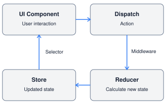

# Redux Toolkit та RTK Query

## 4.1. Коли варто використовувати локальний state, Context API або Redux?

<a id="q-4-1"></a>

### Пояснення

#### Interview answer (EN)

I keep state local by default and lift it only as far as it's needed. Context is a way to pass rarely changing values, like the theme, the locale or the current user, through the tree; it isn't a state manager with selectors. Redux Toolkit pays off for complex client state that distant parts of the app share, while server data belongs in a cache like RTK Query rather than in hand-written slices.

| Інструмент | Коли використовувати |
| --- | --- |
| `useState` | Локальний стан компонента |
| `useReducer` | Складніша локальна логіка з кількома пов'язаними полями |
| URL (search params) | Фільтри, сторінка, сортування — стан, яким можна поділитися посиланням |
| Context API | Рідко змінювані спільні дані та залежності в дереві компонентів |
| Redux Toolkit | Складний глобальний client state, який змінюють різні частини застосунку |
| RTK Query | Server state: API-запити, кешування, інвалідація |

Наприклад, відкриття модального вікна можна зберігати в локальному state, тему застосунку — у Context, кошик або багатокроковий wizard — у Redux, а список продуктів із сервера — у RTK Query.

Context сам по собі не вирішує продуктивність: при зміні значення ререндеряться всі його споживачі. Redux дає selectors, DevTools, middleware та передбачуваний потік даних, але додає структуру й код.

Не потрібно зберігати всі дані в Redux лише тому, що він уже використовується у проєкті.

#### Можливі уточнення

- **Чому не тримати все в Context?** — Немає selectors: кожна зміна value ререндерить усіх споживачів; немає DevTools і middleware.
- **Чи можна поєднувати RTK Query з TanStack Query чи Context?** — Технічно так, але для server state краще один інструмент, щоб не дублювати кеш.

#### Пов’язані питання

- [Чому зміна Context ререндерить усіх споживачів і як цього уникнути?](../03-react/README.md#q-3-27)
- [Коли використовувати `useReducer` замість `useState`?](../03-react/README.md#q-3-28)
- [Чим відрізняється server state від client state?](#q-4-13)

#### Документація

- [Redux — FAQ: General (When should I use Redux?)](https://redux.js.org/faq/general)

## 4.2. Як працює односпрямований потік даних у Redux?

<a id="q-4-2"></a>

### Пояснення

#### Interview answer (EN)

Redux has a one-way data flow. The UI dispatches an action, a plain object describing what happened; middleware can intercept it for side effects, and the reducers calculate the next state from the current state and that action. The store then notifies its subscribers, and each component re-renders only if the value returned by its selector has changed, which makes every state change traceable in DevTools.

```flow
UI | Користувач клікає, компонент викликає dispatch(todoAdded(text))
Middleware | Thunk, listener, RTK Query або logger можуть обробити action
Reducer | Обчислює новий state з поточного state та action
Store | Зберігає новий state і повідомляє підписників
UI | useSelector порівнює новий результат selector зі старим і за потреби ререндерить компонент
```

Action — plain object з полем `type` і зазвичай `payload`: `{ type: "todos/todoAdded", payload: "Buy milk" }`. У Redux Toolkit action creators генерує `createSlice`.

Store один на застосунок, змінити state можна лише через `dispatch`. Це робить зміни стану передбачуваними: кожну зміну видно в Redux DevTools разом з action, що її спричинив.



#### Пов’язані питання

- [Що таке middleware?](#q-4-5)
- [Як уникнути зайвих ререндерів при використанні `useSelector`?](#q-4-12)

#### Документація

- [Redux — Fundamentals, Part 2: Concepts and Data Flow](https://redux.js.org/tutorials/fundamentals/part-2-concepts-data-flow)

## 4.3. Що таке reducer і чому він має бути чистою функцією?

<a id="q-4-3"></a>

### Пояснення

#### Interview answer (EN)

A reducer takes the current state and an action and returns the next state, without side effects and without mutating its inputs. Being pure means the same inputs always give the same output, so there are no API calls, random values or reads of the current time inside it. That purity is what makes reducers easy to test and lets Redux DevTools replay and time-travel through state changes.

Reducer — функція, яка отримує попередній state та action і повертає новий state.

```typescript
function reducer(state: CounterState, action: CounterAction): CounterState {
  switch (action.type) {
    case "increment":
      return {
        ...state,
        count: state.count + 1
      };

    default:
      return state;
  }
}
```

Чиста функція повинна бути передбачуваною: однакові вхідні дані дають однаковий результат. Reducer не повинен:

- виконувати API-запити та інші side effects;
- змінювати зовнішні змінні або сам `state` без Immer;
- генерувати випадкові значення (`Math.random()`, `nanoid()`) чи читати `Date.now()`.

Якщо action потребує id або часу, їх створюють до reducer — у `prepare` callback:

```typescript
const todosSlice = createSlice({
  name: "todos",
  initialState: [] as Todo[],
  reducers: {
    todoAdded: {
      reducer(state, action: PayloadAction<Todo>) {
        state.push(action.payload);
      },
      prepare(title: string) {
        return {
          payload: { id: nanoid(), title, createdAt: new Date().toISOString() },
        };
      },
    },
  },
});
```

Дату зберігаємо як рядок: Redux state має бути серіалізованим, і RTK у development попереджає про `Date`, `Map`, класи та функції в state.

Чистота важлива для тестування, Redux DevTools та відтворення змін стану.

#### Пов’язані питання

- [Як працює Immer у Redux Toolkit?](#q-4-4)
- [Коли використовувати `useReducer` замість `useState`?](../03-react/README.md#q-3-28)
- [Що таке іммутабельність і навіщо вона потрібна?](../01-javascript/README.md#q-1-16)

#### Документація

- [Redux — Fundamentals, Part 3: State, Actions, and Reducers](https://redux.js.org/tutorials/fundamentals/part-3-state-actions-reducers)
- [Redux Toolkit — createSlice](https://redux.js.org/toolkit/api/createSlice)

## 4.4. Як працює Immer у Redux Toolkit?

<a id="q-4-4"></a>

### Пояснення

#### Interview answer (EN)

createSlice and createReducer run case reducers through Immer, which passes in a draft wrapped in a Proxy. You write what looks like mutation, and Immer records the changes and produces a new immutable state, reusing references for everything you didn't touch. In a single reducer you should either mutate the draft or return a new value, but never both, and since drafts are proxies, you log them with current().

Immer дозволяє писати код, який виглядає як мутація, але фактично створює immutable updates.

```typescript
const counterSlice = createSlice({
  name: "counter",
  initialState: { count: 0 },
  reducers: {
    increment(state) {
      state.count++;
    }
  }
});
```

Immer створює draft за допомогою Proxy, відстежує зміни та формує новий state, зберігаючи посилання на незмінені частини (structural sharing).

Правило: або мутувати draft, або повернути нове значення — але не обидва в одному reducer.

```typescript
import { current, type PayloadAction } from "@reduxjs/toolkit";

reducers: {
  todoAdded(state, action: PayloadAction<Todo>) {
    state.push(action.payload); // ✅ мутація draft
  },
  todosCleared() {
    return []; // ✅ повернення нового значення
  },
  todoToggled(state, action: PayloadAction<string>) {
    const todo = state.find(t => t.id === action.payload);
    if (todo) todo.done = !todo.done;
    console.log(current(state)); // звичайний об'єкт замість Proxy
  },
}
```

Неправильно:

```typescript
todoAdded(state, action) {
  state.push(action.payload);
  return [...state]; // ❌ і мутація, і return — Immer кине помилку
},
reset(state) {
  state = initialState; // ❌ лише перепризначає локальну змінну
},
```

Для `reset` треба `return initialState`. Ще одна пастка — стрілкова функція без фігурних дужок: `state => state.value = 0` повертає результат присвоєння, тому Immer бачить і мутацію, і return.

Важливо: це не означає, що можна мутувати Redux state поза reducers, які обробляються Immer. RTK заморожує state, а в development додатково перевіряє мутації між dispatch.

#### Пов’язані питання

- [Що таке reducer і чому він має бути чистою функцією?](#q-4-3)
- [Що таке shallow copy та deep copy?](../01-javascript/README.md#q-1-9)

#### Документація

- [Redux Toolkit — Writing Reducers with Immer](https://redux.js.org/toolkit/usage/immer-reducers)

## 4.5. Що таке middleware?

<a id="q-4-5"></a>

### Пояснення

#### Interview answer (EN)

Middleware wraps the store's dispatch, so every action passes through a chain of functions before it reaches the reducers. Each one can log the action, transform it, stop it, dispatch other actions or start async work, and that's how thunks, the RTK Query middleware and the listener middleware all plug in. In Redux Toolkit you rarely write one by hand; you extend getDefaultMiddleware in configureStore instead.

Middleware — проміжний шар між `dispatch` та reducer.

Він може перехоплювати actions, логувати їх, виконувати асинхронні операції або відправляти додаткові actions.

```typescript
import type { Middleware } from "@reduxjs/toolkit";

const logger: Middleware = store => next => action => {
  console.log("Action:", action);

  const result = next(action);

  console.log("State:", store.getState());

  return result;
};
```

`next(action)` передає action далі по ланцюжку. Якщо його не викликати, action не дійде до reducers.

Підключення в Redux Toolkit:

```typescript
export const store = configureStore({
  reducer: {
    todos: todosReducer,
    [api.reducerPath]: api.reducer,
  },
  middleware: getDefaultMiddleware =>
    getDefaultMiddleware().concat(api.middleware, logger),
});
```

`getDefaultMiddleware()` уже містить thunk, а в development — перевірки мутацій state та серіалізованості actions і state. У RTK 2 поле `middleware` приймає лише callback, а не масив.

Приклади: Redux Thunk, RTK Query middleware, listener middleware, logging middleware.

#### Пов’язані питання

- [Коли використовувати listener middleware, thunks або sagas?](#q-4-17)

#### Документація

- [Redux — Middleware](https://redux.js.org/understanding/history-and-design/middleware)
- [Redux Toolkit — getDefaultMiddleware](https://redux.js.org/toolkit/api/getDefaultMiddleware)

## 4.6. У чому різниця між `createAsyncThunk` та RTK Query?

<a id="q-4-6"></a>

### Пояснення

#### Interview answer (EN)

createAsyncThunk wraps a single async function and dispatches pending, fulfilled and rejected actions, but caching, deduplication and refetching are up to you in extraReducers. RTK Query is a complete data fetching and caching layer: you describe endpoints and get generated hooks, request deduplication, loading and error flags, tag-based invalidation and cache lifetimes out of the box. So I use RTK Query for server data and thunks for workflows that aren't just fetching.

| Можливість | createAsyncThunk | RTK Query |
| --- | --- | --- |
| Асинхронні операції | Так | Так |
| Кешування API | Вручну | Автоматично |
| Loading та error states | Потрібно обробляти в `extraReducers` | Вбудовані (`isLoading`, `isFetching`, `error`) |
| Deduplication | Вручну, через опцію `condition` | Вбудована для однакових queries |
| Cache invalidation | Вручну | Tags |
| React hooks | Вручну | Генеруються |
| Refetching | Вручну | Вбудований |

```typescript
export const fetchUser = createAsyncThunk(
  "users/fetchById",
  async (id: string, { signal }) => {
    const response = await fetch(`/api/users/${id}`, { signal });
    if (!response.ok) throw new Error(`HTTP ${response.status}`);
    return (await response.json()) as User;
  }
);

// у createSlice
extraReducers: builder => {
  builder
    .addCase(fetchUser.pending, state => {
      state.status = "loading";
    })
    .addCase(fetchUser.fulfilled, (state, action) => {
      state.status = "succeeded";
      state.user = action.payload;
    })
    .addCase(fetchUser.rejected, (state, action) => {
      state.status = "failed";
      state.error = action.error.message ?? null;
    });
};
```

`dispatch(fetchUser(id))` повертає Promise з методом `.unwrap()`: він поверне payload або кине помилку. Для типізованої помилки використовують `rejectWithValue`.

Офіційна рекомендація Redux: RTK Query — підхід за замовчуванням для data fetching; `createAsyncThunk` — якщо RTK Query не підходить, а також для складних бізнес-процесів, які не є простим отриманням server state.

#### Пов’язані питання

- [Як працює кешування в RTK Query?](#q-4-7)
- [Як працюють `providesTags` та `invalidatesTags`?](#q-4-8)
- [Коли використовувати listener middleware, thunks або sagas?](#q-4-17)

#### Документація

- [Redux Toolkit — createAsyncThunk](https://redux.js.org/toolkit/api/createAsyncThunk)
- [Redux Toolkit — RTK Query Overview](https://redux.js.org/toolkit/rtk-query/overview)

## 4.7. Як працює кешування в RTK Query?

<a id="q-4-7"></a>

### Пояснення

#### Interview answer (EN)

RTK Query stores each result under a cache key built from the endpoint name and the serialized arguments, and every component using the hook becomes a subscriber of that entry. While at least one subscriber exists, the data stays; after the last one unmounts, it's kept for keepUnusedDataFor, 60 seconds by default, and then removed. Freshness is a separate concern: cached data is reused by default, and you opt into refetching through tags, refetchOnMountOrArgChange, polling, or focus and reconnect events.

RTK Query формує cache key на основі назви endpoint та серіалізованих аргументів.

```typescript
useGetUsersQuery({ page: 1 });
useGetUsersQuery({ page: 2 });
```

Це два окремих записи кешу. За замовчуванням ключі plain-об'єктів сортуються під час серіалізації, тому `{ page: 1, limit: 20 }` і `{ limit: 20, page: 1 }` дають один ключ.

Коли інший компонент запитує той самий endpoint із тими самими аргументами, RTK Query використовує наявний кеш і не робить новий запит.

**Час життя кешу.** RTK Query рахує активні subscriptions. Після видалення останньої підписки дані зберігаються ще 60 секунд, а потім видаляються. Цей час налаштовується через `keepUnusedDataFor` для всього API або окремого endpoint. Це налаштування пам'яті, а не «свіжості» даних.

**Коли дані перезапитуються:**

| Опція | Що робить | За замовчуванням |
| --- | --- | --- |
| Tags (`providesTags`/`invalidatesTags`) | Перезапит після мутації | — |
| `refetchOnMountOrArgChange` | Перезапит при mount або зміні аргументу: `true` або кількість секунд «віку» даних | `false` |
| `refetchOnFocus` | Перезапит, коли вкладка знову у фокусі | `false` |
| `refetchOnReconnect` | Перезапит після відновлення мережі | `false` |
| `pollingInterval` | Polling у мілісекундах | `0` (вимкнено) |

```typescript
export const api = createApi({
  baseQuery: fetchBaseQuery({ baseUrl: "/api" }),
  keepUnusedDataFor: 60,
  refetchOnFocus: true,
  refetchOnReconnect: true,
  endpoints: build => ({
    getUsers: build.query<User[], { page: number }>({
      query: ({ page }) => `/users?page=${page}`,
    }),
  }),
});

// store.ts — без цього refetchOnFocus і refetchOnReconnect не працюють
setupListeners(store.dispatch);

// у компоненті: перезапитати, якщо даним більше 30 секунд
useGetUsersQuery({ page }, { refetchOnMountOrArgChange: 30 });
```

`refetchOnFocus` і `refetchOnReconnect` потребують виклику `setupListeners(store.dispatch)`: саме він підписується на події `focus`, `visibilitychange`, `online` та `offline`.

#### Можливі уточнення

- **Чим `isLoading` відрізняється від `isFetching`?** — `isLoading` — перший запит без даних; `isFetching` — будь-який запит, включно з фоновим refetch.
- **Чи є в RTK Query `staleTime`, як у TanStack Query?** — Ні. Закешовані дані використовуються, доки їх не інвалідують або не спрацює одна з refetch-опцій.

#### Пов’язані питання

- [Як працюють `providesTags` та `invalidatesTags`?](#q-4-8)
- [Як реалізувати optimistic update та rollback?](#q-4-10)
- [Як обрати між RTK Query та TanStack Query?](#q-4-18)

#### Документація

- [Redux Toolkit — Cache Behavior](https://redux.js.org/toolkit/rtk-query/usage/cache-behavior)
- [Redux Toolkit — Request Behavior](https://redux.js.org/toolkit/rtk-query/usage/request-behavior)
- [Redux Toolkit — setupListeners](https://redux.js.org/toolkit/rtk-query/api/setupListeners)

## 4.8. Як працюють `providesTags` та `invalidatesTags`?

<a id="q-4-8"></a>

### Пояснення

#### Interview answer (EN)

A query declares which tags its cached data provides, and a mutation declares which tags it invalidates. When the mutation finishes, every cache entry with a matching tag is invalidated: entries that have active subscribers are refetched, and entries without subscribers are simply removed from the cache. Tags with IDs, plus a 'LIST' ID for collections, let one update refetch only the affected item and the lists, instead of everything of that type.

Tags дозволяють автоматично оновлювати пов'язані серверні дані після мутацій.

```typescript
getUsers: builder.query<User[], void>({
  query: () => "/users",
  providesTags: ["Users"]
}),

addUser: builder.mutation<User, NewUser>({
  query: body => ({
    url: "/users",
    method: "POST",
    body
  }),
  invalidatesTags: ["Users"]
})
```

Тип tag (`"Users"`) має бути оголошений у `tagTypes` в `createApi`.

```flow
getUsers | Запит повертає список і позначає кеш тегом Users
addUser | Мутація POST /users завершується й інвалідує тег Users
Є підписники | Активний getUsers автоматично повторно завантажує список
Немає підписників | Запис одразу видаляється з кешу без refetch
```

Тег без id (`"User"`) інвалідує всі теги цього типу, з id і без. Тег з id (`{ type: "User", id: 1 }`) інвалідує лише точний збіг.

Для точнішого оновлення використовують id сутностей і абстрактний id `"LIST"` для колекції:

```typescript
export const api = createApi({
  baseQuery: fetchBaseQuery({ baseUrl: "/api" }),
  tagTypes: ["User"],
  endpoints: build => ({
    getUsers: build.query<User[], void>({
      query: () => "/users",
      providesTags: result =>
        result
          ? [
              ...result.map(({ id }) => ({ type: "User" as const, id })),
              { type: "User", id: "LIST" },
            ]
          : [{ type: "User", id: "LIST" }],
    }),
    getUser: build.query<User, string>({
      query: id => `/users/${id}`,
      providesTags: (result, error, id) => [{ type: "User", id }],
    }),
    addUser: build.mutation<User, NewUser>({
      query: body => ({ url: "/users", method: "POST", body }),
      invalidatesTags: [{ type: "User", id: "LIST" }],
    }),
    updateUser: build.mutation<User, Pick<User, "id"> & Partial<User>>({
      query: ({ id, ...patch }) => ({ url: `/users/${id}`, method: "PATCH", body: patch }),
      invalidatesTags: (result, error, { id }) => (error ? [] : [{ type: "User", id }]),
    }),
  }),
});
```

- `addUser` перезапитає лише списки, а не кожен `getUser`.
- `updateUser` перезапитає `getUser(id)` і списки, які містять цього користувача.
- Мутація інвалідує теги навіть тоді, коли завершилася помилкою, тому callback повертає `[]` для `error`.

За замовчуванням (`invalidationBehavior: "delayed"`) RTK Query застосовує інвалідації, коли в API не виконується жоден запит, щоб не перезапитувати дані двічі. Інвалідувати теги вручну можна через `dispatch(api.util.invalidateTags([...]))`.

#### Можливі уточнення

- **Чому після мутації не оновився список?** — Тип тегу відсутній у `tagTypes`, query не надає відповідний тег, або мутація інвалідує тег з id, а список надає лише тег без id.
- **Що станеться з кешем, на який ніхто не підписаний?** — Після інвалідації його буде видалено, а наступна підписка зробить новий запит.

#### Пов’язані питання

- [Як працює кешування в RTK Query?](#q-4-7)
- [Як реалізувати optimistic update та rollback?](#q-4-10)

#### Документація

- [Redux Toolkit — Automated Re-fetching](https://redux.js.org/toolkit/rtk-query/usage/automated-refetching)
- [Redux Toolkit — Request Behavior](https://redux.js.org/toolkit/rtk-query/usage/request-behavior)

## 4.9. Що станеться, якщо два компоненти викличуть один query з однаковими параметрами?

<a id="q-4-9"></a>

### Пояснення

#### Interview answer (EN)

Both components subscribe to the same cache entry, because the endpoint and arguments produce the same cache key. If the request is already in flight, RTK Query doesn't start a second one, and if the data is already cached, the second component gets it immediately. Each component is still a separate subscriber, so the entry stays alive until both unmount, and a refetch triggered by either one updates both.

RTK Query використовуватиме спільний cache entry.

```typescript
// Component A
useGetUserQuery(42);

// Component B
useGetUserQuery(42);
```

Якщо запит уже виконується, RTK Query не створюватиме другий ідентичний запит. Якщо дані закешовані, компоненти отримують їх із кешу.

При цьому існують дві окремі subscriptions на один cache entry:

- кеш живе, доки є хоча б одна підписка (плюс `keepUnusedDataFor`);
- `refetch()` з будь-якого компонента оновлює дані для обох;
- якщо обидва компоненти задали `pollingInterval`, використовується найменший;
- кожен компонент може взяти лише потрібну частину даних через `selectFromResult`, щоб не ререндеритися через зміну інших полів.

#### Пов’язані питання

- [Як працює кешування в RTK Query?](#q-4-7)

#### Документація

- [Redux Toolkit — Cache Behavior](https://redux.js.org/toolkit/rtk-query/usage/cache-behavior)

## 4.10. Як реалізувати optimistic update та rollback?

<a id="q-4-10"></a>

### Пояснення

#### Interview answer (EN)

In onQueryStarted I patch the cached data with updateQueryData before the server responds, so the UI updates instantly, and I keep the returned patch result. If queryFulfilled rejects, I call patchResult.undo(), or invalidate the related tags to refetch the truth when overlapping mutations make undo unreliable. When instant feedback isn't critical, a pessimistic update is simpler: wait for the response, then write the server's data into the cache.

Optimistic update — зміна UI ще до отримання підтвердження від сервера.

```typescript
updatePost: build.mutation<Post, Pick<Post, "id"> & Partial<Post>>({
  query: ({ id, ...patch }) => ({ url: `/posts/${id}`, method: "PATCH", body: patch }),
  async onQueryStarted({ id, ...patch }, { dispatch, queryFulfilled }) {
    const patchResult = dispatch(
      api.util.updateQueryData("getPost", id, draft => {
        Object.assign(draft, patch);
      })
    );

    try {
      await queryFulfilled;
    } catch {
      patchResult.undo();
      // або, якщо undo ненадійний:
      // dispatch(api.util.invalidateTags([{ type: "Post", id }]));
    }
  },
}),
```

Якщо API-запит успішний, зміни залишаються. Якщо виникла помилка, виконується rollback.

`updateQueryData` змінює лише наявний запис кешу для конкретних аргументів. Якщо той самий пост відображається ще й у `getPosts`, цей запис треба оновити окремо.

При декількох одночасних мутаціях одного об'єкта `undo()` може відкотити не той стан. У таких випадках надійніше інвалідувати теги й отримати актуальні дані.

**Pessimistic update** — оновити кеш після відповіді сервера, без зайвого refetch:

```typescript
async onQueryStarted({ id }, { dispatch, queryFulfilled }) {
  try {
    const { data: updatedPost } = await queryFulfilled;
    dispatch(
      api.util.updateQueryData("getPost", id, draft => {
        Object.assign(draft, updatedPost);
      })
    );
  } catch {
    // помилку показує компонент через результат мутації
  }
},
```

Для створення нового запису кешу (наприклад, `getPost(newId)` після POST) використовують `api.util.upsertQueryData`.

#### Пов’язані питання

- [Як працюють `providesTags` та `invalidatesTags`?](#q-4-8)
- [Що нового в React 19?](../03-react/README.md#q-3-25)

#### Документація

- [Redux Toolkit — Manual Cache Updates](https://redux.js.org/toolkit/rtk-query/usage/manual-cache-updates)
- [Redux Toolkit — API Slices: Utilities](https://redux.js.org/toolkit/rtk-query/api/created-api/api-slice-utils)

## 4.11. Що таке selectors та навіщо потрібен `createSelector`?

<a id="q-4-11"></a>

### Пояснення

#### Interview answer (EN)

A selector is a function that reads or derives a piece of data from the Redux state, so components don't depend on the exact state shape. Plain selectors that return existing references need no memoization, but derived data like a filtered array would be a new reference on every call, and that's where createSelector helps. It recomputes only when its input selectors return new values, and since Reselect 5 it caches results per argument using weakMapMemoize.

Selector — функція, яка отримує дані з Redux state.

```typescript
const selectUsers = (state: RootState) => state.users.items;
```

`createSelector` дозволяє створювати мемоізовані похідні значення.

```typescript
const selectActiveUsers = createSelector(
  [selectUsers],
  users => users.filter(user => user.active)
);
```

Поки вхідні значення не змінюються, selector повертає попередній результат без повторного обчислення. Без мемоізації `filter` створював би новий масив після кожного action, і `useSelector` ререндерив би компонент.

Selector з аргументом:

```typescript
const selectTodosByStatus = createSelector(
  [selectTodos, (_state: RootState, status: TodoStatus) => status],
  (todos, status) => todos.filter(todo => todo.status === status)
);

const doneTodos = useSelector((state: RootState) => selectTodosByStatus(state, "done"));
```

Правила:

- Input selectors лише витягують дані; трансформація — в output selector.
- Не потрібно мемоізувати прості selectors на кшталт `state => state.user.name`.
- `createSelector` у Reselect 5 (входить у RTK 2) за замовчуванням використовує `weakMapMemoize`: кеш не обмежений одним останнім викликом, тому один selector можна використовувати в багатьох компонентах з різними аргументами.
- У development Reselect попереджає, якщо input selector повертає нове посилання при тих самих аргументах.

#### Пов’язані питання

- [Як уникнути зайвих ререндерів при використанні `useSelector`?](#q-4-12)

#### Документація

- [Redux — Deriving Data with Selectors](https://redux.js.org/usage/deriving-data-selectors)
- [Reselect — createSelector](https://redux.js.org/reselect/api/createselector)

## 4.12. Як уникнути зайвих ререндерів при використанні `useSelector`?

<a id="q-4-12"></a>

### Пояснення

#### Interview answer (EN)

useSelector re-runs its selector after every dispatched action and re-renders the component only when the result differs from the previous one by strict reference equality. So the main rule is to select the smallest value you need and never return a new object or array from an unmemoized selector. React Redux helps in development: it runs the selector twice on the first call and warns if the result isn't stable, and it also warns when a selector returns the whole state.

`useSelector` за замовчуванням порівнює попередній та новий результат через строгу рівність `===`.

Проблемний приклад:

```typescript
const data = useSelector((state: RootState) => ({
  name: state.user.name,
  age: state.user.age
}));
```

Тут щоразу створюється новий об'єкт, тому компонент ререндериться після кожного action.

Варіанти вирішення:

```typescript
const name = useSelector((state: RootState) => state.user.name);
const age = useSelector((state: RootState) => state.user.age);
```

Або:

```typescript
import { shallowEqual, useSelector } from "react-redux";

const data = useSelector(selectUserData, shallowEqual);
```

Також можна використати мемоізований `createSelector`, а в RTK Query — `selectFromResult`.

**Development-перевірки React Redux** (з'явилися у v8.1, увімкнені й у v9):

- `stabilityCheck` — під час першого виклику selector запускається двічі з тим самим state. Якщо результати різні, у консолі з'являється попередження.
- `identityFunctionCheck` — попередження, якщо selector повертає весь root state (`state => state`).

```typescript
<Provider store={store} stabilityCheck="always">
  <App />
</Provider>

const user = useSelector(selectUser, {
  devModeChecks: { stabilityCheck: "never" },
});
```

Значення: `"once"` (за замовчуванням), `"always"`, `"never"`. У production ці перевірки не виконуються.

#### Пов’язані питання

- [Що таке selectors та навіщо потрібен `createSelector`?](#q-4-11)
- [Чому зміна Context ререндерить усіх споживачів і як цього уникнути?](../03-react/README.md#q-3-27)

#### Документація

- [React Redux — Hooks](https://redux.js.org/react-redux/api/hooks)

## 4.13. Чим відрізняється server state від client state?

<a id="q-4-13"></a>

### Пояснення

#### Interview answer (EN)

Client state is owned by the browser, like an open modal, the selected tab or unsaved form input, and it's always up to date by definition. Server state is a cached snapshot of data the backend owns, so it can go stale, be changed by other users, and it needs loading states, caching, deduplication and refetching. Treating it as a cache with a dedicated tool like RTK Query or TanStack Query removes most hand-written Redux code for API data.

| Client state | Server state |
| --- | --- |
| Належить клієнту | Зберігається на сервері, клієнт має лише копію |
| Відкриття модального вікна | Список продуктів |
| Тема UI | Дані користувача |
| Обраний tab | Результати API |
| Незбережені дані форми | Список замовлень |

Server state може застарівати, змінюватися іншими користувачами та потребує кешування, refetching і синхронізації.

RTK Query або TanStack Query краще вирішують ці задачі, ніж звичайне ручне зберігання API responses у глобальному state.

Окремий вид — URL state: фільтри, сторінка, сортування в search params. Ним можна поділитися посиланням, і він переживає перезавантаження.

Антипатерн — копіювати дані з RTK Query у slice «для зручності»: з'являються два джерела правди, які розходяться після refetch.

#### Пов’язані питання

- [Коли варто використовувати локальний state, Context API або Redux?](#q-4-1)
- [Як обрати між RTK Query та TanStack Query?](#q-4-18)

#### Документація

- [Redux Toolkit — RTK Query Overview](https://redux.js.org/toolkit/rtk-query/overview)

## 4.14. Як реалізувати пагінацію та infinite scrolling?

<a id="q-4-14"></a>

### Пояснення

#### Interview answer (EN)

For classic pagination I put the page or cursor into the query argument, so each page gets its own cache entry, and while the next page loads, the hook still returns the previous data, which avoids flicker. For infinite scrolling, RTK 2.6 added build.infiniteQuery: it keeps all pages in one cache entry and calculates the next page param with getNextPageParam. An IntersectionObserver near the end of the list then calls fetchNextPage.

**Звичайна пагінація** — передаємо номер сторінки в query:

```typescript
const [page, setPage] = useState(1);

const { data, currentData, isFetching } = useGetUsersQuery({
  page,
  limit: 20
});
```

Поки завантажується нова сторінка, `data` містить попередній результат, а `currentData` — `undefined`. Можна показувати старі дані напівпрозорими, доки `isFetching` дорівнює `true`.

**Infinite scrolling** — з RTK 2.6 є `build.infiniteQuery`. Усі сторінки зберігаються в одному cache entry як `{ pages, pageParams }`:

```typescript
type FeedPage = { items: Post[]; totalPages: number };

const api = createApi({
  baseQuery: fetchBaseQuery({ baseUrl: "/api" }),
  endpoints: build => ({
    // generics: дані сторінки, query arg, page param
    getFeed: build.infiniteQuery<FeedPage, string, number>({
      infiniteQueryOptions: {
        initialPageParam: 1,
        getNextPageParam: (lastPage, _allPages, lastPageParam) =>
          lastPageParam < lastPage.totalPages ? lastPageParam + 1 : undefined,
      },
      query: ({ queryArg, pageParam }) => ({
        url: "/posts",
        params: { category: queryArg, page: pageParam },
      }),
    }),
  }),
});

const { data, fetchNextPage, hasNextPage, isFetchingNextPage } =
  api.useGetFeedInfiniteQuery("react");

const posts = data?.pages.flatMap(page => page.items) ?? [];
```

`getNextPageParam` повертає `undefined`, коли сторінок більше немає, — тоді `hasNextPage` стає `false`.

Момент для завантаження наступної сторінки визначає `IntersectionObserver` на елементі в кінці списку:

```typescript
const sentinelRef = useRef<HTMLDivElement>(null);

useEffect(() => {
  const node = sentinelRef.current;
  if (!node) return;

  const observer = new IntersectionObserver(([entry]) => {
    if (entry.isIntersecting && hasNextPage && !isFetchingNextPage) {
      fetchNextPage();
    }
  });

  observer.observe(node);
  return () => observer.disconnect();
}, [hasNextPage, isFetchingNextPage, fetchNextPage]);
```

Нюанси infinite queries:

- В одному cache entry одночасно виконується лише один запит, повторний `fetchNextPage()` під час завантаження ігнорується.
- `maxPages` обмежує кількість сторінок у кеші.
- Refetch (через теги, polling) за замовчуванням послідовно перезапитує всі закешовані сторінки.
- Cursor-пагінація надійніша за offset, якщо дані змінюються: менше дублікатів і пропусків.

До RTK 2.6 infinite scroll робили через один query з `serializeQueryArgs`, `merge` та `forceRefetch`. Цей підхід досі трапляється в наявних проєктах.

#### Пов’язані питання

- [Як би ти оптимізував компонент, який рендерить тисячі елементів?](../03-react/README.md#q-3-24)

#### Документація

- [Redux Toolkit — Infinite Queries](https://redux.js.org/toolkit/rtk-query/usage/infinite-queries)
- [Redux Toolkit — Pagination](https://redux.js.org/toolkit/rtk-query/usage/pagination)
- [MDN — Intersection Observer API](https://developer.mozilla.org/en-US/docs/Web/API/Intersection_Observer_API)

## 4.15. Як скасувати або пропустити непотрібний API-запит?

<a id="q-4-15"></a>

### Пояснення

#### Interview answer (EN)

To prevent a query from starting, I pass skip: true or, more conveniently with TypeScript, skipToken instead of the argument, for example while an ID is still undefined. For on-demand requests there's the lazy query hook, whose trigger returns a promise with an abort method. Skipping, unsubscribing and aborting are different things, though: unmounting a component removes its subscription, but it doesn't necessarily cancel a request that is already in flight.

Для умовного виконання використовуємо `skip`:

```typescript
useGetUserQuery(userId, {
  skip: !userId
});
```

Або `skipToken`, що зручно для типізації: аргумент не потрібно приводити до `string`:

```typescript
import { skipToken } from "@reduxjs/toolkit/query/react";

useGetUserQuery(userId ?? skipToken);
```

Для ручного запуску:

```typescript
const [trigger] = useLazyGetUsersQuery();

const request = trigger(params);

request.abort();
```

`abort()` працює через `AbortSignal`, який `fetchBaseQuery` передає у `fetch`. У власному `queryFn` signal (`api.signal` з другого аргументу) потрібно передати у запит вручну.

Важливо розрізняти:

| Дія | Що відбувається |
| --- | --- |
| `skip` / `skipToken` | Запит не стартує, hook не підписується на кеш |
| Демонтування компонента | Підписка зникає, кеш живе ще `keepUnusedDataFor`; запущений запит зазвичай завершується |
| `abort()` | Запущений запит скасовується, результат не потрапляє в кеш |

#### Пов’язані питання

- [Як працює `AbortController`?](../06-browser-network/README.md#q-6-13)

#### Документація

- [Redux Toolkit — Conditional Fetching](https://redux.js.org/toolkit/rtk-query/usage/conditional-fetching)
- [Redux Toolkit — Queries](https://redux.js.org/toolkit/rtk-query/usage/queries)

## 4.16. Що таке `createEntityAdapter` і навіщо нормалізувати state?

<a id="q-4-16"></a>

### Пояснення

#### Interview answer (EN)

createEntityAdapter gives you a standard normalized shape for collections, an ids array plus an entities lookup table, together with prebuilt reducers like addOne, upsertMany, updateOne and removeOne. Normalization means each item is stored exactly once, so lookups by ID are cheap and an update can't leave stale copies elsewhere. The adapter also generates memoized selectors such as selectAll and selectById, and it can keep the ids sorted with sortComparer.

Нормалізований state — це структура, схожа на таблицю в базі даних:

```json
{
  "ids": ["t1", "t2"],
  "entities": {
    "t1": { "id": "t1", "title": "Buy milk", "done": false },
    "t2": { "id": "t2", "title": "Write tests", "done": true }
  }
}
```

Переваги:

- пошук за id — `O(1)` замість `find` по масиву;
- кожна сутність зберігається один раз, тому немає застарілих копій;
- оновлення одного елемента не змінює посилання на інші, менше зайвих ререндерів.

```typescript
import { createEntityAdapter, createSlice, type PayloadAction } from "@reduxjs/toolkit";

type Todo = { id: string; title: string; done: boolean };
type Status = "idle" | "loading" | "failed";

const todosAdapter = createEntityAdapter<Todo>({
  sortComparer: (a, b) => a.title.localeCompare(b.title),
});

const todosSlice = createSlice({
  name: "todos",
  initialState: todosAdapter.getInitialState({ status: "idle" as Status }),
  reducers: {
    todoAdded: todosAdapter.addOne,
    todoRemoved: todosAdapter.removeOne,
    todosReceived(state, action: PayloadAction<Todo[]>) {
      todosAdapter.setAll(state, action.payload);
      state.status = "idle";
    },
    todoToggled(state, action: PayloadAction<string>) {
      const todo = state.entities[action.payload];
      if (todo) todo.done = !todo.done;
    },
  },
});

export const { selectAll: selectAllTodos, selectById: selectTodoById } =
  todosAdapter.getSelectors((state: RootState) => state.todos);
```

Основні методи: `addOne/addMany`, `setOne/setAll`, `upsertOne/upsertMany`, `updateOne` (`{ id, changes }`), `removeOne/removeMany`. Якщо id зберігається не в полі `id`, задають `selectId`.

Кеш RTK Query за замовчуванням не нормалізований: кожен endpoint зберігає власну відповідь. За потреби адаптер можна застосувати в `transformResponse`.

#### Пов’язані питання

- [Як працює Immer у Redux Toolkit?](#q-4-4)
- [Що таке selectors та навіщо потрібен `createSelector`?](#q-4-11)

#### Документація

- [Redux Toolkit — createEntityAdapter](https://redux.js.org/toolkit/api/createEntityAdapter)
- [Redux — Normalizing State Shape](https://redux.js.org/usage/structuring-reducers/normalizing-state-shape)

## 4.17. Коли використовувати listener middleware, thunks або sagas?

<a id="q-4-17"></a>

### Пояснення

#### Interview answer (EN)

Thunks are imperative: you call one to run logic that needs dispatch and getState, like a multi-step checkout. The listener middleware is reactive: it runs an effect in response to actions or state changes and supports cancellation, delays and waiting for other actions, which covers most of what sagas were used for. The Redux team recommends RTK Query for data fetching, thunks for imperative logic and listeners for reactive workflows, with sagas only if listeners aren't enough.

| | Thunk | Listener middleware | Redux-Saga |
| --- | --- | --- | --- |
| Модель | Імперативна: викликав — виконалось | Реактивна: реагує на actions або зміни state | Реактивна, на generator functions |
| Скасування, debounce, очікування action | Вручну | `cancelActiveListeners`, `delay`, `condition`, `take`, `fork` | `takeLatest`, `race`, `cancel` |
| Складність | Низька | Середня | Висока: окремий API, слабка підтримка TypeScript |
| Входить у RTK | Так | Так | Ні |

Thunk — коли логіку потрібно явно запустити з компонента:

```typescript
export function checkout() {
  return async (dispatch: AppDispatch, getState: () => RootState) => {
    const items = selectCartItems(getState());
    await dispatch(api.endpoints.createOrder.initiate(items)).unwrap();
    dispatch(cartCleared());
  };
}
```

Listener — коли треба реагувати на подію, де б вона не сталася:

```typescript
import { createListenerMiddleware } from "@reduxjs/toolkit";

export const listenerMiddleware = createListenerMiddleware();

listenerMiddleware.startListening({
  actionCreator: searchChanged,
  effect: async (action, listenerApi) => {
    listenerApi.cancelActiveListeners(); // як takeLatest
    await listenerApi.delay(300); // debounce

    listenerApi.dispatch(fetchSearchResults(action.payload));
  },
});

// store.ts
middleware: getDefaultMiddleware =>
  getDefaultMiddleware().prepend(listenerMiddleware.middleware),
```

Типові задачі для listeners: синхронізація з `localStorage`, аналітика, debounce пошуку, логіка «після логіну завантаж налаштування», скасування застарілих процесів.

Рекомендації документації Redux:

- data fetching — RTK Query, далі `createAsyncThunk`; sagas для data fetching не використовувати;
- реакція на actions та довгі async-процеси — listeners;
- синхронна та помірна async-логіка з доступом до state — thunks.

#### Пов’язані питання

- [Що таке middleware?](#q-4-5)
- [У чому різниця між `createAsyncThunk` та RTK Query?](#q-4-6)

#### Документація

- [Redux — Side Effects Approaches](https://redux.js.org/usage/side-effects-approaches)
- [Redux Toolkit — createListenerMiddleware](https://redux.js.org/toolkit/api/createListenerMiddleware)

## 4.18. Як обрати між RTK Query та TanStack Query?

<a id="q-4-18"></a>

### Пояснення

#### Interview answer (EN)

Both libraries solve server state with caching, deduplication, background refetching and mutations, so the choice mostly depends on the surrounding architecture. RTK Query fits naturally when the app already uses Redux: the cache lives in the store, endpoints are defined in one place, and tag invalidation and Redux DevTools come for free. TanStack Query doesn't depend on Redux and offers finer-grained controls such as staleTime, so it's usually the better pick in a project without Redux.

| | RTK Query | TanStack Query |
| --- | --- | --- |
| Де зберігається кеш | Redux store | Власний `QueryClient` |
| Опис запитів | Централізовано в `createApi` (endpoints) | Біля використання: `queryKey` + `queryFn` у hooks |
| Інвалідація | Tags (`providesTags`/`invalidatesTags`) | За `queryKey` або його префіксом |
| «Свіжість» даних | Дані використовуються, доки їх не інвалідують; refetch-опції вмикаються явно | `staleTime` (за замовчуванням 0), refetch on window focus увімкнений, повторні спроби після помилки |
| Видалення невикористаного кешу | `keepUnusedDataFor`, 60 с | `gcTime`, 5 хв |
| Інструменти | Redux DevTools, codegen з OpenAPI | Окремі DevTools |
| Фреймворки | React hooks; ядро працює з будь-яким UI через Redux | React, Vue, Solid, Svelte, Angular |

Як обирати:

- Redux уже є і потрібен для client state — RTK Query: один store, одні DevTools, можна реагувати на запити в slices та listeners.
- Redux немає або потрібен лише для кешу API — TanStack Query легший у впровадженні.
- Тримати обидва інструменти для server state в одному проєкті — погана ідея: два кеші та два підходи до інвалідації.

На співбесіді варто показати, що ви розумієте спільні концепції (cache key, deduplication, invalidation, stale data), а не лише API однієї бібліотеки.

#### Пов’язані питання

- [Чим відрізняється server state від client state?](#q-4-13)
- [Як працює кешування в RTK Query?](#q-4-7)

#### Документація

- [Redux Toolkit — Comparison with Other Tools](https://redux.js.org/toolkit/rtk-query/comparison)
- [TanStack Query — Comparison](https://tanstack.com/query/latest/docs/framework/react/comparison)
- [TanStack Query — Important Defaults](https://tanstack.com/query/latest/docs/framework/react/guides/important-defaults)

## 4.19. Як типізувати Redux Toolkit з TypeScript?

<a id="q-4-19"></a>

### Пояснення

#### Interview answer (EN)

With Redux Toolkit, I let TypeScript infer types from the store instead of writing them by hand: RootState comes from store.getState and AppDispatch from store.dispatch, so thunk and middleware types are included automatically. Then I create pre-typed hooks once with useSelector.withTypes and useDispatch.withTypes, available since React Redux 9.1, and use them everywhere. Slices type their actions through PayloadAction, and createAsyncThunk.withTypes does the same for thunks.

```typescript
// store.ts
export const store = configureStore({
  reducer: {
    todos: todosReducer,
    [api.reducerPath]: api.reducer,
  },
  middleware: getDefaultMiddleware =>
    getDefaultMiddleware().concat(api.middleware),
});

export type AppStore = typeof store;
export type RootState = ReturnType<AppStore["getState"]>;
export type AppDispatch = AppStore["dispatch"];
```

```typescript
// hooks.ts
import { useDispatch, useSelector, useStore } from "react-redux";
import type { AppDispatch, AppStore, RootState } from "./store";

export const useAppDispatch = useDispatch.withTypes<AppDispatch>();
export const useAppSelector = useSelector.withTypes<RootState>();
export const useAppStore = useStore.withTypes<AppStore>();
```

```typescript
// slice
type TodosState = { items: Todo[]; filter: "all" | "done" };

const initialState: TodosState = { items: [], filter: "all" };

const todosSlice = createSlice({
  name: "todos",
  initialState,
  reducers: {
    filterChanged(state, action: PayloadAction<TodosState["filter"]>) {
      state.filter = action.payload;
    },
  },
});
```

```typescript
// thunk з типами state, dispatch та помилки
export const createAppAsyncThunk = createAsyncThunk.withTypes<{
  state: RootState;
  dispatch: AppDispatch;
  rejectValue: string;
}>();
```

Чому не звичайні `useDispatch`/`useSelector`:

- стандартний тип `Dispatch` не знає про thunks, тому `dispatch(fetchUser())` дасть помилку типів;
- без типізованого `useSelector` доведеться щоразу писати `(state: RootState) => ...`.

У slice-файлах `RootState` імпортують як `import type`, щоб не створювати циклічних runtime-імпортів. Для тестів і SSR часто створюють функцію `makeStore()` і виводять `AppStore = ReturnType<typeof makeStore>`. До React Redux 9.1 typed hooks писали вручну: `export const useAppSelector: TypedUseSelectorHook<RootState> = useSelector`.

#### Пов’язані питання

- [Що таке generics? Наведи практичний приклад.](../02-typescript/README.md#q-2-3)
- [Як працюють `keyof` та `typeof` у TypeScript?](../02-typescript/README.md#q-2-10)

#### Документація

- [Redux — Usage With TypeScript](https://redux.js.org/usage/usage-with-typescript)
- [Redux Toolkit — Usage With TypeScript](https://redux.js.org/toolkit/usage/usage-with-typescript)
