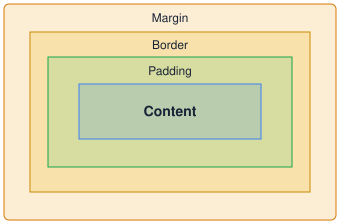
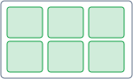
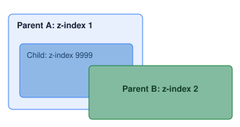

# HTML та CSS

## 5.1. Що таке семантичний HTML?

<a id="q-5-1"></a>

### Пояснення

#### Interview answer (EN)

Semantic HTML means choosing elements for their meaning rather than their look: a button for actions, a link for navigation, headings for structure and landmarks like main and nav. Browsers build the accessibility tree from these elements, so screen reader users get roles, names and keyboard behavior for free. It also makes the code easier to read and gives search engines a clearer structure, which is why I reach for ARIA only when no native element fits.

Семантичний HTML — це використання елементів відповідно до їхнього призначення, а не вигляду.

```html
<header>
  <nav>Navigation</nav>
</header>

<main>
  <article>Content</article>
</main>

<footer>Footer</footer>
```

Замість `div` для всього краще застосовувати `button`, `a`, `nav`, `article`, `section`, `main`, `h1`–`h6`, `ul`, `table` та інші відповідні елементи. `div` і `span` не мають семантики — це лише контейнери для стилів.

Найчастіша помилка — клікабельний `div` замість кнопки:

```html
<!-- Неправильно: немає ролі, focus і реакції на Enter/Space -->
<div class="btn" onclick="save()">Save</div>

<!-- Правильно: роль, focus і клавіатура працюють з коробки -->
<button type="button" onclick="save()">Save</button>
```

Семантика покращує accessibility (браузер будує з неї accessibility tree), зрозумілість коду, роботу assistive technologies, а також може допомогти SEO. Тести з `getByRole` у React Testing Library теж спираються на неї.

#### Можливі уточнення

- **Коли використовувати `<a>`, а коли `<button>`?** — `<a href>` для навігації (змінює URL, відкривається в новій вкладці), `<button>` для дії на сторінці (зберегти, відкрити модалку).
- **Чим `section` відрізняється від `article` і `div`?** — `article` — самодостатній блок (пост, картка товару), `section` — тематичний розділ, зазвичай із заголовком, `div` — без семантики.
- **Навіщо правильна ієрархія заголовків?** — користувачі screen readers навігують сторінкою за заголовками, тому рівні не варто пропускати заради розміру шрифту.

#### Пов’язані питання

- [Що таке accessibility та ARIA-атрибути?](#q-5-10)
- [Чим відрізняються `getBy`, `findBy` та `queryBy` у React Testing Library?](../07-testing/README.md#q-7-6)

#### Документація

- [MDN — Semantics](https://developer.mozilla.org/en-US/docs/Glossary/Semantics)
- [MDN — HTML: A good basis for accessibility](https://developer.mozilla.org/en-US/docs/Learn_web_development/Core/Accessibility/HTML)

## 5.2. Як працює CSS specificity?

<a id="q-5-2"></a>

### Пояснення

#### Interview answer (EN)

Specificity is a weight the cascade uses to choose between competing declarations, but only after origin, importance, inline styles and cascade layers have been compared. It's a three-part value: IDs, then classes, attributes and pseudo-classes, then type selectors and pseudo-elements, compared column by column, so one ID beats any number of classes. In practice I keep specificity low and flat, and :where() or @layer help keep overrides predictable.

Specificity — це вага селектора у форматі `A-B-C`:

- **A** — ID-селектори (`#header`);
- **B** — класи, атрибутні селектори та псевдокласи (`.button`, `[type="text"]`, `:hover`, `:nth-child()`);
- **C** — селектори типу та псевдоелементи (`button`, `::before`).

Універсальний селектор `*` і комбінатори (пробіл, `>`, `+`, `~`) нічого не додають.

| Селектор | Specificity |
| --- | --- |
| `*` | `0-0-0` |
| `li` | `0-0-1` |
| `ul li::before` | `0-0-3` |
| `.button` | `0-1-0` |
| `.button:hover` | `0-2-0` |
| `input[type="text"]` | `0-1-1` |
| `#header .nav a` | `1-1-1` |
| `:where(#header) a` | `0-0-1` |
| `:is(#header, .nav) a` | `1-0-1` |
| `.list :not(.active)` | `0-2-0` |

Значення порівнюються поколонково, а не як число: спершу A, за рівності — B, потім C. Тому `1-0-0` перемагає `0-15-0` — класи ніколи не «переповнюються» в ID.

Функціональні псевдокласи:

- `:is()`, `:not()` і `:has()` самі нічого не додають, але отримують specificity **найспецифічнішого** аргументу. `:is(#header, .nav)` має вагу ID, навіть якщо елемент збігся лише з `.nav`.
- `:where()` завжди має specificity `0-0-0`. Це зручно для reset і базових стилів бібліотек, які легко перевизначити.

Specificity — лише один із кроків каскаду. Спрощений порядок, за яким браузер обирає значення:

1. **Origin та importance** — стилі браузера, користувача й автора; `!important` створює окремий, вищий рівень.
2. **Inline styles** (`style="..."`) — перемагають будь-який селектор зі звичайних таблиць стилів, але програють `!important` з таблиці стилів.
3. **Cascade layers** (`@layer`) — правило з пізніше оголошеного шару перемагає незалежно від specificity; стилі поза шарами перемагають усі шари. Для `!important` порядок шарів зворотний.
4. **Specificity**.
5. **Порядок появи** — за інших рівних перемагає правило, оголошене пізніше.

```css
@layer reset, components, utilities;

@layer components {
  #app .button { color: blue; } /* 1-1-0, але шар components */
}

@layer utilities {
  .text-red { color: red; } /* 0-1-0, перемагає: шар utilities оголошено пізніше */
}
```

Inline styles і `!important` не є частиною specificity — це окремі рівні каскаду. Тому `!important` варто залишати для крайніх випадків, а конфлікти зі сторонніми стилями розв’язувати через шари.

```demo
specificity
```

#### Можливі уточнення

- **Як перевизначити стилі сторонньої бібліотеки без `!important`?** — підключити бібліотеку в нижчий `@layer` або мінімально підвищити specificity власного селектора.
- **Яка specificity у `:is(.a, #b)`?** — `1-0-0`: береться найспецифічніший аргумент, навіть якщо елемент збігся з `.a`.
- **Чи впливає на specificity те, наскільки близько в DOM розташований предок?** — ні, `.card p` і `.page p` мають однакову вагу `0-1-1`, перемагає пізніше правило.

#### Пов’язані питання

- [Які можливості сучасного CSS варто знати: `:has()`, nesting, cascade layers, custom properties?](#q-5-16)

#### Документація

- [MDN — Specificity](https://developer.mozilla.org/en-US/docs/Web/CSS/Guides/Cascade/Specificity)
- [MDN — @layer](https://developer.mozilla.org/en-US/docs/Web/CSS/Reference/At-rules/@layer)
- [W3C — CSS Cascading and Inheritance Level 5](https://www.w3.org/TR/css-cascade-5/)

## 5.3. Що таке CSS Box Model?

<a id="q-5-3"></a>

### Пояснення

#### Interview answer (EN)

Every element is rendered as a rectangular box made of content, padding, border and margin, from the inside out. Padding and border belong to the element itself, so the background extends under them, while margin is transparent space outside the box. Adjacent vertical margins in normal flow can collapse into one, which often surprises people, and the box-sizing property decides whether width covers only the content or also padding and border.

Кожен елемент — прямокутник із чотирьох шарів:

- **Content** — вміст елемента;
- **Padding** — внутрішній відступ, на нього поширюється background;
- **Border** — рамка;
- **Margin** — зовнішній прозорий відступ до сусідніх елементів.



Нюанси, про які часто питають:

- **Margin collapsing** — вертикальні margins сусідніх блоків у звичайному потоці зливаються в один (береться більший). Margin дочірнього елемента може «вийти» за межі батька. У flex- і grid-контейнерах такого немає.
- `outline` і `box-shadow` не займають місця в layout.
- Для inline-елементів (`span`, `a`) вертикальні margins не впливають на layout, а вертикальний padding малюється, але не розсуває рядки.

#### Можливі уточнення

- **Як позбутися margin collapsing між батьком і дитиною?** — додати батькові padding або border, зробити його `display: flow-root` чи flex/grid-контейнером.

#### Пов’язані питання

- [Чим відрізняються `content-box` та `border-box`?](#q-5-4)

#### Документація

- [MDN — The box model](https://developer.mozilla.org/en-US/docs/Learn_web_development/Core/Styling_basics/Box_model)
- [MDN — Mastering margin collapsing](https://developer.mozilla.org/en-US/docs/Web/CSS/Guides/Box_model/Margin_collapsing)

## 5.4. Чим відрізняються `content-box` та `border-box`?

<a id="q-5-4"></a>

### Пояснення

#### Interview answer (EN)

With content-box, which is the default, width and height apply only to the content area, so padding and border are added on top and the element ends up wider than declared. With border-box, the declared width already includes padding and border, and the content area shrinks to fit. Most projects set border-box globally because it makes sizes predictable, especially when mixing percentage widths with fixed padding.

При `width: 200px`, відступі `20px` і рамці `5px` з кожного боку:

| Модель | Зовнішня ширина | Ширина вмісту |
| --- | ---: | ---: |
| `content-box` | 250 px | 200 px |
| `border-box` | 200 px | 150 px |

При `content-box` width визначає лише розмір content. Padding та border додаються зверху.

При `border-box` width уже включає padding та border. Margin не входить у ширину в жодній із моделей.

Тому часто використовують глобальний стиль:

```css
*, *::before, *::after {
  box-sizing: border-box;
}
```

```demo
box-model
```

#### Документація

- [MDN — box-sizing](https://developer.mozilla.org/en-US/docs/Web/CSS/Reference/Properties/box-sizing)

## 5.5. Коли використовувати Flexbox, а коли Grid?

<a id="q-5-5"></a>

### Пояснення

#### Interview answer (EN)

Flexbox lays items out along one axis and lets their content drive the sizing, which suits navbars, toolbars and aligning a few items. Grid defines rows and columns on the container, so it fits page layouts, dashboards and card galleries where items must line up in two dimensions. They complement each other: I often use Grid for the overall structure and Flexbox inside components, and both support gap for consistent spacing.

| | Flexbox | Grid |
| --- | --- | --- |
| Вимірність | Одна вісь — рядок або колонка (перенесення через `flex-wrap`) | Дві осі одночасно |
| Хто визначає розміри | Переважно вміст елементів | Контейнер задає сітку наперед |
| Типові задачі | Navbar, група кнопок, іконка з текстом, центрування | Layout сторінки, dashboard, галерея карток, форма з вирівняними колонками |
| Ключові властивості | `flex-direction`, `justify-content`, `align-items`, `flex: 1` | `grid-template-columns`, `grid-template-areas`, `fr`, `minmax()` |

Їх можна і часто потрібно комбінувати.




```css
.toolbar {
  display: flex;
  align-items: center;
  gap: 0.5rem;
}

.gallery {
  display: grid;
  grid-template-columns: repeat(auto-fill, minmax(200px, 1fr));
  gap: 1rem;
}
```

Що варто знати додатково:

- `gap` працює і у flex, і в grid — margins між елементами більше не потрібні.
- **Intrinsic sizing**: `min-content`, `max-content`, `fit-content()` та `minmax()` дозволяють розмірам залежати від вмісту. `repeat(auto-fill, minmax(200px, 1fr))` дає адаптивну галерею без media queries.
- **Subgrid** (`grid-template-columns: subgrid`) дозволяє вкладеній сітці використовувати треки батьківської. Наприклад, заголовки й кнопки в сусідніх картках вирівнюються в одну лінію.
- Flex-елементи за замовчуванням мають `min-width: auto` і не стискаються менше за свій вміст. Через це довгий текст ламає layout — допомагає `min-width: 0`.

#### Можливі уточнення

- **Як відцентрувати елемент по обох осях?** — `display: grid; place-items: center` або flex із `justify-content: center` та `align-items: center`.
- **Чим `auto-fill` відрізняється від `auto-fit`?** — `auto-fit` згортає порожні треки, тому елементи розтягуються на всю ширину; `auto-fill` залишає порожні колонки.
- **Чому flex-елемент із довгим текстом не стискається?** — через `min-width: auto`; потрібно задати `min-width: 0` або `overflow: hidden`.

#### Документація

- [MDN — Basic concepts of flexbox](https://developer.mozilla.org/en-US/docs/Web/CSS/Guides/Flexible_box_layout/Basic_concepts)
- [MDN — Basic concepts of grid layout](https://developer.mozilla.org/en-US/docs/Web/CSS/Guides/Grid_layout/Basic_concepts)
- [MDN — Subgrid](https://developer.mozilla.org/en-US/docs/Web/CSS/Guides/Grid_layout/Subgrid)

## 5.6. Чим відрізняються `relative`, `absolute`, `fixed` та `sticky`?

<a id="q-5-6"></a>

### Пояснення

#### Interview answer (EN)

Relative keeps the element in normal flow and only shifts it visually, and it's often used to make an element the containing block for absolutely positioned children. Absolute removes the element from flow and positions it against the nearest positioned ancestor. Fixed is usually relative to the viewport, unless an ancestor has a transform or filter, and sticky behaves like relative until a scroll threshold such as top: 0, then sticks within its scroll container.

| Position | Поведінка |
| --- | --- |
| `static` | Звичайний потік документа, `top`/`left` і `z-index` не діють |
| `relative` | Залишається в потоці, зміщується відносно власної позиції, місце зберігається |
| `absolute` | Виходить із потоку, позиціонується відносно containing block |
| `fixed` | Виходить із потоку, зазвичай позиціонується відносно viewport |
| `sticky` | Залишається в потоці, але прилипає при скролі після порогу |

Для `absolute` containing block — найближчий предок із `position`, відмінним від `static`. Якщо такого немає — початковий containing block (розмір viewport).

`fixed` зазвичай прив’язаний до viewport, але якщо в предка є `transform`, `filter`, `perspective`, `contain: paint` або `will-change: transform`, саме цей предок стає containing block. Через це модалки й tooltips часто рендерять через Portal у `body`.

Для `sticky` необхідно задати inset, наприклад `top: 0`. Елемент прилипає лише в межах свого батька та найближчого scroll container: `overflow: hidden` або `auto` у предка часто «ламає» sticky.

`fixed` і `sticky` завжди створюють stacking context.

#### Можливі уточнення

- **Чому модалка з `position: fixed` позиціонується не відносно viewport?** — у предка є `transform` чи `filter`; рішення — Portal або прибрати цю властивість.
- **Чому не працює `position: sticky`?** — не задано `top`, у предка є `overflow`, або батько має ту саму висоту, що й елемент.

#### Пов’язані питання

- [Що таке stacking context? Чому іноді не працює `z-index`?](#q-5-7)
- [Що таке React Portal?](../03-react/README.md#q-3-17)

#### Документація

- [MDN — position](https://developer.mozilla.org/en-US/docs/Web/CSS/Reference/Properties/position)
- [MDN — Layout and the containing block](https://developer.mozilla.org/en-US/docs/Web/CSS/Guides/Display/Containing_block)

## 5.7. Що таке stacking context? Чому іноді не працює `z-index`?

<a id="q-5-7"></a>

### Пояснення

#### Interview answer (EN)

A stacking context is an isolated layer: its children are ordered by z-index only among themselves, and then the whole group is painted as a single unit inside its parent context. So a child with z-index 9999 can't rise above a sibling of its parent if the parent's context sits lower. Many properties create a context implicitly, such as transform, opacity below one, filter, will-change or position fixed, which is why z-index bugs often come from an unrelated style.

Stacking context — ізольований контекст накладання елементів.

`z-index` порівнюється в межах відповідного stacking context, а не глобально між усіма елементами сторінки.

Навіть якщо дочірній елемент має `z-index: 9999`, він не зможе перекрити сусідній stacking context, який розташований вище за його батьківський.



Stacking context створюють, зокрема:

- кореневий елемент `html`;
- `position: relative` або `absolute` разом із `z-index`, відмінним від `auto`;
- `position: fixed` і `position: sticky` — завжди;
- flex- і grid-елементи із `z-index`, відмінним від `auto` (навіть без `position`);
- `opacity` менше 1, `mix-blend-mode`, відмінний від `normal`;
- `transform`, `translate`, `scale`, `rotate`, `filter`, `backdrop-filter`, `perspective`, `clip-path`, `mask` зі значенням, відмінним від `none`;
- `will-change` із властивістю, яка створює stacking context (наприклад, `will-change: transform`);
- `contain: layout`, `paint`, `strict` або `content`, а також `container-type: size` чи `inline-size`;
- `isolation: isolate`;
- елементи в top layer — модальний `dialog`, popover, fullscreen.

Сам `z-index` діє лише на позиціоновані елементи (не `static`) і на flex- чи grid-елементи.

Як розв’язувати проблеми з `z-index`:

- знайти предка, який створює stacking context, і прибрати зайву властивість чи підняти `z-index` самого предка;
- рендерити модалки й dropdowns через Portal або нативний top layer (`dialog`, Popover API);
- використовувати `isolation: isolate` для компонента, щоб його внутрішні `z-index` не «витікали» назовні;
- тримати шкалу `z-index` у design tokens замість випадкових 9999.

#### Пов’язані питання

- [Чим відрізняються `relative`, `absolute`, `fixed` та `sticky`?](#q-5-6)
- [Що таке React Portal?](../03-react/README.md#q-3-17)

#### Документація

- [MDN — Stacking context](https://developer.mozilla.org/en-US/docs/Web/CSS/Guides/Positioned_layout/Stacking_context)

## 5.8. Чим відрізняються `display: none`, `visibility: hidden` та `opacity: 0`?

<a id="q-5-8"></a>

### Пояснення

#### Interview answer (EN)

Display none removes the element from layout and from the accessibility tree, so it takes no space and can't be focused. Visibility hidden keeps the space but hides the element from both sight and assistive technology, and it also stops interaction. Opacity zero only makes it transparent: the element still takes space, receives clicks and focus and is announced by screen readers, so for content that should be read but not seen we use a visually hidden class instead.

| Спосіб | Займає місце | Видимий | Клік і focus | В accessibility tree |
| --- | --- | --- | --- | --- |
| `display: none` | Ні | Ні | Ні | Ні |
| `visibility: hidden` | Так | Ні | Ні | Ні |
| `opacity: 0` | Так | Ні | Так | Так |
| Атрибут `hidden` | Ні | Ні | Ні | Ні |
| Атрибут `inert` | Так | Так | Ні | Ні |
| Клас `.visually-hidden` | Ні (1px) | Ні | Так, якщо елемент фокусований | Так |

`opacity: 0` робить елемент прозорим, але він може продовжувати отримувати кліки та keyboard focus. Невидима кнопка, на яку можна потрапити клавішею Tab, — типова проблема доступності.

Нюанси:

- Атрибут `hidden` працює через стиль браузера `display: none`, тому власний `display: flex` на елементі може його перебити. У reset-стилях часто додають `[hidden] { display: none !important; }`.
- `inert` робить елемент і всіх нащадків недоступними для кліків, focus і assistive technologies. Його використовують для фону під модальним вікном.
- `aria-hidden="true"` ховає елемент лише від assistive technologies, візуально він залишається. Не можна ставити його на фокусовані елементи.
- Дочірній елемент із `visibility: visible` стає видимим усередині батька з `visibility: hidden`.

Для тексту, який потрібен лише screen readers (наприклад, підпис до кнопки-іконки), використовують патерн `.visually-hidden`:

```css
.visually-hidden {
  position: absolute;
  width: 1px;
  height: 1px;
  padding: 0;
  margin: -1px;
  overflow: hidden;
  clip-path: inset(50%);
  white-space: nowrap;
  border: 0;
}
```

#### Можливі уточнення

- **Як плавно сховати елемент з анімацією?** — анімувати `opacity` разом із `visibility` (вона перемикається в кінці transition), щоб прихований елемент не отримував focus.
- **Чим `aria-hidden` відрізняється від `hidden`?** — `aria-hidden` ховає лише від assistive technologies, `hidden` — і візуально, і з accessibility tree.

#### Пов’язані питання

- [Що таке accessibility та ARIA-атрибути?](#q-5-10)

#### Документація

- [MDN — visibility](https://developer.mozilla.org/en-US/docs/Web/CSS/Reference/Properties/visibility)
- [MDN — hidden](https://developer.mozilla.org/en-US/docs/Web/HTML/Reference/Global_attributes/hidden)
- [MDN — inert](https://developer.mozilla.org/en-US/docs/Web/HTML/Reference/Global_attributes/inert)

## 5.9. Чим відрізняються `px`, `em`, `rem`, `vh`, `dvh`?

<a id="q-5-9"></a>

### Пояснення

#### Interview answer (EN)

Px is an absolute CSS unit, while em is relative to the element's font size, or to the parent's when you set font-size itself, so it compounds in nested elements. Rem is relative to the root font size, which makes it a safer choice for typography because it respects the user's browser font settings. Viewport units follow the viewport, and on mobile plain vh equals the large viewport, so full-height layouts often use svh or dvh to avoid hiding content behind browser toolbars.

| Одиниця | Відносно чого |
| --- | --- |
| `px` | CSS-пікселя (не фізичного пікселя екрана) |
| `em` | Розміру шрифту елемента, а для `font-size` — батьківського |
| `rem` | Розміру шрифту кореневого елемента `html` |
| `%` | Розміру containing block або батьківського значення, залежно від властивості |
| `vw` | 1% ширини viewport |
| `vh` | 1% висоти великого viewport (те саме, що `lvh`) |
| `svh` | 1% висоти малого viewport — коли панелі браузера показані |
| `lvh` | 1% висоти великого viewport — коли панелі браузера сховані |
| `dvh` | 1% поточної динамічної висоти viewport |
| `cqi` | 1% inline-розміру (зазвичай ширини) найближчого query container |

На мобільних пристроях `100vh` рахується від великого viewport, тому частина контенту може ховатися під адресним рядком. `100svh` гарантує, що блок поміститься навіть із показаними панелями. `100dvh` підлаштовується під поточну висоту, але змінюється під час скролу і може спричиняти перерахунок layout.

```css
.hero {
  min-height: 100svh;
}

.card-title {
  /* потрібен предок із container-type: inline-size */
  font-size: clamp(1rem, 4cqi, 1.5rem);
}
```

`em` зручний для відступів, які мають масштабуватися разом із текстом компонента (наприклад, padding кнопки). Для `font-size` безпечніше `rem`: `em` накопичується при вкладенні.

#### Можливі уточнення

- **Чому для `font-size` краще `rem`, ніж `px`?** — `rem` враховує розмір шрифту, який користувач задав у налаштуваннях браузера; `px` цю настройку ігнорує.
- **Що таке container query units?** — `cqw`, `cqh`, `cqi`, `cqb` рахуються від розміру query container, а не viewport.

#### Пов’язані питання

- [Як працює responsive design: media queries, container queries і `clamp()`?](#q-5-12)

#### Документація

- [MDN — length](https://developer.mozilla.org/en-US/docs/Web/CSS/Reference/Values/length)
- [W3C — CSS Values and Units Module Level 4](https://www.w3.org/TR/css-values-4/)

## 5.10. Що таке accessibility та ARIA-атрибути?

<a id="q-5-10"></a>

### Пояснення

#### Interview answer (EN)

Accessibility means people can perceive and operate the interface whether they use a mouse, a keyboard, a screen reader or zoom. Native HTML elements already expose roles, states and keyboard behavior, so they should come first. ARIA only changes what assistive technology is told, such as a role, a name or aria-expanded, and it adds no behavior, which is why the first rule of ARIA is not to use it when a native element will do.

Accessibility — створення інтерфейсів, доступних користувачам із різними фізичними та когнітивними можливостями. Орієнтир для більшості продуктів — WCAG 2.2 рівня AA.

Приклади: семантичний HTML, keyboard navigation, правильні labels, достатній контраст, видимий focus, підтримка screen readers і масштабування.

Assistive technologies бачать для кожного елемента три речі: **роль** (button, dialog), **доступну назву** («Close dialog») і **стан** (expanded, checked, disabled).

```tsx
<button aria-label="Close dialog">
  <CloseIcon />
</button>

<button aria-expanded={isOpen} aria-controls="menu">
  Menu
</button>
```

ARIA додає інформацію для assistive technologies, але сама по собі не реалізує поведінку.

Наприклад, `role="button"` на `div` не робить його автоматично доступним із клавіатури: потрібні `tabindex="0"`, обробка Enter і Space. Краще використовувати нативний `button`.

Часто вживані атрибути:

- `aria-label` / `aria-labelledby` — доступна назва; краще посилатися на видимий текст через `aria-labelledby`;
- `aria-describedby` — додатковий опис, наприклад підказка чи помилка поля;
- `aria-expanded`, `aria-pressed`, `aria-selected` — стани інтерактивних елементів;
- `aria-live="polite"` або `role="status"` — оголошення динамічних повідомлень без переміщення focus.

Автоматичні інструменти (axe, Lighthouse) знаходять лише частину проблем. Варто перевіряти інтерфейс клавіатурою та screen reader (VoiceOver, NVDA).

#### Можливі уточнення

- **Як повідомити screen reader про результат дії, не переміщуючи focus?** — live region (`role="status"` чи `aria-live="polite"`), який уже є в DOM до зміни тексту.
- **Чим `aria-label` відрізняється від `aria-labelledby`?** — перший задає рядок, другий посилається на id видимого тексту; видимий текст краще, бо його бачать усі й він перекладається разом зі сторінкою.
- **Як перевіряєш доступність?** — keyboard-only проходження, screen reader, axe DevTools, запити `getByRole` у тестах.

#### Пов’язані питання

- [Як зробити модальне вікно доступним для клавіатурної навігації?](#q-5-11)
- [Як зробити форму доступною?](#q-5-15)

#### Документація

- [MDN — ARIA](https://developer.mozilla.org/en-US/docs/Web/Accessibility/ARIA)
- [W3C — ARIA Authoring Practices: Read Me First](https://www.w3.org/WAI/ARIA/apg/practices/read-me-first/)

## 5.11. Як зробити модальне вікно доступним для клавіатурної навігації?

<a id="q-5-11"></a>

### Пояснення

#### Interview answer (EN)

An accessible modal needs an accessible name, moves focus inside when it opens, keeps the rest of the page out of reach, closes on Escape and returns focus to the trigger afterwards. The native dialog element opened with showModal() gives most of this for free: it renders in the top layer, makes the rest of the page inert, handles Escape and provides a backdrop. For a custom modal, I'd put inert on the background and manage focus myself, or rely on a well-tested component library.

Модальне вікно повинно:

- мати доступну назву (`aria-labelledby` на заголовок);
- переміщувати focus усередину при відкритті;
- не пускати focus і кліки на фоновий контент;
- закриватися через Escape;
- повертати focus до елемента, який його відкрив.

Нативний `<dialog>` із `showModal()` дає більшість цього з коробки:

- рендериться в **top layer** — над усім контентом, без боротьби із `z-index` і stacking context;
- решта сторінки стає **inert**: її не можна сфокусувати чи клікнути, вона прихована від assistive technologies;
- Escape закриває діалог (спершу спрацьовує подія `cancel`);
- `::backdrop` дозволяє стилізувати затемнення;
- focus переходить на перший фокусований елемент або на елемент з `autofocus`;
- після `close()` браузер повертає focus на елемент, який був у фокусі до відкриття.

Це не жорсткий focus trap: Tab може вийти в інтерфейс браузера, але не на фонову сторінку — для модальних вікон це очікувана поведінка. Скрол сторінки під діалогом `showModal()` не блокує, це роблять окремо.

```tsx
function SettingsDialog({ open, onClose }: { open: boolean; onClose: () => void }) {
  const ref = useRef<HTMLDialogElement>(null);

  useEffect(() => {
    const dialog = ref.current;
    if (!dialog) return;
    if (open && !dialog.open) dialog.showModal();
    if (!open && dialog.open) dialog.close();
  }, [open]);

  return (
    <dialog ref={ref} aria-labelledby="settings-title" onClose={onClose}>
      <h2 id="settings-title">Settings</h2>
      <button type="button" onClick={onClose}>Close</button>
    </dialog>
  );
}
```

Подія `close` спрацьовує і при закритті через Escape, тому стан у React залишається синхронізованим.

Якщо модальне вікно реалізоване вручну:

```html
<div id="app" inert>…</div>

<div role="dialog" aria-modal="true" aria-labelledby="dialog-title">
  <h2 id="dialog-title">Settings</h2>
</div>
```

Тоді потрібно самостійно: поставити `inert` на фоновий контент, зберегти `document.activeElement` і повернути на нього focus при закритті, обробити Escape та перемістити focus усередину.

Самих ARIA-атрибутів недостатньо — потрібно реалізувати поведінку. Тому краще нативний `<dialog>` або перевірені UI-компоненти.

#### Можливі уточнення

- **Чим `show()` відрізняється від `showModal()`?** — `show()` відкриває немодальний діалог: без top layer, inert-фону, backdrop і закриття через Escape.
- **Навіщо повертати focus на кнопку-тригер?** — інакше користувач клавіатури після закриття опиняється на початку сторінки й втрачає контекст.

#### Пов’язані питання

- [Що таке accessibility та ARIA-атрибути?](#q-5-10)
- [Що таке stacking context? Чому іноді не працює `z-index`?](#q-5-7)
- [Що таке React Portal?](../03-react/README.md#q-3-17)

#### Документація

- [MDN — The Dialog element](https://developer.mozilla.org/en-US/docs/Web/HTML/Reference/Elements/dialog)
- [W3C — ARIA Authoring Practices: Dialog (Modal) Pattern](https://www.w3.org/WAI/ARIA/apg/patterns/dialog-modal/)
- [MDN — inert](https://developer.mozilla.org/en-US/docs/Web/HTML/Reference/Global_attributes/inert)

## 5.12. Як працює responsive design: media queries, container queries і `clamp()`?

<a id="q-5-12"></a>

### Пояснення

#### Interview answer (EN)

Responsive design adapts the layout to the available space. Media queries respond to the viewport and device features, so they suit page-level changes, while container queries let a component react to the size of its own container, which makes a reusable card work equally well in a sidebar or a main column. I usually go mobile-first with min-width breakpoints and use fluid values like clamp() and flexible grids to reduce the number of breakpoints.

Базові складники:

- meta viewport, без якого мобільний браузер рендерить сторінку як десктопну й зменшує її:

```html
<meta name="viewport" content="width=device-width, initial-scale=1" />
```

- гнучкі layouts (flex, grid з `fr` і `minmax()`), відносні одиниці;
- **mobile-first**: базові стилі для вузького екрана, а розширення — через `min-width`. Так простіші стилі отримують слабкі пристрої, а складність додається поступово.

```css
.layout {
  display: grid;
  gap: 1rem;
}

@media (width >= 48rem) {
  .layout {
    grid-template-columns: 16rem 1fr;
  }
}
```

**Container queries** реагують на розмір контейнера, а не всього вікна. Це ідеально для компонентів у design system:

```css
.card-list {
  container-type: inline-size;
  container-name: cards;
}

@container cards (width > 30rem) {
  .card {
    display: grid;
    grid-template-columns: 8rem 1fr;
  }
}
```

**`clamp(min, preferred, max)`** дає плавні значення без breakpoints:

```css
h1 {
  font-size: clamp(1.75rem, 1.2rem + 2vw, 3rem);
}
```

Частина в `rem` у середньому значенні потрібна, щоб текст масштабувався разом із zoom і налаштуваннями шрифту; чисті `vw` для тексту погіршують доступність.

Media queries корисні не лише для ширини: `prefers-reduced-motion`, `prefers-color-scheme`, `hover` і `pointer` (сенсорний чи точний ввід).

#### Можливі уточнення

- **Коли media query, а коли container query?** — media для layout сторінки й налаштувань користувача, container — для компонентів, які живуть у контейнерах різної ширини.
- **Як підтримати користувачів, яким заважає анімація?** — вимикати чи спрощувати її в `@media (prefers-reduced-motion: reduce)`.

#### Пов’язані питання

- [Чим відрізняються `px`, `em`, `rem`, `vh`, `dvh`?](#q-5-9)
- [Коли використовувати Flexbox, а коли Grid?](#q-5-5)

#### Документація

- [MDN — Responsive web design](https://developer.mozilla.org/en-US/docs/Learn_web_development/Core/CSS_layout/Responsive_Design)
- [MDN — CSS container queries](https://developer.mozilla.org/en-US/docs/Web/CSS/Guides/Containment/Container_queries)
- [MDN — clamp()](https://developer.mozilla.org/en-US/docs/Web/CSS/Reference/Values/clamp)

## 5.13. Які є підходи до організації CSS: BEM, CSS Modules, Tailwind, CSS-in-JS?

<a id="q-5-13"></a>

### Пояснення

#### Interview answer (EN)

The main goal of any CSS architecture is to keep styles scoped and predictable as the codebase grows. BEM is just a naming convention for global CSS, CSS Modules scope class names at build time with no runtime cost, and utility-first frameworks like Tailwind trade longer class lists for a consistent design system and small CSS bundles. Runtime CSS-in-JS offers dynamic styling but adds work during render and needs extra setup for Server Components and streaming, so many teams now prefer zero-runtime options.

| Підхід | Як працює | Переваги | Недоліки |
| --- | --- | --- | --- |
| BEM | Угода про імена: `.card__title--active` | Не потребує інструментів, зрозумілі класи | Глобальний простір імен, усе тримається на дисципліні команди |
| CSS Modules | `Button.module.css`, bundler генерує унікальні імена класів | Справжня ізоляція, звичайний CSS, нуль runtime | Динамічні стилі — через класи або custom properties |
| Utility-first (Tailwind) | Атомарні класи `flex gap-2 p-4`, у build потрапляють лише використані | Швидка розробка, єдині tokens, малий CSS | Довгі `className`, потрібна дисципліна з компонентами |
| Runtime CSS-in-JS (styled-components, Emotion) | Стилі генеруються в JS під час рендеру | Стилі поруч із компонентом, динаміка через props | Витрати на runtime, складніше з Server Components і streaming SSR |
| Zero-runtime CSS-in-JS (vanilla-extract, Linaria) | Стилі пишуться в TS, на етапі build витягуються у статичний CSS | Типобезпечність, без runtime | Складніше налаштування build |

CSS Modules підтримуються у Vite і Next.js без додаткової конфігурації:

```tsx
import styles from "./Button.module.css";

type Props = { variant?: "primary" | "ghost" };

export function Button({ variant = "primary" }: Props) {
  return <button className={`${styles.button} ${styles[variant]}`}>Save</button>;
}
```

Незалежно від підходу, design tokens (кольори, відступи, радіуси) зручно тримати в CSS custom properties: їх читають і CSS Modules, і Tailwind, і CSS-in-JS, а тема змінюється без перерендеру React.

Немає «правильного» вибору: важливі розмір команди, наявність design system, SSR і вимоги до продуктивності. На співбесіді варто пояснити компроміси підходу, який використовувався на проєкті.

#### Можливі уточнення

- **Чому runtime CSS-in-JS може сповільнювати застосунок?** — стилі серіалізуються й вставляються під час рендеру, а це додаткова робота на кожен рендер і hydration.
- **Як зробити динамічний колір у CSS Modules?** — передати значення через custom property в `style` (`--accent`) і використати `var(--accent)` у модулі; у TypeScript такий об’єкт доведеться привести до `CSSProperties`.

#### Пов’язані питання

- [Як працює CSS specificity?](#q-5-2)
- [Які можливості сучасного CSS варто знати: `:has()`, nesting, cascade layers, custom properties?](#q-5-16)

#### Документація

- [Vite — CSS Modules](https://vite.dev/guide/features#css-modules)
- [Next.js — How to use CSS-in-JS libraries](https://nextjs.org/docs/app/guides/css-in-js)
- [MDN — Organizing your CSS](https://developer.mozilla.org/en-US/docs/Learn_web_development/Core/Styling_basics/Organizing)

## 5.14. Як оптимізувати завантаження зображень: `srcset`, `sizes`, `<picture>`, lazy loading?

<a id="q-5-14"></a>

### Пояснення

#### Interview answer (EN)

Responsive images let the browser download the right file for each device instead of one huge image for everyone. With srcset and sizes, I describe the available widths and how wide the image will be rendered, and the browser picks the best candidate, while picture is for art direction or for serving modern formats like AVIF with a fallback. I also set width and height to reserve space and prevent layout shift, lazy-load offscreen images, and give the LCP image fetchpriority high instead of lazy-loading it.

```html
<!-- Головне зображення першого екрана (LCP) -->


<!-- Зображення нижче першого екрана -->
<picture>
  <source type="image/avif" srcset="/card.avif" />
  <source type="image/webp" srcset="/card.webp" />
  
</picture>
```

| Інструмент | Для чого |
| --- | --- |
| `srcset` з `w` | Набір файлів різної ширини; браузер обирає з урахуванням DPR і мережі |
| `sizes` | Ширина зображення в layout для кожної умови; без нього браузер вважає, що це `100vw` |
| `<picture>` + `<source>` | Різні формати (AVIF/WebP із fallback) або різний кадр для мобільних (art direction) |
| `width` / `height` | Браузер знає пропорції заздалегідь і резервує місце — менше CLS |
| `loading="lazy"` | Відкладене завантаження зображень та iframe поза екраном |
| `fetchpriority="high"` | Підвищує пріоритет критичного зображення, зазвичай LCP |

Типові помилки:

- `loading="lazy"` на LCP-зображенні — воно завантажується пізніше й погіршує LCP;
- відсутні `width` і `height` — контент «стрибає», коли зображення завантажується;
- одне велике зображення на всі екрани.

`alt` описує зміст зображення; для декоративних — порожній `alt=""`, щоб screen reader його пропустив.

#### Пов’язані питання

- [Що таке Core Web Vitals — LCP, INP та CLS?](../08-architecture/README.md#q-8-10)
- [Як керувати порядком завантаження: `defer`, `async`, `preload`, `preconnect`, `prefetch`?](../06-browser-network/README.md#q-6-18)

#### Документація

- [MDN — Using responsive images in HTML](https://developer.mozilla.org/en-US/docs/Web/HTML/Guides/Responsive_images)
- [web.dev — Optimize resource loading with the Fetch Priority API](https://web.dev/articles/fetch-priority)
- [web.dev — Optimize Cumulative Layout Shift](https://web.dev/articles/optimize-cls)

## 5.15. Як зробити форму доступною?

<a id="q-5-15"></a>

### Пояснення

#### Interview answer (EN)

Every control needs a programmatic label, ideally a visible label element tied to the input by for and id, because a placeholder disappears and isn't a reliable label. Errors should be connected to the field with aria-describedby and the field marked with aria-invalid, and on submit I move focus to the first invalid field or to an error summary. Related controls like radio buttons go into a fieldset with a legend, and the correct type and autocomplete attributes help both assistive technology and autofill.

```html
<form novalidate>
  <label for="email">Email</label>
  <input
    id="email"
    name="email"
    type="email"
    autocomplete="email"
    required
    aria-invalid="true"
    aria-describedby="email-hint email-error"
  />
  <p id="email-hint">Надішлемо підтвердження замовлення.</p>
  <p id="email-error">Введіть email у форматі name@example.com.</p>

  <fieldset>
    <legend>Спосіб доставки</legend>
    <label><input type="radio" name="delivery" value="courier" /> Кур’єр</label>
    <label><input type="radio" name="delivery" value="pickup" /> Самовивіз</label>
  </fieldset>

  <button type="submit">Оформити</button>
</form>
```

Основні правила:

- **Label** — `<label for>` або обгортання поля в `<label>`. У React — `htmlFor`, а id краще генерувати через `useId()`. Placeholder не замінює label.
- **Помилки** — текст помилки пов’язаний через `aria-describedby`, поле має `aria-invalid="true"`. Колір не може бути єдиним індикатором помилки.
- **Після submit** — перемістити focus на перше невалідне поле або на блок зі списком помилок.
- **Групи** — radio і checkbox групуються в `fieldset` з `legend`.
- **Типи й autocomplete** — `type="email"`, `type="tel"`, `autocomplete="email"`, `"current-password"`, `"one-time-code"` покращують клавіатуру на мобільних і автозаповнення.
- **Обов’язкові поля** — нативний `required` уже повідомляє assistive technologies; `aria-required` потрібен лише для кастомних контролів.

Не варто блокувати кнопку submit, доки форма невалідна: користувач не розуміє, що саме виправити. Краще дозволити submit і показати помилки.

#### Можливі уточнення

- **Як показати помилку, щоб її почув screen reader?** — пов’язати текст через `aria-describedby` і перемістити focus на поле або оголосити підсумок через live region.
- **Чому placeholder — поганий label?** — він зникає під час введення, часто має низький контраст і не завжди оголошується як назва поля.

#### Пов’язані питання

- [Що таке controlled та uncontrolled components?](../03-react/README.md#q-3-15)
- [Що таке accessibility та ARIA-атрибути?](#q-5-10)

#### Документація

- [W3C — Forms Tutorial](https://www.w3.org/WAI/tutorials/forms/)
- [MDN — aria-invalid](https://developer.mozilla.org/en-US/docs/Web/Accessibility/ARIA/Reference/Attributes/aria-invalid)
- [MDN — autocomplete](https://developer.mozilla.org/en-US/docs/Web/HTML/Reference/Attributes/autocomplete)

## 5.16. Які можливості сучасного CSS варто знати: `:has()`, nesting, cascade layers, custom properties?

<a id="q-5-16"></a>

### Пояснення

#### Interview answer (EN)

A few modern features remove a lot of old workarounds. Custom properties are runtime variables that cascade and inherit, so they're ideal for theming and design tokens, and native nesting covers the main reason people used preprocessors. The :has() selector finally lets us style a parent based on its contents, and cascade layers make the priority of resets, libraries and utilities explicit. All of them are supported in every modern browser, so they're safe for most production apps.

**Custom properties** — змінні, які каскадуються, успадковуються й змінюються під час виконання без перебудови CSS:

```css
:root {
  --color-primary: #2563eb;
  --radius: 0.5rem;
}

[data-theme="dark"] {
  --color-primary: #60a5fa;
}

.button {
  background: var(--color-primary);
  border-radius: var(--radius);
}
```

Змінити тему можна одним атрибутом на `html`, а значення з JS — через `element.style.setProperty("--x", "10px")`. На відміну від змінних Sass, вони існують у браузері, а не лише на етапі збірки.

**Nesting** — вкладені правила без препроцесора:

```css
.card {
  padding: 1rem;

  &:hover {
    box-shadow: 0 0 0 2px var(--color-primary);
  }

  & .title {
    font-weight: 600;
  }
}
```

**`:has()`** — «батьківський» селектор: стилізує елемент залежно від того, що в ньому є:

```css
/* показати помилку, коли поле невалідне після взаємодії */
.field:has(input:user-invalid) .error {
  display: block;
}

/* картка з зображенням має інший layout */
.card:has(img) {
  grid-template-columns: 8rem 1fr;
}
```

**Cascade layers** (`@layer`) — явний порядок пріоритету для reset, бібліотек, компонентів і утиліт незалежно від specificity (докладніше — у питанні про specificity).

Також корисно знати: container queries, логічні властивості (`margin-inline`, `padding-block`) для RTL-мов і `@property` для типізованих custom properties, які можна анімувати.

#### Можливі уточнення

- **Чим CSS custom properties відрізняються від змінних Sass?** — Sass-змінні замінюються під час збірки, custom properties живуть у браузері, успадковуються та можуть змінюватися через JS і media queries.
- **Чи впливає `:has()` на продуктивність?** — браузери його оптимізують, але дуже широкі селектори на кшталт `body:has(...)` на великих сторінках варто перевіряти профайлером.

#### Пов’язані питання

- [Як працює CSS specificity?](#q-5-2)
- [Які є підходи до організації CSS: BEM, CSS Modules, Tailwind, CSS-in-JS?](#q-5-13)
- [Як працює responsive design: media queries, container queries і `clamp()`?](#q-5-12)

#### Документація

- [MDN — Using CSS custom properties](https://developer.mozilla.org/en-US/docs/Web/CSS/Guides/Cascading_variables/Using_custom_properties)
- [MDN — Using CSS nesting](https://developer.mozilla.org/en-US/docs/Web/CSS/Guides/Nesting/Using)
- [MDN — :has()](https://developer.mozilla.org/en-US/docs/Web/CSS/Reference/Selectors/:has)
