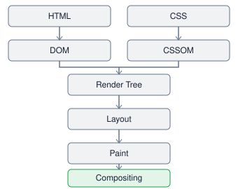
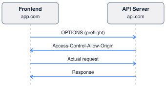
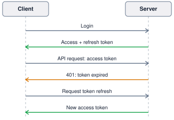
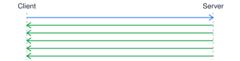
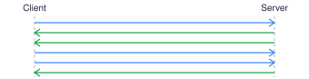

# Браузер, мережа та веббезпека

## 6.1. Що відбувається після введення URL в адресний рядок браузера?

<a id="q-6-1"></a>

### Пояснення

#### Interview answer (EN)

The browser first parses the input and checks its caches, then resolves the domain through DNS, opens a TCP and TLS connection, or a QUIC connection for HTTP/3, and sends the request. As the HTML arrives, it's parsed incrementally, so the browser discovers CSS, scripts and images early and builds the DOM and CSSOM. Finally it computes styles and layout, paints and composites, and many of these steps overlap or are skipped thanks to caching and reused connections.

```flow
URL parsing | Браузер аналізує введене: це URL чи пошуковий запит, перевіряє HSTS і кеш
DNS resolution | Визначає IP-адресу сервера (кеш браузера, ОС, DNS resolver)
Connection | Встановлює TCP-з’єднання і TLS handshake; для HTTP/3 — QUIC поверх UDP
HTTP request | Надсилає запит; service worker, якщо зареєстрований, може перехопити його
HTTP response | Отримує статус, заголовки та HTML; редиректи запускають новий запит
Parsing | Потоково парсить HTML у DOM, preload scanner заздалегідь знаходить ресурси
Rendering | Обчислює стилі й layout, виконує paint і compositing
```

Це спрощена послідовність. Частина кроків може виконуватися паралельно, пропускатися через кеш або використовувати вже відкрите з’єднання.

Що блокує показ сторінки:

- CSS у `<head>` — **render-blocking**: браузер не малює сторінку, доки не отримає стилі;
- звичайний `<script>` без `defer`/`async` — **parser-blocking**: парсинг HTML зупиняється на час завантаження й виконання.

#### Можливі уточнення

- **Що таке preload scanner?** — паралельний легкий парсер, який знаходить `img`, `link` і `script` у HTML і починає їх завантажувати, поки основний парсер заблокований скриптом.
- **Чому CSS блокує рендеринг?** — без стилів браузер показав би нестилізований контент і одразу перемалював його (FOUC).

#### Пов’язані питання

- [Як браузер рендерить сторінку?](#q-6-2)
- [Як керувати порядком завантаження: `defer`, `async`, `preload`, `preconnect`, `prefetch`?](#q-6-18)

#### Документація

- [MDN — Populating the page: how browsers work](https://developer.mozilla.org/en-US/docs/Web/Performance/Guides/How_browsers_work)

## 6.2. Як браузер рендерить сторінку?

<a id="q-6-2"></a>

### Пояснення

#### Interview answer (EN)

The browser parses HTML into the DOM and CSS into the CSSOM, combines them into a render tree of visible elements with computed styles, and then runs layout to calculate geometry. After that it paints pixels into layers, and the compositor combines those layers, often on the GPU. Because CSS is render-blocking and synchronous scripts block parsing, the way resources are loaded directly affects how quickly the first content appears.

HTML перетворюється на DOM, CSS — на CSSOM. Браузер об’єднує їх у render tree: лише видимі елементи з обчисленими стилями (без `head`, елементів із `display: none` тощо).

Далі етапи:

1. **Style** — обчислення стилів для кожного елемента;
2. **Layout** — розрахунок позицій і розмірів;
3. **Paint** — малювання пікселів: текст, кольори, тіні, зображення;
4. **Composite** — об’єднання шарів у фінальний кадр.

JavaScript може змінювати DOM і стилі, спричиняючи повторне виконання частини цього процесу.



Для плавності при 60 Hz браузер має близько 16 мс на кадр. Довгі задачі JavaScript на main thread затримують рендеринг і реакцію на ввід — це погіршує INP.

#### Пов’язані питання

- [Що таке reflow, repaint та compositing?](#q-6-4)
- [Що таке Core Web Vitals — LCP, INP та CLS?](../08-architecture/README.md#q-8-10)

#### Документація

- [web.dev — Critical Rendering Path](https://web.dev/articles/critical-rendering-path)
- [web.dev — Rendering performance](https://web.dev/articles/rendering-performance)

## 6.3. Що таке DOM та CSSOM?

<a id="q-6-3"></a>

### Пояснення

#### Interview answer (EN)

The DOM is a tree of node objects that represents the document and gives JavaScript an API to read and change it. The CSSOM is the equivalent object model for styles: it represents stylesheets and their rules, and APIs like getComputedStyle expose the final computed values. The browser combines both to render the page, so changes made through either API can trigger style recalculation, layout or paint.

DOM — Document Object Model. Деревоподібне представлення HTML-документа, доступне через JavaScript.

```javascript
const button = document.querySelector(".button");
button.textContent = "Saved";
```

DOM не дорівнює вихідному HTML: браузер виправляє некоректну розмітку, а JavaScript змінює дерево. У DevTools на вкладці Elements видно саме DOM.

CSSOM — CSS Object Model. Представлення CSS-правил та стилів, з якими браузер і JavaScript можуть працювати.

```javascript
document.styleSheets;
getComputedStyle(button).color;
button.style.setProperty("--accent", "tomato");
```

Браузер використовує DOM та CSSOM для розрахунку стилів і відображення сторінки.

`getComputedStyle()` і читання геометрії (`offsetWidth`, `getBoundingClientRect()`) змушують браузер синхронно оновити стилі й layout, якщо перед цим DOM змінювався. Це основа layout thrashing.

#### Пов’язані питання

- [Що таке reflow, repaint та compositing?](#q-6-4)

#### Документація

- [MDN — Document Object Model (DOM)](https://developer.mozilla.org/en-US/docs/Web/API/Document_Object_Model)
- [MDN — CSS Object Model (CSSOM)](https://developer.mozilla.org/en-US/docs/Web/API/CSS_Object_Model)

## 6.4. Що таке reflow, repaint та compositing?

<a id="q-6-4"></a>

### Пояснення

#### Interview answer (EN)

Layout, often called reflow, recalculates the size and position of elements, and it's the most expensive step because one change can affect a large part of the page. Paint fills in pixels for things like colors, text and shadows, while compositing only combines layers that were already painted. That's why animations should prefer transform and opacity, which can usually stay on the compositor, and why reading layout properties right after writing styles in a loop causes layout thrashing.

| Операція | Що відбувається | Приклад зміни |
| --- | --- | --- |
| Reflow / Layout | Перерахунок геометрії | `width`, `height`, `top`, `font-size`, додавання елементів |
| Repaint | Перемальовування | `color`, `background`, `box-shadow` |
| Compositing | Компонування шарів | `transform`, `opacity` у відповідних умовах |

Layout може бути особливо дорогим, оскільки зміна одного елемента здатна вплинути на інші елементи. Зміна layout зазвичай тягне за собою і paint.

Для анімацій часто краще використовувати:

```css
transform: translateX(100px);
```

Замість:

```css
left: 100px;
```

`transform` та `opacity` можуть оброблятися лише на етапі compositing, але це залежить від того, як браузер організував шари. `will-change: transform` заздалегідь виносить елемент в окремий шар, але кожен шар споживає пам’ять, тому використовувати його варто точково.

**Layout thrashing** — чергування запису стилів і читання геометрії, через яке браузер змушений робити layout синхронно багато разів:

```javascript
// Неправильно: кожне читання offsetWidth після запису змушує перерахувати layout
for (const box of boxes) {
  box.style.width = `${container.offsetWidth / 2}px`;
}

// Краще: спершу прочитати, потім записувати
const half = container.offsetWidth / 2;
for (const box of boxes) {
  box.style.width = `${half}px`;
}
```

#### Пов’язані питання

- [Що таке Core Web Vitals — LCP, INP та CLS?](../08-architecture/README.md#q-8-10)
- [Що таке stacking context? Чому іноді не працює `z-index`?](../05-html-css/README.md#q-5-7)

#### Документація

- [web.dev — Rendering performance](https://web.dev/articles/rendering-performance)
- [web.dev — Avoid large, complex layouts and layout thrashing](https://web.dev/articles/avoid-large-complex-layouts-and-layout-thrashing)

## 6.5. Що таке CORS? Навіщо потрібен preflight request?

<a id="q-6-5"></a>

### Пояснення

#### Interview answer (EN)

CORS is a browser mechanism that relaxes the same-origin policy: the server uses Access-Control-Allow headers to say which other origins may read its responses. Simple requests, like a GET or a form-style POST without custom headers, are sent directly, while anything else, such as a JSON body or an Authorization header, first triggers an OPTIONS preflight. It protects users rather than the server, because the request can still reach the backend, and tools like curl ignore CORS entirely.

CORS — Cross-Origin Resource Sharing. Механізм, який дозволяє серверу повідомити браузеру, чи може JavaScript з іншого origin отримати доступ до відповіді.

Origin визначається схемою, доменом та портом. `https://app.example.com` і `https://api.example.com` — різні origins.

**Simple request** (без preflight) — коли одночасно:

- метод `GET`, `HEAD` або `POST`;
- лише CORS-safelisted заголовки (`Accept`, `Accept-Language`, `Content-Language`, `Content-Type`);
- `Content-Type` — лише `text/plain`, `multipart/form-data` або `application/x-www-form-urlencoded`.

Тому запит із `Content-Type: application/json`, заголовком `Authorization` чи методом `PUT`/`DELETE` завжди починається з preflight.

**Preflight** — браузер відправляє `OPTIONS` з `Origin`, `Access-Control-Request-Method` і `Access-Control-Request-Headers`, а сервер відповідає, що дозволено:

```http
HTTP/1.1 204 No Content
Access-Control-Allow-Origin: https://app.example.com
Access-Control-Allow-Methods: GET, POST, PUT, DELETE
Access-Control-Allow-Headers: Content-Type, Authorization
Access-Control-Allow-Credentials: true
Access-Control-Max-Age: 600
Vary: Origin
```

`Access-Control-Max-Age` дозволяє кешувати результат preflight. Браузери обмежують це значення: Chromium — до 2 годин, Firefox — до 24 годин.

**Credentials** (cookies, HTTP auth) надсилаються cross-origin лише з `fetch(url, { credentials: "include" })`. Тоді сервер має повернути `Access-Control-Allow-Credentials: true` і конкретний origin — `Access-Control-Allow-Origin: *` разом із credentials не працює.

Помилка CORS недоступна JavaScript у деталях: `fetch` просто відхиляється з `TypeError`, а причина видна лише в консолі DevTools. `mode: "no-cors"` проблему не розв’язує — відповідь стає opaque, її не можна прочитати.

CORS контролюється браузером і налаштовується на сервері. Він не замінює authentication або authorization.



#### Можливі уточнення

- **Чому запит видно у вкладці Network, а JS отримує помилку?** — сервер відповів, але без потрібних заголовків, тому браузер не віддав відповідь скрипту.
- **Як обійти CORS у development?** — проксі dev-сервера (`server.proxy` у Vite): браузер звертається до того самого origin, а проксі пересилає запит до API.
- **Чи захищає CORS від CSRF?** — ні: simple request усе одно доходить до сервера й виконується, браузер лише не дає прочитати відповідь.

#### Пов’язані питання

- [Що таке XSS та CSRF? Як від них захиститися?](#q-6-7)

#### Документація

- [MDN — Cross-Origin Resource Sharing (CORS)](https://developer.mozilla.org/en-US/docs/Web/HTTP/Guides/CORS)
- [MDN — Access-Control-Max-Age](https://developer.mozilla.org/en-US/docs/Web/HTTP/Reference/Headers/Access-Control-Max-Age)

## 6.6. Чим відрізняються `localStorage`, `sessionStorage` та cookies?

<a id="q-6-6"></a>

### Пояснення

#### Interview answer (EN)

LocalStorage and sessionStorage are synchronous key-value stores for strings, limited to a few megabytes per origin and never sent to the server. LocalStorage persists until it's cleared, while sessionStorage lives only as long as the tab. Cookies are small and travel automatically with matching HTTP requests, so they suit sessions, especially with the HttpOnly, Secure and SameSite flags, and for larger structured or offline data, IndexedDB is the right tool.

| Характеристика | localStorage | sessionStorage | Cookies | IndexedDB |
| --- | --- | --- | --- | --- |
| Тривалість | До очищення | Поки відкрита вкладка, переживає reload | `Expires`/`Max-Age` або до закриття браузера | До очищення |
| Область видимості | Origin, усі вкладки | Origin і конкретна вкладка | Domain і path | Origin |
| Автоматично надсилається серверу | Ні | Ні | Так, із відповідними запитами | Ні |
| Типовий обсяг | Близько 5 MiB на origin | Близько 5 MiB на origin | Близько 4 KB на cookie | Значно більший: частка вільного місця на диску в межах квоти origin |
| API | Синхронний, лише рядки | Синхронний, лише рядки | `Set-Cookie`, `document.cookie` | Асинхронний, об’єкти, індекси, транзакції |
| Доступ із JavaScript | Так | Так | Не для HttpOnly | Так |
| Призначення | Налаштування, чернетки | Тимчасовий стан вкладки | Сесії, авторизація | Offline-дані, кеш, великі набори |

Атрибути cookies:

- `HttpOnly` — недоступна з JavaScript;
- `Secure` — лише через HTTPS;
- `SameSite=Strict | Lax | None` — чи надсилати cookie в cross-site запитах; `None` вимагає `Secure`. Chromium вважає cookie без `SameSite` як `Lax`, але інші браузери поводяться інакше, тому атрибут варто задавати явно;
- `Partitioned` (CHIPS) — third-party cookie зберігається окремо для кожного top-level сайту, тож вбудований віджет не може стежити за користувачем між сайтами.

Дані в `localStorage` доступні JavaScript, тому можуть бути викрадені внаслідок XSS. Синхронний API блокує main thread, тому великі обсяги краще тримати в IndexedDB.

Квоти: перевищення ліміту Web Storage кидає `QuotaExceededError`. Загальну квоту origin можна дізнатися через `navigator.storage.estimate()`. Safari з увімкненим захистом від трекінгу видаляє дані, записані скриптами, якщо користувач не взаємодіяв із сайтом 7 днів; cookies, встановлені сервером, це не зачіпає.

#### Можливі уточнення

- **Як синхронізувати дані між вкладками?** — подія `storage` спрацьовує в інших вкладках при зміні `localStorage`; для повідомлень є `BroadcastChannel`.
- **Чи можна зберігати access token у `localStorage`?** — технічно так, але будь-який XSS його прочитає; безпечніше тримати в пам’яті, а refresh token — у HttpOnly cookie.

#### Пов’язані питання

- [Як працює access token та refresh token?](#q-6-10)
- [Що таке XSS та CSRF? Як від них захиститися?](#q-6-7)

#### Документація

- [MDN — Web Storage API](https://developer.mozilla.org/en-US/docs/Web/API/Web_Storage_API)
- [MDN — Using HTTP cookies](https://developer.mozilla.org/en-US/docs/Web/HTTP/Guides/Cookies)
- [MDN — Storage quotas and eviction criteria](https://developer.mozilla.org/en-US/docs/Web/API/Storage_API/Storage_quotas_and_eviction_criteria)

## 6.7. Що таке XSS та CSRF? Як від них захиститися?

<a id="q-6-7"></a>

### Пояснення

#### Interview answer (EN)

XSS happens when attacker-controlled input ends up running as script in your origin, so it can do anything the user can, including sending authenticated requests even when cookies are HttpOnly. The defenses are contextual output encoding, sanitizing any HTML you must render, avoiding dangerous sinks, plus a strict CSP or Trusted Types as defense in depth. CSRF instead tricks the browser into sending a request with the user's cookies from another site, and it's mitigated with SameSite cookies, CSRF tokens and Origin checks.

**XSS — Cross-Site Scripting.** Атака, при якій шкідливий JavaScript виконується в контексті сайту. Буває stored (збережений у базі), reflected (з URL) і DOM-based (клієнтський код сам вставляє дані в небезпечне місце).

Небезпечні місця (sinks): `innerHTML`, `dangerouslySetInnerHTML`, `document.write`, `eval`, `new Function`, `setTimeout` з рядком, `href` або `src` зі схемою `javascript:`.

Захист: escaping відповідно до контексту, sanitization HTML (наприклад, DOMPurify), уникнення небезпечних sinks, Content Security Policy і Trusted Types.

React за замовчуванням екранує текстові значення в JSX:

```tsx
// Безпечно: React екранує текст
<p>{comment.text}</p>

// Небезпечно без санітизації
<div dangerouslySetInnerHTML={{ __html: comment.html }} />

// Краще
<div dangerouslySetInnerHTML={{ __html: DOMPurify.sanitize(comment.html) }} />
```

Починаючи з React 19, `javascript:` URL в атрибутах на кшталт `href`, `src` чи `action` блокуються: React підставляє замість них URL, який лише кидає помилку. У React 16.9–18 було тільки попередження в development. Від `dangerouslySetInnerHTML`, `window.location = userInput` чи прямої роботи з DOM через ref це не захищає.

`HttpOnly` cookie не дає скрипту прочитати сесію, але не зупиняє XSS: шкідливий код може надсилати запити від імені користувача, і браузер сам додасть cookies.

**Trusted Types** — з CSP-директивою `require-trusted-types-for 'script'` небезпечні DOM sinks приймають лише об’єкти, створені зареєстрованою політикою, а не довільні рядки. API підтримується в усіх основних браузерах з 2026 року.

**CSRF — Cross-Site Request Forgery.** Атака, при якій користувача змушують виконати небажаний запит до іншого сайту, де він уже авторизований.

Захист: `SameSite` cookies (`Lax` блокує cookies у cross-site POST, але не в top-level GET-навігаціях — тому GET не має змінювати стан), CSRF tokens, перевірка заголовків `Origin` або `Sec-Fetch-Site` та коректне використання HTTP-методів.

Головна різниця: XSS виконує сторонній код у контексті сайту, CSRF зловживає автоматично переданими credentials користувача.

#### Можливі уточнення

- **Чи захищає HttpOnly cookie від XSS?** — лише від крадіжки самої cookie; виконувати запити від імені користувача скрипт усе одно може.
- **Чи потрібен CSRF-захист, якщо токен передається в заголовку `Authorization`?** — для CSRF ні, бо браузер не додає його автоматично; але такий токен доступний JavaScript і вразливий до XSS.
- **Чи повністю захищає React від XSS?** — ні: лишаються `dangerouslySetInnerHTML`, робота з DOM напряму, небезпечні URL поза атрибутами React і сторонні скрипти.

#### Пов’язані питання

- [Як налаштувати Content Security Policy на практиці?](#q-6-14)
- [Чим відрізняються `localStorage`, `sessionStorage` та cookies?](#q-6-6)

#### Документація

- [OWASP — Cross Site Scripting Prevention Cheat Sheet](https://cheatsheetseries.owasp.org/cheatsheets/Cross_Site_Scripting_Prevention_Cheat_Sheet.html)
- [OWASP — Cross-Site Request Forgery Prevention Cheat Sheet](https://cheatsheetseries.owasp.org/cheatsheets/Cross-Site_Request_Forgery_Prevention_Cheat_Sheet.html)
- [MDN — Trusted Types API](https://developer.mozilla.org/en-US/docs/Web/API/Trusted_Types_API)

## 6.8. Чим відрізняються HTTP-методи `POST`, `PUT` та `PATCH`?

<a id="q-6-8"></a>

### Пояснення

#### Interview answer (EN)

POST sends data for the server to process, typically creating a resource or triggering an action, and it isn't idempotent, so retrying it can create duplicates. PUT replaces the whole resource at a known URI and is idempotent, while PATCH applies a partial update and isn't guaranteed to be idempotent, depending on the patch format. This matters for retries: idempotent requests can be repeated safely, and for POST many APIs accept an idempotency key.

| Метод | Типове призначення | Безпечний | Ідемпотентний |
| --- | --- | --- | --- |
| GET | Отримання даних | Так | Так |
| POST | Створення або виконання операції | Ні | Не гарантується |
| PUT | Створення або повна заміна ресурсу за URI | Ні | Так |
| PATCH | Часткове оновлення ресурсу | Ні | Не гарантується |
| DELETE | Видалення ресурсу | Ні | Так |

**Безпечний** метод не змінює стан сервера (GET, HEAD, OPTIONS). **Ідемпотентність** означає, що повторення однакового запиту має той самий очікуваний ефект на стан сервера, що й один запит.

Наприклад, повторний DELETE може повернути 404 замість 204, але ресурс усе одно залишається видаленим.

PUT замінює ресурс повністю: поля, яких немає в тілі, зазвичай скидаються. PATCH змінює лише передані поля; запит «встановити `name`» ідемпотентний, а «збільшити лічильник на 1» — ні.

Чому це важливо на frontend: ідемпотентні запити можна безпечно повторювати після мережевої помилки. Для POST (оплата, створення замовлення) API часто приймає заголовок `Idempotency-Key`, щоб сервер не створив дублікат.

#### Документація

- [MDN — HTTP request methods](https://developer.mozilla.org/en-US/docs/Web/HTTP/Reference/Methods)
- [RFC 9110 — Idempotent Methods](https://www.rfc-editor.org/rfc/rfc9110.html#name-idempotent-methods)

## 6.9. Що означають статус-коди 401, 403, 409, 422 та 500?

<a id="q-6-9"></a>

### Пояснення

#### Interview answer (EN)

A 401 means the request has no valid authentication, so the client should log in or refresh its token, while 403 means the server knows who you are but you aren't allowed to do this, and retrying won't help. A 409 signals a conflict with the current state, like a duplicate or an outdated version, and 422 means the request is well-formed but fails validation. A 500 is an unexpected server failure, so the client shows a generic error and may offer a retry.

| Код | Значення |
| --- | --- |
| 200 | OK |
| 201 | Created |
| 204 | No Content |
| 301 | Moved Permanently |
| 302 | Found — тимчасовий редирект |
| 304 | Not Modified |
| 307 | Temporary Redirect |
| 308 | Permanent Redirect |
| 400 | Bad Request |
| 401 | Unauthorized — потрібна автентифікація |
| 403 | Forbidden — доступ заборонено |
| 404 | Not Found |
| 409 | Conflict |
| 422 | Unprocessable Content |
| 429 | Too Many Requests |
| 500 | Internal Server Error |
| 502 | Bad Gateway |
| 503 | Service Unavailable |

Особливо часто запитують різницю між 401 та 403.

401 означає, що запит не має коректних authentication credentials (за специфікацією відповідь містить заголовок `WWW-Authenticate`). 403 означає, що сервер знає користувача, але відмовляється виконувати запит, наприклад через недостатні дозволи. Іноді замість 403 повертають 404, щоб не розкривати існування ресурсу.

Як frontend зазвичай реагує:

| Код | Реакція клієнта |
| --- | --- |
| 401 | Оновити access token і повторити запит або перенаправити на login |
| 403 | Показати «немає доступу»; refresh token не допоможе |
| 409 | Показати конфлікт (email уже зайнятий, дані змінив інший користувач) і перезавантажити дані |
| 422 | Показати помилки валідації біля відповідних полів форми |
| 429 | Повторити пізніше з урахуванням `Retry-After` |
| 500, 502, 503 | Загальне повідомлення про помилку; для GET можна повторити запит |

400 і 422: 400 — запит некоректний синтаксично (зламаний JSON), 422 — синтаксис правильний, але дані не проходять валідацію. Багато API використовують 400 для обох випадків, тому важливий контракт API.

Редиректи: 301 і 308 — постійні, 302 і 307 — тимчасові. При 301/302 браузери історично змінюють POST на GET, а 307/308 гарантують збереження методу й тіла запиту.

`fetch` не відхиляє Promise для 4xx і 5xx — потрібно перевіряти `response.ok` або `response.status`. RTK Query `fetchBaseQuery` робить це сам і повертає `error.status`.

#### Пов’язані питання

- [Як працює access token та refresh token?](#q-6-10)

#### Документація

- [MDN — HTTP response status codes](https://developer.mozilla.org/en-US/docs/Web/HTTP/Reference/Status)
- [MDN — Redirections in HTTP](https://developer.mozilla.org/en-US/docs/Web/HTTP/Guides/Redirections)
- [RFC 9110 — Status Codes](https://www.rfc-editor.org/rfc/rfc9110.html#name-status-codes)

## 6.10. Як працює access token та refresh token?

<a id="q-6-10"></a>

### Пояснення

#### Interview answer (EN)

A short-lived access token authorizes API calls, and a longer-lived refresh token is used only to get a new access token when the old one expires. In the browser, I'd keep the access token in memory and the refresh token in an HttpOnly, Secure, SameSite cookie, so scripts can't read it. The server should rotate the refresh token on every use, and on the client, concurrent 401 responses must share a single refresh request instead of each starting its own.

Access token використовується для авторизованих API-запитів і зазвичай має короткий термін дії (хвилини).

Refresh token використовується для отримання нового access token без повторного введення логіна та пароля. Він живе довше, тому його витік небезпечніший.



**Де зберігати:**

| Токен | Де | Чому |
| --- | --- | --- |
| Access token | У пам’яті (змінна модуля, Redux state без persist) | XSS не прочитає його зі сховища; після reload його отримують знову через refresh |
| Refresh token | HttpOnly, Secure, SameSite cookie, обмежена `Path` до endpoint оновлення | JavaScript не має до нього доступу |

`localStorage` для токенів зручний, але будь-який XSS їх прочитає. Альтернатива — патерн BFF (Backend for Frontend): токени взагалі не потрапляють у браузер, а frontend працює із сесійною cookie.

**Rotation:** при кожному оновленні сервер видає новий refresh token, а старий робить недійсним. Якщо хтось повторно використав старий токен, сервер може відкликати всю сесію — так виявляють крадіжку.

**Single-flight refresh:** якщо одночасно прийшло кілька 401, оновлення має бути одне, а решта запитів чекають на його результат.

```javascript run
let refreshCalls = 0;
let refreshPromise = null;

function refreshToken() {
  refreshCalls++;
  return new Promise(resolve => setTimeout(() => resolve("token-2"), 50));
}

function getFreshToken() {
  // Перший 401 запускає refresh, решта чекають на той самий Promise
  if (!refreshPromise) {
    refreshPromise = refreshToken().finally(() => {
      refreshPromise = null;
    });
  }
  return refreshPromise;
}

async function request(name) {
  // Уявімо, що сервер щойно відповів 401
  const token = await getFreshToken();
  console.log(`${name}: повтор із ${token}`);
}

await Promise.all([request("users"), request("orders"), request("profile")]);
console.log("Кількість refresh-запитів:", refreshCalls);
```

На frontend це реалізують централізовано: в Axios interceptor або в обгортці над RTK Query `fetchBaseQuery` (документація Redux показує варіант з `async-mutex`).

Важливі нюанси:

- повторювати оригінальний запит лише один раз;
- не запускати refresh для 401 від самого endpoint оновлення чи login — інакше буде нескінченний цикл;
- якщо refresh не вдався — очистити стан і перенаправити на login;
- endpoint оновлення, який читає cookie, теж потребує захисту від CSRF.

#### Можливі уточнення

- **Що станеться після перезавантаження сторінки, якщо access token лише в пам’яті?** — під час старту застосунок викликає refresh endpoint, cookie надсилається автоматично, і користувач отримує новий access token.
- **Навіщо access token, якщо є refresh token?** — access token надсилається з кожним запитом і має короткий термін дії, тому його витік обмежений у часі; refresh token надсилається лише на один endpoint.

#### Пов’язані питання

- [Чим відрізняються `localStorage`, `sessionStorage` та cookies?](#q-6-6)
- [Що таке XSS та CSRF? Як від них захиститися?](#q-6-7)
- [Що означають статус-коди 401, 403, 409, 422 та 500?](#q-6-9)

#### Документація

- [Redux — Customizing Queries: Preventing multiple unauthorized errors](https://redux.js.org/toolkit/rtk-query/usage/customizing-queries#preventing-multiple-unauthorized-errors)
- [RFC 9700 — Best Current Practice for OAuth 2.0 Security](https://www.rfc-editor.org/rfc/rfc9700.html)

## 6.11. Як працює HTTP-кешування?

<a id="q-6-11"></a>

### Пояснення

#### Interview answer (EN)

HTTP caching is controlled mainly by Cache-Control: max-age says how long a response stays fresh, no-cache allows storing it but requires revalidation, and no-store forbids storing it at all. When a response becomes stale, the browser revalidates it with ETag or Last-Modified and gets a cheap 304 if nothing changed. A common strategy is to give content-hashed assets a year-long max-age with immutable, while HTML uses no-cache so new deployments are picked up immediately.

Браузер може зберігати HTTP responses і повторно використовувати їх відповідно до cache headers.

Основні заголовки:

| Header | Призначення |
| --- | --- |
| `Cache-Control: max-age=N` | Відповідь вважається свіжою N секунд |
| `Cache-Control: no-cache` | Дозволяє зберігати, але потребує перевірки перед повторним використанням |
| `Cache-Control: no-store` | Забороняє зберігання |
| `Cache-Control: private` | Зберігати можна лише в браузері, не в спільних кешах (CDN, proxy) |
| `Cache-Control: public` | Можна зберігати й у спільних кешах |
| `Cache-Control: immutable` | Поки відповідь свіжа, браузер не перевіряє її навіть при reload |
| `Cache-Control: stale-while-revalidate=N` | Після закінчення `max-age` ще N секунд можна віддавати застарілу версію й оновлювати її у фоні |
| `ETag` | Ідентифікатор версії ресурсу |
| `Last-Modified` | Дата останньої зміни |

Клієнт може відправити `If-None-Match` з попереднім ETag. Якщо ресурс не змінився, сервер поверне `304 Not Modified` без тіла, і браузер використає кешовані дані.

Типова стратегія для SPA, зібраної Vite:

```text
# index.html — завжди перевіряти, щоб отримати новий деплой
Cache-Control: no-cache

# /assets/index-3f9a1c.js — ім’я містить content hash
Cache-Control: public, max-age=31536000, immutable

# API з персональними даними
Cache-Control: private, no-cache

# чутливі дані, які не можна зберігати
Cache-Control: no-store
```

Content hash у назві файлу змінюється разом із вмістом, тому старий файл можна кешувати «назавжди»: новий деплой просто посилається на інше ім’я.

Якщо `Cache-Control` не вказано, браузер може застосувати heuristic caching на основі `Last-Modified`, тому заголовки краще задавати явно. `stale-while-revalidate` найчастіше використовують на CDN, підтримка в браузерних кешах неоднакова.

HTTP-кешування та RTK Query cache — це різні рівні кешування: перше працює на рівні браузера й мережі, друге — у пам’яті застосунку.

#### Можливі уточнення

- **Чим `no-cache` відрізняється від `no-store`?** — `no-cache` зберігає, але перевіряє перед використанням (може отримати 304); `no-store` не зберігає взагалі.
- **Чому після деплою користувачі бачать стару версію?** — `index.html` закешовано з `max-age`; для HTML потрібен `no-cache`, а для assets — імена з hash.

#### Пов’язані питання

- [Як працює кешування в RTK Query?](../04-redux-toolkit/README.md#q-4-7)
- [Що таке Service Worker і які є стратегії кешування?](#q-6-15)

#### Документація

- [MDN — HTTP caching](https://developer.mozilla.org/en-US/docs/Web/HTTP/Guides/Caching)
- [web.dev — Prevent unnecessary network requests with the HTTP Cache](https://web.dev/articles/http-cache)
- [MDN — Cache-Control](https://developer.mozilla.org/en-US/docs/Web/HTTP/Reference/Headers/Cache-Control)

## 6.12. Чим відрізняються WebSocket, SSE та polling?

<a id="q-6-12"></a>

### Пояснення

#### Interview answer (EN)

Polling simply repeats normal HTTP requests on an interval, which is easy but wasteful and adds latency, while long polling keeps each request open until the server has something to send. Server-Sent Events stream text events from the server to the client over a regular HTTP response with built-in reconnection, so they fit notifications and live feeds. WebSocket gives a full-duplex connection for chats or collaborative editing, but reconnection, heartbeats and scaling stateful connections are up to you.

| | Polling | Long polling | SSE | WebSocket |
| --- | --- | --- | --- | --- |
| Напрям | Клієнт запитує, сервер відповідає | Так само, але сервер тримає запит, доки не з’являться дані | Сервер → клієнт | В обидва боки |
| Протокол | Звичайний HTTP | Звичайний HTTP | HTTP, `text/event-stream` | `ws://` / `wss://`, upgrade з HTTP |
| Формат даних | Будь-який | Будь-який | Лише текст (UTF-8) | Текст і бінарні дані |
| Перепідключення | Не потрібне | Новий запит після кожної відповіді | Автоматичне (`retry`, `Last-Event-ID`) | Реалізується вручну |
| Типові задачі | Статус фонової задачі, прості дашборди | Fallback, коли SSE чи WebSocket недоступні | Нотифікації, live feed, прогрес, стрімінг відповідей | Чат, спільне редагування, ігри |

Polling підходить для нескладного періодичного оновлення даних. У RTK Query для цього є опція `pollingInterval`.

SSE — для односторонніх оновлень із сервера, наприклад notifications або live feed.

```javascript
const events = new EventSource("/api/notifications", { withCredentials: true });

events.addEventListener("message", event => {
  console.log(JSON.parse(event.data));
});

// при unmount компонента
events.close();
```

Нюанси SSE:

- `EventSource` сам перепідключається й надсилає `Last-Event-ID`, щоб сервер міг дослати пропущені події;
- `EventSource` не дозволяє задати власні заголовки (лише `withCredentials` для cookies), тому для `Authorization` використовують `fetch` зі стрімінгом відповіді;
- на HTTP/1.1 браузер обмежує кількість з’єднань до одного домену (близько 6 на всі вкладки), і кілька вкладок із SSE можуть їх вичерпати; HTTP/2 мультиплексує потоки в одному з’єднанні.

WebSocket — для двосторонньої взаємодії в реальному часі, наприклад чатів та спільного редагування. Перепідключення з backoff, heartbeat (ping/pong) і відновлення стану після розриву доводиться реалізовувати самостійно або брати бібліотеку.






#### Можливі уточнення

- **Що обрати для нотифікацій?** — зазвичай SSE: простіше за WebSocket, працює через звичайний HTTP і сам перепідключається.
- **Як інтегрувати WebSocket з RTK Query?** — через `onCacheEntryAdded`: відкрити з’єднання, оновлювати кеш через `updateCachedData` і закрити його після `cacheEntryRemoved`.

#### Документація

- [MDN — Using server-sent events](https://developer.mozilla.org/en-US/docs/Web/API/Server-sent_events/Using_server-sent_events)
- [MDN — The WebSocket API](https://developer.mozilla.org/en-US/docs/Web/API/WebSockets_API)

## 6.13. Як працює `AbortController`?

<a id="q-6-13"></a>

### Пояснення

#### Interview answer (EN)

AbortController creates a signal that you pass to fetch or any other API that supports AbortSignal, and calling abort() rejects the pending promise with an AbortError. In React, I create a controller inside an effect and abort it in the cleanup, so a stale response from a previous search can't overwrite newer state. AbortSignal.timeout() and AbortSignal.any() cover timeouts and combined signals, but aborting only stops the client from waiting, and the server may still finish the work.

`AbortController` дозволяє скасовувати операції, які підтримують `AbortSignal`.

```typescript
const controller = new AbortController();

fetch("/api/users", {
  signal: controller.signal
});

controller.abort();
```

У React:

```typescript
useEffect(() => {
  const controller = new AbortController();
  const params = new URLSearchParams({ q: search });

  fetch(`/api/users?${params}`, {
    signal: controller.signal
  })
    .then(response => {
      if (!response.ok) throw new Error(`HTTP ${response.status}`);
      return response.json();
    })
    .then(setUsers)
    .catch(error => {
      if (error.name !== "AbortError") {
        console.error(error);
      }
    });

  return () => controller.abort();
}, [search]);
```

Значення з поля введення потрібно кодувати: `URLSearchParams` або `encodeURIComponent(search)`. Інакше символи `&`, `#` чи `?` зламають URL.

Це корисно для запобігання непотрібним мережевим операціям та деяким race conditions.

Скасування fetch не гарантує, що сервер припинить виконувати вже отриманий запит.

**Таймаут і комбінування сигналів:**

```typescript
const signal = AbortSignal.any([controller.signal, AbortSignal.timeout(5000)]);
await fetch("/api/report", { signal });
```

`AbortSignal.timeout()` відхиляє операцію з `TimeoutError`, а не `AbortError` — це дозволяє показати різні повідомлення. `AbortSignal.any()` скасовує операцію, щойно спрацював будь-який із сигналів.

Власні async-функції теж можуть підтримувати `AbortSignal`:

```javascript run
function sleep(ms, signal) {
  return new Promise((resolve, reject) => {
    if (signal.aborted) return reject(signal.reason);
    const id = setTimeout(resolve, ms, "done");
    signal.addEventListener("abort", () => {
      clearTimeout(id);
      reject(signal.reason);
    }, { once: true });
  });
}

const user = new AbortController();
const signal = AbortSignal.any([user.signal, AbortSignal.timeout(100)]);
sleep(1000, signal).catch(error => console.log("1:", error.name));

const manual = new AbortController();
sleep(1000, manual.signal).catch(error => console.log("2:", error.name));
manual.abort();
```

Спершу виведеться `2: AbortError` (ручне скасування), а через 100 мс — `1: TimeoutError`.

Ще одне корисне застосування — `addEventListener(type, handler, { signal })`: після `abort()` усі такі обробники знімаються разом.

#### Можливі уточнення

- **Як скасувати запит у RTK Query?** — RTK Query передає `signal` у `baseQuery`, а результат `trigger()` з lazy query чи `dispatch(endpoint.initiate())` має метод `abort()`.
- **Чи потрібен AbortController, якщо компонент перевіряє прапорець `ignore`?** — прапорець захищає від race condition, але сам запит продовжує завантажуватися; `abort()` ще й звільняє мережу.

#### Пов’язані питання

- [Race Condition](../09-live-coding/README.md#q-9-8)
- [Як скасувати або пропустити непотрібний API-запит?](../04-redux-toolkit/README.md#q-4-15)

#### Документація

- [MDN — AbortController](https://developer.mozilla.org/en-US/docs/Web/API/AbortController)
- [MDN — AbortSignal.timeout()](https://developer.mozilla.org/en-US/docs/Web/API/AbortSignal/timeout_static)
- [MDN — AbortSignal.any()](https://developer.mozilla.org/en-US/docs/Web/API/AbortSignal/any_static)

## 6.14. Як налаштувати Content Security Policy на практиці?

<a id="q-6-14"></a>

### Пояснення

#### Interview answer (EN)

Content Security Policy is a response header that tells the browser which scripts, styles, frames and connections are allowed, so injected markup can't easily execute. The modern approach is a strict policy based on nonces or hashes with strict-dynamic instead of long domain allowlists, plus object-src none and base-uri none. I'd roll it out with the Report-Only header first, fix the violations, and keep in mind that CSP is defense in depth, not a replacement for escaping.

CSP передається заголовком відповіді:

```http
Content-Security-Policy:
  script-src 'nonce-4f8a2c1b' 'strict-dynamic';
  object-src 'none';
  base-uri 'none';
  frame-ancestors 'none'
```

```html
<script nonce="4f8a2c1b" src="/assets/main.js"></script>
```

| Директива | Що контролює |
| --- | --- |
| `script-src` | Звідки й які скрипти можна виконувати |
| `'nonce-…'` | Дозволяє лише скрипти з цим атрибутом `nonce`; значення має бути новим випадковим для кожної відповіді |
| `'strict-dynamic'` | Скрипти, завантажені довіреним скриптом, теж довірені; allowlist доменів ігнорується |
| `object-src 'none'` | Забороняє `<object>` і `<embed>` |
| `base-uri 'none'` | Не дає підмінити `<base>` і перенаправити відносні URL |
| `frame-ancestors` | Хто може вбудувати сторінку в iframe — захист від clickjacking |
| `connect-src` | Куди можна робити `fetch`, XHR і WebSocket |

Практичні нюанси:

- nonce має генеруватися на сервері для кожної відповіді. Для статичної SPA на CDN, де HTML не змінюється, використовують hashes inline-скриптів або взагалі не мають inline-скриптів і дозволяють `'self'`;
- `'unsafe-inline'` і `'unsafe-eval'` значно послаблюють захист від XSS;
- спершу вмикають `Content-Security-Policy-Report-Only`: порушення лише логуються, а сайт не ламається;
- `frame-ancestors` і звітування не працюють через `<meta http-equiv>` — лише через заголовок;
- `require-trusted-types-for 'script'` додатково вмикає Trusted Types;
- у Vite є опція `html.cspNonce`: Vite додає вказане значення як nonce до згенерованих тегів, а сервер має замінювати цей плейсхолдер унікальним значенням для кожної відповіді.

#### Можливі уточнення

- **Чому allowlist доменів вважають слабким захистом?** — на дозволених CDN часто є бібліотеки чи JSONP endpoints, через які можна виконати довільний код.
- **Чи захищає CSP від усіх XSS?** — ні, це другий рубіж; основний захист — правильне екранування й санітизація.

#### Пов’язані питання

- [Що таке XSS та CSRF? Як від них захиститися?](#q-6-7)

#### Документація

- [MDN — Content Security Policy (CSP)](https://developer.mozilla.org/en-US/docs/Web/HTTP/Guides/CSP)
- [web.dev — Mitigate cross-site scripting (XSS) with a strict Content Security Policy (CSP)](https://web.dev/articles/strict-csp)
- [OWASP — Content Security Policy Cheat Sheet](https://cheatsheetseries.owasp.org/cheatsheets/Content_Security_Policy_Cheat_Sheet.html)

## 6.15. Що таке Service Worker і які є стратегії кешування?

<a id="q-6-15"></a>

### Пояснення

#### Interview answer (EN)

A service worker is a script that runs separately from the page and acts as a programmable network proxy for its scope, so it can answer requests from the Cache Storage API and make an app work offline. Common strategies are cache-first for versioned static assets, network-first for HTML or data that must be fresh, and stale-while-revalidate when a fast, slightly outdated response is fine. The tricky part is the update lifecycle, because a careless cache can keep users on an old version.

Service Worker:

- працює в окремому потоці, без доступу до DOM;
- перехоплює запити сторінок у своєму scope через подію `fetch`;
- вимагає HTTPS (виняток — `localhost`);
- має життєвий цикл: `install` → `waiting` → `activate`. Нова версія чекає, доки закриються всі вкладки зі старою, якщо не викликати `skipWaiting()`.

| Стратегія | Як працює | Для чого |
| --- | --- | --- |
| Cache first | Спершу кеш, мережа лише якщо в кеші немає | Assets з hash у назві, шрифти, іконки |
| Network first | Спершу мережа, кеш — якщо мережа недоступна | HTML, дані, які мають бути свіжими |
| Stale-while-revalidate | Одразу віддати кеш, паралельно оновити його з мережі | Аватари, не критичні дані, другорядні API |
| Network only | Лише мережа | Платежі, аналітика, POST-запити |
| Cache only | Лише кеш | Ресурси, попередньо збережені під час `install` |

Спрощений stale-while-revalidate для зображень:

```javascript
self.addEventListener("fetch", event => {
  if (event.request.destination !== "image") return;

  event.respondWith(
    caches.open("images-v1").then(async cache => {
      const cached = await cache.match(event.request);
      const network = fetch(event.request).then(response => {
        if (response.ok) cache.put(event.request, response.clone());
        return response;
      });

      if (cached) {
        event.waitUntil(network.catch(() => {}));
        return cached;
      }
      return network;
    })
  );
});
```

У реальних проєктах замість ручного коду зазвичай використовують Workbox (наприклад, через `vite-plugin-pwa`).

Типові помилки:

- cache first для `index.html` — користувачі «застрягають» на старій версії;
- кеші без версій і без очищення старих у `activate`;
- кешування персональних відповідей API на спільних пристроях.

PWA — це вебзастосунок із manifest, service worker і HTTPS, який можна встановити та використовувати offline.

#### Пов’язані питання

- [Як працює HTTP-кешування?](#q-6-11)

#### Документація

- [MDN — Using Service Workers](https://developer.mozilla.org/en-US/docs/Web/API/Service_Worker_API/Using_Service_Workers)
- [Chrome for Developers — Strategies for service worker caching](https://developer.chrome.com/docs/workbox/caching-strategies-overview)
- [MDN — Caching (Progressive web apps)](https://developer.mozilla.org/en-US/docs/Web/Progressive_web_apps/Guides/Caching)

## 6.16. Коли варто використовувати Web Workers?

<a id="q-6-16"></a>

### Пояснення

#### Interview answer (EN)

Web Workers run JavaScript on a background thread, so CPU-heavy work like parsing a large file, processing images or building a search index doesn't block rendering and input on the main thread. A worker has no access to the DOM and communicates through postMessage, where data is copied with the structured clone algorithm. For large binary data, I transfer ownership of an ArrayBuffer instead of copying it, and I remember that starting a worker and serializing messages has a cost, so small tasks don't benefit.

Main thread відповідає і за JavaScript, і за рендеринг, і за обробку вводу. Довга синхронна задача блокує все це й погіршує INP. Worker виконує код в окремому потоці.

```typescript
// worker.ts
self.onmessage = (event: MessageEvent<ArrayBuffer>) => {
  const bytes = new Uint8Array(event.data);
  let sum = 0;
  for (const byte of bytes) sum += byte;
  self.postMessage(sum);
};
```

```typescript
// main.ts — синтаксис, який підтримує Vite
const worker = new Worker(new URL("./worker.ts", import.meta.url), { type: "module" });

worker.onmessage = event => console.log("sum:", event.data);

const buffer = new ArrayBuffer(50_000_000);
worker.postMessage(buffer, [buffer]); // transfer, а не копія
console.log(buffer.byteLength); // 0 — буфер більше не належить main thread
```

| Добре підходить | Не підходить |
| --- | --- |
| Парсинг великих JSON/CSV, генерація звітів | Робота з DOM — у worker його немає |
| Обробка зображень, `OffscreenCanvas` | Звичайні `fetch` — вони вже асинхронні |
| Пошук і фільтрація великих масивів, індексація | Дрібні обчислення: передача даних коштує більше за виграш |
| Криптографія, стиснення | |

Передача даних:

- за замовчуванням `postMessage` копіює дані через structured clone (функції та DOM-вузли передати не можна);
- **transferable objects** (`ArrayBuffer`, `MessagePort`, `ImageBitmap`, `OffscreenCanvas`) передаються без копіювання — оригінал у відправника стає непридатним.

У React worker зазвичай створюють у `useEffect` і викликають `worker.terminate()` у cleanup. Бібліотека Comlink дозволяє викликати функції worker як звичайні async-функції.

#### Можливі уточнення

- **Чим Web Worker відрізняється від Service Worker?** — Web Worker виконує обчислення для однієї сторінки; Service Worker — проксі між сторінками й мережею, живе незалежно від вкладки.
- **Що робити, якщо задачу не можна винести у worker?** — розбивати її на частини й віддавати керування main thread між ними, щоб браузер встигав обробляти ввід і рендеринг.

#### Пов’язані питання

- [Що таке Core Web Vitals — LCP, INP та CLS?](../08-architecture/README.md#q-8-10)
- [Як працює Event Loop?](../01-javascript/README.md#q-1-4)

#### Документація

- [MDN — Using Web Workers](https://developer.mozilla.org/en-US/docs/Web/API/Web_Workers_API/Using_web_workers)
- [MDN — Transferable objects](https://developer.mozilla.org/en-US/docs/Web/API/Web_Workers_API/Transferable_objects)
- [Vite — Web Workers](https://vite.dev/guide/features#web-workers)

## 6.17. Чим відрізняються HTTP/1.1, HTTP/2 та HTTP/3?

<a id="q-6-17"></a>

### Пояснення

#### Interview answer (EN)

HTTP/1.1 effectively handles one request at a time per connection, so browsers open several connections per host, and we used tricks like domain sharding, sprites and aggressive concatenation. HTTP/2 multiplexes many requests over a single connection with header compression, which makes those tricks unnecessary or even harmful. HTTP/3 runs over QUIC on top of UDP, so a lost packet no longer stalls every stream and connections are set up faster, which especially helps on mobile networks.

| | HTTP/1.1 | HTTP/2 | HTTP/3 |
| --- | --- | --- | --- |
| Транспорт | TCP | TCP | QUIC поверх UDP |
| Паралельні запити | Близько 6 з’єднань на host, один запит за раз у з’єднанні | Багато потоків в одному з’єднанні (multiplexing) | Multiplexing із незалежними потоками |
| Head-of-line blocking | На рівні HTTP | Залишається на рівні TCP: втрачений пакет зупиняє всі потоки | Усунуто на рівні транспорту |
| Заголовки | Текстові, повторюються | Стиснення HPACK | Стиснення QPACK |
| TLS | Необов’язковий | У браузерах фактично обов’язковий | TLS 1.3 вбудований у QUIC |

Що це змінює для frontend:

- **domain sharding** більше не потрібен і навіть шкодить: зайві DNS-запити й TLS handshakes, гірша пріоритизація;
- **спрайти й надмірна конкатенація** не обов’язкові: дрібні файли не так дорого завантажувати окремо, і їх краще кешувати незалежно;
- **bundling** усе одно потрібен: тисячі дрібних модулів погіршують стиснення та додають накладні витрати, тому зазвичай роблять code splitting за маршрутами;
- **HTTP/2 Server Push** Chrome вимкнув у 2022 році; замість нього використовують `103 Early Hints` і `preload`.

Браузер дізнається про підтримку HTTP/3 із заголовка `Alt-Svc` або DNS-запису HTTPS, тому перший запит може піти через HTTP/2. Версію протоколу видно в колонці Protocol у вкладці Network DevTools (`h2`, `h3`).

#### Пов’язані питання

- [Що таке code splitting та tree shaking?](../08-architecture/README.md#q-8-5)
- [Що відбувається після введення URL в адресний рядок браузера?](#q-6-1)

#### Документація

- [MDN — Evolution of HTTP](https://developer.mozilla.org/en-US/docs/Web/HTTP/Guides/Evolution_of_HTTP)
- [MDN — HTTP/3](https://developer.mozilla.org/en-US/docs/Glossary/HTTP_3)
- [MDN — 103 Early Hints](https://developer.mozilla.org/en-US/docs/Web/HTTP/Reference/Status/103)

## 6.18. Як керувати порядком завантаження: `defer`, `async`, `preload`, `preconnect`, `prefetch`?

<a id="q-6-18"></a>

### Пояснення

#### Interview answer (EN)

A classic script blocks the HTML parser, defer downloads in parallel and runs scripts in order after parsing, async runs each one as soon as it arrives, and module scripts are deferred by default. Resource hints cover what the browser can't discover early: preload fetches a critical resource for the current page, preconnect warms up a connection to another origin, and prefetch grabs something for the likely next navigation at low priority. They're easy to overuse, though, because every preload competes for bandwidth.

**Скрипти:**

| Варіант | Завантаження | Виконання | Порядок |
| --- | --- | --- | --- |
| `<script>` | Блокує парсинг HTML | Одразу після завантаження | За порядком у документі |
| `<script async>` | Паралельно з парсингом | Щойно завантажився, перериваючи парсинг | Не гарантований |
| `<script defer>` | Паралельно з парсингом | Після парсингу, перед `DOMContentLoaded` | За порядком у документі |
| `<script type="module">` | Паралельно, разом із залежностями | Як `defer`; з `async` — як `async` | Як `defer` |

`defer` — вибір за замовчуванням для власного коду, `async` — для незалежних сторонніх скриптів на кшталт аналітики.

**Resource hints:**

| Hint | Що робить | Коли використовувати |
| --- | --- | --- |
| `preload` | Завантажує ресурс для поточної сторінки з високим пріоритетом; потрібен `as` | Шрифт, hero-зображення чи CSS, які браузер знайде пізно |
| `modulepreload` | Завантажує й одразу парсить ES-модуль | Chunks, потрібні одразу; Vite додає їх автоматично |
| `preconnect` | Заздалегідь робить DNS, TCP і TLS | Критичні сторонні origins: CDN, API, шрифти |
| `dns-prefetch` | Лише DNS | Менш важливі сторонні домени |
| `prefetch` | Завантажує з низьким пріоритетом для наступної навігації | Chunk сторінки, на яку користувач найімовірніше перейде |

```html
<head>
  <link rel="preconnect" href="https://cdn.example.com" />
  <link rel="preload" href="/fonts/inter.woff2" as="font" type="font/woff2" crossorigin />
  <link rel="prefetch" href="/assets/settings-page.js" />
  <script src="https://analytics.example.com/script.js" async></script>
  <script type="module" src="/assets/main.js"></script>
</head>
```

Нюанси:

- шрифти завжди завантажуються в CORS-режимі, тому `preload` шрифту потребує `crossorigin`, інакше файл завантажиться двічі;
- невикористаний `preload` марно витрачає трафік, а Chrome показує попередження в консолі;
- `fetchpriority="high"` на `img` часто краще за `preload` для LCP-зображення, яке і так є в HTML;
- забагато `preconnect` шкодить: кожне з’єднання коштує ресурсів, тому їх обмежують кількома критичними origins.

#### Можливі уточнення

- **Чим `preload` відрізняється від `prefetch`?** — `preload` — для поточної сторінки й з високим пріоритетом; `prefetch` — для майбутньої навігації й з низьким.
- **Коли спрацьовує `DOMContentLoaded` відносно `defer` і `async`?** — після виконання всіх `defer`-скриптів; `async`-скрипти можуть виконатися як до, так і після нього.

#### Пов’язані питання

- [Що відбувається після введення URL в адресний рядок браузера?](#q-6-1)
- [Як оптимізувати завантаження зображень: `srcset`, `sizes`, `<picture>`, lazy loading?](../05-html-css/README.md#q-5-14)
- [Що таке Core Web Vitals — LCP, INP та CLS?](../08-architecture/README.md#q-8-10)

#### Документація

- [MDN — The script element](https://developer.mozilla.org/en-US/docs/Web/HTML/Reference/Elements/script)
- [MDN — rel=preload](https://developer.mozilla.org/en-US/docs/Web/HTML/Reference/Attributes/rel/preload)
- [web.dev — Establish network connections early to improve perceived page speed](https://web.dev/articles/preconnect-and-dns-prefetch)
