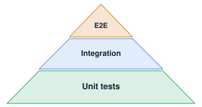

# Тестування

## 7.1. Чим відрізняються Unit, Integration та E2E tests?

<a id="q-7-1"></a>

### Пояснення

#### Interview answer (EN)

Unit tests check a small piece of logic in isolation, integration tests check that several parts work together, and end-to-end tests drive a real browser through a complete user flow. The classic pyramid recommends many cheap unit tests and only a few slow E2E tests. For frontend apps, many teams prefer the testing trophy instead: static analysis at the base and most of the effort in integration tests, because they give the most confidence for their cost.

| Тип | Що перевіряє | Інструменти | Вартість |
| --- | --- | --- | --- |
| Static | Типи, очевидні помилки, небезпечні патерни ще до запуску | TypeScript, ESLint | Майже безкоштовно |
| Unit | Окрему функцію, reducer, selector, utility | Vitest, Jest | Швидкі, ізольовані |
| Integration | Компонент разом зі store, router та змоканою мережею | Vitest/Jest + React Testing Library + MSW | Середня |
| E2E | Повний сценарій користувача в реальному браузері | Playwright, Cypress | Повільні, дорожчі в підтримці |

Класична піраміда тестування радить багато unit tests і мало E2E. Це не обов'язкова пропорція для кожного frontend-проєкту.

**Testing trophy** (популяризував Kent C. Dodds) — альтернативний погляд для frontend: в основі static analysis, далі трохи unit tests, **найбільше integration tests** і зверху небагато E2E. Логіка проста: користувач взаємодіє не з окремою функцією, а з компонентами, які разом працюють зі store та API. Integration tests через RTL + MSW перевіряють саме це, але залишаються значно швидшими за E2E.



#### Можливі уточнення

- **Why not test everything with E2E?** — повільні, крихкіші, складно знайти причину падіння та покрити edge cases (наприклад, помилку 500 на конкретному кроці).
- **What is the ratio of tests in your project?** — чесно опиши: що покрито unit, що integration, які критичні сценарії є в E2E.
- **Що таке component testing у браузері?** — запуск компонентних тестів у справжньому браузері замість jsdom, наприклад Vitest Browser Mode.

#### Пов’язані питання

- [Що варто тестувати в React-компоненті?](#q-7-2)
- [E2E з Playwright](#q-7-14)

#### Документація

- [Testing Library — Guiding Principles](https://testing-library.com/docs/guiding-principles/)
- [Vitest — Browser Mode](https://vitest.dev/guide/browser/)
- [Playwright — Best Practices](https://playwright.dev/docs/best-practices)

## 7.2. Що варто тестувати в React-компоненті?

<a id="q-7-2"></a>

### Пояснення

#### Interview answer (EN)

I focus on what the user can see and do: rendered data, typing and clicking, validation messages, and the loading, empty and error states. I query elements by role and accessible name, the way a user or a screen reader would find them, which also catches basic accessibility problems. I avoid asserting internal state or which hooks are used, so the tests survive refactoring as long as the behavior stays the same.

Насамперед поведінку, яку бачить користувач:

- відображення даних і форматування;
- взаємодію: кліки, введення тексту, клавіатуру;
- валідацію та повідомлення про помилки;
- loading, error та empty states;
- callbacks, які компонент викликає назовні (`onSubmit`, `onChange`), — з правильними аргументами.

```tsx
import { render, screen } from "@testing-library/react";
import userEvent from "@testing-library/user-event";
import { expect, it, vi } from "vitest";

it("submits email and password", async () => {
  const user = userEvent.setup();
  const onSubmit = vi.fn();

  render(<LoginForm onSubmit={onSubmit} />);

  await user.type(
    screen.getByRole("textbox", { name: /email/i }),
    "user@example.com"
  );
  // input type="password" не має ролі textbox, тому шукаємо за label
  await user.type(screen.getByLabelText(/password/i), "secret");
  await user.click(screen.getByRole("button", { name: /log in/i }));

  expect(onSubmit).toHaveBeenCalledWith({
    email: "user@example.com",
    password: "secret",
  });
});
```

`toHaveBeenCalledWith` перевіряє не лише факт виклику, а й дані, які отримає батьківський компонент. `toBeInTheDocument`, `toHaveTextContent` та інші DOM-matchers додає пакет `@testing-library/jest-dom` (для Vitest — імпорт `@testing-library/jest-dom/vitest` у setup-файлі).

Запити `getByRole(..., { name })` — це водночас базова перевірка accessibility: якщо кнопку чи поле не вдається знайти за роллю та доступним ім'ям, найімовірніше, їх не знайде й screen reader.

Не потрібно без необхідності тестувати внутрішній state або те, який конкретно hook використовується.

#### Можливі уточнення

- **How do you test the error state?** — підміняю відповідь API через MSW (`server.use`) і перевіряю повідомлення в UI.
- **Would you test styles?** — зазвичай ні; візуальні регресії краще ловити visual snapshots у браузері, а не перевіркою className.

#### Пов’язані питання

- [Чому краще тестувати поведінку, а не реалізацію?](#q-7-9)
- [`userEvent` vs `fireEvent`](#q-7-10)
- [Як тестувати компонент, який виконує API-запит?](#q-7-5)

#### Документація

- [Testing Library — About Queries](https://testing-library.com/docs/queries/about/)
- [Testing Library — user-event Introduction](https://testing-library.com/docs/user-event/intro)

## 7.3. Що таке mock, stub та spy?

<a id="q-7-3"></a>

### Пояснення

#### Interview answer (EN)

These are all test doubles, objects that stand in for a real dependency. A stub returns canned data, a spy records how it was called, a mock is set up with expectations about the interaction, and a fake is a simplified working implementation, such as an in-memory repository. In Vitest, a mock function from vi.fn covers stubs and spies, while vi.spyOn wraps an existing method, so I restore it after each test to avoid leaking state.

Загальна назва — **test double** (термінологія Gerard Meszaros):

| Термін | Призначення | Приклад |
| --- | --- | --- |
| Dummy | Заповнює обов'язковий параметр, не використовується | `onClose={() => {}}`, коли сценарій його не викликає |
| Stub | Повертає заздалегідь визначені дані | `vi.fn().mockResolvedValue(users)` |
| Spy | Записує виклики (аргументи, кількість), може залишати оригінальну поведінку | `vi.spyOn(console, "error")` |
| Mock | Double з очікуваннями щодо взаємодії, які перевіряє тест | `expect(onSubmit).toHaveBeenCalledWith(...)` |
| Fake | Спрощена робоча реалізація | In-memory storage, MSW handlers як «фейковий backend» |

У Vitest/Jest межі розмиті: `vi.fn()` створює mock function, яка водночас записує виклики (spy) і може повертати підготовлені дані (stub).

```typescript
// Stub: функція повертає підготовлені дані
const fetchUsers = vi.fn().mockResolvedValue([{ id: 1, name: "Alex" }]);
```

```typescript
// Spy на існуючому методі
const errorSpy = vi
  .spyOn(console, "error")
  .mockImplementation(() => {}); // без цього викликається оригінал

renderBrokenComponent();

expect(errorSpy).toHaveBeenCalled();
errorSpy.mockRestore(); // повертає оригінальний console.error
```

`vi.spyOn` за замовчуванням викликає оригінальну реалізацію; `mockImplementation` або `mockReturnValue` її замінюють. Щоб spies не «протікали» між тестами, викликай `mockRestore()`, `vi.restoreAllMocks()` в `afterEach` або увімкни `restoreMocks: true` у конфігурації:

```typescript
// vitest.config.ts
import { defineConfig } from "vitest/config";

export default defineConfig({
  test: {
    restoreMocks: true,
  },
});
```

| Метод | Що робить |
| --- | --- |
| `mockClear` / `vi.clearAllMocks` | Очищає історію викликів, реалізація лишається |
| `mockReset` / `vi.resetAllMocks` | Очищає історію та скидає реалізацію |
| `mockRestore` / `vi.restoreAllMocks` | Повертає оригінальні методи для spies, створених через `vi.spyOn` |

У Vitest 5 опція `clearMocks` за замовчуванням увімкнена, тобто історія викликів очищається перед кожним тестом. Термінологія дещо відрізняється між testing frameworks.

#### Можливі уточнення

- **When would you avoid mocks?** — коли мок замінює саме те, що потрібно перевірити; для мережі краще MSW, ніж мок `fetch` або hook.
- **Що таке `vi.mock`?** — мокає цілий модуль; виклик hoisted на початок файлу, тому змінні ззовні треба оголошувати через `vi.hoisted`.

#### Документація

- [Vitest — Vi Utility](https://vitest.dev/api/vi)
- [Vitest — restoreMocks](https://vitest.dev/config/restoremocks)
- [Wikipedia — Test double](https://en.wikipedia.org/wiki/Test_double)

## 7.4. Як тестувати асинхронний код?

<a id="q-7-4"></a>

### Пояснення

#### Interview answer (EN)

The key is to wait for the signal that the work is done instead of sleeping for an arbitrary time. For plain functions, I await the promise or use the resolves and rejects matchers, and for components I use findBy queries or waitFor until the UI changes. I always cover both the success and the failure path, and I make sure every async assertion is awaited, otherwise the test can finish before anything has actually been checked.

Використовувати `async/await`, перевіряти завершення Promise та очікувати зміни UI.

```typescript
it("returns users", async () => {
  const result = await fetchUsers();

  expect(result).toEqual(expectedUsers);
});
```

Для помилок:

```typescript
await expect(fetchUsers()).rejects.toThrow("Network error");
```

Без `await` перед `expect(...).rejects` тест може завершитися раніше, ніж Promise відхилиться, і пройти хибно.

Для React:

```typescript
expect(
  await screen.findByText("Success")
).toBeInTheDocument();

await waitFor(() => {
  expect(screen.getByRole("button", { name: /save/i })).toBeEnabled();
});

await waitForElementToBeRemoved(() => screen.queryByText(/loading/i));
```

`findBy*` = `getBy*` + `waitFor`: повторює пошук, доки елемент не з'явиться (за замовчуванням до 1000 мс). У `waitFor` бажано мати одну assertion і не виконувати в ньому side effects (кліки, введення), бо callback може викликатися багато разів.

Не потрібно використовувати довільні `setTimeout` у тестах для очікування результату, коли є відповідні async testing utilities.

#### Можливі уточнення

- **What does the "not wrapped in act" warning mean?** — стан компонента оновився після завершення тесту або поза очікуванням; зазвичай бракує `await findBy…`/`waitFor` для асинхронного оновлення.

#### Пов’язані питання

- [Як тестувати компонент, який виконує API-запит?](#q-7-5)
- [Що таке fake timers?](#q-7-7)

#### Документація

- [Testing Library — Async Methods](https://testing-library.com/docs/dom-testing-library/api-async/)

## 7.5. Як тестувати компонент, який виконує API-запит?

<a id="q-7-5"></a>

### Пояснення

#### Interview answer (EN)

I mock the network rather than the data-fetching hook, usually with Mock Service Worker, which intercepts requests at the network level. Handlers describe the happy path once, and individual tests override them with server.use to simulate errors or empty responses. The component, the Redux store and RTK Query all run for real, so the test checks loading, success and error states through the UI, the same way a user would see them.

Зручний варіант — Mock Service Worker (MSW), який перехоплює HTTP-запити на мережевому рівні. У Node.js (Vitest, Jest) це робить `setupServer`, у браузері — Service Worker.

Приклад для актуального MSW 3 (вийшов у вересні 2026). У MSW 2 `http` і `HttpResponse` імпортуються з `"msw"`, а опція називається `onUnhandledRequest`.

```typescript
// src/mocks/handlers.ts
import { http, HttpResponse } from "msw/http";

export const handlers = [
  http.get("/api/users", () => {
    return HttpResponse.json([{ id: 1, name: "Alex" }]);
  }),
];
```

```typescript
// src/mocks/node.ts
import { setupServer } from "msw/node";
import { handlers } from "./handlers";

export const server = setupServer(...handlers);
```

```typescript
// vitest.setup.ts
import { afterAll, afterEach, beforeAll } from "vitest";
import { server } from "./src/mocks/node";

// "error" — тест падає на будь-якому запиті без handler
beforeAll(() => server.listen({ onUnhandledFrame: "error" }));
afterEach(() => server.resetHandlers()); // прибирає overrides з окремих тестів
afterAll(() => server.close());
```

```tsx
import { http, HttpResponse } from "msw/http";
import { server } from "../mocks/node";

it("shows users", async () => {
  render(<UsersList />);

  expect(await screen.findByText("Alex")).toBeInTheDocument();
});

it("shows an error when the server fails", async () => {
  server.use(
    http.get("/api/users", () => {
      return new HttpResponse(null, { status: 500 });
    })
  );

  render(<UsersList />);

  expect(await screen.findByRole("alert")).toHaveTextContent(
    /something went wrong/i
  );
});
```

`server.use()` додає runtime handler з вищим пріоритетом лише для поточного тесту, а `resetHandlers()` в `afterEach` повертає початкові handlers.

Для RTK Query можна використовувати реальний Redux store з API middleware, а відповіді сервера підміняти через MSW. Важливо створювати **новий store для кожного тесту**, інакше кеш RTK Query з одного тесту вплине на інший. Це дозволяє перевірити більше реальної логіки, ніж повне мокання query hook.

У Node.js `fetch` не приймає відносні URL, тому для тестового середовища часто задають абсолютний `baseUrl` (наприклад, `http://localhost/api`).

#### Можливі уточнення

- **Why MSW instead of mocking fetch or the hook?** — тестується реальний код запиту, кешування та обробки помилок; ті самі handlers можна використати в браузері, Storybook і тестах.
- **How do you assert the request body?** — MSW радить перевіряти наслідок у UI, а не сам запит; за потреби handler може прочитати `request` і повернути відповідь залежно від body.
- **How do you prevent mocks drifting from the real API?** — типізувати handlers за спільними типами або OpenAPI-схемою, мати контрактні/E2E тести для критичних endpoint'ів.

#### Пов’язані питання

- [Тестування компонентів із providers](#q-7-13)
- [Як працює кешування в RTK Query?](../04-redux-toolkit/README.md#q-4-7)

#### Документація

- [MSW — Node.js integration](https://mswjs.io/guides/integrations/node)
- [MSW — Network behavior overrides](https://mswjs.io/guides/best-practices/network-behavior-overrides)
- [MSW — 2.x → 3.x migration](https://mswjs.io/docs/migrations/2.x-to-3.x)

## 7.6. Чим відрізняються `getBy`, `findBy` та `queryBy` у React Testing Library?

<a id="q-7-6"></a>

### Пояснення

#### Interview answer (EN)

getBy returns the element or throws immediately, so it's for elements that must already be there. queryBy returns null instead of throwing, which makes it the right tool to assert that something is absent. findBy returns a promise and retries until the element appears or the timeout expires, so it's for async UI. Each one has an AllBy variant for multiple matches, and I always start with role-based queries.

| Метод | 0 збігів | 1 збіг | > 1 збігу | Асинхронний |
| --- | --- | --- | --- | --- |
| `getBy` | Кидає помилку | Елемент | Кидає помилку | Ні |
| `queryBy` | `null` | Елемент | Кидає помилку | Ні |
| `findBy` | Відхиляє Promise після timeout | Елемент | Відхиляє Promise | Так, повторює спроби |
| `getAllBy` | Кидає помилку | Масив | Масив | Ні |
| `queryAllBy` | `[]` | Масив | Масив | Ні |
| `findAllBy` | Відхиляє Promise після timeout | Масив | Масив | Так |

```typescript
screen.getByText("Hello");
```

```typescript
expect(
  screen.queryByText("Error")
).not.toBeInTheDocument();
```

```typescript
await screen.findByText("Loaded");

expect(screen.getAllByRole("listitem")).toHaveLength(3);
```

`queryBy` зручний для перевірки відсутності елемента, `findBy` — для асинхронної появи. Timeout `findBy` за замовчуванням — 1000 мс.

**Пріоритет запитів** (рекомендація Testing Library):

1. `ByRole` (з `name`) — основний вибір майже для всього.
2. `ByLabelText` — поля форм.
3. `ByPlaceholderText` — якщо немає label (що саме по собі проблема).
4. `ByText` — неінтерактивний контент.
5. `ByDisplayValue` — поточне значення заповненого поля.
6. `ByAltText`, `ByTitle`.
7. `ByTestId` — лише коли інші варіанти неможливі або не мають сенсу.

Щоб шукати всередині конкретного блоку (наприклад, рядка таблиці), використовують `within(element)`.

#### Можливі уточнення

- **When is `getByTestId` acceptable?** — коли немає доступної ролі чи стабільного тексту (наприклад, динамічний контент або canvas); це явний контракт для тестів, але користувач його не бачить.

#### Документація

- [Testing Library — About Queries](https://testing-library.com/docs/queries/about/)
- [Testing Library — ByRole](https://testing-library.com/docs/queries/byrole/)

## 7.7. Що таке fake timers?

<a id="q-7-7"></a>

### Пояснення

#### Interview answer (EN)

Fake timers replace setTimeout, setInterval and Date with a virtual clock that the test advances manually. That makes debounce, polling and timeouts fast and deterministic, because nothing waits in real time. The trade-offs are that I must restore real timers after each test, use the async advance methods when callbacks schedule promises, and tell user-event how to advance the fake clock, otherwise interactions can hang.

Fake timers дозволяють контролювати віртуальний час у тестах без реального очікування.

```typescript
vi.useFakeTimers();

const callback = vi.fn();

setTimeout(callback, 5000);

vi.advanceTimersByTime(5000);

expect(callback).toHaveBeenCalled();

vi.useRealTimers();
```

Корисно для debounce, throttle, `setTimeout`, `setInterval`, polling та роботи з датами (`vi.setSystemTime`).

| Метод | Що робить |
| --- | --- |
| `vi.advanceTimersByTime(ms)` | Просуває час на `ms` і виконує таймери, що настали |
| `vi.advanceTimersByTimeAsync(ms)` | Те саме, але дочікується Promise, створених у callbacks |
| `vi.runAllTimers()` | Виконує всі таймери, доки черга не спорожніє (на нескінченному `setInterval` кине помилку після ліміту) |
| `vi.runOnlyPendingTimers()` | Виконує лише таймери, заплановані на цей момент |

**Fake timers + user-event.** `user-event` робить паузи між діями через `setTimeout`. З fake timers ці паузи ніхто не просуває, і тест зависає, тому потрібно передати функцію просування часу:

```tsx
import { act, render, screen } from "@testing-library/react";
import userEvent from "@testing-library/user-event";

beforeEach(() => {
  vi.useFakeTimers();
});

afterEach(() => {
  vi.runOnlyPendingTimers();
  vi.useRealTimers();
});

it("calls onSearch once after the debounce delay", async () => {
  const user = userEvent.setup({ advanceTimers: vi.advanceTimersByTime });
  const onSearch = vi.fn();

  render(<SearchInput onSearch={onSearch} delay={300} />);

  await user.type(screen.getByRole("searchbox"), "react");
  expect(onSearch).not.toHaveBeenCalled();

  // act — бо callback таймера може оновлювати state компонента
  await act(() => vi.advanceTimersByTimeAsync(300));

  expect(onSearch).toHaveBeenCalledTimes(1);
  expect(onSearch).toHaveBeenCalledWith("react");
});
```

Fake timers треба повертати в `afterEach` (`vi.useRealTimers()`), інакше вони «протікатимуть» у наступні тести.

#### Можливі уточнення

- **Why can `findBy`/`waitFor` hang with Vitest fake timers?** — DOM Testing Library автоматично просуває лише Jest fake timers; з Vitest допомагає `shouldAdvanceTime: true` або підробка лише потрібних API через `toFake`.
- **Does MSW `delay()` work with fake timers?** — у MSW 3 бібліотека більше не обходить fake timers, тож затриману відповідь треба «дочекатися», просунувши час.

#### Пов’язані питання

- [Debounce та throttle](../01-javascript/README.md#q-1-13)
- [Flaky tests](#q-7-12)

#### Документація

- [Vitest — Timers](https://vitest.dev/guide/mocking/timers)
- [Testing Library — Using Fake Timers](https://testing-library.com/docs/using-fake-timers)
- [Testing Library — user-event Options](https://testing-library.com/docs/user-event/options)

## 7.8. Чи означає 100% test coverage відсутність багів?

<a id="q-7-8"></a>

### Пояснення

#### Interview answer (EN)

No. Coverage only tells you which lines and branches were executed, not whether any assertion would fail if the code were wrong. You can reach full coverage with tests that assert almost nothing. I treat coverage as a way to find untested areas, especially branches, and if I want to measure test quality, mutation testing is more honest: it changes the code on purpose and checks whether the tests notice.

Ні. Coverage показує, яка частина коду виконувалася під час тестування, але не гарантує правильності перевірок.

Можна виконати всі рядки коду, не перевіривши важливі edge cases або навіть не зробивши змістовних assertions.

| Метрика | Що рахує |
| --- | --- |
| Statements / Lines | Виконані інструкції та рядки |
| Functions | Функції, які викликалися хоча б раз |
| Branches | Пройдені гілки `if`, `? :`, `&&`, `??`, `switch` |

Branch coverage зазвичай корисніша за line coverage: рядок `return isAdmin ? <Admin /> : <User />` буде «покритий», навіть якщо перевірено лише одну гілку.

**Mutation testing** (наприклад, Stryker) оцінює якість тестів: інструмент вносить у код дрібні зміни-«мутанти» (`>` на `>=`, `&&` на `||`, видаляє виклик) і запускає тести. Якщо тести падають — мутант «вбитий», якщо проходять — тести цю поведінку насправді не перевіряють. Це повільно, тому зазвичай запускають для критичних модулів або за розкладом.

Потрібно оцінювати не лише line coverage, а й branch coverage, якість тестів та покриття критичних бізнес-сценаріїв. Coverage thresholds у CI корисні як нижня межа, але не як ціль сама по собі.

#### Можливі уточнення

- **What coverage target would you set?** — немає магічного числа; важливіше покрити критичну логіку й гілки помилок, ніж гнатися за 100% на UI-обгортках.

#### Документація

- [Vitest — Coverage](https://vitest.dev/guide/coverage)
- [Wikipedia — Mutation testing](https://en.wikipedia.org/wiki/Mutation_testing)

## 7.9. Чому краще тестувати поведінку компонента, а не деталі його реалізації?

<a id="q-7-9"></a>

### Пояснення

#### Interview answer (EN)

Tests that check behavior describe what the user experiences, so they keep passing when I refactor the internals, for example moving from local state to Redux. Tests tied to implementation details break on every refactor even when nothing is broken for the user, which is noise, and they can also stay green while a real bug slips through. A good test fails only when the behavior actually changes.

Тести, прив'язані до внутрішньої реалізації, часто ламаються після рефакторингу, навіть якщо поведінка застосунку не змінилася.

Наприклад, користувач не знає, чи компонент використовує `useState`, Redux або Context. Його цікавить, чи працює кнопка.

Ознаки тестування реалізації:

- перевірка внутрішнього state або того, скільки разів викликався hook;
- пошук елементів за CSS-класами чи структурою DOM;
- мокання дочірніх компонентів без потреби;
- великі snapshots усього компонента.

Тестування через DOM та user interactions робить тести стійкішими до рефакторингу та ближчими до реальних сценаріїв. Є й зворотний бік: тест реалізації може лишатися зеленим, коли UI вже зламаний (state правильний, але кнопка не відображається).

#### Пов’язані питання

- [Що варто тестувати в React-компоненті?](#q-7-2)
- [Snapshot tests](#q-7-11)

#### Документація

- [Testing Library — Guiding Principles](https://testing-library.com/docs/guiding-principles/)

## 7.10. Чим відрізняються `userEvent` та `fireEvent`?

<a id="q-7-10"></a>

### Пояснення

#### Interview answer (EN)

fireEvent dispatches a single DOM event, while user-event simulates the whole interaction the way a browser would. Typing, for example, includes focus, keyboard events, input events and value updates, and user-event respects browser rules, so it won't type into a disabled field. That's why user-event is my default for component tests, and fireEvent is only a fallback for events that user-event doesn't cover.

| | `fireEvent` | `user-event` |
| --- | --- | --- |
| Що робить | Диспатчить одну конкретну DOM-подію | Імітує дію користувача: послідовність подій |
| Клік | Лише `click` | `pointerdown`, `mousedown`, focus, `pointerup`, `mouseup`, `click` |
| Введення тексту | `change` з готовим значенням | Click і focus на полі, далі `keydown`, `input`, `keyup` для кожного символу |
| Перевірки | Немає | Враховує правила браузера: не вводить текст у disabled-поле, кидає помилку при кліку на елемент з `pointer-events: none` |
| API | Синхронний | Асинхронний: `await user.click(...)` |

```tsx
// fireEvent: значення просто з'являється, focus і keydown не відбуваються
fireEvent.change(input, { target: { value: "react" } });

// user-event: як справжній користувач
const user = userEvent.setup();
await user.type(input, "react");
await user.keyboard("{Enter}");
await user.tab(); // перевірка клавіатурної навігації
```

Рекомендований патерн — викликати `userEvent.setup()` на початку тесту, до `render`, і використовувати методи повернутого об'єкта.

`fireEvent` лишається корисним для подій, які user-event не імітує (наприклад, `scroll` або кастомні події).

#### Пов’язані питання

- [Що варто тестувати в React-компоненті?](#q-7-2)
- [Що таке fake timers?](#q-7-7)

#### Документація

- [Testing Library — user-event Introduction](https://testing-library.com/docs/user-event/intro)
- [Testing Library — Considerations for fireEvent](https://testing-library.com/docs/guide-events/)

## 7.11. Snapshot tests: коли вони допомагають, а коли шкодять?

<a id="q-7-11"></a>

### Пояснення

#### Interview answer (EN)

A snapshot test saves serialized output and fails when it changes. It works well for small, stable outputs, such as a formatter result, an error message or a generated config. Large component snapshots usually hurt: they break on every markup change, reviewers just press update, and the test no longer says what actually matters. I prefer explicit assertions, inline snapshots for small values, and visual or ARIA snapshots for real UI regressions.

Snapshot зберігає серіалізований результат (рядок, об'єкт, HTML) і під час наступних запусків порівнює з ним новий результат.

```typescript
it("builds a query string", () => {
  expect(buildQueryString({ page: 2, sort: "name" })).toMatchInlineSnapshot(
    `"page=2&sort=name"`
  );
});
```

Під час першого запуску Vitest сам записує значення в `toMatchInlineSnapshot()`, далі порівнює з ним.

| Допомагають | Шкодять |
| --- | --- |
| Малий, стабільний, детермінований результат | Великий snapshot усього дерева компонента |
| Inline snapshot, який видно в коді тесту | Snapshot, який ніхто не читає на code review |
| Серіалізація помилок, згенерованого коду, конфігурації | Дані з датами, id, random — snapshot нестабільний |
| Visual/ARIA snapshots у браузері для регресій UI | Snapshot як заміна осмисленій assertion |

Головна проблема великих snapshots — **update fatigue**: після будь-якої зміни розмітки тест падає, розробник запускає `vitest -u`, і справжня регресія проходить разом з «очікуваними» змінами. У CI Vitest за замовчуванням не записує нові snapshots, тож відсутній snapshot призводить до падіння тесту.

Альтернативи: явні assertions на важливе (`toHaveTextContent`, `toHaveBeenCalledWith`), visual regression (Playwright `toHaveScreenshot`, Vitest Browser Mode) та ARIA snapshots, які фіксують дерево доступності, а не CSS-класи.

#### Пов’язані питання

- [Чому краще тестувати поведінку, а не реалізацію?](#q-7-9)

#### Документація

- [Vitest — Snapshot](https://vitest.dev/guide/snapshot)
- [Playwright — Snapshot testing (ARIA)](https://playwright.dev/docs/aria-snapshots)
- [Playwright — Visual comparisons](https://playwright.dev/docs/test-snapshots)

## 7.12. Що таке flaky tests і як їх виправляти?

<a id="q-7-12"></a>

### Пояснення

#### Interview answer (EN)

A flaky test passes and fails on the same code, which destroys trust in the whole suite. In frontend tests, the usual causes are real timers and animations, state shared between tests, unmocked or slow network calls, dependence on test order, and assertions that don't wait for async UI. I fix the root cause, for example by awaiting the right condition, isolating state or mocking the network, and treat retries only as a temporary safety net.

| Причина | Симптом | Виправлення |
| --- | --- | --- |
| Довільні `setTimeout`/`sleep` у тесті | Падає на повільному CI | Чекати на умову: `findBy`, `waitFor`, web-first assertions |
| Реальні таймери, debounce, анімації | Різний результат залежно від швидкості | Fake timers; вимкнути анімації в тестовому середовищі |
| Спільний state між тестами | Падає лише в певному порядку або разом з іншими | Новий store/QueryClient на тест, `resetHandlers`, `restoreMocks`, очищення `localStorage` |
| Реальна мережа | Таймаути, залежність від даних на сервері | MSW (`onUnhandledFrame: "error"`) або `page.route` |
| Залежність від порядку тестів | Тест проходить лише після іншого | Кожен тест сам готує свої дані; запуск у випадковому порядку для перевірки |
| Дати, часові пояси, локаль | Падає в іншому TZ або після півночі | `vi.setSystemTime`, фіксований TZ і локаль |
| Нечіткі селектори | Знаходить кілька елементів або не той | `getByRole` з `name`, `within` |

Корисні практики: відтворити падіння локально (запуск тесту багато разів), дивитися trace (Playwright Trace Viewer), не ігнорувати попередження `act(...)`.

**Retries** (`retries` у Playwright, `retry` у Vitest) приховують симптом. Їх варто використовувати як тимчасову страховку та стежити за звітом про flaky tests, а не як рішення.

#### Можливі уточнення

- **What would you do with a flaky test that blocks the team?** — тимчасово ізолювати (quarantine/skip з задачею та власником), але швидко знайти причину, а не просто збільшити timeout.

#### Пов’язані питання

- [Що таке fake timers?](#q-7-7)
- [E2E з Playwright](#q-7-14)

#### Документація

- [Playwright — Retries](https://playwright.dev/docs/test-retries)
- [Playwright — Trace viewer](https://playwright.dev/docs/trace-viewer)
- [Vitest — retry](https://vitest.dev/config/retry)

## 7.13. Як тестувати custom hooks та компоненти, яким потрібні providers?

<a id="q-7-13"></a>

### Пояснення

#### Interview answer (EN)

For a custom hook, I first try to test it through a component that uses it, because that is closer to real usage. When a hook is reusable on its own, renderHook gives me access to its result and lets me rerender it with new props. Components that need a Redux store, a router or a theme get a custom render helper that wraps them in real providers, with a fresh store for every test.

**Custom hook через `renderHook`:**

```tsx
import { act, renderHook } from "@testing-library/react";

it("increments the counter", () => {
  const { result } = renderHook(() => useCounter(5));

  act(() => {
    result.current.increment();
  });

  expect(result.current.count).toBe(6);
});
```

`result.current` — актуальне значення, яке повернув hook після останнього рендеру. Оновлення state треба обгортати в `act`. Для асинхронних hooks використовують `await waitFor(() => expect(result.current...))`. Testing Library зазначає, що `renderHook` найкорисніший для бібліотечних hooks; hooks застосунку часто природніше тестувати через компонент.

**Custom render з providers** (за рекомендаціями Redux і Testing Library):

```tsx
// test-utils.tsx
import { render, type RenderOptions } from "@testing-library/react";
import { Provider } from "react-redux";
import { MemoryRouter } from "react-router";
import { setupStore, type AppStore, type RootState } from "../app/store";

interface ExtendedRenderOptions extends Omit<RenderOptions, "wrapper"> {
  preloadedState?: Partial<RootState>;
  store?: AppStore;
  route?: string;
}

export function renderWithProviders(
  ui: React.ReactElement,
  {
    preloadedState = {},
    store = setupStore(preloadedState),
    route = "/",
    ...options
  }: ExtendedRenderOptions = {}
) {
  function Wrapper({ children }: { children: React.ReactNode }) {
    return (
      <Provider store={store}>
        <MemoryRouter initialEntries={[route]}>{children}</MemoryRouter>
      </Provider>
    );
  }

  return { store, ...render(ui, { wrapper: Wrapper, ...options }) };
}
```

```tsx
const { store } = renderWithProviders(<Cart />, {
  preloadedState: { cart: { items: [] } },
});
```

`setupStore` створює **новий** store на кожен виклик, тому state і кеш RTK Query не переходять між тестами. Краще використовувати справжній store з reducers, ніж мокати `useSelector`.

#### Пов’язані питання

- [Як тестувати компонент, який виконує API-запит?](#q-7-5)
- [Що таке custom hooks і коли їх варто створювати?](../03-react/README.md#q-3-19)

#### Документація

- [Testing Library — React Testing Library API](https://testing-library.com/docs/react-testing-library/api/)
- [Testing Library — Setup (custom render)](https://testing-library.com/docs/react-testing-library/setup)
- [Redux — Writing Tests](https://redux.js.org/usage/writing-tests)

## 7.14. Як писати E2E-тести з Playwright?

<a id="q-7-14"></a>

### Пояснення

#### Interview answer (EN)

With Playwright, I locate elements by role and accessible name, just like in Testing Library, and rely on auto-waiting: actions wait until the element is visible and enabled, and web-first assertions retry until the condition is met. I can mock backend responses with page.route for unstable or hard-to-reproduce cases. I keep E2E for a few critical user journeys, like login or checkout, and cover edge cases in faster integration tests.

```typescript
import { expect, test } from "@playwright/test";

test("user can add a product to the cart", async ({ page }) => {
  await page.goto("/products");

  await page
    .getByRole("listitem")
    .filter({ hasText: "Keyboard" })
    .getByRole("button", { name: "Add to cart" })
    .click();

  await expect(page.getByRole("status")).toHaveText("1 item in cart");
});
```

Ключові ідеї:

- **Locators** — `getByRole`, `getByLabel`, `getByText`, `getByTestId`; пріоритет на user-facing атрибутах, а не на CSS/XPath. Locators можна ланцюжити й фільтрувати.
- **Auto-waiting** — перед `click()` Playwright перевіряє, що елемент видимий, стабільний, enabled і отримує події.
- **Web-first assertions** — `await expect(locator).toBeVisible()` повторює перевірку до timeout. Антипатерн: `expect(await locator.isVisible()).toBe(true)` — перевіряє один раз.
- **Ізоляція** — кожен тест отримує новий browser context (cookies, storage); логін виносять у setup зі збереженим станом.

**Мокання мережі** через `page.route`:

```typescript
await page.route("**/api/products", async (route) => {
  await route.fulfill({ status: 500 });
});

await page.goto("/products");
await expect(page.getByRole("alert")).toBeVisible();
```

| Залишити для E2E | Перенести в integration (RTL + MSW) |
| --- | --- |
| Критичні сценарії: login, checkout, оплата | Усі стани компонента: loading, empty, error |
| Інтеграцію з реальним backend і routing | Валідацію форм і edge cases |
| Те, що залежить від справжнього браузера (layout, navigation, storage) | Логіку reducers, selectors, форматування |

#### Можливі уточнення

- **How do you debug a failing E2E test in CI?** — Trace Viewer (`trace: "on-first-retry"`), скриншоти й відео при падінні.
- **Real backend or mocked?** — для smoke-сценаріїв — реальний (staging), для стабільних перевірок UI і рідкісних помилок — `page.route`.

#### Пов’язані питання

- [Flaky tests](#q-7-12)
- [Чим відрізняються Unit, Integration та E2E tests?](#q-7-1)

#### Документація

- [Playwright — Locators](https://playwright.dev/docs/locators)
- [Playwright — Auto-waiting](https://playwright.dev/docs/actionability)
- [Playwright — Mock APIs](https://playwright.dev/docs/mock)

## 7.15. Як тестувати accessibility?

<a id="q-7-15"></a>

### Пояснення

#### Interview answer (EN)

Automated tools such as axe catch a useful set of issues, for example missing labels, invalid ARIA attributes or poor contrast, and I can run them in component tests or in Playwright. But they only find a portion of the problems, so a clean report doesn't prove that a page is accessible. I also check manually: keyboard-only navigation, visible focus, focus management in dialogs, and a quick pass with a screen reader.

**Автоматичні перевірки:**

| Де | Інструмент | Нюанс |
| --- | --- | --- |
| Компонентні тести | `jest-axe` / `vitest-axe` + RTL | У jsdom немає layout, тому перевірки контрасту там не працюють |
| E2E / браузер | `@axe-core/playwright` (`AxeBuilder`) | Перевіряє реально відрендерену сторінку, включно з контрастом |
| Під час розробки | ESLint `jsx-a11y`, Lighthouse, DevTools | Швидкий фідбек, але не повна перевірка |
| Самі тести | `getByRole` з `name` | Елемент без ролі чи доступного імені не знайдеться |

```typescript
import AxeBuilder from "@axe-core/playwright";
import { expect, test } from "@playwright/test";

test("checkout page has no detectable a11y violations", async ({ page }) => {
  await page.goto("/checkout");

  const results = await new AxeBuilder({ page }).analyze();

  expect(results.violations).toEqual([]);
});
```

**Ручні перевірки**, які автоматика не замінить:

- уся функціональність доступна з клавіатури (`Tab`, `Shift+Tab`, `Enter`, `Space`, `Esc`);
- фокус видимий, порядок фокусу логічний;
- modal переміщує фокус усередину, не випускає його і повертає після закриття;
- screen reader (VoiceOver, NVDA) озвучує зміст і зміни стану зрозуміло;
- сторінка працює при збільшенні до 200% і з `prefers-reduced-motion`.

#### Пов’язані питання

- [Що таке accessibility та ARIA-атрибути?](../05-html-css/README.md#q-5-10)
- [Як зробити модальне вікно доступним для клавіатурної навігації?](../05-html-css/README.md#q-5-11)

#### Документація

- [Playwright — Accessibility testing](https://playwright.dev/docs/accessibility-testing)
- [W3C WAI — Evaluating Web Accessibility Overview](https://www.w3.org/WAI/test-evaluate/)
- [Testing Library — Accessibility](https://testing-library.com/docs/dom-testing-library/api-accessibility/)
