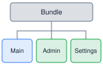
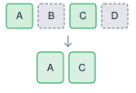
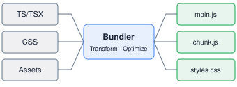
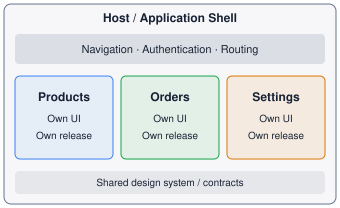

# Архітектура та продуктивність

## 8.1. Як би ти організував структуру великого React-проєкту?

<a id="q-8-1"></a>

### Пояснення

#### Interview answer (EN)

I organize a large React app by feature rather than by file type, so everything a feature needs, its components, hooks, API slice and types, lives together. Shared code moves to a separate layer only when it's genuinely reused, and an app layer wires up the providers, the store and the router. I also define dependency rules, for example that features can import from shared but not from each other's internals, and enforce them with lint rules.

Для великих застосунків зручно використовувати feature-based architecture, де код групується за функціональністю, а не лише за типом файлів.

```text
src/
├── app/
│   ├── providers/
│   ├── store/
│   └── router/
├── features/
│   ├── authentication/
│   │   ├── api/
│   │   ├── components/
│   │   ├── hooks/
│   │   ├── types/
│   │   └── index.ts      ← публічний API feature
│   └── products/
│       ├── api/
│       ├── components/
│       ├── state/
│       └── index.ts
├── pages/
└── shared/
    ├── ui/
    ├── hooks/
    ├── utils/
    └── types/
```

Правила, які роблять структуру корисною:

- **Напрям залежностей:** `app` → `pages` → `features` → `shared`. `shared` нічого не знає про features.
- **Публічний API:** інші частини імпортують feature лише через її `index.ts`, а не з внутрішніх файлів.
- **Без імпортів між features напряму** — спільне виноситься в `shared` або композиція відбувається на рівні `pages`.
- **Автоматична перевірка:** правила імпортів фіксують через ESLint (`no-restricted-imports` або спеціалізовані плагіни), а не лише домовленістю.
- **Colocation:** тести, стилі та stories лежать поруч із компонентом.

Це дозволяє зменшити зв'язність модулів, локалізувати зміни та спростити роботу декількох команд. Відомий формалізований варіант такого підходу — Feature-Sliced Design.

Не існує єдиної правильної структури. Вона має відповідати складності проєкту та потребам команди.

#### Можливі уточнення

- **Where would you put a component used by two features?** — у `shared/ui`, якщо він не містить бізнес-логіки; якщо містить — це, ймовірно, окрема feature або entity.
- **How do you prevent the `shared` folder from becoming a dumping ground?** — виносити туди лише справді перевикористаний код без доменної логіки, переглядати на code review.

#### Пов’язані питання

- [Що таке separation of concerns?](#q-8-3)
- [Design system](#q-8-13)

## 8.2. Як визначити, що компонент необхідно розділити на декілька?

<a id="q-8-2"></a>

### Пояснення

#### Interview answer (EN)

I split a component when it has several reasons to change, for example when it fetches data, holds form logic and renders a complex layout at the same time. Other signals are parts that could be reused, logic that is hard to test through the UI, or a state change that re-renders much more than it needs to. Line count alone isn't a reason; each piece should end up with a clear responsibility and a simple interface.

Основні сигнали:

- компонент має декілька незалежних відповідальностей (дані, бізнес-логіка, складний UI);
- його частини змінюються з різних причин або різними людьми;
- частини можна повторно використати;
- логіку складно протестувати через UI;
- зміна локального state перерендерює велике дерево, якому цей state не потрібен.

Наприклад:

```tsx
function ProductsPage() {
  return (
    <>
      <ProductsFilters />
      <ProductsTable />
      <ProductsPagination />
    </>
  );
}
```

Логіку можна винести в custom hook:

```typescript
const {
  products,
  filters,
  setFilters
} = useProducts();
```

Розділення може допомогти й продуктивності: якщо state (наприклад, значення поля пошуку) живе в маленькому компоненті, його зміна не перерендерює всю сторінку.

Не потрібно розділяти компоненти лише через кількість рядків. Важливіше, щоб кожна частина мала зрозумілу відповідальність. Надмірне дроблення створює prop drilling і ускладнює навігацію кодом.

#### Пов’язані питання

- [Що таке custom hooks і коли їх варто створювати?](../03-react/README.md#q-3-19)
- [Що таке lifting state up?](../03-react/README.md#q-3-16)

## 8.3. Що таке separation of concerns?

<a id="q-8-3"></a>

### Пояснення

#### Interview answer (EN)

Separation of concerns means giving different responsibilities clear boundaries: components render the UI, hooks handle interaction logic, an API layer talks to the server, and selectors derive data from the store. Each part can then change, be tested and be reused independently. The trade-off is that too many layers make simple features harder to follow, so I separate only where concerns really change for different reasons.

Принцип розділення різних відповідальностей між частинами системи.

| Шар | Відповідальність | Приклад |
| --- | --- | --- |
| UI component | Відображення та події | `<ProductCard />` |
| Custom hook | Логіка взаємодії, стан UI | `useProductFilters()` |
| API layer | Комунікація із сервером, кешування | RTK Query `productsApi` |
| Selectors | Отримання та трансформація даних | `selectVisibleProducts` |
| Domain utils | Чисті бізнес-правила | `calculateDiscount()` |

Це спрощує підтримку, тестування, повторне використання та рефакторинг. Наприклад, чисту функцію `calculateDiscount` можна покрити unit tests без рендеру компонентів.

При цьому надмірне розділення також може ускладнювати навігацію кодом.

#### Пов’язані питання

- [Як би ти організував структуру великого React-проєкту?](#q-8-1)
- [Як принципи SOLID застосовуються у frontend?](#q-8-4)

## 8.4. Як принципи SOLID застосовуються у frontend?

<a id="q-8-4"></a>

### Пояснення

#### Interview answer (EN)

I use SOLID as a vocabulary rather than a checklist. In React, single responsibility maps to focused components and hooks, open-closed to composition through children and render props, interface segregation to narrow props, and dependency inversion to passing services or callbacks in instead of importing concrete implementations. Applied pragmatically, these ideas keep components easy to extend and test, but forcing every rule onto small components just adds abstraction.

| Принцип | Значення | Приклад |
| --- | --- | --- |
| S — Single Responsibility | Одна основна відповідальність | Компонент не містить усю бізнес-логіку |
| O — Open/Closed | Розширення без зайвих змін існуючого коду | Composition, `children`, slots |
| L — Liskov Substitution | Сумісні реалізації можна замінювати | Компоненти зі спільним контрактом |
| I — Interface Segregation | Маленькі цільові контракти | Передавати лише необхідні props |
| D — Dependency Inversion | Залежність від абстракцій | Передавати сервіс замість жорсткої прив'язки до реалізації |

Приклад Open/Closed через composition: новий варіант картки не потребує зміни `Card`.

```tsx
function Card({ header, children }: { header: React.ReactNode; children: React.ReactNode }) {
  return (
    <section className="card">
      <header>{header}</header>
      {children}
    </section>
  );
}

<Card header={<ProductTitle />}>
  <ProductPrice />
</Card>;
```

Замість десятка boolean props (`showIcon`, `isCompact`, `withFooter`) компонент приймає вміст ззовні.

SOLID — це принципи проєктування, а не набір обов'язкових React-патернів. Використовувати їх потрібно прагматично.

#### Документація

- [React — Passing JSX as children](https://react.dev/learn/passing-props-to-a-component#passing-jsx-as-children)

## 8.5. Що таке code splitting та tree shaking?

<a id="q-8-5"></a>

### Пояснення

#### Interview answer (EN)

Code splitting breaks the bundle into chunks that load on demand, usually through dynamic import, for example with React lazy on route boundaries, so users download only what the current screen needs. Tree shaking removes exports that are never imported, but it works only with ES modules and only when the bundler can prove the code has no side effects. That's why libraries publish ESM builds and declare the sideEffects field in package.json.

| | Code splitting | Tree shaking |
| --- | --- | --- |
| Суть | Розділяємо код на частини (chunks) | Видаляємо невикористаний код |
| Коли діє | Під час завантаження: chunk вантажиться за потребою | Під час збірки |
| Механізм | Dynamic `import()`, `React.lazy`, окремі entry points | Статичний аналіз `import`/`export` |
| Результат | Менший початковий bundle | Менший bundle загалом |
| Умови | Точки розділення в коді (routes, модалки, важкі віджети) | ES modules, відсутність side effects |

Code splitting — розділення JavaScript bundle на менші частини, які можна завантажувати за потребою.

```tsx
const AdminPage = lazy(() => import("./AdminPage"));

<Suspense fallback={<PageSpinner />}>
  <AdminPage />
</Suspense>;
```

`React.lazy` потребує `Suspense` вище в дереві. Найкращі точки розділення — routes і рідко використовувані важкі частини UI (редактори, графіки, модальні вікна).

Tree shaking — видалення невикористаного коду під час збірки, коли bundler може безпечно визначити, що він не потрібен.

```typescript
import { debounce } from "./utils";
```

Якщо інші exports модуля не використовуються і не мають необхідних side effects, bundler може видалити їх із production bundle.

Що заважає tree shaking:

- **CommonJS** (`require`, `module.exports`) — структуру неможливо надійно проаналізувати статично; тому tree shaking покладається на ES modules.
- **Side effects під час імпорту** — код верхнього рівня, який змінює глобальний стан, реєструє щось або імпортує CSS.
- **Barrel files з side effects** і імпорт цілої бібліотеки замість окремих функцій.

Поле `sideEffects` у `package.json` повідомляє bundler, які файли можна безпечно відкинути, якщо їхні exports не використовуються:

```json
{
  "name": "my-ui-lib",
  "type": "module",
  "sideEffects": ["*.css"]
}
```

`"sideEffects": false` означає, що жоден файл пакета не має side effects. CSS-імпорти зазвичай треба залишити в списку, інакше стилі можуть зникнути з bundle. Поле документує webpack, Rolldown (bundler у Vite) також його враховує.





#### Можливі уточнення

- **How do you find what makes the bundle large?** — bundle analyzer (візуалізація chunks), перевірка дублікатів залежностей і того, чи бібліотека має ESM-збірку.
- **Can code splitting make things slower?** — так, забагато дрібних chunks — більше запитів і waterfall; важливі chunks можна preload/prefetch.

#### Пов’язані питання

- [Як працюють `React.lazy` та `Suspense`?](../03-react/README.md#q-3-21)
- [Як працює bundler?](#q-8-6)

#### Документація

- [webpack — Tree Shaking](https://webpack.js.org/guides/tree-shaking/)
- [React — lazy](https://react.dev/reference/react/lazy)
- [MDN — import()](https://developer.mozilla.org/en-US/docs/Web/JavaScript/Reference/Operators/import)

## 8.6. Як працює bundler?

<a id="q-8-6"></a>

### Пояснення

#### Interview answer (EN)

A bundler starts from entry points, resolves every import into a dependency graph, transforms each module, such as TypeScript, JSX and CSS, and then generates optimized chunks with hashed file names. Along the way, it performs tree shaking, code splitting and minification. Vite serves source files as native ES modules in development for fast startup and HMR, and since Vite 8 it uses Rolldown for production builds. Type checking still runs separately with tsc.

Bundler аналізує залежності між модулями, трансформує код і формує файли для запуску застосунку.

```flow
Entry | Починає з точки входу (index.html, main.tsx)
Resolve | Знаходить файли для кожного import, будує dependency graph
Transform | TypeScript/JSX → JavaScript, обробка CSS та assets через plugins
Optimize | Tree shaking, code splitting, minification
Output | Chunks з hash у назві для довготривалого кешування, source maps
```

Основні задачі: dependency graph, обробка imports, інтеграція транспіляції TypeScript та JSX, minification, code splitting, tree shaking, обробка CSS та assets.

**Vite** — build tool, який забезпечує development server і production build:

| Режим | Як працює (Vite 8) |
| --- | --- |
| Development | Залежності з `node_modules` один раз проходять pre-bundling через Rolldown; власний код віддається браузеру як native ES modules за запитом і трансформується Oxc; зміни застосовуються через HMR |
| Production | Повноцінна збірка Rolldown; JS мінімізує Oxc Minifier, CSS — Lightning CSS |

До Vite 8 використовувалися два інструменти: esbuild у development (трансформація та pre-bundling) і Rollup для production build. Rolldown — bundler на Rust із сумісним з Rollup plugin API — об'єднав обидва pipeline.

Vite лише транспілює TypeScript і **не перевіряє типи**. Type checking виконують окремо: `tsc --noEmit` у CI або паралельно під час розробки (наприклад, `tsc --noEmit --watch`). Через ізольовану транспіляцію в `tsconfig.json` варто вмикати `isolatedModules: true`.

Інші bundlers: webpack (найпоширеніший у старших проєктах, гнучкий через loaders і plugins), Rspack (сумісний з webpack, написаний на Rust).



#### Можливі уточнення

- **Why does production still need bundling if browsers support ES modules?** — сотні вкладених imports означають багато мережевих запитів і waterfall; bundling, tree shaking і minification дають швидше завантаження.
- **What is HMR?** — Hot Module Replacement: оновлення зміненого модуля в браузері без повного перезавантаження та зі збереженням стану, де це можливо.

#### Документація

- [Vite — Why Vite](https://vite.dev/guide/why)
- [Vite — Features (TypeScript)](https://vite.dev/guide/features)
- [webpack — Concepts](https://webpack.js.org/concepts/)

## 8.7. Що таке CSR, SSR та SSG?

<a id="q-8-7"></a>

### Пояснення

#### Interview answer (EN)

With CSR, the browser downloads JavaScript and builds the page itself, which is simple to host but slower to show the first content. SSR renders HTML on each request, so content appears earlier and is easy to index, at the cost of server work and hydration. SSG renders pages at build time and serves them from a CDN. Modern frameworks mix these per route, adding streaming SSR, incremental revalidation and React Server Components.

| Підхід | Де та коли генерується HTML | Приклад застосування |
| --- | --- | --- |
| CSR | У браузері | Dashboard, внутрішні інструменти за логіном |
| SSR | На сервері під час запиту | Динамічні публічні сторінки, персоналізований контент |
| SSG | Заздалегідь під час збірки | Документація, статті, landing pages |
| ISR / revalidation | Під час збірки або першого запиту, потім оновлюється у фоні | Каталог товарів, блог з частими оновленнями |

CSR — Client-Side Rendering. Браузер завантажує JavaScript, який формує UI.

SSR — Server-Side Rendering. Сервер повертає готовий HTML, після чого клієнтський JavaScript може додати інтерактивність (hydration).

SSG — Static Site Generation. HTML генерується заздалегідь і може віддаватися через CDN.

Сучасні розширення:

- **Streaming SSR** — сервер не чекає всіх даних, а відправляє HTML частинами: спочатку оболонку, потім вміст кожного `Suspense` boundary в міру готовності (`renderToPipeableStream`, `renderToReadableStream`). Користувач бачить сторінку раніше.
- **ISR / revalidation** — статична сторінка кешується, а після заданого часу (`revalidate`) або явної інвалідації перегенеровується у фоні за принципом stale-while-revalidate. Термін ISR походить з Next.js.
- **React Server Components (RSC)** — компоненти, які виконуються лише на сервері або під час збірки. Вони можуть напряму читати дані, а їхній код і залежності не потрапляють у клієнтський bundle. Інтерактивні частини позначаються `'use client'`. RSC — не те саме, що SSR: це модель розділення компонентів, яку зазвичай використовують разом із SSR у фреймворках (наприклад, Next.js App Router).

SSR та SSG можуть покращувати початкове відображення і доступність контенту для пошукових систем, але результат залежить від реалізації. Вибір робиться не для всього застосунку, а для кожного route.

#### Можливі уточнення

- **What's the downside of SSR?** — навантаження на сервер, складніший deploy і кешування, hydration cost; TTFB може зрости, якщо сервер чекає на повільні дані (це частково вирішує streaming).
- **Is SSR the same as Server Components?** — ні: SSR генерує HTML для першого відображення, а RSC визначає, які компоненти взагалі не відправляються на клієнт.

#### Пов’язані питання

- [Що таке hydration?](#q-8-8)
- [Як працюють `React.lazy` та `Suspense`?](../03-react/README.md#q-3-21)

#### Документація

- [web.dev — Rendering on the web](https://web.dev/articles/rendering-on-the-web)
- [React — Server Components](https://react.dev/reference/rsc/server-components)
- [Next.js — Incremental Static Regeneration](https://nextjs.org/docs/app/guides/incremental-static-regeneration)

## 8.8. Що таке hydration?

<a id="q-8-8"></a>

### Пояснення

#### Interview answer (EN)

Hydration is the step where React takes server-rendered HTML, renders the same tree on the client and attaches event handlers instead of recreating the DOM. It requires the first client render to match the server output. Mismatches usually come from dates, random values or browser-only APIs used during render; the fix is to render the same initial output and move client-only values into an effect, or suppress the warning for truly unavoidable differences like timestamps.

Hydration — процес підключення React до вже згенерованого сервером HTML, щоб зробити його інтерактивним.

```flow
Server | Генерує HTML
Browser | Показує UI ще до завантаження JavaScript
Hydration | React рендерить те саме дерево і підключає обробники подій до наявного DOM
Інтерактивний застосунок
```

```typescript
hydrateRoot(
  document.getElementById("root")!,
  <App />
);
```

Hydration mismatch виникає, коли HTML, згенерований сервером, не відповідає тому, що React очікує отримати під час першого клієнтського рендера. React радить ставитися до таких розбіжностей як до багів.

Типові причини:

- `Date.now()`, `new Date()`, `Math.random()` під час рендеру;
- локальний час, часовий пояс або локаль, що відрізняються на сервері та клієнті;
- `window`, `localStorage`, `navigator` у render (`typeof window !== "undefined" ? ... : ...`);
- невалідна вкладеність HTML (наприклад, `<div>` усередині `<p>`), яку браузер «виправляє» при парсингу;
- browser extensions, які змінюють DOM до hydration.

**React 19** замість кількох розрізнених попереджень показує одну помилку «Hydration failed because the server rendered HTML didn't match the client» з diff розбіжності. Якщо розбіжність не вдається виправити, React перерендерює відповідне дерево на клієнті, а це втрата переваг SSR.

Значення, яке має існувати лише на клієнті, встановлюють після hydration в Effect (two-pass rendering):

```tsx
function LocalTime() {
  const [time, setTime] = useState<string | null>(null);

  useEffect(() => {
    setTime(new Date().toLocaleTimeString());
  }, []);

  return <span>{time ?? "—"}</span>;
}
```

Для неминучої різниці в тексті одного елемента (наприклад, timestamp) можна додати `suppressHydrationWarning`. Він працює лише на один рівень вглиб, і React не виправлятиме цей текст — це запасний вихід, а не спосіб приховати баги.

```tsx
<time suppressHydrationWarning>{new Date().toLocaleDateString()}</time>
```

Помилки, після яких React відновився автоматично, можна логувати через опцію `onRecoverableError` у `hydrateRoot`.

#### Пов’язані питання

- [Що таке CSR, SSR та SSG?](#q-8-7)
- [Як працює `useEffect`?](../03-react/README.md#q-3-7)

#### Документація

- [React — hydrateRoot](https://react.dev/reference/react-dom/client/hydrateRoot)
- [React — React 19 (Diffs for hydration errors)](https://react.dev/blog/2024/12/05/react-19)

## 8.9. Як знайти причину повільної роботи React-застосунку?

<a id="q-8-9"></a>

### Пояснення

#### Interview answer (EN)

I start by reproducing the problem and measuring, not by adding memoization everywhere. The React Profiler shows which components render too often or too slowly, the Chrome Performance panel shows long tasks, layout and paint, and the Network panel shows heavy bundles or slow requests. Once I know the actual bottleneck, I apply a targeted fix, such as virtualization, code splitting or moving heavy work off the main thread, and then measure again.

Почати потрібно з вимірювання, а не з мемоізації всього коду.

```flow
Reproduce | Конкретний сценарій: який екран, яка дія, на якому пристрої
Measure | Profiler, Performance panel, Network, field data
Identify | Що саме дороге: рендер, long task, мережа, layout
Fix | Одна цілеспрямована зміна
Verify | Повторне вимірювання в тих самих умовах
```

| Інструмент | Що показує |
| --- | --- |
| React DevTools Profiler | Які компоненти рендеряться, скільки часу і чому («Why did this render?») |
| Chrome Performance panel | Long tasks, JavaScript execution, layout, paint; з React 19.2 — React Performance Tracks (Scheduler, Components) |
| Network panel | Повільні API, великі bundles, зайві та дубльовані запити |
| Memory panel | Витоки пам'яті (heap snapshots) |
| Lighthouse / web-vitals | LCP, INP, CLS у лабораторії та в реальних користувачів |

Для реалістичних вимірювань варто використовувати production build і CPU/network throttling: development mode React помітно повільніший.

Після визначення проблеми можна застосовувати конкретне рішення: virtualization, мемоізацію (або React Compiler), винесення state нижче по дереву, code splitting, оптимізацію запитів, `useTransition`/`useDeferredValue` для нетермінових оновлень або перенесення важких обчислень у Web Worker.

#### Пов’язані питання

- [Коли мемоізація може погіршити продуктивність?](../03-react/README.md#q-3-6)
- [Як би ти оптимізував компонент, який рендерить тисячі елементів?](../03-react/README.md#q-3-24)
- [Core Web Vitals](#q-8-10)

#### Документація

- [React — Profiler](https://react.dev/reference/react/Profiler)
- [React — Performance tracks](https://react.dev/reference/dev-tools/react-performance-tracks)
- [Chrome DevTools — Analyze runtime performance](https://developer.chrome.com/docs/devtools/performance)

## 8.10. Що таке Core Web Vitals — LCP, INP та CLS?

<a id="q-8-10"></a>

### Пояснення

#### Interview answer (EN)

Core Web Vitals are Google's three user-centric metrics: LCP for loading, INP for responsiveness, and CLS for visual stability. INP replaced First Input Delay in March 2024 and measures the latency of interactions throughout the whole visit, not just the first one. The metrics are assessed on real-user field data at the 75th percentile, for example through CrUX or the web-vitals library. Lab tools like Lighthouse can't measure INP directly, so Total Blocking Time serves as a proxy.

Core Web Vitals — метрики користувацького досвіду.

| Метрика | Хороший | Потребує покращення | Поганий |
| --- | --- | --- | --- |
| LCP · Largest Contentful Paint | ≤ 2,5 с | > 2,5 до 4 с | > 4 с |
| INP · Interaction to Next Paint | ≤ 200 мс | > 200 до 500 мс | > 500 мс |
| CLS · Cumulative Layout Shift | ≤ 0,1 | > 0,1 до 0,25 | > 0,25 |

- **LCP** — коли відрендерився найбільший видимий елемент (зображення, блок тексту).
- **INP** — затримка від взаємодії (клік, тап, натискання клавіші) до наступного кадру; береться одна з найгірших взаємодій за весь візит. 12 березня 2024 року INP замінив **FID**, який враховував лише затримку першої взаємодії.
- **CLS** — сума неочікуваних зсувів layout.

LCP оптимізують через швидке завантаження основних ресурсів (TTFB, preload, `fetchpriority`, оптимізовані зображення), INP — через зменшення блокування main thread (розбиття long tasks, менше JavaScript, `useTransition`), CLS — через резервування місця для контенту (`width`/`height` зображень, `aspect-ratio`, skeletons).

**Як вимірювати:**

| | Field (реальні користувачі, RUM) | Lab (контрольоване середовище) |
| --- | --- | --- |
| Інструменти | CrUX (PageSpeed Insights, Search Console), бібліотека `web-vitals` з відправкою в аналітику | Lighthouse, DevTools Performance panel |
| Плюси | Реальні пристрої, мережі, поведінка | Відтворюваність, зручно для налагодження і CI |
| INP | Вимірюється | Не вимірюється без реальної взаємодії; proxy — **TBT** (Total Blocking Time) |

```typescript
import { onCLS, onINP, onLCP } from "web-vitals";

function sendToAnalytics(metric: { name: string; value: number }) {
  navigator.sendBeacon("/analytics", JSON.stringify(metric));
}

onCLS(sendToAnalytics);
onINP(sendToAnalytics);
onLCP(sendToAnalytics);
```

Для польових метрик зазвичай оцінюють 75-й перцентиль відвідувань, окремо для mobile і desktop. Сторінка «проходить», якщо всі три метрики в зоні «хороший» на 75-му перцентилі.

#### Можливі уточнення

- **Lighthouse is green, but field data is bad. Why?** — lab — це один синтетичний запуск; реальні користувачі мають слабші пристрої, повільнішу мережу, інший кеш і реальні взаємодії.
- **How would you improve INP in a React app?** — знайти довгі обробники та рендери, розбити роботу, відкласти нетермінові оновлення через `useTransition`, зменшити кількість перерендерів.

#### Пов’язані питання

- [Як знайти причину повільної роботи React-застосунку?](#q-8-9)
- [Що таке `useTransition` та `useDeferredValue`?](../03-react/README.md#q-3-22)

#### Документація

- [web.dev — Web Vitals](https://web.dev/articles/vitals)
- [web.dev — Interaction to Next Paint (INP)](https://web.dev/articles/inp)
- [web.dev — INP becomes a Core Web Vital on March 12](https://web.dev/blog/inp-cwv-march-12)

## 8.11. Як би ти організував централізовану обробку помилок?

<a id="q-8-11"></a>

### Пояснення

#### Interview answer (EN)

I separate expected errors, like validation failures or a 404, from unexpected ones, like bugs and failed renders. Expected errors are handled close to where they happen with a clear message, API errors are normalized in one place, such as a custom base query, and Error Boundaries catch render failures with a fallback UI. Everything unexpected is reported to a monitoring tool with the release version, a correlation id and uploaded source maps, but without personal data or tokens.

Розділити помилки за їхнім походженням та відповідальністю.

| Джерело | Де обробляти |
| --- | --- |
| UI rendering errors | React Error Boundary (на рівні app і окремих секцій) |
| API errors | RTK Query `baseQuery` (обгортка над `fetchBaseQuery`) або Axios interceptor |
| Business / validation errors | Локальна обробка та зрозуміле повідомлення біля поля |
| Async errors поза рендером | `try/catch` в обробниках, `window.onerror`, `unhandledrejection` |
| Monitoring | Error tracking (Sentry, New Relic, Datadog тощо), структуровані логи |

Наприклад, 401 можна обробляти централізовано через refresh flow, 403 — через повідомлення про відсутність доступу, а помилки валідації форми — локально біля відповідного поля.

Error Boundary **не** ловить помилки в event handlers, асинхронному коді (`setTimeout`, Promise) та під час SSR — їх обробляють окремо. Виняток — помилки всередині функції, переданої в `startTransition`: їх Error Boundary перехоплює. Root-опції `onCaughtError`, `onUncaughtError` та `onRecoverableError` у `createRoot`/`hydrateRoot` (React 19) зручні для централізованого логування.

**Observability на frontend:**

- **Error tracking** — збір винятків зі stack trace, браузером, route і кроками користувача (breadcrumbs).
- **Source maps** — production-код мінімізований, тому stack trace без source maps нечитабельний. Source maps завантажують у систему моніторингу під час deploy і **не публікують** на CDN (у Vite — `build.sourcemap: "hidden"`: файли генеруються, але без посилання в bundle).
- **Release tag** — кожна помилка прив'язується до версії/commit, щоб бачити, який deploy її спричинив, і правильно зіставляти source maps.
- **Correlation id** — ідентифікатор запиту (наприклад, заголовок `X-Request-Id` або trace id), який є і в логах frontend, і в логах backend. Його можна показати користувачу в повідомленні про помилку для звернення в підтримку.
- **RUM** — Web Vitals і продуктивність реальних користувачів поруч із помилками.

У monitoring важливо не передавати паролі, токени та інші конфіденційні дані: їх фільтрують перед відправкою.

#### Можливі уточнення

- **Where would you place Error Boundaries?** — один на рівні застосунку як останній рубіж і локальні для незалежних віджетів, щоб падіння одного не ламало всю сторінку.
- **How do you avoid alert fatigue?** — групування однакових помилок, ігнорування шуму (browser extensions, скасовані запити), алерти за зростанням частоти після релізу.

#### Пов’язані питання

- [Як працюють Error Boundaries?](../03-react/README.md#q-3-18)
- [Як працює access token та refresh token?](../06-browser-network/README.md#q-6-10)

#### Документація

- [React — Catching rendering errors with an Error Boundary](https://react.dev/reference/react/Component#catching-rendering-errors-with-an-error-boundary)
- [Redux — RTK Query Error Handling](https://redux.js.org/toolkit/rtk-query/usage/error-handling)
- [MDN — Source map](https://developer.mozilla.org/en-US/docs/Glossary/Source_map)

## 8.12. Що таке microfrontend? Які його переваги та недоліки?

<a id="q-8-12"></a>

### Пояснення

#### Interview answer (EN)

Microfrontends split a large UI into parts that different teams own, build and deploy independently, and a shell composes them using tools like Module Federation or single-spa. The benefit is mostly organizational: autonomous teams, independent releases and a gradual migration away from legacy code. The cost is technical: shared dependencies, a consistent design, routing, cross-app communication and more complex testing. They make sense mainly when team scale, not code size, is the bottleneck.

Microfrontend — архітектурний підхід, за якого великий frontend-застосунок розділяється на менші відносно незалежні застосунки.

| Переваги | Недоліки |
| --- | --- |
| Незалежні команди та власність над частиною продукту | Складніша інтеграція та routing |
| Окремі deployments і релізні цикли | Shared dependencies: версії React, дублювання в bundle |
| Поступова міграція з legacy-технологій | Узгодженість UI (потрібна спільна design system) |
| Ізоляція збоїв (за правильної реалізації) | Синхронізація стану й комунікація між частинами |
| Менші codebases | Складніші тестування, локальна розробка, observability |

Способи інтеграції:

- **Build-time** — microfrontends як npm-пакети. Просто, але без незалежного deploy.
- **Runtime через JavaScript** — Module Federation (спільні залежності, завантаження remote-модулів), single-spa (оркестрація застосунків за routes).
- **Server-side / edge composition** — збирання сторінки з фрагментів на сервері.
- **iframes** — максимальна ізоляція, але погана інтеграція UX, accessibility і продуктивності.

Приклади технологій: Module Federation, single-spa, Qiankun.

Microfrontends мають сенс переважно тоді, коли організаційні та технічні переваги виправдовують додаткову складність. Для однієї команди зазвичай достатньо модульного моноліту з чіткими межами features.



#### Можливі уточнення

- **How do microfrontends communicate?** — через props/контракти від shell, custom events, URL; спільний глобальний store зазвичай вважають антипатерном, бо він знову зв'язує команди.
- **How do you avoid loading React twice?** — shared singleton dependencies у Module Federation з узгодженими версіями.

#### Пов’язані питання

- [Як би ти організував структуру великого React-проєкту?](#q-8-1)
- [Design system](#q-8-13)

#### Документація

- [Module Federation — Introduction](https://module-federation.io/guide/start/)
- [single-spa — Microfrontends Overview](https://single-spa.js.org/docs/microfrontends-concept/)

## 8.13. Що таке design system і як будувати спільну бібліотеку компонентів?

<a id="q-8-13"></a>

### Пояснення

#### Interview answer (EN)

A design system is a shared set of design tokens, components and guidelines, so different teams can build a consistent UI without reinventing buttons and modals. Tokens store decisions like colors, spacing and typography, and components consume them instead of hard-coded values. Good component APIs are small, composable and accessible by default, the components are documented in Storybook, and the library is versioned with semantic versioning so that breaking changes are explicit.

Design system складається з кількох рівнів:

| Рівень | Що містить | Приклад |
| --- | --- | --- |
| Design tokens | Іменовані рішення дизайну | `color.primary`, `space.4`, `radius.md` |
| Компоненти | Перевикористовувані UI-елементи на основі tokens | `Button`, `Input`, `Dialog`, `Tabs` |
| Патерни та гайдлайни | Як і коли використовувати компоненти | Форми, повідомлення про помилки, empty states |

**Tokens** часто зберігають у JSON і генерують із них CSS custom properties, щоб тему (наприклад, dark mode) можна було змінити без зміни компонентів. W3C Design Tokens Community Group у жовтні 2025 року випустила першу стабільну версію стандартного формату tokens, який підтримують дизайн-інструменти.

```css
:root {
  --color-primary: #2563eb;
  --space-4: 1rem;
}

[data-theme="dark"] {
  --color-primary: #60a5fa;
}
```

**API компонентів:**

- мінімум props, передбачувані назви, `variant`/`size` замість наборів boolean props;
- composition (`children`, compound components на кшталт `<Tabs.List>`, `<Tabs.Panel>`) замість конфігурації через десятки props;
- прокидання нативних атрибутів (`...rest`) і `ref` (у React 19 `ref` — звичайний prop);
- accessibility за замовчуванням: правильні ролі, клавіатурна навігація й керування фокусом за WAI-ARIA Authoring Practices;
- підтримка controlled і uncontrolled режимів там, де це доречно.

```tsx
type ButtonProps = React.ComponentPropsWithRef<"button"> & {
  variant?: "primary" | "secondary" | "danger";
  size?: "sm" | "md";
};

export function Button({ variant = "primary", size = "md", ...rest }: ButtonProps) {
  return <button className={`btn btn-${variant} btn-${size}`} {...rest} />;
}
```

**Документація та якість:** Storybook як каталог компонентів і середовище для їхньої ізольованої розробки, visual regression та a11y-перевірки для кожного story.

**Версіонування:** бібліотека публікується як пакет із semantic versioning (major — breaking changes), changelog і зрозумілими кроками міграції; застарілі API спершу позначають як deprecated.

#### Можливі уточнення

- **Build your own components or use a headless library?** — headless-бібліотеки (наприклад, Radix, React Aria) дають готову accessibility і поведінку, а design system додає стилі та tokens.
- **How do you roll out a breaking change?** — deprecation warning, codemod або гайд міграції, major-версія, підтримка попередньої версії певний час.

#### Пов’язані питання

- [Як принципи SOLID застосовуються у frontend?](#q-8-4)
- [Що таке accessibility та ARIA-атрибути?](../05-html-css/README.md#q-5-10)

#### Документація

- [W3C — Design Tokens Community Group](https://www.w3.org/community/design-tokens/)
- [W3C WAI — ARIA Authoring Practices Guide](https://www.w3.org/WAI/ARIA/apg/)

## 8.14. Як працювати зі змінними середовища та секретами на frontend?

<a id="q-8-14"></a>

### Пояснення

#### Interview answer (EN)

Everything that ends up in the frontend bundle is public, because anyone can open DevTools and read it. Build tools inline environment variables at build time, and Vite exposes only variables with the VITE_ prefix to client code precisely to prevent accidental leaks. So the bundle may contain public configuration, such as an API URL or a public analytics key, but real secrets belong on a server, a backend-for-frontend or a serverless function.

Головне правило: **frontend не може зберігати секрети**. Мінімізація чи обфускація коду не захищає: значення видно в JavaScript-файлах і в Network tab.

У Vite змінні з `.env` доступні через `import.meta.env`, але в клієнтський код потрапляють лише змінні з префіксом `VITE_` (префікс змінюється опцією `envPrefix`). Значення **вбудовуються в bundle під час збірки**.

```bash
# .env
VITE_API_URL=https://api.example.com   # потрапить у bundle — це публічна конфігурація
DB_PASSWORD=foobar                     # без префікса — недоступна клієнтському коду
```

```typescript
console.log(import.meta.env.VITE_API_URL); // "https://api.example.com"
console.log(import.meta.env.DB_PASSWORD);  // undefined
```

Значення завжди рядки: `VITE_FEATURE_X=true` треба явно перетворити на boolean. Для типізації оголошують `ImportMetaEnv` у `vite-env.d.ts`. Аналог у Next.js — префікс `NEXT_PUBLIC_`.

| Можна в bundle | Не можна в bundle |
| --- | --- |
| URL публічного API | Приватні API keys (платіжні, AI, email-сервіси) |
| Публічні ключі аналітики, maps з обмеженням за доменом | Паролі до баз даних, service account credentials |
| Feature flags за замовчуванням | Client secret OAuth, ключі підпису JWT |

**Де тримати секрети:** на backend, у BFF (backend-for-frontend) або serverless/edge function, які роблять запит до стороннього API від свого імені. Frontend звертається лише до власного backend з авторизацією користувача.

Практика: `.env.local` та `.env.*.local` додають у `.gitignore`; секрети для CI зберігають у secret storage (наприклад, GitHub Actions secrets), а не в репозиторії. Оскільки значення вбудовуються під час збірки, для різних середовищ потрібні або окремі збірки, або runtime-конфігурація (наприклад, `config.json`, який сервер віддає разом із застосунком).

#### Можливі уточнення

- **A secret key was accidentally shipped to the bundle. What do you do?** — негайно відкликати (rotate) ключ, бо видалення з коду не допоможе: старі bundles кешовані й могли бути збережені; потім перенести виклик на backend.

#### Пов’язані питання

- [Що таке XSS та CSRF?](../06-browser-network/README.md#q-6-7)
- [Як працює access token та refresh token?](../06-browser-network/README.md#q-6-10)

#### Документація

- [Vite — Env Variables and Modes](https://vite.dev/guide/env-and-mode)
- [OWASP — Secrets Management Cheat Sheet](https://cheatsheetseries.owasp.org/cheatsheets/Secrets_Management_Cheat_Sheet.html)
- [Next.js — Environment variables](https://nextjs.org/docs/app/guides/environment-variables)

## 8.15. Що таке feature flags і як безпечно викочувати зміни?

<a id="q-8-15"></a>

### Пояснення

#### Interview answer (EN)

A feature flag lets you ship code to production while switching a feature on or off at runtime, without a new deployment. That enables gradual rollouts to a percentage of users, A/B tests, beta access and a fast kill switch if something breaks. On the frontend, flags only control what the user sees, so access control must still be enforced on the server. Flags also need owners and cleanup, otherwise they turn into technical debt.

Feature flag (feature toggle) розділяє **deploy** (код у production) і **release** (функцію бачать користувачі).

| Тип | Призначення | Час життя |
| --- | --- | --- |
| Release flag | Приховати незавершену функцію, поступовий rollout | Короткий: видаляється після 100% |
| Experiment | A/B test, порівняння варіантів | До завершення експерименту |
| Ops / kill switch | Швидко вимкнути важку або ризиковану функцію | Довгий |
| Permission / entitlement | Доступ для тарифу чи групи користувачів | Довгий, але перевірка обов'язково на сервері |

```tsx
function Checkout() {
  const newCheckout = useFeatureFlag("new-checkout");

  return newCheckout ? <NewCheckout /> : <LegacyCheckout />;
}
```

**Безпечний rollout:**

```flow
Deploy | Код у production, flag вимкнений
Internal | Увімкнути для команди та QA
Canary | 1–5% користувачів, спостереження за помилками й метриками
Ramp up | 25% → 50% → 100%, якщо метрики стабільні
Cleanup | Видалити flag і стару гілку коду
```

Нюанси для frontend:

- значення flags потрібні **до першого рендеру**, інакше UI «блимає» (спершу старий варіант, потім новий); їх отримують разом із початковими даними або на сервері при SSR;
- той самий користувач має стабільно потрапляти в ту саму групу (bucketing за user id);
- код обох гілок є в bundle, тому flag **не приховує** функціональність від зацікавленого користувача — справжні обмеження доступу перевіряє backend;
- тести мають покривати обидва стани flag;
- кожен flag має власника і дату видалення.

#### Можливі уточнення

- **Feature flags vs long-lived feature branches?** — flags дозволяють часто зливати код у main (trunk-based development) і уникати великих конфліктних merge.
- **How do you roll back quickly?** — вимкнути flag (kill switch) без нового deploy; для змін без flag — rollback до попереднього build.

#### Пов’язані питання

- [Як би ти організував централізовану обробку помилок?](#q-8-11)

#### Документація

- [Wikipedia — Feature toggle](https://en.wikipedia.org/wiki/Feature_toggle)
