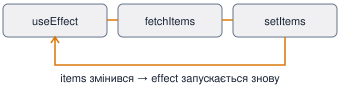
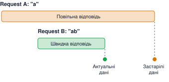

# Практичні завдання

## 9.1. Event Loop

<a id="q-9-1"></a>

Що виведеться в консоль і чому?

```javascript
console.log(1);

setTimeout(() => console.log(2), 0);

Promise.resolve().then(() => console.log(3));

console.log(4);
```

### Розв’язок

#### Interview answer (EN)

The output is 1, 4, 3, 2. Both console calls at the top level run synchronously, so 1 and 4 come first. When the call stack is empty, the engine drains the whole microtask queue, which prints 3 from the Promise callback, and only then does the event loop pick the timer task, so 2 is last even with a zero delay.

Відповідь: `1 → 4 → 3 → 2`.

Як міркувати на співбесіді: розкладіть код на три «черги».

1. **Синхронний код** виконується одразу: `1`, потім `4`.
2. **Microtasks** (`.then`, `await`, `queueMicrotask`) виконуються, щойно call stack порожній, і черга вичерпується повністю: `3`.
3. **Tasks (macrotasks)** — `setTimeout`, події, повідомлення — event loop бере по одному після microtasks: `2`.

`setTimeout(fn, 0)` не означає «виконати одразу»: це мінімальна затримка, після якої callback лише потрапляє в чергу. Для вкладених таймерів (від 5-го рівня) браузери ще й підвищують її до 4 мс.

Перевірте себе:

```javascript run
console.log(1);

setTimeout(() => console.log(2), 0);

Promise.resolve().then(() => console.log(3));

console.log(4);
```

#### Можливі уточнення

- **А якщо всередині `.then` створити ще один Promise?** — Новий microtask додасться в кінець тієї самої черги й виконається до `setTimeout`. Нескінченне додавання microtasks «заморозить» сторінку, бо до рендеру й tasks черга так і не дійде.
- **Де тут рендер браузера?** — Зазвичай між tasks, після вичерпання microtasks. Тому довгий синхронний код чи ланцюг microtasks блокує відмальовку.
- **Чи буде порядок інакшим у Node.js?** — Для такого простого випадку ні. Відмінності з’являються з `process.nextTick` і `setImmediate`.

#### Пов’язані питання

- [Як працює Event Loop?](../01-javascript/README.md#q-1-4)
- [У чому різниця між microtasks та macrotasks?](../01-javascript/README.md#q-1-5)
- [Predict the output: async/await, Promise і setTimeout](#q-9-18)

#### Документація

- [MDN — JavaScript execution model](https://developer.mozilla.org/en-US/docs/Web/JavaScript/Reference/Execution_model)
- [MDN — Using microtasks in JavaScript with queueMicrotask()](https://developer.mozilla.org/en-US/docs/Web/API/HTML_DOM_API/Microtask_guide)

## 9.2. Closure

<a id="q-9-2"></a>

Що виведеться? Як зміниться результат, якщо використати `let`?

```javascript
for (var i = 0; i < 3; i++) {
  setTimeout(() => console.log(i), 100);
}
```

### Розв’язок

#### Interview answer (EN)

With var, the loop has a single function-scoped binding, and by the time the timers fire it already holds 3, so we see 3, 3, 3. A let declaration in a for loop creates a fresh binding for every iteration, and each callback closes over its own copy, which gives 0, 1, 2. Before ES2015, people solved this with an IIFE or by passing the value as an argument.

З `var` буде `3, 3, 3`. З `let` буде `0, 1, 2`.

`var` створює одну змінну на всю функцію (або модуль). Усі три callbacks замикаються на ту саму змінну, а до моменту їхнього виконання цикл уже завершився й `i === 3`.

`let` у заголовку `for` створює окремий binding для кожної ітерації: значення копіюється в нову змінну перед наступним кроком, тому кожен callback бачить своє значення.

```javascript run
for (var i = 0; i < 3; i++) {
  setTimeout(() => console.log("var:", i), 100);
}

for (let j = 0; j < 3; j++) {
  setTimeout(() => console.log("let:", j), 100);
}
```

Як виправити без `let` (legacy-код):

```javascript
for (var i = 0; i < 3; i++) {
  setTimeout((value) => console.log(value), 100, i); // третій аргумент setTimeout
}
```

#### Можливі уточнення

- **Як розв’язати задачу без `let`?** — IIFE `(function (j) { ... })(i)`, третій аргумент `setTimeout` або `forEach`, де кожен виклик callback має власну область видимості.
- **Чому затримка 100 мс, а не 0, нічого не змінює?** — Цикл синхронний і завжди завершується до виконання будь-якого таймера.
- **Де ця проблема трапляється в React?** — Схожа ідея лежить в основі stale closure: callback бачить значення з того рендера, у якому був створений.

#### Пов’язані питання

- [Що таке closure (замикання)?](../01-javascript/README.md#q-1-3)
- [У чому різниця між `var`, `let` та `const`?](../01-javascript/README.md#q-1-1)
- [Що таке stale closure?](../03-react/README.md#q-3-12)

#### Документація

- [MDN — Closures](https://developer.mozilla.org/en-US/docs/Web/JavaScript/Guide/Closures)
- [MDN — for](https://developer.mozilla.org/en-US/docs/Web/JavaScript/Reference/Statements/for)

## 9.3. React State

<a id="q-9-3"></a>

Яке значення матиме `count` після одного натискання кнопки? Як зробити так, щоб воно збільшувалося на 3?

```typescript
const [count, setCount] = useState(0);

const handleClick = () => {
  setCount(count + 1);
  setCount(count + 1);
  setCount(count + 1);
};
```

### Розв’язок

#### Interview answer (EN)

After one click, the count is 1, because state behaves like a snapshot: all three calls read the same count from the current render and each queues "set it to 1". To get 3, I would pass an updater function, so React applies the queued updates in order, and each one receives the result of the previous one. Thanks to batching, it is still a single re-render.

Результат — `1`, оскільки всі три виклики використовують `count` із поточного рендера, тобто `0`. `setCount` не змінює змінну одразу: він ставить оновлення в чергу на наступний рендер. Тричі поставити в чергу «замінити на 1» — це те саме, що один раз.

Щоб отримати `+3`, використовуйте updater function:

```typescript
setCount(prev => prev + 1);
setCount(prev => prev + 1);
setCount(prev => prev + 1);
```

React під час наступного рендера застосовує чергу по порядку: `0 → 1 → 2 → 3`. Завдяки automatic batching (React 18+) три виклики дадуть лише **один** re-render.

Важливо: `console.log(count)` одразу після `setCount` у тому самому обробнику виведе старе значення `0` — змінна `count` належить поточному рендеру.

```demo
batching
```

#### Можливі уточнення

- **Що буде після `setCount(count + 5); setCount(prev => prev + 1)`?** — `6`: спершу «замінити на 5», потім updater отримає 5.
- **Скільки буде ре-рендерів?** — Один: React групує оновлення в обробниках подій, Promise і `setTimeout` (automatic batching з React 18).
- **Як змусити React оновити DOM синхронно?** — `flushSync` з `react-dom`, але це рідкісний випадок (наприклад, прокрутка до щойно доданого елемента).

#### Пов’язані питання

- [Як працює batching оновлень стану?](../03-react/README.md#q-3-13)
- [Що таке stale closure?](../03-react/README.md#q-3-12)

#### Документація

- [React — Queueing a Series of State Updates](https://react.dev/learn/queueing-a-series-of-state-updates)
- [React — State as a Snapshot](https://react.dev/learn/state-as-a-snapshot)

## 9.4. useEffect

<a id="q-9-4"></a>

Що не так із цим кодом?

```typescript
const [items, setItems] = useState([]);

useEffect(() => {
  fetchItems().then(setItems);
}, [items]);
```

### Розв’язок

#### Interview answer (EN)

The effect depends on the same state it updates, so every response sets a new array, the reference changes, and the effect fetches again in an endless loop. The fix is to depend only on real inputs, such as a user ID or filters, and add cleanup so a late response cannot overwrite newer data. In a real app, I would move this to RTK Query, which handles caching, deduplication, and loading states for me.

Виникає потенційний нескінченний цикл. Кожен запит зазвичай повертає новий масив, `setItems` змінює залежність (порівняння за посиланням, `Object.is`), і effect повторюється.



Залежностями effect мають бути **вхідні дані запиту** (наприклад, `userId`, фільтри), а не його результат. Якщо дані потрібні лише при монтуванні і `fetchItems` — стабільна зовнішня функція:

```typescript
useEffect(() => {
  let ignore = false;

  fetchItems().then((data) => {
    if (!ignore) setItems(data);
  });

  return () => {
    ignore = true;
  };
}, []);
```

Додаткові проблеми оригінального коду:

- `useState([])` без типу в TypeScript виводить `never[]` — краще `useState<Item[]>([])`.
- Немає обробки помилок і стану завантаження.
- У Strict Mode у dev-режимі effect виконується двічі (mount → cleanup → mount), тож cleanup з `ignore` захищає від подвійного запису.

У production такий код варто замінити на RTK Query (`useGetItemsQuery()`): кеш, дедуплікація запитів, `isLoading`/`isError` і повторні запити вже реалізовані.

#### Можливі уточнення

- **А якщо прибрати масив залежностей зовсім?** — Effect виконуватиметься після кожного рендера, а `setItems` викликає рендер — той самий нескінченний цикл.
- **Що підкаже лінтер?** — `react-hooks/exhaustive-deps` перевіряє, що всі реактивні значення в effect є в залежностях. Правильна відповідь — не «вимкнути правило», а прибрати зайву залежність із коду.
- **Чому б не залежати від `items.length`?** — Це маскування проблеми: effect усе одно реагує на свій результат, а не на причину запиту.

#### Пов’язані питання

- [Як працює `useEffect`?](../03-react/README.md#q-3-7)
- [Коли виконується cleanup-функція в `useEffect`?](../03-react/README.md#q-3-8)
- [Race Condition](#q-9-8)

#### Документація

- [React — Synchronizing with Effects](https://react.dev/learn/synchronizing-with-effects)
- [React — Removing Effect Dependencies](https://react.dev/learn/removing-effect-dependencies)

## 9.5. Reference vs Value

<a id="q-9-5"></a>

Що виведеться в консоль?

```javascript
const a = { user: { name: "Alex" } };
const b = { ...a };

b.user.name = "John";

console.log(a.user.name);
console.log(a === b);
console.log(a.user === b.user);
```

### Розв’язок

#### Interview answer (EN)

It prints John, false, and true. Spread creates a shallow copy: the outer object is new, so a and b are different references, but the nested user object is copied by reference and shared. To change the name independently, I would copy every level I modify, or use structuredClone when I really need a full deep copy.

```text
John
false
true
```

Spread operator створює shallow copy. Об'єкти `a` та `b` мають різні посилання, але їхні вкладені `user` вказують на той самий об'єкт, тому зміна через `b` видна і через `a`.

Для незалежного копіювання вкладеного об'єкта копіюйте кожен рівень, який змінюєте (так само працюють іммутабельні оновлення state в React і Redux):

```javascript run
const a = { user: { name: "Alex" } };
const b = { ...a };

b.user.name = "John";

console.log(a.user.name);
console.log(a === b);
console.log(a.user === b.user);

const c = { ...a, user: { ...a.user } };
c.user.name = "Kate";
console.log(a.user.name, c.user.name);
```

Для повної глибокої копії — `structuredClone(a)`. Він підтримує `Date`, `Map`, `Set` і циклічні посилання, але не копіює функції, DOM-вузли та прототипи класів.

#### Можливі уточнення

- **Чому не `JSON.parse(JSON.stringify(obj))`?** — Втрачає `undefined`, функції, `Date` (стає рядком), `Map`/`Set`, падає на циклічних посиланнях.
- **Чи робить `Object.assign({}, a)` глибоку копію?** — Ні, це така сама shallow copy, як spread.
- **Як це пов’язано з Redux Toolkit?** — Immer дозволяє писати «мутуючий» код, а сам створює нові посилання лише для змінених гілок дерева.

#### Пов’язані питання

- [Що таке shallow copy та deep copy?](../01-javascript/README.md#q-1-9)
- [Що таке іммутабельність і навіщо вона потрібна?](../01-javascript/README.md#q-1-16)
- [Як працює Immer у Redux Toolkit?](../04-redux-toolkit/README.md#q-4-4)

#### Документація

- [MDN — Spread syntax (...)](https://developer.mozilla.org/en-US/docs/Web/JavaScript/Reference/Operators/Spread_syntax)
- [MDN — Shallow copy](https://developer.mozilla.org/en-US/docs/Glossary/Shallow_copy)
- [MDN — structuredClone()](https://developer.mozilla.org/en-US/docs/Web/API/Window/structuredClone)

## 9.6. TypeScript Generics

<a id="q-9-6"></a>

Типізуй функцію так, щоб TypeScript автоматично визначав тип значення, що повертається, та не дозволяв передати неіснуючий ключ.

```typescript
function getProperty(obj, key) {
  return obj[key];
}

const user = { name: "Alex", age: 30 };

getProperty(user, "name");
getProperty(user, "age");
getProperty(user, "email"); // TypeScript error
```

### Розв’язок

#### Interview answer (EN)

I would add two type parameters: T for the object and K constrained to keyof T, so only existing keys are accepted. The return type is the indexed access type T[K], which means the result is a string for "name" and a number for "age". Both type arguments are inferred from the call, so the caller never writes them explicitly.

```typescript
function getProperty<T, K extends keyof T>(
  obj: T,
  key: K
): T[K] {
  return obj[key];
}

const user = {
  name: "Alex",
  age: 30
};

getProperty(user, "name"); // string
getProperty(user, "age");  // number
getProperty(user, "email"); // TS error
```

`T` — тип об'єкта. `K` — один із його ключів (`keyof T` = `"name" | "age"`). `T[K]` — тип значення відповідної властивості.

Чому другий generic `K`, а не просто `key: keyof T`? Тоді тип результату був би `T[keyof T]` = `string | number` для будь-якого ключа. Окремий параметр `K` «запам’ятовує» конкретний літерал `"name"`.

#### Можливі уточнення

- **Як типізувати `pick(obj, keys)`?** — `function pick<T, K extends keyof T>(obj: T, keys: readonly K[]): Pick<T, K>`.
- **Що буде, якщо передати ключ змінною типу `string`?** — Помилка: `string` не можна присвоїти `keyof T`. Потрібен union-літерал або `as const`.
- **Як типізувати шлях `"address.city"`?** — Через template literal types і рекурсивні conditional types; на співбесіді достатньо описати ідею.

#### Пов’язані питання

- [Що таке generics?](../02-typescript/README.md#q-2-3)
- [Як працюють `keyof` та `typeof` у TypeScript?](../02-typescript/README.md#q-2-10)
- [Типізований EventEmitter](#q-9-15)

#### Документація

- [TypeScript — Generics](https://www.typescriptlang.org/docs/handbook/2/generics.html)
- [TypeScript — Keyof Type Operator](https://www.typescriptlang.org/docs/handbook/2/keyof-types.html)
- [TypeScript — Indexed Access Types](https://www.typescriptlang.org/docs/handbook/2/indexed-access-types.html)

## 9.7. Реалізуй debounce

<a id="q-9-7"></a>

Реалізуй власну функцію `debounce` без використання сторонніх бібліотек: callback має виконатися один раз через `delay` мс після **останнього** виклику, з останніми аргументами.

```typescript
function debounce<Args extends unknown[]>(
  callback: (...args: Args) => void,
  delay: number
): (...args: Args) => void {
  // ...
}
```

### Розв’язок

#### Interview answer (EN)

The debounced wrapper keeps a timer in a closure. Every call clears the previous timer and schedules a new one with the latest arguments, so the callback runs only after calls have stopped for the given delay. I would return a regular function rather than an arrow, so the original this is preserved, and in production I would also expose cancel and flush, mainly to clear the timer on unmount.

```typescript
function debounce<This, Args extends unknown[]>(
  callback: (this: This, ...args: Args) => void,
  delay: number
) {
  let timer: ReturnType<typeof setTimeout> | undefined;

  return function (this: This, ...args: Args) {
    clearTimeout(timer);
    timer = setTimeout(() => callback.apply(this, args), delay);
  };
}

const search = debounce((value: string) => {
  console.log("Search:", value);
}, 500);

search("a");
search("ab");
search("abc");
```

Якщо виклики відбулися без необхідної паузи, через 500 мс після останнього виклику буде виведено `Search: abc`.

Як міркувати:

- `timer` живе в closure, тож він спільний для всіх викликів однієї debounced-функції.
- `clearTimeout(undefined)` безпечний, тому окрема перевірка не потрібна.
- Повертається звичайна `function`, а всередині `setTimeout` — стрілкова: вона бере `this` обгортки, і метод об’єкта (`obj.save = debounce(obj.save, 300)`) не втратить контекст.
- `ReturnType<typeof setTimeout>` працює і в браузері (`number`), і в Node (`Timeout`).
- Generics зберігають типи аргументів callback.

Розширена версія з `cancel()` і `flush()`:

```javascript run
function debounce(callback, delay) {
  let timer;
  let lastArgs;
  let lastThis;

  function debounced(...args) {
    lastArgs = args;
    lastThis = this;
    clearTimeout(timer);
    timer = setTimeout(() => {
      timer = undefined;
      callback.apply(lastThis, lastArgs);
    }, delay);
  }

  debounced.cancel = () => {
    clearTimeout(timer);
    timer = undefined;
  };

  debounced.flush = () => {
    if (timer === undefined) return;
    clearTimeout(timer);
    timer = undefined;
    callback.apply(lastThis, lastArgs);
  };

  return debounced;
}

const search = debounce((value) => console.log("Search:", value), 100);

search("a");
search("ab");
search("abc"); // через 100 мс: Search: abc

const save = debounce((value) => console.log("Save:", value), 100);
save("draft 1");
save("draft 2");
save.flush(); // одразу: Save: draft 2

const track = debounce((value) => console.log("Track:", value), 100);
track("click");
track.cancel(); // нічого не виведеться
```

#### Можливі уточнення

- **Додай `cancel()`** — потрібен, щоб скасувати відкладений виклик при unmount компонента: інакше callback виконається після того, як компонент зник.
- **Додай `flush()`** — виконує відкладений виклик негайно, наприклад автозбереження перед закриттям форми.
- **Як зробити leading edge?** — Викликати callback, якщо таймера ще немає, і лише запускати таймер, який «знімає блокування»; опційно додати trailing-виклик, якщо за цей час були нові виклики.
- **Як використати в React?** — Не створювати debounce в тілі компонента на кожен рендер: тримати його в `useMemo`/`useRef` і скасовувати в cleanup або debounce-ити значення через `useDebouncedValue`.

#### Пов’язані питання

- [Що таке debounce та throttle?](../01-javascript/README.md#q-1-13)
- [Реалізуй throttle](#q-9-9)
- [Custom hook `useDebouncedValue`](#q-9-19)

#### Документація

- [MDN — setTimeout()](https://developer.mozilla.org/en-US/docs/Web/API/Window/setTimeout)
- [MDN — Function.prototype.apply()](https://developer.mozilla.org/en-US/docs/Web/JavaScript/Reference/Global_Objects/Function/apply)

## 9.8. Race Condition

<a id="q-9-8"></a>

Є поле пошуку, яке відправляє API-запит при зміні тексту. Старий запит повернув результат пізніше за новий і перезаписав актуальні дані. Як розв'язати цю проблему?

### Розв’язок

#### Interview answer (EN)

Responses can arrive in any order, so the UI must accept only the result of the latest request. In an effect, I would create an AbortController per search term and abort it in the cleanup, which cancels the obsolete request and ignores its result. Debounce alone does not fix this; it only reduces the number of requests. With RTK Query, each argument has its own cache entry, so a late response cannot overwrite the current one.



Варіант вирішення — скасовувати попередній запит та ігнорувати застарілі результати.

```typescript
useEffect(() => {
  const controller = new AbortController();
  let active = true;

  async function searchUsers() {
    try {
      const response = await fetch(
        `/api/users?q=${encodeURIComponent(search)}`,
        { signal: controller.signal }
      );

      if (!response.ok) {
        throw new Error("Request failed");
      }

      const data = await response.json();

      if (active) {
        setUsers(data);
      }
    } catch (error) {
      if (active && !controller.signal.aborted) {
        console.error(error);
      }
    }
  }

  searchUsers();

  return () => {
    active = false;
    controller.abort();
  };
}, [search]);
```

Чому і `abort()`, і прапорець `active`? `abort()` скасовує мережевий запит і відхиляє Promise з `AbortError`, але якщо відповідь уже прийшла й код дійшов до `response.json()`, надійніше додатково перевірити прапорець. Cleanup виконується перед кожним новим запуском effect (зміна `search`) і при unmount.

Інші варіанти: request ID (зберігати номер останнього запиту в `useRef` і порівнювати) або бібліотека server state. В RTK Query кеш розділений за аргументами: `useSearchUsersQuery(search)` для `"ab"` і `"abc"` — це різні записи, і хук повертає дані для поточного аргументу.

Сам debounce не гарантує вирішення race condition, оскільки декілька запитів усе одно можуть виконуватися одночасно.

#### Можливі уточнення

- **Чи скасовує RTK Query попередній запит при зміні аргументу?** — Автоматично ні: старий запит завершиться й заповнить свій запис у кеші, але компонент його не покаже. `data` при цьому тримає попередній результат, поки йде новий запит, а `currentData` — лише для поточного аргументу.
- **А TanStack Query?** — Передає `signal` у `queryFn`; якщо ви його використовуєте у `fetch`, запит скасується, коли query стане неактивним (наприклад, зміниться query key).
- **Як протестувати race condition?** — MSW з різними затримками для різних запитів і перевірка, що на екрані результат останнього вводу.

#### Пов’язані питання

- [Що таке debounce та throttle? Коли їх використовувати?](../01-javascript/README.md#q-1-13)
- [Як працює `AbortController`?](../06-browser-network/README.md#q-6-13)
- [Як скасувати або пропустити непотрібний API-запит?](../04-redux-toolkit/README.md#q-4-15)

#### Документація

- [MDN — AbortController](https://developer.mozilla.org/en-US/docs/Web/API/AbortController)
- [React — Synchronizing with Effects](https://react.dev/learn/synchronizing-with-effects)
- [TanStack Query — Query Cancellation](https://tanstack.com/query/latest/docs/framework/react/guides/query-cancellation)

## 9.9. Реалізуй throttle

<a id="q-9-9"></a>

Реалізуй `throttle(fn, wait, { leading, trailing })`: функція виконується не частіше одного разу за `wait` мс. `leading` — виконати перший виклик одразу, `trailing` — виконати останній виклик у кінці вікна. За замовчуванням обидва `true`.

```javascript
function throttle(fn, wait, { leading = true, trailing = true } = {}) {
  // ...
}

const onScroll = throttle(() => console.log(window.scrollY), 100);
window.addEventListener("scroll", onScroll);
```

### Розв’язок

#### Interview answer (EN)

Throttle guarantees at most one call per time window. On the first call, I run the function immediately if leading is enabled and start a cooldown timer; any calls during the cooldown only overwrite the saved arguments. When the timer fires and there is a pending call, I run it as the trailing call and start a new window, so the latest value is never lost, and the rate limit still holds.

Як міркувати на співбесіді: спершу уточніть вимоги — потрібен перший виклик одразу (leading)? Чи важливий останній (trailing — так, для scroll/resize, бо фінальна позиція важлива)? Які аргументи передавати — останні. Потім опишіть стан: таймер «вікна» і відкладений виклик.

```javascript run
function throttle(fn, wait, { leading = true, trailing = true } = {}) {
  let timer = null;
  let pendingArgs = null;
  let pendingThis = null;

  function startCooldown() {
    timer = setTimeout(() => {
      if (trailing && pendingArgs) {
        fn.apply(pendingThis, pendingArgs);
        pendingArgs = pendingThis = null;
        startCooldown(); // після trailing-виклику знову чекаємо wait
      } else {
        timer = null;
      }
    }, wait);
  }

  return function throttled(...args) {
    if (timer === null) {
      if (leading) {
        fn.apply(this, args);
      } else {
        pendingArgs = args;
        pendingThis = this;
      }
      startCooldown();
      return;
    }

    pendingArgs = args; // запам’ятовуємо лише останній виклик
    pendingThis = this;
  };
}

const onScroll = throttle((y) => console.log("handle", y), 100);

onScroll(1); // leading: одразу
onScroll(2);
onScroll(3); // trailing через 100 мс
setTimeout(() => onScroll(4), 150); // trailing у наступному вікні
setTimeout(() => onScroll(5), 350); // пауза минула — знову leading
```

Очікуваний результат: `handle 1`, `handle 3`, `handle 4`, `handle 5`. Виклик `2` відкинуто — throttle гарантує частоту, а не виконання кожного виклику.

Нюанси:

- Після trailing-виклику вікно стартує знову, інакше наступний leading-виклик міг би статися одразу після trailing і порушити ліміт.
- `leading: false, trailing: false` — функція не виконається ніколи (так само в lodash); можна валідувати опції.
- Складність — O(1) на виклик, пам’ять — лише останні аргументи.
- Альтернатива на timestamp (`Date.now() - last >= wait`) простіша, але без таймера не дає trailing-виклику.

#### Можливі уточнення

- **Чим throttle відрізняється від debounce з `maxWait`?** — Debounce з `maxWait` = throttle: виклик гарантовано відбудеться хоча б раз за `maxWait`, навіть якщо події не припиняються.
- **Додай `cancel()`** — `clearTimeout(timer)`, скинути `timer`, `pendingArgs` і `pendingThis`; викликати в cleanup effect.
- **Що краще для анімацій і scroll-ефектів?** — Throttle через `requestAnimationFrame`: не частіше одного разу на кадр і синхронно з рендером браузера.
- **Навіщо `fn.apply(this, args)`?** — Щоб throttled-метод об’єкта зберіг `this` і всі аргументи.

#### Пов’язані питання

- [Що таке debounce та throttle?](../01-javascript/README.md#q-1-13)
- [Реалізуй debounce](#q-9-7)

#### Документація

- [MDN — setTimeout()](https://developer.mozilla.org/en-US/docs/Web/API/Window/setTimeout)
- [MDN — requestAnimationFrame()](https://developer.mozilla.org/en-US/docs/Web/API/Window/requestAnimationFrame)

## 9.10. Polyfill для `Promise.all`

<a id="q-9-10"></a>

Реалізуй `promiseAll(iterable)`, який поводиться як `Promise.all`:

- повертає Promise з масивом результатів **у порядку вхідних елементів**, а не в порядку завершення;
- приймає й звичайні значення (не Promise);
- для порожнього масиву одразу повертає `[]`;
- відхиляється з першою помилкою.

```javascript
function promiseAll(iterable) {
  // ...
}

promiseAll([fetchUser(), fetchOrders(), 42]).then(([user, orders, answer]) => {});
```

### Розв’язок

#### Interview answer (EN)

I return a new Promise and subscribe to every item through Promise.resolve, so plain values and thenables work too. Each result is written by its index, which keeps the input order, and a separate counter tells me when all items have fulfilled, because the array length cannot. The first rejection is passed straight to reject; later results are ignored, since a promise settles only once, but the other operations keep running.

Хід думок: результат — новий Promise; кожен елемент обгортаємо в `Promise.resolve` (працює і для значень, і для thenable); пишемо результат за індексом; рахуємо, скільки ще чекаємо.

```javascript run
function promiseAll(iterable) {
  return new Promise((resolve, reject) => {
    const items = Array.from(iterable);
    const results = new Array(items.length);
    let remaining = items.length;

    if (remaining === 0) {
      resolve(results);
      return;
    }

    items.forEach((item, index) => {
      Promise.resolve(item).then((value) => {
        results[index] = value;
        remaining -= 1;

        if (remaining === 0) {
          resolve(results);
        }
      }, reject);
    });
  });
}

const delay = (ms, value, fail = false) =>
  new Promise((resolve, reject) =>
    setTimeout(() => (fail ? reject(new Error(value)) : resolve(value)), ms)
  );

promiseAll([delay(300, "slow"), delay(100, "fast"), 42])
  .then((result) => console.log("all:", JSON.stringify(result)));

promiseAll([])
  .then((result) => console.log("empty:", JSON.stringify(result)));

promiseAll([delay(200, "ok"), delay(50, "boom", true)])
  .catch((error) => console.log("rejected:", error.message));
```

Очікуваний порядок: `empty: []`, `rejected: boom`, `all: ["slow","fast",42]` — порядок результатів збігається з вхідним, хоча `"fast"` завершився раніше.

Типові помилки:

- `results.push(value)` — порядок за часом завершення, а не за входом.
- `if (results.length === items.length)` — `new Array(n)` уже має довжину `n`, а присвоєння `results[2]` до `results[0]` теж робить довжину 3. Потрібен окремий лічильник.
- Забути порожній масив — Promise ніколи не завершиться.
- `Array.from(iterable)` потрібен, бо `Promise.all` приймає будь-який iterable (`Set`, генератор).

Складність: O(n) часу й пам’яті.

#### Можливі уточнення

- **Чи скасовує `Promise.all` інші операції після помилки?** — Ні, вони продовжують виконуватися; для скасування потрібен спільний `AbortController`.
- **Реалізуй `Promise.allSettled`** — той самий каркас, але обидва обробники записують `{ status: "fulfilled", value }` або `{ status: "rejected", reason }`, і `reject` не викликається.
- **Чому не `for (const p of items) results.push(await p)`?** — Результат буде правильний, але помилка пізнішого Promise виявиться тільки після завершення попередніх, а необроблені відхилення можуть дати `unhandledrejection`.
- **Як реалізувати `Promise.race`/`Promise.any`?** — `race`: `Promise.resolve(item).then(resolve, reject)` для кожного; `any`: навпаки, рахувати помилки й наприкінці відхилити з `AggregateError`.

#### Пов’язані питання

- [Чим відрізняються `Promise.all`, `Promise.allSettled`, `Promise.race` та `Promise.any`?](../01-javascript/README.md#q-1-12)
- [Concurrency limiter (promise pool)](#q-9-11)

#### Документація

- [MDN — Promise.all()](https://developer.mozilla.org/en-US/docs/Web/JavaScript/Reference/Global_Objects/Promise/all)
- [MDN — Promise.resolve()](https://developer.mozilla.org/en-US/docs/Web/JavaScript/Reference/Global_Objects/Promise/resolve)

## 9.11. Concurrency limiter (promise pool)

<a id="q-9-11"></a>

Є масив асинхронних задач (наприклад, 100 завантажень файлів). Реалізуй `promisePool(tasks, limit)`: одночасно виконується не більше `limit` задач, щойно одна завершується — стартує наступна. Результат — масив у порядку вхідних задач.

```javascript
// tasks — масив функцій, що повертають Promise
async function promisePool(tasks, limit) {
  // ...
}

const results = await promisePool(files.map((file) => () => upload(file)), 3);
```

### Розв’язок

#### Interview answer (EN)

The key detail is that tasks are functions, not promises, because a promise has already started by the time it exists. I start limit workers, and each one loops: it takes the next index from a shared counter, awaits that task, stores the result by index, and moves on until the queue is empty. JavaScript is single-threaded, so incrementing the counter is safe, and Promise.all over the workers gives me the final ordered result.

Як міркувати:

1. Уточнити: задачі — функції (лінивий старт), чи потрібен порядок результатів, що робити з помилкою (зупинитися чи зібрати всі)?
2. Обрати модель «K workers»: кожен worker у циклі бере наступну задачу. Це простіше, ніж вручну запускати нову задачу в `.then` попередньої.
3. Індекс «бронюється» синхронно (`nextIndex++` до `await`), тому дві задачі не візьмуть один індекс.

```javascript run
async function promisePool(tasks, limit) {
  if (!Number.isInteger(limit) || limit < 1) {
    throw new RangeError("limit must be a positive integer");
  }

  const results = new Array(tasks.length);
  let nextIndex = 0;

  async function worker() {
    while (nextIndex < tasks.length) {
      const index = nextIndex++; // синхронно «бронюємо» задачу
      results[index] = await tasks[index]();
    }
  }

  const workerCount = Math.min(limit, tasks.length);
  await Promise.all(Array.from({ length: workerCount }, () => worker()));

  return results;
}

let active = 0;
let maxActive = 0;

const task = (id, ms) => async () => {
  active += 1;
  maxActive = Math.max(maxActive, active);
  console.log("start", id);
  await new Promise((resolve) => setTimeout(resolve, ms));
  active -= 1;
  console.log("done", id);
  return id * 10;
};

const results = await promisePool(
  [task(1, 300), task(2, 100), task(3, 100), task(4, 50)],
  2
);

console.log("results:", JSON.stringify(results), "max active:", maxActive);
```

Задача 1 довга, тому поки вона виконується, другий worker послідовно проходить задачі 2, 3 і 4. Результат — `[10,20,30,40]`, максимум 2 одночасні задачі.

Нюанси:

- Помилка будь-якої задачі відхиляє `Promise.all` (fail fast), але інші workers **продовжать** брати нові задачі. Якщо треба зупинитися — прапорець `failed` у циклі або `AbortSignal`.
- Складність: O(n) часу на керування, O(n) пам’яті на результати; одночасно в роботі — не більше `limit` Promise.
- Практика: у браузері HTTP/1.1 і так обмежує ~6 з’єднань на origin, але pool усе одно потрібен, щоб не перевантажити сервер, rate limit API або пам’ять (наприклад, при обробці файлів).

#### Можливі уточнення

- **Зупини pool після першої помилки** — спільний прапорець, який перевіряється в `while`, або `AbortController`, сигнал якого передається в задачі.
- **Поверни результати як `allSettled`** — у `try/catch` записувати `{ status, value/reason }` замість падіння.
- **Зроби API як у `p-limit`: `const limit = createLimit(3); limit(() => fetch(...))`** — черга функцій + лічильник активних; при завершенні задачі брати наступну з черги.
- **Чому `tasks` — функції, а не Promise?** — Promise починає виконуватися в момент створення; масив Promise означає, що всі запити вже пішли.

#### Пов’язані питання

- [Polyfill для `Promise.all`](#q-9-10)
- [Retry з exponential backoff](#q-9-12)

#### Документація

- [MDN — Promise.all()](https://developer.mozilla.org/en-US/docs/Web/JavaScript/Reference/Global_Objects/Promise/all)
- [MDN — async function](https://developer.mozilla.org/en-US/docs/Web/JavaScript/Reference/Statements/async_function)

## 9.12. Retry з exponential backoff і AbortSignal

<a id="q-9-12"></a>

Реалізуй `retry(fn, options)`: якщо асинхронна функція падає, повтори її до `retries` разів із затримкою, що зростає експоненційно (`baseDelay * 2^attempt`, але не більше `maxDelay`). Додай jitter, можливість вирішувати, які помилки повторювати, і скасування через `AbortSignal` — як під час запиту, так і під час очікування.

```javascript
const data = await retry(
  ({ signal }) => fetch("/api/report", { signal }).then(toJsonOrThrow),
  { retries: 3, baseDelay: 200, signal: controller.signal }
);
```

### Розв’язок

#### Interview answer (EN)

I run the function in a loop, and when it fails, I check whether a retry makes sense: attempts are left, the signal is not aborted, and the error is transient, such as a network error, a 5xx, or a 429. The delay doubles on every attempt up to a cap, and I add random jitter so many clients do not retry at the same moment. The signal is passed to the request and to the sleep, so aborting stops everything immediately.

Як міркувати:

- **Що повторювати?** Мережеві збої, 5xx, 408, 429. Не повторювати 400/401/403/404/422 — повтор нічого не змінить. Обережно з неідемпотентними запитами (`POST` оплати): повтор може створити дублікат, якщо сервер не підтримує idempotency key.
- **Скільки чекати?** `min(maxDelay, baseDelay * 2^attempt)` + jitter. Full jitter (`random(0, backoff)`) розносить повтори багатьох клієнтів у часі й не створює «хвилю» запитів після збою сервера.
- **Як скасувати?** `signal` передається у `fn` (у `fetch`) і в `sleep`, який слухає подію `abort`.

```javascript run
function sleep(ms, signal) {
  return new Promise((resolve, reject) => {
    if (signal?.aborted) {
      reject(signal.reason);
      return;
    }

    const timer = setTimeout(() => {
      signal?.removeEventListener("abort", onAbort);
      resolve();
    }, ms);

    function onAbort() {
      clearTimeout(timer);
      reject(signal.reason);
    }

    signal?.addEventListener("abort", onAbort, { once: true });
  });
}

async function retry(fn, options = {}) {
  const {
    retries = 3,
    baseDelay = 200,
    maxDelay = 5000,
    signal,
    shouldRetry = () => true,
  } = options;

  for (let attempt = 0; ; attempt++) {
    signal?.throwIfAborted();

    try {
      return await fn({ attempt, signal });
    } catch (error) {
      const canRetry =
        attempt < retries && !signal?.aborted && shouldRetry(error);

      if (!canRetry) throw error;

      const backoff = Math.min(maxDelay, baseDelay * 2 ** attempt);
      await sleep(Math.random() * backoff, signal); // full jitter
    }
  }
}

let calls = 0;

const flakyRequest = async ({ attempt }) => {
  calls += 1;
  console.log("attempt", attempt);
  if (calls < 3) throw new Error("503 Service Unavailable");
  return "data";
};

console.log("result:", await retry(flakyRequest, { baseDelay: 50 }));

const controller = new AbortController();
setTimeout(() => controller.abort(new Error("user left the page")), 120);

try {
  await retry(
    async () => {
      throw new Error("always fails");
    },
    { retries: 10, baseDelay: 100, signal: controller.signal }
  );
} catch (error) {
  console.log("stopped:", error.message);
}

try {
  await retry(
    async () => {
      throw Object.assign(new Error("404 Not Found"), { status: 404 });
    },
    { shouldRetry: (error) => error.status >= 500 || error.status === 429 }
  );
} catch (error) {
  console.log("no retry for:", error.message);
}
```

Очікуваний вивід: `attempt 0`, `attempt 1`, `attempt 2`, `result: data`, `stopped: user left the page`, `no retry for: 404 Not Found`.

Нюанси:

- `retries: 3` означає до 4 спроб загалом (1 + 3 повтори) — варто проговорити, бо це частий off-by-one.
- `sleep` прибирає listener після таймера, інакше довгоживучий `signal` накопичуватиме обробники.
- `signal.reason` — причина скасування (за замовчуванням `DOMException` з ім’ям `AbortError`); `throwIfAborted()` кидає саме її.
- Якщо сервер повертає `Retry-After` (часто з 429/503), краще чекати вказаний час, а не власний backoff.

#### Можливі уточнення

- **Додай загальний timeout на всі спроби** — `AbortSignal.any([userSignal, AbortSignal.timeout(10_000)])` і передавати комбінований сигнал.
- **Як це зроблено в бібліотеках?** — TanStack Query за замовчуванням повторює запит 3 рази із затримкою, що подвоюється від 1 с до 30 с. У RTK Query є обгортка `retry(fetchBaseQuery(...), { maxRetries })` з `@reduxjs/toolkit/query`.
- **Як протестувати без реального очікування?** — Fake timers (`vi.useFakeTimers()`, `vi.advanceTimersByTimeAsync`) і `Math.random`, підмінений через `vi.spyOn`.

#### Пов’язані питання

- [Як працює `AbortController`?](../06-browser-network/README.md#q-6-13)
- [Що означають статус-коди 401, 403, 409, 422 та 500?](../06-browser-network/README.md#q-6-9)
- [Що таке fake timers?](../07-testing/README.md#q-7-7)

#### Документація

- [MDN — AbortSignal](https://developer.mozilla.org/en-US/docs/Web/API/AbortSignal)
- [MDN — Retry-After header](https://developer.mozilla.org/en-US/docs/Web/HTTP/Reference/Headers/Retry-After)
- [TanStack Query — Query Retries](https://tanstack.com/query/latest/docs/framework/react/guides/query-retries)

## 9.13. Deep equality `isEqual`

<a id="q-9-13"></a>

Реалізуй `isEqual(a, b)`, що глибоко порівнює значення: примітиви, масиви, звичайні об’єкти, `Date`. `NaN` дорівнює `NaN`. Масив `[1, 2]` не дорівнює об’єкту `{ 0: 1, 1: 2 }`.

```javascript
isEqual({ a: [1, { b: 2 }] }, { a: [1, { b: 2 }] }); // true
isEqual({ a: 1 }, { a: 1, b: 2 }); // false
```

### Розв’язок

#### Interview answer (EN)

I start with a fast path: identical values or two NaNs are equal. If either side is not an object, they are different, and objects with different prototypes are different too, which separates arrays from plain objects. Dates are compared by timestamp; otherwise, I compare the number of own enumerable keys and recurse into each one. The cost is linear in the number of nested properties, and cycles or Map and Set need extra handling.

Як міркувати: уточнити, які типи потрібно підтримати (лише JSON-подібні дані? `Date`? `Map`/`Set`? циклічні посилання?), і що вважати рівним (`NaN`, `0` і `-0`). Далі — від простого до складного: примітиви → тип і прототип → спеціальні об’єкти → рекурсія за ключами.

```javascript run
function isEqual(a, b) {
  if (a === b || (Number.isNaN(a) && Number.isNaN(b))) return true;

  if (typeof a !== "object" || typeof b !== "object" || a === null || b === null) {
    return false;
  }

  if (Object.getPrototypeOf(a) !== Object.getPrototypeOf(b)) return false;

  if (a instanceof Date) return a.getTime() === b.getTime();

  const keysA = Object.keys(a);
  const keysB = Object.keys(b);

  if (keysA.length !== keysB.length) return false;

  return keysA.every((key) => Object.hasOwn(b, key) && isEqual(a[key], b[key]));
}

console.log(isEqual({ a: [1, { b: 2 }] }, { a: [1, { b: 2 }] })); // true
console.log(isEqual(NaN, NaN)); // true
console.log(isEqual([1, 2], { 0: 1, 1: 2 })); // false — різні прототипи
console.log(isEqual({ a: undefined }, { b: undefined })); // false — різні ключі
console.log(isEqual({ a: 1 }, { a: 1, b: 2 })); // false
console.log(isEqual(new Date(0), new Date(0))); // true
console.log(isEqual(new Date(0), new Date(1))); // false
```

Нюанси:

- Порівняння `a === b || both NaN` — це SameValueZero (як у `Array.prototype.includes`): `0` і `-0` рівні. `Object.is` розрізнив би `0` і `-0`.
- Без перевірки `Object.hasOwn(b, key)` об’єкти `{ a: undefined }` і `{ b: undefined }` вважалися б рівними: `b.a` теж `undefined`.
- Без окремої гілки для `Date` дві будь-які дати були б «рівні»: у них немає власних enumerable-ключів.
- Складність: O(n), де n — загальна кількість вкладених властивостей; глибина рекурсії — глибина структури.

#### Можливі уточнення

- **Як обробити циклічні посилання?** — Передавати в рекурсію `WeakMap` уже порівнюваних пар (`seen.get(a) === b` → `true`), інакше буде нескінченна рекурсія і `RangeError`.
- **Додай `Map` і `Set`** — порівняти `size`, для `Map` — кожен ключ через `b.has(key)` і рекурсивно значення; для `Set` з об’єктами доведеться шукати пару, що дає O(n²).
- **Де це потрібно у фронтенді?** — Перевірка «чи змінилася форма» (dirty state), кастомний comparator для `React.memo`. Але глибоке порівняння на кожен рендер дороге — часто краще іммутабельні оновлення й порівняння посилань.

#### Пов’язані питання

- [Чим відрізняються `null`, `undefined` та `NaN`?](../01-javascript/README.md#q-1-8)
- [У чому різниця між `==` та `===`?](../01-javascript/README.md#q-1-7)

#### Документація

- [MDN — Equality comparisons and sameness](https://developer.mozilla.org/en-US/docs/Web/JavaScript/Guide/Equality_comparisons_and_sameness)
- [MDN — Object.hasOwn()](https://developer.mozilla.org/en-US/docs/Web/JavaScript/Reference/Global_Objects/Object/hasOwn)

## 9.14. Реалізуй `memoize`

<a id="q-9-14"></a>

Реалізуй `memoize(fn, getKey?)`: повторний виклик з тими самими аргументами повертає результат із кешу, не викликаючи `fn`. Яку проблему має ключ за замовчуванням і коли мемоізація шкодить?

```javascript
const fastSquare = memoize((n) => n * n);
fastSquare(4); // обчислення
fastSquare(4); // з кешу
```

### Розв’язок

#### Interview answer (EN)

The memoized wrapper keeps a Map from a cache key to a result. A JSON string of the arguments works for simple primitives, but it breaks for objects with a different key order, functions, or Dates, so I let the caller pass a custom key function, for example, by ID. The main risks are unbounded memory growth and caching impure functions, so I would add a size limit, such as LRU, or a WeakMap when the key is an object.

```javascript run
function memoize(fn, getKey = (...args) => JSON.stringify(args)) {
  const cache = new Map();

  return function memoized(...args) {
    const key = getKey(...args);

    if (cache.has(key)) {
      return cache.get(key);
    }

    const result = fn.apply(this, args);
    cache.set(key, result);
    return result;
  };
}

let squareCalls = 0;
const square = memoize((n) => {
  squareCalls += 1;
  return n * n;
});

console.log(square(4), square(4), square(5)); // 16 16 25
console.log("square calls:", squareCalls); // 2

let formatCalls = 0;
const formatName = (user) => {
  formatCalls += 1;
  return user.name.toUpperCase();
};

const byJson = memoize(formatName);
byJson({ id: 1, name: "alex" });
byJson({ name: "alex", id: 1 }); // ті самі дані, інший порядок ключів
console.log("JSON key, calls:", formatCalls); // 2 — cache miss

formatCalls = 0;
const byId = memoize(formatName, (user) => user.id);
byId({ id: 1, name: "alex" });
byId({ name: "alex", id: 1 });
console.log("id key, calls:", formatCalls); // 1
```

Чому `cache.has(key)`, а не `if (cache.get(key))`? Інакше результати `0`, `""`, `false`, `undefined` ніколи не братимуться з кешу.

Підводні камені:

- **Ключ.** `JSON.stringify` залежить від порядку ключів, втрачає `undefined`, функції, `Map`/`Set`, перетворює `Date` на рядок і падає на циклах. Ключ за посиланням (`Map` з об’єктом як ключем) не спрацює, якщо об’єкт щоразу новий.
- **Пам’ять.** Кеш росте без меж — memory leak у довгоживучому застосунку. Рішення: LRU з лімітом (у `Map` зберігається порядок вставки: найстаріший ключ — `cache.keys().next().value`) або `WeakMap`, якщо ключ — об’єкт.
- **Чистота.** Мемоізувати можна лише чисті функції: результат залежить тільки від аргументів.
- **Async.** Якщо кешувати Promise, то при rejection його треба видаляти з кешу, інакше помилка «закешується» назавжди.

#### Можливі уточнення

- **Додай LRU з лімітом `maxSize`** — при hit: `delete` + `set` (перемістити в кінець); при переповненні: видалити `cache.keys().next().value`.
- **Чим це відрізняється від `useMemo`?** — `useMemo` кешує лише останнє значення для конкретного компонента й порівнює залежності через `Object.is`; `memoize` зберігає багато результатів глобально.
- **Як `createSelector` з Reselect кешує результат?** — За замовчуванням (Reselect 5) використовує `weakMapMemoize`, що зберігає результати для різних аргументів із ключами за посиланням.

#### Пов’язані питання

- [У чому різниця між `useMemo`, `useCallback` та `React.memo`?](../03-react/README.md#q-3-5)
- [Що таке selectors та навіщо потрібен `createSelector`?](../04-redux-toolkit/README.md#q-4-11)
- [Як працює Garbage Collector? Через що виникають memory leaks?](../01-javascript/README.md#q-1-14)

#### Документація

- [MDN — Map](https://developer.mozilla.org/en-US/docs/Web/JavaScript/Reference/Global_Objects/Map)
- [MDN — WeakMap](https://developer.mozilla.org/en-US/docs/Web/JavaScript/Reference/Global_Objects/WeakMap)

## 9.15. EventEmitter з типізованими подіями

<a id="q-9-15"></a>

Реалізуй `EventEmitter` з методами `on`, `off`, `once`, `emit`. `on` повертає функцію відписки. Потім типізуй його в TypeScript так, щоб назва події та аргументи перевірялися компілятором.

```javascript
const bus = new EventEmitter();

const unsubscribe = bus.on("message", (text) => console.log(text));
bus.once("message", (text) => console.log("once:", text));
bus.emit("message", "hello");
unsubscribe();
```

### Розв’язок

#### Interview answer (EN)

I store listeners in a Map from the event name to a Set of functions, so adding and removing are constant time, and on returns an unsubscribe function, which fits nicely into a React effect cleanup. The once method wraps the listener in a function that removes itself before calling the original. When emitting, I iterate over a copy, so listeners that unsubscribe during the emit do not affect the current loop. In TypeScript, a generic event map ties every event name to its argument tuple.

```javascript run
class EventEmitter {
  #listeners = new Map();

  on(event, listener) {
    if (!this.#listeners.has(event)) {
      this.#listeners.set(event, new Set());
    }
    this.#listeners.get(event).add(listener);

    return () => this.off(event, listener);
  }

  off(event, listener) {
    const listeners = this.#listeners.get(event);
    if (!listeners) return;

    listeners.delete(listener);
    if (listeners.size === 0) this.#listeners.delete(event);
  }

  once(event, listener) {
    const wrapper = (...args) => {
      this.off(event, wrapper);
      listener(...args);
    };

    return this.on(event, wrapper);
  }

  emit(event, ...args) {
    const listeners = this.#listeners.get(event);
    if (!listeners) return false;

    for (const listener of [...listeners]) {
      listener(...args);
    }
    return true;
  }
}

const bus = new EventEmitter();

const unsubscribe = bus.on("message", (text) => console.log("on:", text));
bus.once("message", (text) => console.log("once:", text));

bus.emit("message", "first"); // on: first, once: first
bus.emit("message", "second"); // on: second

unsubscribe();
console.log("has listeners:", bus.emit("message", "third")); // false
```

Рішення, які варто проговорити:

- `Set` дає O(1) для додавання й видалення і не дозволяє дублікатів. Node.js `EventEmitter` дублікати дозволяє — це питання вимог.
- Порожні `Set` видаляються, щоб `Map` не накопичувала назви подій.
- `#listeners` — приватне поле класу, ззовні його не змінити.
- Відписка через повернену функцію зручна в React: `useEffect(() => bus.on("login", handler), [])`.

Типізація через event map:

```typescript
type Listener<Args extends unknown[]> = (...args: Args) => void;

class TypedEmitter<Events extends Record<string, unknown[]>> {
  #listeners: { [E in keyof Events]?: Set<Listener<Events[E]>> } = {};

  on<E extends keyof Events>(event: E, listener: Listener<Events[E]>): () => void {
    (this.#listeners[event] ??= new Set()).add(listener);
    return () => this.off(event, listener);
  }

  off<E extends keyof Events>(event: E, listener: Listener<Events[E]>): void {
    this.#listeners[event]?.delete(listener);
  }

  emit<E extends keyof Events>(event: E, ...args: Events[E]): void {
    this.#listeners[event]?.forEach((listener) => listener(...args));
  }
}

type AppEvents = {
  login: [user: { id: string; name: string }];
  logout: [];
  error: [error: Error, retryable: boolean];
};

const bus = new TypedEmitter<AppEvents>();

bus.on("login", (user) => console.log(user.name)); // user виводиться автоматично
bus.emit("error", new Error("Network"), true);
bus.emit("logout", 1); // TS error: зайвий аргумент
bus.emit("signup"); // TS error: такої події немає
```

`Events[E]` — tuple аргументів конкретної події, а rest-параметр `...args: Events[E]` перевіряє і кількість, і типи. Іменовані елементи tuple (`user:`, `retryable:`) з’являються в підказках IDE.

#### Можливі уточнення

- **Як зробити `off(event, original)` для listener, доданого через `once`?** — Зберегти посилання на оригінал у wrapper (`wrapper.listener = listener`) і в `off` порівнювати обидва варіанти, як це робить Node.js.
- **Що буде, якщо listener кине помилку?** — Решта listeners не виконається. Можна обгорнути кожен виклик у `try/catch` і репортити помилку, не перериваючи emit.
- **Чому `AppEvents` — `type`, а не `interface`?** — Інтерфейс не має неявної index signature і не задовольняє обмеження `Record<string, unknown[]>`. Альтернатива — обмеження `Events extends { [E in keyof Events]: unknown[] }`.
- **Що вбудовано в браузер?** — `EventTarget` + `CustomEvent`: `addEventListener` з `{ once: true }` або `{ signal }` для відписки.

#### Пов’язані питання

- [TypeScript Generics](#q-9-6)
- [Як працюють `keyof` та `typeof` у TypeScript?](../02-typescript/README.md#q-2-10)
- [Чим відрізняються WebSocket, SSE та polling?](../06-browser-network/README.md#q-6-12)

#### Документація

- [Node.js — Events](https://nodejs.org/api/events.html)
- [MDN — EventTarget](https://developer.mozilla.org/en-US/docs/Web/API/EventTarget)
- [TypeScript — Mapped Types](https://www.typescriptlang.org/docs/handbook/2/mapped-types.html)

## 9.16. Реалізуй `groupBy`

<a id="q-9-16"></a>

Реалізуй `groupBy(items, getKey)`, який групує масив в об’єкт: ключ — результат `getKey(item)`, значення — масив елементів. Чи є вбудована альтернатива?

```javascript
groupBy(orders, (order) => order.status);
// { paid: [...], new: [...] }
```

### Розв’язок

#### Interview answer (EN)

I make one pass over the array, compute the key for every item, and push the item into its bucket, creating the bucket on first use. The result object is created with a null prototype, so keys like constructor or toString do not collide with inherited properties. Since ES2024, we have Object.groupBy for string keys and Map.groupBy when keys are objects or other non-string values, so in modern code, I would use those.

```javascript run
function groupBy(items, getKey) {
  const groups = Object.create(null); // без прототипа, як в Object.groupBy

  items.forEach((item, index) => {
    const key = getKey(item, index);
    (groups[key] ??= []).push(item);
  });

  return groups;
}

const orders = [
  { id: 1, status: "paid", total: 120 },
  { id: 2, status: "new", total: 40 },
  { id: 3, status: "paid", total: 75 },
  { id: 4, status: "constructor", total: 10 },
];

const byStatus = groupBy(orders, (order) => order.status);
for (const [status, group] of Object.entries(byStatus)) {
  console.log(status, group.map((order) => order.id));
}

const bySize = Object.groupBy(orders, (order) => (order.total >= 50 ? "large" : "small"));
console.log("Object.groupBy:", Object.keys(bySize), bySize.large.map((order) => order.id));

const byParity = Map.groupBy(orders, (order) => order.id % 2 === 0);
console.log("Map.groupBy:", [...byParity.keys()], byParity.get(true).map((order) => order.id));
```

Чому `Object.create(null)`? Зі звичайним `{}` вираз `groups["constructor"]` повертає успадковану функцію `Object`, `??=` нічого не присвоїть, і `.push` впаде з `TypeError`. `Object.groupBy` теж повертає об’єкт без прототипа.

Складність: O(n) часу, O(n) пам’яті. Варіант через `reduce` рівноцінний, `forEach` просто легше читати.

Типізація (як у `lib.es2024`):

```typescript
function groupBy<T, K extends PropertyKey>(
  items: readonly T[],
  getKey: (item: T, index: number) => K
): Partial<Record<K, T[]>> {
  const groups: Partial<Record<K, T[]>> = Object.create(null);

  items.forEach((item, index) => {
    const key = getKey(item, index);
    (groups[key] ??= []).push(item);
  });

  return groups;
}
```

`Partial`, бо для частини можливих ключів групи може не бути — TypeScript змусить перевірити `undefined`.

#### Можливі уточнення

- **Коли `Map.groupBy`, а не `Object.groupBy`?** — Коли ключі не рядки: об’єкти, `boolean`, числа без перетворення на рядок. `Object.groupBy` перетворює ключ на рядок (або symbol).
- **Чи можна використовувати `Object.groupBy` у проєкті?** — Він входить в ES2024 і є Baseline з 2024 року; для TypeScript потрібен `lib: ["ES2024"]` або новіший.
- **Як порахувати кількість у кожній групі?** — Той самий прохід, але `counts[key] = (counts[key] ?? 0) + 1`.

#### Пов’язані питання

- [У чому різниця між `map`, `forEach`, `filter` та `reduce`?](../01-javascript/README.md#q-1-11)
- [Як працюють `Partial`, `Required`, `Pick`, `Omit`, `Record`?](../02-typescript/README.md#q-2-4)

#### Документація

- [MDN — Object.groupBy()](https://developer.mozilla.org/en-US/docs/Web/JavaScript/Reference/Global_Objects/Object/groupBy)
- [MDN — Map.groupBy()](https://developer.mozilla.org/en-US/docs/Web/JavaScript/Reference/Global_Objects/Map/groupBy)

## 9.17. Predict the output: `this`, arrow functions і `bind`

<a id="q-9-17"></a>

Що виведеться в консоль? Код виконується як ES module (strict mode). `?.` додано, щоб код не падав, коли `this` дорівнює `undefined`.

```javascript
const user = {
  label: "Alex",
  regular() {
    return this?.label;
  },
  arrow: () => this?.label,
  delayed() {
    setTimeout(function () {
      console.log("timeout function:", this?.label);
    }, 0);
    setTimeout(() => {
      console.log("timeout arrow:", this?.label);
    }, 0);
  },
};

const detached = user.regular;
const bound = user.regular.bind({ label: "Bound" });

console.log("method:", user.regular());
console.log("arrow:", user.arrow());
console.log("detached:", detached());
console.log("bound + call:", bound.call({ label: "Call" }));
console.log("bind twice:", bound.bind({ label: "Again" })());
console.log("arrow + call:", user.arrow.call({ label: "Call" }));
user.delayed();
console.log("sync end");
```

### Розв’язок

#### Interview answer (EN)

For a regular function, this is set at call time by the object before the dot, so user.regular() returns Alex, while the detached call gets undefined in strict mode. Arrow functions have no own this; they capture it from the enclosing scope, which is the module scope here, so call cannot change it. A bound function is locked, and neither call nor a second bind overrides it. Inside delayed, the arrow callback keeps the method's this, but the plain function does not.

```text
method: Alex
arrow: undefined
detached: undefined
bound + call: Bound
bind twice: Bound
arrow + call: undefined
sync end
timeout function: undefined
timeout arrow: Alex
```

Розбір по рядках:

| Виклик | Чому |
| --- | --- |
| `user.regular()` | Виклик як метод: `this` — об’єкт перед крапкою |
| `user.arrow()` | Стрілкова функція бере `this` з місця оголошення. Літерал об’єкта не створює області видимості, тож це `this` модуля — `undefined` |
| `detached()` | Виклик без об’єкта; у strict mode `this` — `undefined` (у sloppy-скрипті був би `globalThis`) |
| `bound.call(...)` | `bind` створює функцію з назавжди зафіксованим `this`; `call` його не змінює |
| `bound.bind(...)` | Повторний `bind` теж не змінює `this`, лише може додати аргументи |
| `user.arrow.call(...)` | `call`/`apply`/`bind` не впливають на `this` стрілкових функцій |
| `timeout function` | `setTimeout` викликає звичайну функцію не як метод `user` (у браузері `this` — `window`, у Node — об’єкт `Timeout`); `label` там немає |
| `timeout arrow` | Стрілкова функція замкнула `this` методу `delayed`, тобто `user` |

Обидва таймери виконуються після синхронного коду, тому `sync end` стоїть перед ними.

Перевірте себе:

```javascript run
const user = {
  label: "Alex",
  regular() {
    return this?.label;
  },
  arrow: () => this?.label,
  delayed() {
    setTimeout(function () {
      console.log("timeout function:", this?.label);
    }, 0);
    setTimeout(() => {
      console.log("timeout arrow:", this?.label);
    }, 0);
  },
};

const detached = user.regular;
const bound = user.regular.bind({ label: "Bound" });

console.log("method:", user.regular());
console.log("arrow:", user.arrow());
console.log("detached:", detached());
console.log("bound + call:", bound.call({ label: "Call" }));
console.log("bind twice:", bound.bind({ label: "Again" })());
console.log("arrow + call:", user.arrow.call({ label: "Call" }));
user.delayed();
console.log("sync end");
```

#### Можливі уточнення

- **Що буде без `?.` у `detached()`?** — `TypeError: Cannot read properties of undefined`: у strict mode `this` — `undefined`. Саме так «ламаються» методи класу, передані як callback (`onClick={this.handleClick}` у класових компонентах).
- **Як передати метод у `setTimeout` без втрати `this`?** — `setTimeout(() => user.regular(), 0)` або `setTimeout(user.regular.bind(user), 0)`.
- **А що з `this` у `new`?** — `new` має пріоритет над `bind`: bound-функцію можна викликати з `new`, і `this` буде новим об’єктом. Стрілкові функції з `new` викликати не можна.

#### Пов’язані питання

- [Як працює `this` у звичайних та стрілкових функціях?](../01-javascript/README.md#q-1-6)
- [Closure](#q-9-2)

#### Документація

- [MDN — this](https://developer.mozilla.org/en-US/docs/Web/JavaScript/Reference/Operators/this)
- [MDN — Arrow function expressions](https://developer.mozilla.org/en-US/docs/Web/JavaScript/Reference/Functions/Arrow_functions)
- [MDN — Function.prototype.bind()](https://developer.mozilla.org/en-US/docs/Web/JavaScript/Reference/Global_Objects/Function/bind)

## 9.18. Predict the output: async/await, Promise і setTimeout

<a id="q-9-18"></a>

Що виведеться в консоль? Поясніть порядок.

```javascript
console.log("1");

setTimeout(() => console.log("2"), 0);

async function first() {
  console.log("3");
  await second();
  console.log("4");
}

async function second() {
  console.log("5");
}

first();

new Promise((resolve) => {
  console.log("6");
  resolve();
})
  .then(() => {
    console.log("7");
    setTimeout(() => console.log("8"), 0);
  })
  .then(() => console.log("9"));

queueMicrotask(() => console.log("10"));

console.log("11");
```

### Розв’язок

#### Interview answer (EN)

The answer is 1, 3, 5, 6, 11, 4, 7, 10, 9, 2, 8. An async function runs synchronously until its first await, and a Promise executor runs immediately, which is why 3, 5, and 6 appear in the synchronous phase. Everything after an await becomes a microtask, so 4, 7, and 10 run in the order they were queued, and 9 comes later because it waits for the first then to finish. Timers run last, in the order they were scheduled.

```text
1 3 5 6 11 4 7 10 9 2 8
```

Як розкладати на співбесіді — тримайте три колонки: **синхронний код**, **черга microtasks**, **черга tasks**.

```flow
Синхронно: 1 | console.log на верхньому рівні; setTimeout(2) іде в tasks
Синхронно: 3, 5 | async-функція виконується до першого await; second() теж синхронна до кінця
await second() | second() повертає вже виконаний Promise — продовження first (4) іде в microtasks
Синхронно: 6 | executor new Promise виконується одразу; resolve() → .then(7) іде в microtasks
queueMicrotask | 10 іде в microtasks; потім синхронно 11
Microtasks: 4, 7 | 7 планує setTimeout(8) у tasks і виконує свій Promise — .then(9) стає в кінець microtasks
Microtasks: 10, 9 | черга вичерпана
Tasks: 2, 8 | таймери в порядку постановки
```

Ключові правила:

- `async`-функція до першого `await` поводиться як звичайна синхронна функція.
- Executor у `new Promise(...)` виконується синхронно.
- Ланцюг `.then().then()` не ставить обидва callbacks у чергу одразу: другий потрапляє туди лише після завершення першого.
- `await` уже виконаного нативного Promise коштує одну microtask (так з ES2019; раніше було три).

```javascript run
console.log("1");

setTimeout(() => console.log("2"), 0);

async function first() {
  console.log("3");
  await second();
  console.log("4");
}

async function second() {
  console.log("5");
}

first();

new Promise((resolve) => {
  console.log("6");
  resolve();
})
  .then(() => {
    console.log("7");
    setTimeout(() => console.log("8"), 0);
  })
  .then(() => console.log("9"));

queueMicrotask(() => console.log("10"));

console.log("11");
```

#### Можливі уточнення

- **А якщо `second` поверне `Promise.resolve()`?** — Тоді `4` виведеться після `9`: повернення Promise з async-функції додає дві зайві microtasks (розгортання thenable), перш ніж зовнішній Promise виконається.
- **Що, якщо `second` кине помилку?** — `first()` поверне rejected Promise, `4` не виведеться, а без `.catch` буде `unhandledrejection`.
- **Чи може `setTimeout(…, 0)` виконатися раніше за microtask?** — Ні: tasks обробляються лише тоді, коли черга microtasks порожня.

#### Пов’язані питання

- [Event Loop](#q-9-1)
- [У чому різниця між microtasks та macrotasks?](../01-javascript/README.md#q-1-5)

#### Документація

- [MDN — await](https://developer.mozilla.org/en-US/docs/Web/JavaScript/Reference/Operators/await)
- [MDN — Using microtasks in JavaScript with queueMicrotask()](https://developer.mozilla.org/en-US/docs/Web/API/HTML_DOM_API/Microtask_guide)
- [MDN — JavaScript execution model](https://developer.mozilla.org/en-US/docs/Web/JavaScript/Reference/Execution_model)

## 9.19. Custom hook `useDebouncedValue`

<a id="q-9-19"></a>

Напиши хук `useDebouncedValue<T>(value: T, delay?: number): T`, який повертає значення лише після того, як воно не змінювалося `delay` мс. Покажи, як використати його для пошуку з RTK Query.

```tsx
function UserSearch() {
  const [query, setQuery] = useState("");
  const debouncedQuery = useDebouncedValue(query, 300);
  // запит має йти лише за debouncedQuery
}
```

### Розв’язок

#### Interview answer (EN)

The hook stores the debounced value in state and uses an effect that starts a timer whenever the value or delay changes. The cleanup clears the previous timer, so only the last value survives a pause, and nothing fires after unmount. The input stays responsive because it uses the raw value, while the request uses the debounced one. Debouncing reduces the number of requests, but stale responses still need handling, which RTK Query does by keeping a cache entry per argument.

```tsx
import { useEffect, useState } from "react";

export function useDebouncedValue<T>(value: T, delay = 300): T {
  const [debouncedValue, setDebouncedValue] = useState(value);

  useEffect(() => {
    const timer = setTimeout(() => setDebouncedValue(value), delay);
    return () => clearTimeout(timer);
  }, [value, delay]);

  return debouncedValue;
}
```

Використання:

```tsx
function UserSearch() {
  const [query, setQuery] = useState("");
  const debouncedQuery = useDebouncedValue(query.trim(), 300);

  const { data: users = [], isFetching } = useSearchUsersQuery(debouncedQuery, {
    skip: debouncedQuery === "",
  });

  return (
    <>
      <input value={query} onChange={(event) => setQuery(event.target.value)} />
      {isFetching && <Spinner />}
      <UserList users={users} />
    </>
  );
}
```

Як міркувати:

- Cleanup — серце рішення: кожна зміна `value` скасовує попередній таймер. Це і є debounce, і заодно захист від `setState` після unmount.
- Поле вводу контрольоване «сирим» `query`, тому друк не гальмує; затримується лише запит.
- Якщо передати об’єкт, створений під час рендера (`useDebouncedValue({ q, page })`), посилання щоразу нове — таймер перезапускатиметься на кожен рендер. Передавайте примітиви або мемоізуйте об’єкт.
- Generic `T` виводиться з аргументу, тож `useDebouncedValue(query)` має тип `string`.

#### Можливі уточнення

- **Чим це відрізняється від `useDeferredValue`?** — `useDeferredValue` не має фіксованої затримки й не зменшує кількість запитів: він лише дозволяє React спершу відрендерити термінове оновлення (ввід), а важкий рендер — потім. Для мережі потрібен debounce.
- **Як зробити `useDebouncedCallback`?** — Тримати таймер і актуальний callback в `useRef`, повертати стабільну функцію і скасовувати таймер у cleanup при unmount.
- **Як протестувати хук?** — `renderHook` з React Testing Library і `vi.useFakeTimers()`: змінити prop через `rerender`, просунути час у `act(() => vi.advanceTimersByTime(300))` і перевірити результат.

#### Пов’язані питання

- [Що таке custom hooks і коли їх варто створювати?](../03-react/README.md#q-3-19)
- [Що таке `useTransition` та `useDeferredValue`?](../03-react/README.md#q-3-22)
- [Реалізуй debounce](#q-9-7)

#### Документація

- [React — Reusing Logic with Custom Hooks](https://react.dev/learn/reusing-logic-with-custom-hooks)
- [React — useDeferredValue](https://react.dev/reference/react/useDeferredValue)
- [Redux — RTK Query: Conditional Fetching](https://redux.js.org/toolkit/rtk-query/usage/conditional-fetching)

## 9.20. Code review: знайди баги в React-компоненті

<a id="q-9-20"></a>

Тобі дали на review компонент. Знайди всі проблеми, поясни наслідки і запропонуй виправлення. Неправильно (навмисно з помилками):

```tsx
type Todo = { id: string; title: string; done: boolean };

function TodoList({ userId }: { userId: string }) {
  const [todos, setTodos] = useState<Todo[]>([]);
  const [filter, setFilter] = useState("");
  const [visibleTodos, setVisibleTodos] = useState<Todo[]>([]);
  const [seconds, setSeconds] = useState(0);

  useEffect(() => {
    fetch(`/api/users/${userId}/todos`)
      .then((response) => response.json())
      .then(setTodos);
  }, []);

  useEffect(() => {
    setVisibleTodos(todos.filter((todo) => todo.title.includes(filter)));
  }, [todos, filter]);

  useEffect(() => {
    setInterval(() => {
      setSeconds(seconds + 1);
    }, 1000);
  }, []);

  function toggle(id: string) {
    const todo = todos.find((item) => item.id === id)!;
    todo.done = !todo.done;
    setTodos(todos);
  }

  return (
    <div>
      <p>Час на сторінці: {seconds} с</p>
      <input value={filter} onChange={(event) => setFilter(event.target.value)} />
      <ul>
        {visibleTodos.map((todo) => (
          <li onClick={() => toggle(todo.id)}>
            {todo.done ? "✅" : "⬜️"} {todo.title}
          </li>
        ))}
      </ul>
    </div>
  );
}
```

### Розв’язок

#### Interview answer (EN)

The biggest bugs are the mutation in toggle, which keeps the same array reference, so React skips the update, and the interval, which has no cleanup and a stale closure that freezes the counter at 1. The fetch ignores userId changes, races, and errors, while the filtered list is derived state that should be computed during render. Finally, the list items have no keys, and a clickable li is not accessible from the keyboard. I would explain each issue by its user-visible impact, then fix it.

Як проводити review на співбесіді: читати зверху вниз, називати **баг → наслідок для користувача → виправлення**, і починати з найсерйозніших.

| # | Проблема | Наслідок | Виправлення |
| --- | --- | --- | --- |
| 1 | `toggle` мутує об’єкт і передає той самий масив у `setTodos` | React порівнює через `Object.is`, бачить те саме посилання й пропускає ре-рендер — чекбокс «не працює» | Новий масив і новий об’єкт: `prev.map(...)` з functional update |
| 2 | `setInterval` без cleanup | Таймер живе після unmount (memory leak), у Strict Mode в dev їх два | Повертати `() => clearInterval(id)` |
| 3 | Stale closure: `seconds + 1` з першого рендера | Лічильник застряє на `1` | `setSeconds((s) => s + 1)` |
| 4 | Effect запиту має `[]`, хоча використовує `userId` | При зміні користувача показуються старі todos | Залежність `[userId]` |
| 5 | Немає cleanup/скасування й обробки помилок у fetch | Race condition при швидкій зміні `userId`; помилка 500 потрапляє в `setTodos` | `AbortController` у cleanup, перевірка `response.ok` |
| 6 | `visibleTodos` — derived state в effect | Зайвий рендер, рендер із застарілим списком, ризик розсинхронізації | Обчислювати під час рендера (`useMemo` лише якщо дорого) |
| 7 | Немає `key` у `<li>` | Попередження й неправильне збереження стану елементів при фільтрації | `key={todo.id}` |
| 8 | `onClick` на `<li>`, `input` без label | Недоступно з клавіатури та для screen readers | `<input type="checkbox">` у `<label>` |
| 9 | Таймер у тому самому компоненті | Увесь список ре-рендериться щосекунди | Винести в окремий `<TimeOnPage />` (state colocation) |

Також: `!` (non-null assertion) у `find` маскує можливий `undefined`, а пошук чутливий до регістру — варто уточнити вимоги.

Виправлена версія:

```tsx
type Todo = { id: string; title: string; done: boolean };

function TodoList({ userId }: { userId: string }) {
  const [todos, setTodos] = useState<Todo[]>([]);
  const [filter, setFilter] = useState("");

  useEffect(() => {
    const controller = new AbortController();

    fetch(`/api/users/${userId}/todos`, { signal: controller.signal })
      .then((response) => {
        if (!response.ok) throw new Error(`HTTP ${response.status}`);
        return response.json() as Promise<Todo[]>;
      })
      .then(setTodos)
      .catch((error) => {
        if (!controller.signal.aborted) console.error(error);
      });

    return () => controller.abort();
  }, [userId]);

  const visibleTodos = todos.filter((todo) =>
    todo.title.toLowerCase().includes(filter.toLowerCase())
  );

  function toggle(id: string) {
    setTodos((prev) =>
      prev.map((todo) => (todo.id === id ? { ...todo, done: !todo.done } : todo))
    );
  }

  return (
    <div>
      <TimeOnPage />
      <label>
        Фільтр
        <input value={filter} onChange={(event) => setFilter(event.target.value)} />
      </label>
      <ul>
        {visibleTodos.map((todo) => (
          <li key={todo.id}>
            <label>
              <input
                type="checkbox"
                checked={todo.done}
                onChange={() => toggle(todo.id)}
              />
              {todo.title}
            </label>
          </li>
        ))}
      </ul>
    </div>
  );
}

function TimeOnPage() {
  const [seconds, setSeconds] = useState(0);

  useEffect(() => {
    const id = setInterval(() => setSeconds((s) => s + 1), 1000);
    return () => clearInterval(id);
  }, []);

  return <p>Час на сторінці: {seconds} с</p>;
}
```

У реальному проєкті зі стеком RTK Query запит і toggle варто перенести в `useGetTodosQuery(userId)` та mutation з optimistic update — тоді зникають пункти 4–5 і ручний state для серверних даних.

#### Можливі уточнення

- **Чи врятує React Compiler від цих багів?** — Ні. Компілятор автоматично мемоізує, але не виправляє мутацію state, відсутній cleanup чи неправильні залежності; він розраховує на код, що дотримується Rules of React.
- **Як зловити такі баги автоматично?** — `eslint-plugin-react-hooks` (exhaustive-deps і правила компілятора), Strict Mode (подвійний виклик effects в dev), TypeScript strict, тест на зміну `userId`.
- **Що робити зі старими todos, поки вантажаться нові для іншого `userId`?** — Скинути state через `key={userId}` у батьківському компоненті або показувати стан завантаження.

#### Пов’язані питання

- [Що таке stale closure?](../03-react/README.md#q-3-12)
- [У яких випадках не потрібно використовувати `useEffect`?](../03-react/README.md#q-3-23)
- [Чому не рекомендується використовувати індекс масиву як `key`?](../03-react/README.md#q-3-14)

#### Документація

- [React — You Might Not Need an Effect](https://react.dev/learn/you-might-not-need-an-effect)
- [React — Updating Arrays in State](https://react.dev/learn/updating-arrays-in-state)
- [React — Synchronizing with Effects](https://react.dev/learn/synchronizing-with-effects)

## 9.21. Доступний autocomplete (typeahead)

<a id="q-9-21"></a>

Спроєктуй і напиши ключовий код компонента автодоповнення для пошуку міста. Вимоги:

- запит до API лише після паузи у вводі (debounce), застарілі відповіді не перезаписують актуальні;
- стани: завантаження, порожній результат, помилка;
- клавіатура: `ArrowDown`/`ArrowUp` — рух по списку, `Enter` — вибір, `Escape` — закрити;
- вибір мишею;
- доступність за ARIA combobox pattern: screen reader має чути активний варіант і кількість результатів.

### Розв’язок

#### Interview answer (EN)

I would split it into data and interaction. The input value is debounced, and the debounced string becomes the RTK Query argument, so every query has its own cache entry, and I read currentData so that results for an old query are never shown. For interaction, I keep isOpen and activeIndex in state: arrows move the index, Enter selects, and Escape closes. The input has role combobox with aria-expanded, aria-controls, and aria-activedescendant, so focus stays in the input while screen readers announce the active option.

Як міркувати на співбесіді: спершу проговорити вимоги та розбити задачу на частини, а не одразу писати 300 рядків.

1. **Дані:** `query` → `useDebouncedValue` → запит. Race condition вирішує кеш за аргументом в RTK Query (або `AbortController`, як у [9.8](#q-9-8)).
2. **Стан UI:** `isOpen`, `activeIndex`. Список варіантів — derived з даних, не копіюється в state.
3. **Клавіатура:** обробник `onKeyDown` на input; фокус завжди лишається в полі.
4. **ARIA:** `role="combobox"` на input, `role="listbox"`/`role="option"`, `aria-activedescendant` вказує на id активного варіанту, live region озвучує кількість результатів.

```tsx
import { useId, useState, type KeyboardEvent } from "react";

type City = { id: string; name: string };

export function CityAutocomplete({ onSelect }: { onSelect: (city: City) => void }) {
  const [query, setQuery] = useState("");
  const [isOpen, setIsOpen] = useState(false);
  const [activeIndex, setActiveIndex] = useState(-1);
  const inputId = useId();
  const listboxId = useId();

  const debouncedQuery = useDebouncedValue(query.trim(), 300);
  const { currentData: options = [], isFetching, isError } = useSearchCitiesQuery(
    debouncedQuery,
    { skip: debouncedQuery === "" }
  );

  const showList = isOpen && options.length > 0;
  const optionId = (city: City) => `${listboxId}-${city.id}`;
  const activeOption = options[activeIndex];

  function select(city: City) {
    setQuery(city.name);
    setIsOpen(false);
    setActiveIndex(-1);
    onSelect(city);
  }

  function handleKeyDown(event: KeyboardEvent<HTMLInputElement>) {
    if (event.key === "Escape") {
      setIsOpen(false);
      setActiveIndex(-1);
      return;
    }
    if (options.length === 0) return;

    if (event.key === "ArrowDown" || event.key === "ArrowUp") {
      event.preventDefault(); // не переміщати курсор у полі
      const step = event.key === "ArrowDown" ? 1 : -1;
      setIsOpen(true);
      setActiveIndex((index) =>
        index === -1
          ? step === 1 ? 0 : options.length - 1
          : (index + step + options.length) % options.length
      );
    }

    if (event.key === "Enter" && showList && activeOption) {
      event.preventDefault();
      select(activeOption);
    }
  }

  return (
    <div className="autocomplete">
      <label htmlFor={inputId}>Місто</label>
      <input
        id={inputId}
        type="text"
        role="combobox"
        aria-autocomplete="list"
        aria-expanded={showList}
        aria-controls={listboxId}
        aria-activedescendant={showList && activeOption ? optionId(activeOption) : undefined}
        value={query}
        onChange={(event) => {
          setQuery(event.target.value);
          setIsOpen(true);
          setActiveIndex(-1);
        }}
        onKeyDown={handleKeyDown}
        onBlur={() => setIsOpen(false)}
      />

      <ul id={listboxId} role="listbox" aria-label="Міста" hidden={!showList}>
        {options.map((city, index) => (
          <li
            key={city.id}
            id={optionId(city)}
            role="option"
            aria-selected={index === activeIndex}
            onMouseDown={(event) => event.preventDefault()} // не втрачати фокус
            onClick={() => select(city)}
          >
            {city.name}
          </li>
        ))}
      </ul>

      <div role="status" className="visually-hidden">
        {isFetching ? "Пошук…" : isError ? "Не вдалося завантажити міста" : showList ? `Знайдено: ${options.length}` : ""}
      </div>
    </div>
  );
}
```

`useDebouncedValue` — з [9.19](#q-9-19); `useSearchCitiesQuery` — звичайний query endpoint RTK Query (`build.query<City[], string>`). Повідомлення «нічого не знайдено» додається в той самий live region за умовою `!isFetching && debouncedQuery && options.length === 0`.

Рішення, які варто пояснити:

- **`currentData`, а не `data`.** `data` під час нового запиту тримає результат попереднього аргументу; `currentData` — лише для поточного, тож список не показує міста для старого вводу.
- **`aria-activedescendant` замість переносу фокусу.** Фокус лишається в input (можна далі друкувати), а screen reader озвучує активний option за id.
- **`onMouseDown` + `preventDefault`.** Інакше `blur` закриє список раніше, ніж спрацює `click`.
- **`listbox` завжди в DOM, але `hidden`.** `aria-controls` має посилатися на наявний елемент.
- **`role="status"`** (live region з `aria-live="polite"`) озвучує завантаження, помилку й кількість результатів без переносу фокусу.

#### Можливі уточнення

- **Що робити з дуже довгим списком?** — Обмежити кількість результатів на бекенді або віртуалізувати список; для `aria-activedescendant` активний елемент має бути в DOM.
- **Як протестувати?** — React Testing Library + `user-event`: `await user.type(...)`, `await user.keyboard("{ArrowDown}{Enter}")`, запити через MSW; шукати елементи за ролями `combobox`, `listbox`, `option`.
- **Чи писати це самому в production?** — Зазвичай ні: готові headless-рішення (React Aria `useComboBox`, Downshift, Headless UI) уже покривають edge cases ARIA та мобільних screen readers. На співбесіді важливо показати розуміння, що саме вони роблять.
- **А `<datalist>`?** — Найпростіший нативний варіант без JS-логіки, але з обмеженою стилізацією і різною поведінкою в браузерах.

#### Пов’язані питання

- [Що таке accessibility та ARIA-атрибути?](../05-html-css/README.md#q-5-10)
- [Race Condition](#q-9-8)
- [Custom hook `useDebouncedValue`](#q-9-19)

#### Документація

- [W3C WAI-ARIA APG — Combobox Pattern](https://www.w3.org/WAI/ARIA/apg/patterns/combobox/)
- [MDN — ARIA: combobox role](https://developer.mozilla.org/en-US/docs/Web/Accessibility/ARIA/Reference/Roles/combobox_role)
- [Redux — RTK Query: API Slices: React Hooks](https://redux.js.org/toolkit/rtk-query/api/created-api/hooks)
